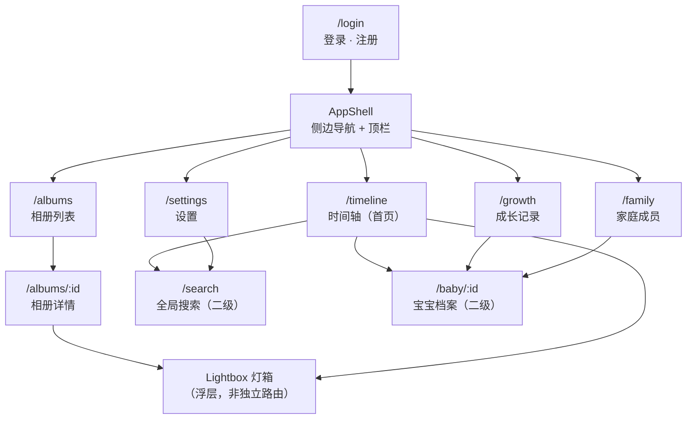
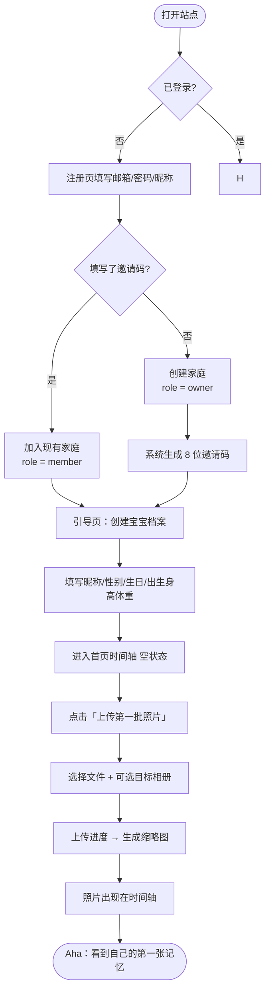
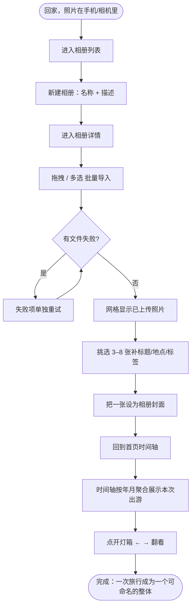
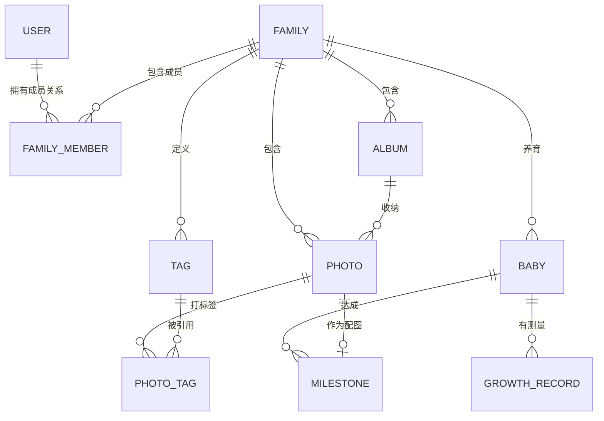

# 蜜记 · Bee Family 产品需求文档（PRD）

| 项目 | 内容 |
| --- | --- |
| 文档版本 | v1.0 |
| 日期 | 2026-11-05 |
| 作者 | 许清楚（产品经理） |
| 状态 | 待评审（作为架构与编码唯一依据） |
| 配套文档 | `docs/02-ui-design.md`（UI 高保真设计规格） |
| 项目代号 | `bee-family` |
| 语言 | 简体中文 |

---

## 1. 项目信息

| 项 | 值 |
| --- | --- |
| 产品形态 | Web 应用（桌面优先，移动端可用） |
| 部署环境 | 家庭内网 / 单机自托管，非商业 SaaS |
| 前端技术栈 | Vite + Vue 3 + TypeScript + ESLint |
| 设计体系 | 自研 Design Tokens（见 02 文档），无重量级 UI 框架依赖 |
| 后端技术栈 | Java 17 + Spring Boot 3 |
| 数据库 | MySQL 8.4（本机已启动，库名 `bee_family`） |
| 存储 | 本地磁盘 |
| 鉴权 | JWT |
| 图表 | ECharts |

### 1.1 原始需求复述

> 做一个「家庭相册」Web 应用，用来记录宝宝成长、家庭出游等场景。自家用，部署在内网。
> 需要能传照片、按相册组织、看时间轴、记录宝宝身高体重和里程碑、能搜索、有个数据概览。
> 界面要温暖治愈，有质感，不要幼稚。

### 1.2 本 MVP 的核心判断

- 这是**自用型工具**，不是商业产品：没有增长、转化、变现诉求，一切以「家庭记录者用得顺、三年后还愿意打开」为准。
- 记录者的真实敌人是**摩擦**：拍完照不想整理。所以 P0 的一切努力都指向「导入无痛 + 回看有惊喜」。
- 因此 MVP 只做两件事做到 90 分：**照片收纳（上传/相册/灯箱）** 与**成长回看（时间轴/成长曲线）**，其余均为支撑。

---

## 2. 应用命名

### 2.1 候选方案

| # | 中文名 | 英文副标 | 品牌母题 | 优点 | 缺点 |
| --- | --- | --- | --- | --- | --- |
| A | **蜜记** | Bee Family | 蜜蜂采蜜 = 收集美好；蜂巢六边形 = 相册网格 | 两字好记、口语自然（"记到蜜记里"）、母题可延伸到视觉系统 | "蜜"偏甜，需靠视觉压住不过分可爱 |
| B | 蜂巢时光 | HiveTime | 六边形蜂巢空间 | 空间感强，契合"家庭空间"概念 | 四字偏长，导航栏与 favicon 不好排；"蜂巢"略硬件感 |
| C | 甜匣 | Sweetcomb | 蜂巢蜜格 = 收纳格 | 意象新颖，"匣"有收藏仪式感 | 认知成本高，家人第一眼不懂是什么产品 |

### 2.2 定稿：**A — 蜜记 · Bee Family**

**选择理由**

1. **名字即行为**：蜜记 = 甜蜜的记忆，也是"记录"这个动作本身，用户不需要被解释。
2. **母题可落地为视觉系统而非装饰**：六边形（honeycomb）天然适配「网格照片墙」，金色（honey）天然适配「暖光纸质相册」的目标观感，一个母题同时解决品牌与设计。
3. **两字名对 UI 友好**：Logo 区、移动端顶栏、浏览器标签页都放得下，英文副标 `Bee Family` 用于副标题与 favicon。
4. **情感尺度合适**：不幼稚（不像"宝宝树"）、不冰冷（不像"家庭云盘"），符合"被暖光晒过的纸质相册"的定位。

**品牌母题定义（后续设计必须遵守）**

| 元素 | 定义 | 使用约束 |
| --- | --- | --- |
| 蜂巢六边形 | 正六边形（尖顶），`clip-path` 实现 | 仅用于：Logo、头像框、加载器、里程碑徽章、空状态底纹。**不用于照片网格与相册封面**（会裁掉主体，详见 02 文档 §3） |
| 蜂蜜金 | 主色 `#E89A2B` | 用于主按钮、激活态、数据强调；不做大面积背景 |
| 暖纸白 | 页面底色 `#FBF7F1` | 全局背景，营造"相册纸"质感 |
| 微颗粒 | 页面底层 3% 不透明度的噪点纹理 | 仅页面底层，不叠加在照片上 |

---

## 3. 产品定位与目标用户

### 3.1 一句话定位

> 蜜记是一个装在家庭内网的私密相册，帮家里的「记录者」把宝宝长大和一家人的出行，收成一册可以被反复翻开的暖光相册。

### 3.2 目标用户

| 角色 | 画像 | 核心诉求 | 使用频率 | 关键痛点 |
| --- | --- | --- | --- | --- |
| **记录者**（主用户，妈妈/爸爸） | 28–40 岁，手机拍照为主，电脑整理 | 快速导入、少填表、能看到"长大了多少" | 每周 1–3 次，集中在晚上 | 导入繁琐、跨设备、旧照片散落在聊天记录 |
| **家庭成员**（祖辈/伴侣） | 45–65 岁，只看不传 | 打开就能看到最新照片，字大图大 | 每天/隔天 | 不会用复杂 App，怕点错 |
| **访客**（P1 才支持） | 亲友，临时查看某个分享链接 | 点开链接即看，不用注册 | 一次性 | 需要登录、链接失效 |

> 本期（P0）**只服务「记录者」与「家庭成员」**，访客能力（分享链接）进入 P1 预留。

### 3.3 核心使用场景

| 场景 | 触发 | 用户动作 | 产品价值 |
| --- | --- | --- | --- |
| 宝宝成长里程碑 | 第一次翻身/走路/说话 | 拍一张 → 记一条里程碑 → 填身高体重 | 三年后能看见一条完整的成长曲线 |
| 家庭出游 | 周末/假期结束回家 | 建相册 → 批量导入几百张 → 补几个标题 | 一次旅行成为一个可命名的整体 |
| 日常碎片 | 随手拍 | 直接传到"日常"相册，不填任何信息 | 零摩擦沉淀，不因"懒得整理"而丢失 |
| 节日纪念 | 生日/满月/过年 | 建相册 + 时间轴回顾 + 配文字 | 形成年度记忆锚点 |

---

## 4. 产品目标（3 个正交目标）

| 编号 | 目标 | 衡量方式 | 正交性说明 |
| --- | --- | --- | --- |
| G1 | **导入无痛**：把 100 张照片从相机/手机搬进相册，不超过 3 分钟且无需逐张填表 | 批量上传 100 张（≤20MB/张）总耗时 ≤ 3min；上传后必填字段数 = 0 | 只关乎"进"，与"看"无关 |
| G2 | **回看有惊喜**：打开首页 2 秒内看到"最近发生了什么"，并能在 3 次点击内定位到任意一张记忆 | 首屏 LCP ≤ 2s；从首页到目标照片 ≤ 3 次点击 | 只关乎"出"，与"进"无关 |
| G3 | **成长可量化**：宝宝的身高/体重/头围与里程碑形成一条可对比、可回溯的时间线 | 记录 3 次以上测量后曲线可读；里程碑与照片一一挂接 | 独立于照片管理，是产品的差异化内核 |

**非目标（明确不做）**：社交、公开分享、多租户 SaaS、商业变现、原生 App。

---

## 5. 用户故事

### 5.1 记录者

| 编号 | 用户故事 | 优先级 |
| --- | --- | --- |
| US-01 | 作为**记录者**，我希望**用邮箱和密码注册并自动创建我的家庭空间**，以便**不用先做一堆配置就能开始放照片**。 | P0 |
| US-02 | 作为**记录者**，我希望**一次选中几十上百张照片并看到实时进度**，以便**把一次旅行的照片一口气导入**。 | P0 |
| US-03 | 作为**记录者**，我希望**新建相册并指定任意一张照片为封面**，以便**相册列表看起来像一排真实的相册书脊**。 | P0 |
| US-04 | 作为**记录者**，我希望**只给少数几张照片补标题、地点和标签**，其余保持默认可浏览，以便**整理不必一次做完**。 | P0 |
| US-05 | 作为**记录者**，我希望**记录宝宝每次的身高体重头围并看到曲线**，以便**一眼看出生长趋势是否正常**。 | P0 |
| US-06 | 作为**记录者**，我希望**把某个瞬间标记为里程碑并挂上一张照片**，以便**未来按"第一次"回顾**。 | P0 |
| US-07 | 作为**记录者**，我希望**在首页看到按时间倒序混合排列的照片与里程碑**，以便**不进入任何相册也能回忆最近**。 | P0 |
| US-08 | 作为**记录者**，我希望**按标题、标签、相册名搜索**，以便**只记得"海边"两个字也能找到那张照片**。 | P0 |
| US-09 | 作为**记录者**，我希望**邀请伴侣和父母加入家庭**，以便**他们也能看到并上传**。 | P0 |
| US-10 | 作为**记录者**，我希望**把喜欢的照片收藏起来**，以便**做年度总结时快速捞出来**。 | P1 |

### 5.2 家庭成员

| 编号 | 用户故事 | 优先级 |
| --- | --- | --- |
| US-11 | 作为**家庭成员**，我希望**用邀请码加入已有的家庭**，以便**不用自己建空间**。 | P0 |
| US-12 | 作为**家庭成员**，我希望**打开首页就看到大图的最近照片**，以便**不会用复杂界面也能看孙辈**。 | P0 |
| US-13 | 作为**家庭成员**，我希望**点开照片能全屏看并左右翻页**，以便**像翻相册一样浏览**。 | P0 |
| US-14 | 作为**家庭成员**，我希望**在照片下留一句话**，以便**告诉孩子妈这张拍得好**。 | P1 |
| US-15 | 作为**非创建者成员**，我希望**不能删除别人建的家庭与相册**，以便**不会误操作毁掉全家的数据**。 | P0 |

### 5.3 访客（P1 预留）

| 编号 | 用户故事 | 优先级 |
| --- | --- | --- |
| US-16 | 作为**访客**，我希望**打开一个分享链接就能看某个相册，无需注册**，以便**亲友之间快速传递喜悦**。 | P1 |
| US-17 | 作为**访客**，我希望**链接可以设置有效期和密码**，以便**家庭隐私不被长期暴露**。 | P1 |

---

## 6. 需求池

### 6.1 P0（本次必须实现）

| 编号 | 名称 | 描述 | 验收标准 |
| --- | --- | --- | --- |
| **P0-01** | 账号体系 | 邮箱+密码注册、登录、登出；JWT 鉴权；密码 bcrypt 加密存储 | ① 注册成功后自动创建家庭并把该用户设为 owner；② 密码错误返回统一提示不暴露账号是否存在；③ Token 过期自动跳登录页且回跳原页面；④ 数据库中不存在明文或可逆密码 |
| **P0-02** | 家庭空间与成员 | 创建/重命名家庭；邀请码加入；成员列表；角色 owner / member；移除成员 | ① 邀请码 8 位、24h 有效、可重置；② 单家庭 ≤ 6 人；③ 仅 owner 可移除成员与重命名家庭；④ 非本家庭成员访问任何资源返回 403 |
| **P0-03** | 宝宝档案 | 昵称、性别、生日、头像、出生身高体重；支持多个宝宝（≤3） | ① 生日必填且不可为未来日期；② 档案页展示"已出生 X 天"；③ 多个宝宝可切换，切换后成长记录联动 |
| **P0-04** | 成长记录与曲线 | 记录身高(cm)/体重(kg)/头围(cm)/备注/测量日期；ECharts 三线曲线 | ① 同一宝宝同一日期只允许 1 条记录（可编辑覆盖）；② 曲线按日期升序，支持 3/6/12 月与全部区间切换；③ 至少 1 条数据即渲染，≥3 条显示趋势；④ 异常值（身高 30–150cm、体重 1–60kg）前端校验拦截 |
| **P0-05** | 里程碑 | 标题、日期、描述、可选关联一张照片；列表按时间倒序 | ① 关联照片后卡片展示缩略图；② 里程碑同时出现在首页时间轴；③ 可编辑/删除；④ 里程碑数计入统计概览 |
| **P0-06** | 相册管理 | 创建/编辑/删除相册；设置封面（默认取相册内最新照片）；相册下照片计数 | ① 删除相册为二次确认，且需选择"照片移到未分类"/"一并删除"；② 相册名 1–40 字、同家庭内不可重名；③ 封面展示照片缩略图，无照片时展示空状态插画；④ 列表按更新时间倒序 |
| **P0-07** | 照片上传 | 多选上传、拖拽上传、单批 ≤100 张、可取消、进度条、失败重试；服务端生成 2 档缩略图 | ① 支持 jpg/jpeg/png/webp，单张 ≤20MB，超出前端即拦截并提示；② 上传并发 3，实显总体进度与逐张状态；③ 成功后照片出现在相册详情与首页时间轴（无需刷新）；④ 单张 20MB 照片端到端（上传+缩略图）≤5s（内网） |
| **P0-08** | 照片浏览 | 方形网格（2/3/4/5 列响应式）；点击进入灯箱；灯箱支持 ←/→/Esc、缩略条、图片信息侧栏 | ① 网格懒加载 + 骨架屏；② 灯箱打开后焦点锁定，Esc 关闭并把焦点还给原网格单元；③ 灯箱展示原图（最长边 1600px 版本）；④ 移动端灯箱支持左右滑动 |
| **P0-09** | 照片信息与标签 | 编辑标题、描述、拍摄时间、地点（文本）、标签（多选/新建） | ① 无 EXIF 时拍摄时间默认取上传时间；② 标签在同一家庭内复用，输入即搜索；③ 保存后网格与时间轴同步更新；④ 单张照片标签 ≤10 个 |
| **P0-10** | 首页时间轴 | 按时间倒序聚合照片与成长记录/里程碑，按「年月」分组，无限滚动分页 | ① 首屏 2s 内出现首屏内容（骨架先出）；② 分组标题吸顶；③ 每次加载 24 条，滚动到底自动加载；④ 无数据时展示引导型空状态（指向"上传第一批照片"） |
| **P0-11** | 全局搜索 | 顶栏搜索入口；按照片标题/描述/标签、相册名检索 | ① 输入 300ms 防抖；② 结果分「照片 / 相册 / 里程碑」三组，每组最多 20 条并可"查看全部"；③ 空关键词不请求；④ 无结果给出可操作建议 |
| **P0-12** | 数据统计概览 | 照片总数、相册数、里程碑数、成员数、宝宝天数、本月新增照片数 | ① 数据来源实时聚合，非缓存快照；② 展示在首页顶部概览条与设置页；③ 数字使用等宽字体避免跳动 |

> **P0 合计 12 项**。范围克制原则：任何 P0 项如果去掉后「照片仍能被上传、被看见、被找回」，则该功能降级到 P1。

### 6.2 P1（本期只做设计预留，不实现）

| 编号 | 名称 | 描述 | 设计预留要求 |
| --- | --- | --- | --- |
| P1-01 | 收藏 | 照片/相册加入收藏夹，支持"年度精选"视图 | 灯箱与照片网格单元预留心形收藏按钮位置（右上角 32×32） |
| P1-02 | 留言评论 | 照片下按时间排列的家庭成员短留言 | 灯箱信息侧栏预留「留言」Tab |
| P1-03 | 旅行足迹地图 | 按照片地点在地图上打点连线 | 相册详情页头部预留「地图」视图切换 |
| P1-04 | 相册分享链接 | 生成带有效期/密码的只读链接 | 相册详情页预留分享图标（禁用态 + tooltip「即将支持」） |
| P1-05 | 批量导出 | 按相册导出 ZIP（含原图与元数据 JSON） | 设置页预留「导出」区块 |

### 6.3 P2（本期只做设计预留，不实现）

| 编号 | 名称 | 描述 | 备注 |
| --- | --- | --- | --- |
| P2-01 | 视频支持 | 上传与播放短视频（mp4/mov），封面抽帧 | 数据表预留 `media_type` 字段 |
| P2-02 | AI 自动整理去重 | 感知哈希去重 + 自动打标 | 预留 `content_hash` 字段 |
| P2-03 | 人脸聚类 | 本地模型聚类"爸爸/妈妈/宝宝" | 无设计预留，纯技术演进 |

---

## 7. 信息架构与页面清单

### 7.1 站点地图

### 7.2 页面清单

| # | 路由 | 页面 | 层级 | 目标 | 入口 |
| --- | --- | --- | --- | --- | --- |
| 1 | `/login` | 登录 / 注册 | 一级（未登录） | 30 秒内进入产品 | 未登录访问任意页重定向 |
| 2 | `/timeline` | 首页时间轴 | 一级（默认首页） | 打开即看到最近的家庭记忆 | 登录成功、Logo 点击 |
| 3 | `/albums` | 相册列表 | 一级 | 按"事件"组织照片的入口 | 侧边导航 |
| 4 | `/albums/:id` | 相册详情 | 一级 | 浏览/管理一个相册内的照片 | 相册卡点击 |
| 5 | `/growth` | 成长记录 | 一级 | 量化宝宝成长 | 侧边导航 |
| 6 | `/family` | 家庭成员 | 一级 | 管理家庭成员与宝宝档案入口 | 侧边导航、头像菜单 |
| 7 | `/settings` | 设置 | 一级 | 账号、家庭、存储、导出（预留） | 侧边导航底部 |
| 8 | `/baby/:id` | 宝宝档案 | 二级 | 查看/编辑单个宝宝资料 | 成长记录页、成员页 |
| 9 | `/search` | 全局搜索 | 二级（也可 ⌘K 浮层） | 找回任意一张记忆 | 顶栏搜索框、`/` 或 `⌘K` |
| 10 | — | 灯箱 Lightbox | 全局浮层 | 沉浸浏览照片 | 任意照片网格单元 |

> **页面统计：7 个一级页面 + 2 个二级页面 + 1 个全局浮层。**

### 7.3 逐页说明

#### 7.3.1 登录 / 注册 `/login`

- **目标**：让记录者在 30 秒内进入产品，且第一眼就感受到品牌调性。
- **主要模块**：左侧品牌区（Logo、一句话定位、蜂巢纹理装饰）/ 右侧表单卡（Tab 切换"登录 / 注册"，邮箱、密码、昵称、邀请码选填）。
- **关键交互**：注册成功 → 若填了邀请码则加入家庭，否则自动创建家庭 → 进入「创建宝宝档案」引导 → 跳首页。
- **状态**：加载态 = 按钮内 spinner；错误态 = 字段下方红色文案（不弹全局 Toast）；空态 = 无。

#### 7.3.2 首页时间轴 `/timeline`

- **目标**：2 秒内让用户看到"最近发生了什么"。
- **主要模块**：概览条（照片数/相册数/里程碑数/宝宝天数）→ 时间轴流（按年月分组，条目类型 = 照片 / 里程碑 / 成长记录）。
- **关键交互**：点击照片开灯箱；点击里程碑进成长记录；月份标题吸顶；滚动到底自动加载；顶部「上传照片」主按钮。
- **状态**：
  - 空态：六边形插画 + 「还没有记忆，上传第一批照片」+ 主按钮。
  - 加载态：3 条时间轴骨架（左圆点灰 + 右侧 16:10 灰块呼吸）。
  - 错误态：内联错误条 + 重试按钮，不阻塞导航。

#### 7.3.3 相册列表 `/albums`

- **目标**：一眼看到"我们家有哪几本相册"。
- **主要模块**：页面标题区（标题 + 相册总数 + 新建按钮）→ 相册卡网格（响应式 1/2/3/4 列）。
- **关键交互**：卡片 hover 浮出「编辑 / 删除」；点击卡片进详情；新建走模态框（名称 + 描述）。
- **状态**：空态 = 空相册书脊插画 + 「新建第一本相册」；加载 = 4 个卡片骨架；错误 = 区块级重试。

#### 7.3.4 相册详情 `/albums/:id`

- **目标**：高效浏览与整理一本相册。
- **主要模块**：面包屑 → 相册头（封面缩略、名称、照片数、日期范围、描述、编辑按钮）→ 操作条（上传、全选、删除、视图切换）→ 照片方形网格。
- **关键交互**：拖拽文件到页面任意位置触发上传区；点击单元开灯箱；悬停显示勾选框；批量选择后出现浮动操作条。
- **状态**：空态 = 「这本相册还是空的」+ 拖拽提示；加载 = 网格骨架 12 格；错误 = 顶部条 + 重试。

#### 7.3.5 照片灯箱 Lightbox（全局浮层）

- **目标**：沉浸、无障碍地看一张照片。
- **主要模块**：左 ← 箭头 / 中央图像区 / 右侧信息栏（标题、描述、拍摄时间、地点、标签、上传者）/ 底部缩略条 / 右上关闭。
- **关键交互**：`←` `→` 切换、`Esc` 关闭、`I` 切换信息栏、点击图像区背景关闭、移动端左右滑动。
- **状态**：原图加载 = 模糊缩略图垫底 + 进度环；错误 = 「图片加载失败」+ 重试。

#### 7.3.6 成长记录 `/growth`

- **目标**：把"长大了多少"变成一条可读的线。
- **主要模块**：宝宝切换器 → 关键指标卡（最新身高/体重/头围 + 环比）→ 成长曲线（身高/体重/头围三条，可单独开关）→ 记录列表（时间倒序，可增删改）→ 里程碑区。
- **关键交互**：新增记录用右侧抽屉；曲线区间切换（3/6/12 月/全部）；点击曲线数据点弹出该次记录详情。
- **状态**：无记录 = 曲线区展示空坐标系 + 「记录第一次测量」；加载 = 曲线区灰底骨架；错误 = 曲线区重试。

#### 7.3.7 宝宝档案 `/baby/:id`

- **目标**：一个宝宝的全部身份信息与关键数字。
- **主要模块**：头像 + 昵称 + 性别 + 生日 + "已出生 X 天" + 出生身高体重 + 里程碑数 + 编辑入口。
- **关键交互**：编辑进入同一页的表单态（非跳转）；切换宝宝用顶部胶囊切换器。
- **状态**：无头像 = 六边形边框内的首字占位（蜜金色底）。

#### 7.3.8 家庭成员 `/family`

- **目标**：让"谁在这个家里"一目了然，并能安全地增删。
- **主要模块**：家庭名与创建者 → 成员卡列表（头像、昵称、角色、加入时间）→ 邀请区（邀请码大字展示 + 复制 + 重置）→ 宝宝区（宝宝卡 + 新增）。
- **关键交互**：复制邀请码给 Toast 反馈；移除成员需二次确认并提示"其上传的照片会保留"。
- **状态**：满员（6/6）= 邀请区置灰并提示上限。

#### 7.3.9 全局搜索 `/search`

- **目标**：只记得零碎线索也能找回照片。
- **主要模块**：大搜索框（自动聚焦）→ 分组结果（照片 / 相册 / 里程碑）→ 每组"查看全部"。
- **关键交互**：300ms 防抖；`↑ ↓` 选择结果、`Enter` 打开；命中关键词高亮。
- **状态**：初始 = 搜索建议（最近标签、相册名）；无结果 = 「没找到"xxx"」+ 建议放宽关键词。

#### 7.3.10 设置 `/settings`

- **目标**：账号、家庭与系统级配置的收口。
- **主要模块**：账号（昵称、邮箱、头像、修改密码）/ 家庭（名称、成员入口）/ 数据（存储占用、导出——P1 禁用态）/ 关于（版本、技术栈）。
- **关键交互**：所有修改需显式"保存"按钮并 Toast 反馈；危险操作（删除家庭）在底部独立红色区块，需输入家庭名确认。

---

## 8. 核心流程

### 8.1 流程一：首次使用

### 8.2 流程二：记录一次出游

---

## 9. 数据字典（概念级）

### 9.1 ER 关系图

> 关系基数说明：一张照片属于 0..1 个相册（`album_id` 可空 = 未分类）；一个里程碑可关联 0..1 张照片；一张照片可属于多个标签（多对多经 `photo_tag`）。

### 9.2 字段定义

> 命名约定：数据库列 `snake_case`；Java 实体 / TS 类型使用 `camelCase`；TS 接口字段与 API JSON 一致（`camelCase`）。

#### `user` 用户

| 列 (snake_case) | Java / TS (camelCase) | 类型 | 约束 | 说明 |
| --- | --- | --- | --- | --- |
| `id` | `id` | BIGINT | PK, AUTO_INCREMENT | 主键 |
| `email` | `email` | VARCHAR(120) | UNIQUE, NOT NULL | 登录账号 |
| `password_hash` | `passwordHash` | VARCHAR(100) | NOT NULL | bcrypt，cost 10 |
| `nickname` | `nickname` | VARCHAR(32) | NOT NULL | 显示名 |
| `avatar_url` | `avatarUrl` | VARCHAR(255) | NULL | 头像地址 |
| `created_at` | `createdAt` | DATETIME | NOT NULL | 注册时间 |
| `updated_at` | `updatedAt` | DATETIME | NOT NULL | 更新时间 |

#### `family` 家庭空间

| 列 | Java / TS | 类型 | 约束 | 说明 |
| --- | --- | --- | --- | --- |
| `id` | `id` | BIGINT | PK | 主键 |
| `name` | `name` | VARCHAR(40) | NOT NULL | 家庭名，如"许家小院" |
| `owner_id` | `ownerId` | BIGINT | FK → user.id, NOT NULL | 创建者 |
| `invite_code` | `inviteCode` | CHAR(8) | UNIQUE, NULL | 邀请码，可重置 |
| `invite_code_expires_at` | `inviteCodeExpiresAt` | DATETIME | NULL | 邀请码过期时间（24h） |
| `cover_photo_id` | `coverPhotoId` | BIGINT | FK → photo.id, NULL | 家庭封面 |
| `created_at` | `createdAt` | DATETIME | NOT NULL | 创建时间 |

#### `family_member` 家庭成员

| 列 | Java / TS | 类型 | 约束 | 说明 |
| --- | --- | --- | --- | --- |
| `id` | `id` | BIGINT | PK | 主键 |
| `family_id` | `familyId` | BIGINT | FK → family.id, NOT NULL | 所属家庭 |
| `user_id` | `userId` | BIGINT | FK → user.id, NOT NULL | 成员 |
| `role` | `role` | VARCHAR(10) | NOT NULL, ENUM(`owner`,`member`) | 角色 |
| `joined_at` | `joinedAt` | DATETIME | NOT NULL | 加入时间 |

> 唯一约束：`(family_id, user_id)`；业务约束：单家庭成员 ≤ 6；单用户只属于 1 个家庭。

#### `baby` 宝宝档案

| 列 | Java / TS | 类型 | 约束 | 说明 |
| --- | --- | --- | --- | --- |
| `id` | `id` | BIGINT | PK | 主键 |
| `family_id` | `familyId` | BIGINT | FK → family.id, NOT NULL | 所属家庭 |
| `name` | `name` | VARCHAR(32) | NOT NULL | 昵称 |
| `gender` | `gender` | VARCHAR(8) | NULL, ENUM(`male`,`female`,`unknown`) | 性别 |
| `birthday` | `birthday` | DATE | NOT NULL, ≤ 今天 | 生日 |
| `avatar_url` | `avatarUrl` | VARCHAR(255) | NULL | 头像 |
| `birth_height_cm` | `birthHeightCm` | DECIMAL(5,1) | NULL | 出生身高 |
| `birth_weight_kg` | `birthWeightKg` | DECIMAL(4,2) | NULL | 出生体重 |
| `created_at` | `createdAt` | DATETIME | NOT NULL | — |

#### `growth_record` 成长记录

| 列 | Java / TS | 类型 | 约束 | 说明 |
| --- | --- | --- | --- | --- |
| `id` | `id` | BIGINT | PK | 主键 |
| `baby_id` | `babyId` | BIGINT | FK → baby.id, NOT NULL | 所属宝宝 |
| `recorded_at` | `recordedAt` | DATE | NOT NULL | 测量日期 |
| `height_cm` | `heightCm` | DECIMAL(5,1) | NULL, 30–150 | 身高 |
| `weight_kg` | `weightKg` | DECIMAL(4,2) | NULL, 1–60 | 体重 |
| `head_cm` | `headCm` | DECIMAL(4,1) | NULL, 20–70 | 头围 |
| `note` | `note` | VARCHAR(200) | NULL | 备注 |
| `created_by` | `createdBy` | BIGINT | FK → user.id | 记录人 |

> 唯一约束：`(baby_id, recorded_at)`。

#### `milestone` 里程碑

| 列 | Java / TS | 类型 | 约束 | 说明 |
| --- | --- | --- | --- | --- |
| `id` | `id` | BIGINT | PK | 主键 |
| `baby_id` | `babyId` | BIGINT | FK → baby.id, NULL | 可为家庭级里程碑 |
| `family_id` | `familyId` | BIGINT | FK → family.id, NOT NULL | 冗余，用于权限过滤 |
| `title` | `title` | VARCHAR(60) | NOT NULL | 如"第一次翻身" |
| `description` | `description` | VARCHAR(500) | NULL | 描述 |
| `achieved_at` | `achievedAt` | DATE | NOT NULL | 达成日期 |
| `photo_id` | `photoId` | BIGINT | FK → photo.id, NULL | 配图 |
| `created_by` | `createdBy` | BIGINT | FK → user.id | 创建人 |

#### `album` 相册

| 列 | Java / TS | 类型 | 约束 | 说明 |
| --- | --- | --- | --- | --- |
| `id` | `id` | BIGINT | PK | 主键 |
| `family_id` | `familyId` | BIGINT | FK → family.id, NOT NULL | 所属家庭 |
| `name` | `name` | VARCHAR(40) | NOT NULL | 相册名，家庭内唯一 |
| `description` | `description` | VARCHAR(300) | NULL | 描述 |
| `cover_photo_id` | `coverPhotoId` | BIGINT | FK → photo.id, NULL | 封面；空则取最新照片 |
| `photo_count` | `photoCount` | INT | DEFAULT 0 | 冗余计数，列表页免聚合 |
| `created_by` | `createdBy` | BIGINT | FK → user.id | 创建人 |
| `created_at` / `updated_at` | `createdAt` / `updatedAt` | DATETIME | NOT NULL | — |

#### `photo` 照片

| 列 | Java / TS | 类型 | 约束 | 说明 |
| --- | --- | --- | --- | --- |
| `id` | `id` | BIGINT | PK | 主键 |
| `family_id` | `familyId` | BIGINT | FK → family.id, NOT NULL | 权限过滤第一条件 |
| `album_id` | `albumId` | BIGINT | FK → album.id, NULL | 空 = 未分类 |
| `title` | `title` | VARCHAR(80) | NULL | 标题 |
| `description` | `description` | VARCHAR(500) | NULL | 描述 |
| `storage_key` | `storageKey` | VARCHAR(255) | NOT NULL | 原图相对路径 |
| `thumb_key` | `thumbKey` | VARCHAR(255) | NULL | 缩略图相对路径 |
| `preview_key` | `previewKey` | VARCHAR(255) | NULL | 灯箱预览图（最长边 1600px） |
| `mime_type` | `mimeType` | VARCHAR(40) | NOT NULL | image/jpeg 等 |
| `file_size` | `fileSize` | BIGINT | NOT NULL, ≤ 20MB | 字节 |
| `width` / `height` | `width` / `height` | INT | NULL | 原图像素 |
| `taken_at` | `takenAt` | DATETIME | NOT NULL | 优先 EXIF，缺失取上传时间 |
| `location_name` | `locationName` | VARCHAR(100) | NULL | 地点文本 |
| `latitude` / `longitude` | `latitude` / `longitude` | DECIMAL(9,6) | NULL | P1 地图预留 |
| `content_hash` | `contentHash` | CHAR(64) | NULL | P2 去重预留 |
| `media_type` | `mediaType` | VARCHAR(10) | DEFAULT `photo` | P2 视频预留 |
| `uploaded_by` | `uploadedBy` | BIGINT | FK → user.id | 上传者 |
| `created_at` | `createdAt` | DATETIME | NOT NULL | 上传时间 |

#### `tag` / `photo_tag` 标签

| 表 | 列 | Java / TS | 类型 | 约束 |
| --- | --- | --- | --- | --- |
| `tag` | `id` / `family_id` / `name` | `id` / `familyId` / `name` | BIGINT / BIGINT / VARCHAR(20) | 家庭内唯一 `(family_id, name)` |
| `photo_tag` | `photo_id` / `tag_id` | `photoId` / `tagId` | BIGINT / BIGINT | 联合 PK |

### 9.3 P1 预留实体（仅记录，不建表）

`favorite(user_id, target_type, target_id)`、`comment(photo_id, user_id, content, created_at)`、`share_link(album_id, token, password, expires_at)`。

---

## 10. 非功能需求

| 类别 | 要求 | 验收方式 |
| --- | --- | --- |
| 规模 · 成员 | 单家庭 ≤ 6 人；单用户属于 1 个家庭；单家庭宝宝 ≤ 3 | 接口层校验并返回明确错误码 |
| 规模 · 照片 | 单家庭照片总量 ≤ 50,000 张；单相册 ≤ 5,000 张 | 分页与索引设计需在上述规模下 P95 查询 ≤ 300ms |
| 上传 | 单张 ≤ 20MB；单批 ≤ 100 张；浏览器并发 3；支持 jpg/jpeg/png/webp | 100 张批量上传不出现浏览器崩溃或内存溢出 |
| 性能 | 首屏 LCP ≤ 2s（内网千兆 / 本地）；列表分页接口 P95 ≤ 300ms；缩略图单张 ≤ 80KB | Lighthouse + 接口压测 |
| 存储 | 原图与缩略图均落本地磁盘；目录按 `{familyId}/{yyyy}/{MM}/{uuid}.ext`；缩略图 2 档（网格 480px、预览 1600px） | 磁盘目录结构可被 `rsync` 直接备份 |
| 安全 · 密码 | bcrypt（cost ≥ 10），禁止明文、禁止可逆加密、禁止日志输出密码 | 代码评审 + 数据库抽样 |
| 安全 · 鉴权 | JWT 放 HttpOnly Cookie 或 Authorization Header（架构定），有效期 7 天，支持主动登出失效 | 过期 Token 访问返回 401 |
| 安全 · 权限隔离 | **所有**数据查询强制携带 `family_id` 过滤；越权访问返回 403 而非 404（本项目选择 403，便于自查） | 编写越权用例：A 家庭 Token 访问 B 家庭相册/照片/宝宝 |
| 安全 · 上传 | 校验 MIME 与文件头魔数；禁止 SVG（XSS 风险）与可执行扩展名；文件名由服务端重写为 UUID | 上传伪装扩展名文件应被拒绝 |
| 可用性 | 单机部署，无高可用要求；数据库每日 `mysqldump` 建议由运维脚本承担（本期不含） | — |
| 兼容性 | Chrome / Edge / Safari 最近 2 个大版本；最小支持宽度 375px | 手动回归 |
| 可访问性 | 全键盘可达；焦点可见（`outline: 2px solid` 主色）；正文对比度 ≥ 4.5:1；灯箱 `role="dialog"` + 焦点陷阱 | axe 扫描无 critical |
| 国际化 | 本期仅简体中文；文案集中管理，不硬编码在组件内（便于后续扩展） | — |
| 可维护性 | 前端 ESLint 零 error；前后端接口契约以 OpenAPI 或 TS 类型单一来源 | CI 校验 |

---

## 11. 待确认问题

| # | 问题 | 默认假设（未确认则按此执行） | 影响 |
| --- | --- | --- | --- |
| Q1 | 是否允许一个用户加入多个家庭？ | **不允许**，1 用户 = 1 家庭。若后续要多家庭，需在 `family_member` 上加"当前激活家庭"概念。 | 影响 JWT 是否携带 `familyId` |
| Q2 | 注册是否开放？ | **半开放**：站点首个注册用户自动成为 owner 并创建家庭；后续注册必须填邀请码。防止内网被误注册。 | 影响注册接口与引导流程 |
| Q3 | 是否必须支持 iPhone 的 HEIC？ | **必须支持**（目标用户手机以 iPhone 为主），服务端转码为 JPEG 存储。若转码方案评估成本过高，降级为"提示用户改用 JPEG 上传"。 | 影响后端依赖与上传耗时 |
| Q4 | JWT 存放方式？ | Header `Authorization: Bearer` + `localStorage`（内网自用，接受 XSS 风险换取实现简单）。若架构师坚持更安全方案，改 HttpOnly Cookie。 | 影响前后端鉴权实现 |
| Q5 | 拍摄时间以 EXIF 为准还是上传时间？ | **EXIF 优先，缺失回退上传时间**；用户可在照片信息里手动改。 | 影响时间轴排序准确性 |
| Q6 | 是否需要"未分类"相册？ | **需要**：`album_id` 为空的照片归入虚拟相册「未分类」，在相册列表页以特殊卡片展示，不可删除。 | 影响相册列表 UI |

---

## 12. 范围边界（明确不做）

- ❌ 公开社交、点赞、关注、话题
- ❌ 多租户与商业化（订阅/付费/配额）
- ❌ 原生 App、离线 PWA、后台自动备份相机胶卷
- ❌ 照片在线编辑（裁剪、滤镜、调色）
- ❌ 视频上传与播放（P2）
- ❌ 人脸识别、AI 打标（P2）
- ❌ 暗色模式（见 02 文档 §7 明确结论：本期不做，仅预留 token）

---

**文档结束。** 下游请以 `docs/02-ui-design.md` 为视觉与组件的唯一依据，以本文档 §6 需求池为范围唯一依据。
