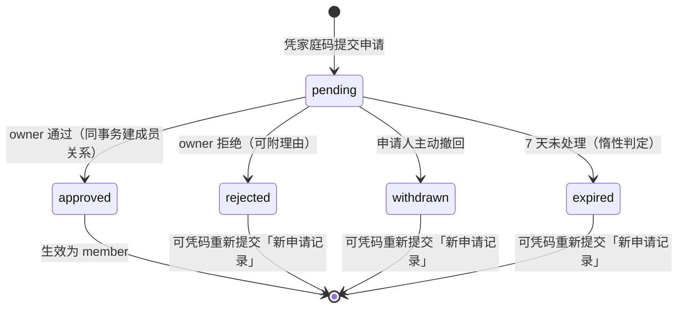
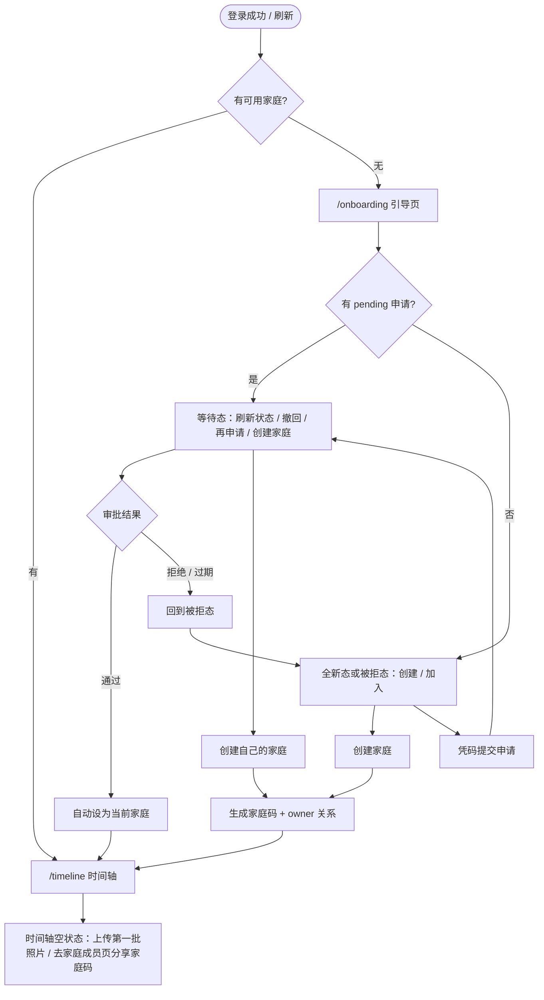

# 05 · 蜜记 Bee Family 增量 PRD（v1.1 变更集）

| 项 | 内容 |
| --- | --- |
| 文档版本 | v1.1-incremental |
| 日期 | 2026-11-05 |
| 作者 | 许清楚（产品经理） |
| 状态 | 待用户/负责人拍板 §11 的 9 个问题后，交架构师出变更设计 |
| 文档性质 | **增量文档，只描述变更**。未提及的行为一律继续以 `docs/01-prd.md`、`docs/02-ui-design.md`、`docs/03-architecture.md` 为准 |
| 上游依据 | 用户 5 条原话（见 §1.2）+ 01/02/03/04 四份既有文档 |
| 本步边界 | **只做产品定义**：不改代码、不改既有文档、不改数据库、不改演示库 |
| 语言 | 简体中文 |

> **冲突裁决**：本文与 01/02/03 冲突时，**以本文为准**（仅针对本文显式列出的变更项）。
> 本文未列出的条款（如 Design Tokens 色值、组件尺寸、错误码编号格式、JWT 结构、存储目录结构）**一律不变**。

---

## 1. 变更目标与非目标

### 1.1 变更目标（可衡量）

| 编号 | 目标 | 衡量标准 | 对应原话 |
| --- | --- | --- | --- |
| IG-1 | **注册零门槛**：任何新用户不再被邀请码卡住，注册后无家庭也有明确落点 | 注册表单字段由 4 个降到 3 个（邮箱/密码/昵称）；注册成功率 100%（不因缺码失败）；注册 → 到达可操作引导页 ≤ 3s | ①③ |
| IG-2 | **家庭归属可治理**：家庭码 + 申请审批取代「持码即入」；支持一人多家庭且严格隔离 | 5 类申请状态全部可达；审批通过后成员关系即时生效；每张照片 `family_id` 唯一且创建后不可变；切换后上一家庭数据残留 = 0 条 | ①② |
| IG-3 | **iPhone 导入无痛 + 照片信息有质感**：HEIC 直传、EXIF 关键参数可读 | HEIC 单张端到端 ≤ 8s；批量 100 张 ≤ 3min（G1 不退化）；EXIF 19 个字段按必选/可选规则渲染；解析失败不阻断上传 | ⑤ |
| IG-4 | **大屏信息效率**：顶部导航释放 240px 横向空间 | ≥1024px 内容可用宽由 1136px → 约 1200px（容器上限内）；一级导航 5 项零隐藏；<768px 无横向滚动 | ④ |

### 1.2 用户原话与覆盖矩阵

| # | 用户原话（摘要） | 覆盖需求项 | 覆盖状态 |
| --- | --- | --- | --- |
| 1 | 注册可不填邀请码；每人可创建家庭或申请加入；创建时后台随机生成**全局唯一家庭码**、创建者为默认家庭管理员；凭码发申请，管理员在家庭管理中通过/拒绝 | INC-P0-01 / 03 / 04 / 05 | ✅ 全覆盖 |
| 2 | 每人可加入多个家庭并可切换；**每张照片只属于一个家庭** | INC-P0-02 / 06 | ✅ 全覆盖 |
| 3 | 登录后尚未创建或加入任何家庭，引导去创建或加入 | INC-P0-07 | ✅ 全覆盖 |
| 4 | Web 样式把左侧菜单改为顶部菜单或导航 | INC-P0-08 / 09 | ✅ 全覆盖 |
| 5 | 上传支持 HEIC；照片信息展示中获取 EXIF 核心关键内容 | INC-P0-10 / 11 / 12 | ✅ 全覆盖 |

### 1.3 非目标（本次明确不做）

| # | 不做 | 理由 / 边界 |
| --- | --- | --- |
| N-1 | ❌ **不引入付费/云端转码服务、不引入外部地理编码 API** | 内网单机自托管的产品定位不变；HEIC 转码与位置展示必须在本机闭环 |
| N-2 | ❌ **不改既有照片归属与迁移规则** | `photo.family_id` 不重算、不回填、不重新分派；磁盘 `{familyId}/{yyyy}/{MM}/` 目录不移动、不改名；56 张演示照片保持原位 |
| N-3 | ❌ **不提供跨家庭照片移动 / 复制 / 合并视图 / 跨家庭全局搜索** | 与「每张照片只属于一个家庭」直接冲突；统计概览仍只统计当前家庭 |
| N-4 | ❌ **不做邮件 / 短信 / 微信通知、不做即时推送** | 内网自用无通知通道；状态变更靠用户主动刷新与登录后重查 |
| N-5 | ❌ **不做多管理员 / owner 转让 / 角色细分** | 本期家庭管理员 = 唯一 owner（创建者）；「默认管理员」理解为创建时自动授予，不引入可指派角色 |
| N-6 | ❌ **不做 EXIF 编辑、EXIF 批量回填、GPS 地图打点** | 编辑已有 P0-09；地图为 01 文档 P1-03；回填为本文 INC-P2-01 |
| N-7 | ❌ **不做暗色模式** | 沿用 02 文档 §6.6 结论 |
| N-8 | ❌ **不改 JWT claims 结构、不改 Bearer + localStorage** | 03 文档 ADR-02 的 claims 与 ADR-03 的凭证方式保持不变；「当前家庭」不进 token |
| N-9 | ❌ **不做顶部横向滚动导航 / 汉堡抽屉作为移动端主导航** | 见 §8.4 取舍结论 |
| N-10 | ❌ **不做视频（P2 不变）、不做人脸聚类（P2 不变）** | 范围外 |
| N-11 | ❌ **不做付费/配额/商业化** | 范围外 |
| N-12 | ❌ **不做「家庭码即密钥」的加密体系** | 家庭码是标识不是凭证，安全边界为管理员审批 + 限流（§5.4） |

### 1.4 被本次变更覆盖/作废的既有条款（下游必读）

| 既有位置 | 原条款 | 新结论 |
| --- | --- | --- |
| `01-prd.md` §6 P0-01 ① | 注册成功自动创建家庭并设为 owner | **作废** → 注册后无任何家庭，走 `/onboarding` |
| `01-prd.md` §6 P0-02 ① | 邀请码 8 位、24h 有效、可重置 | **作废** → 家庭码 10 位、永久、可重置（§5） |
| `01-prd.md` §10 规模·成员 | 单用户属于 1 个家庭 | **作废** → 单用户可加入多个家庭（单家庭仍 ≤6 人不变） |
| `01-prd.md` §11 Q1 / Q2 / Q3 | 不多家庭 / 半开放注册 / HEIC 待定 | **全部被用户原话拍板覆盖**：多家庭 ✅、注册完全开放 ✅、HEIC 必须支持 ✅ |
| `01-prd.md` §8.1 流程图 | 注册 → 首个用户建家庭 → 引导建宝宝 | **作废** → 见 §7.3 新流程 |
| `02-ui-design.md` §2.13 / §4.1 / §4.2 | ≥1024 左侧 SideNav 240px；NavItem 激活为左竖条 + 蜜金底 | **变更** → 顶部导航，激活为下划线（§8）；<768 底部 TabBar **保留不变** |
| `03-architecture.md` ADR-01 | HEIC 不支持，前端拦截 + 41501 | **作废** → HEIC 支持并转码（§9） |
| `03-architecture.md` ADR-02 | 每请求由 `family_member` 按 `user_id` 唯一索引解析 familyId | **修订** → 改为「`user.active_family_id` + 每请求校验成员关系」（§6.1）；「familyId 不进 token」与「权限变更即时生效」两条原则**保留** |
| `03-architecture.md` §4.1 / DDL | `uk_member_user(user_id)` 强制 1 用户 = 1 家庭 | **删除该唯一约束**；`uk_member_family_user` 保留 |
| `03-architecture.md` §5.2 `40902` | `INVITE_CODE_INVALID` 邀请码无效或已过期 | **语义改名** → 「家庭码无效或不存在」，编号建议保留（由架构定） |
| `03-architecture.md` §5.2 `41501` | HEIC 分支返回 41501 + 「兼容性最佳」指引 | **HEIC 分支删除**；41501 仍用于 SVG/伪装文件/其它不支持格式 |
| `04-test-report.md` U1 / D4 | 「HEIC 文案含 iPhone/兼容性最佳」、`.HEIC → 41501` | **断言作废**，替换为新断言（§10.4） |
| `04-test-report.md` B2 | `user` 表非空时缺邀请码注册 → 409/40902 | **断言作废** → 注册不需任何码，成功且 0 家庭 |

---

## 2. 用户故事（增量编号 US-I）

> 格式：作为…我希望…以便…；「验收要点」为该故事可判定的最小集合。

### 2.1 新注册用户（无任何家庭）

| 编号 | 用户故事 | 验收要点 |
| --- | --- | --- |
| US-I01 | 作为**新注册用户**，我希望**注册时只填邮箱、密码、昵称**，以便**不认识任何人也能先拥有账号**。 | ① 表单无邀请码/家庭码字段；② 任何时刻注册都成功（不再判 `user` 表是否为空）；③ 注册响应中家庭成员列表为空 |
| US-I02 | 作为**新注册用户**，我希望**登录后看到「创建家庭」和「凭码加入」两条清晰路径**，以便**知道下一步该做什么**。 | ① 落地页为 `/onboarding`，不显示主框架导航；② 两个入口并列且视觉权重相同；③ 不出现空白时间轴或 403 报错 |
| US-I03 | 作为**新注册用户**，我希望**创建家庭后立刻成为管理员并拿到家庭码**，以便**马上能邀请家人**。 | ① 创建成功即写入 owner 成员关系；② 10 位家庭码当场可见、可复制；③ 自动进入时间轴空状态，不强制先建宝宝档案 |
| US-I04 | 作为**新注册用户**，我希望**输入家庭码后先确认「要加入的是哪个家庭」再提交申请**，以便**不把申请发错地方**。 | ① 输入后展示目标家庭名（仅名称，不展示成员/照片/统计）；② 可填 ≤50 字申请留言（选填）；③ 提交后状态为 `pending` |
| US-I05 | 作为**新注册用户**，我希望**申请被拒绝后能知道原因并重新申请**，以便**不被一次误操作困死**。 | ① 可见拒绝理由（管理员选填）；② 有「重新申请」与「换个家庭码」两个入口；③ 历史申请可查 |

### 2.2 家庭管理员（owner）

| 编号 | 用户故事 | 验收要点 |
| --- | --- | --- |
| US-I06 | 作为**家庭管理员**，我希望**在家庭成员页看到待审申请列表与数量角标**，以便**不漏掉家人的加入请求**。 | ① 列表显示申请人昵称/邮箱、申请时间、留言、第几次申请；② 顶栏与导航项有 pending 数字角标；③ 默认只列 `pending` |
| US-I07 | 作为**家庭管理员**，我希望**通过或拒绝一条申请并可选填理由**，以便**决定谁能进这个家**。 | ① 通过后同事务生成 `role=member` 成员关系，申请人立即可见该家庭数据；② 拒绝不生成任何成员关系；③ 每步有 Toast 反馈 |
| US-I08 | 作为**家庭管理员**，我希望**重置家庭码并明确知道旧码失效**，以便**码泄露后能止损**。 | ① 二次确认弹窗；② 重置后旧码立即不能提交新申请；③ 已提交的 pending 申请与已有成员不受影响 |
| US-I09 | 作为**家庭管理员**，我希望**家庭满 6 人时通过按钮被禁用并说明原因**，以便**不产生超限成员**。 | ① 6/6 时审批区提示「家庭已满 6 人，请先移除成员」；② 后端同样校验，拒绝并发超员 |
| US-I10 | 作为**家庭管理员**，我希望**看到已处理申请的历史（通过/拒绝/撤回/过期）**，以便**回忆谁曾经申请过**。 | ① 「已处理」分组按时间倒序；② 保留 `attempt_count`；③ 历史只读不可改 |

### 2.3 普通成员

| 编号 | 用户故事 | 验收要点 |
| --- | --- | --- |
| US-I11 | 作为**普通成员**，我希望**撤回自己还在等待中的申请**，以便**发错家庭时能纠正**。 | ① 仅 `pending` 可撤回；② 撤回后可立即重新申请；③ 撤回不影响其他家庭已生效的成员关系 |
| US-I12 | 作为**普通成员**，我希望**申请通过后自动进入该家庭**，以便**不用重新登录或手动刷新一堆页面**。 | ① 下一次进入/刷新即看到「已加入 XX 家庭」；② 自动设为当前家庭并跳时间轴；③ 无需重新签发 token |
| US-I13 | 作为**普通成员**，我希望**看不到也点不到审批入口**，以便**界面不给我做不了的事**。 | ① 审批按钮仅 owner 可见；② 直接调用审批接口返回 `40302 OWNER_ONLY` |
| US-I14 | 作为**普通成员**，我希望**只看到我所属家庭的数据**，以便**别的家庭的孩子照片不会串进来**。 | ① 所有列表/时间轴/搜索/统计按当前家庭过滤；② 跨家庭资源返回 `40301`；③ 灯箱缩略条不含其他家庭照片 |

### 2.4 多家庭用户

| 编号 | 用户故事 | 验收要点 |
| --- | --- | --- |
| US-I15 | 作为**多家庭用户**，我希望**在顶栏一键切换当前家庭**，以便**在「自己家」和「爸妈家」之间来回查照片**。 | ① 切换器列出全部已加入家庭与各自角色；② 切换 ≤1s 生效；③ 当前家庭名常驻可见 |
| US-I16 | 作为**多家庭用户**，我希望**切换后所有内容整体变成新家庭的**，以便**不会看到上一家庭的相册或宝宝**。 | ① 见 §6.3 全量重置清单；② 切换后残留数据 = 0 条；③ 强制回到 `/timeline` |
| US-I17 | 作为**多家庭用户**，我希望**每次上传的照片只进入当前选中的家庭**，以便**归属不会搞错**。 | ① 归属取服务端解析出的当前家庭，不由前端传 `familyId`；② 切换后上传落新家庭；③ 无法通过任何接口把照片改到另一家庭 |
| US-I18 | 作为**多家庭用户**，我希望**上传过程中不被误切换**，以便**不会出现「以为传到了 A 家、实际传到 B 家」**。 | ① 队列非空时切换器禁用并提示在途张数；② 已发出的上传请求绑定原家庭并继续完成；③ 切换时取消其它在途业务请求 |
| US-I19 | 作为**多家庭用户**，我希望**被移出某个家庭后自动落到仍有效的家庭**，以便**不会卡在 403 页面**。 | ① 服务端每请求校验当前家庭有效性；② 失效时自动回退到最早加入的家庭并 Toast 告知；③ 无任何家庭时跳 `/onboarding` |

### 2.5 全体用户（体验项）

| 编号 | 用户故事 | 验收要点 |
| --- | --- | --- |
| US-I20 | 作为**记录者**，我希望**iPhone 拍的 HEIC 能直接拖进上传区**，以便**不必先手动导出 JPEG**。 | ① HEIC 与 JPEG 可同批；② 浏览/缩略图/灯箱全部正常显示且非黑图；③ 默认下载给通用 JPEG，可另选原始 HEIC |
| US-I21 | 作为**记录者**，我希望**在灯箱里看到这张照片的拍摄参数**，以便**回忆当时用什么拍的、怎么拍的**。 | ① 基础区 4 项 + 展开区可选字段按 §9.3 渲染；② 缺字段省略不留 `—`；③ 解析失败不影响照片浏览 |
| US-I22 | 作为**记录者**，我希望**截图 / 被转发图有明确说明而不是一片空白**，以便**知道不是产品坏了**。 | ① 三种无 EXIF 场景各有专属文案（§9.5）；② 拍摄时间回退上传时间时显式标注 |
| US-I23 | 作为**家庭成员**，我希望**顶部导航一眼看到全部入口**，以便**不用在左侧找**。 | ① ≥768px 一级项 5 个全部常显、无横向滚动；② 当前项有下划线当前态；③ 内容区宽度不因导航被压缩 |
| US-I24 | 作为**用手机的家庭成员**，我希望**375px 下仍能单手点到导航**，以便**看孙辈照片不费劲**。 | ① <768px 保留底部 TabBar；② 家庭切换器在顶栏可达；③ `overflow-x = false`（沿用 04 文档视觉判定项） |

---

## 3. 需求池（增量，20 项）

> 编号规则 `INC-{优先级}-{序号}`。**依赖**列指向本表内编号或既有文档编号。
> 「原话」列映射 §1.2 的 5 条用户原话，用于逐条追溯。

### 3.1 P0（本次必须实现，12 项）

| 编号 | 名称 | 描述 | 验收标准 | 依赖 | 原话 |
| --- | --- | --- | --- | --- | --- |
| **INC-P0-01** | 注册去码化 | 注册表单移除邀请码；不再判「首用户」；注册成功**不创建、不加入任何家庭** | ① 表单仅 3 字段；② `user` 表已有 N 人时注册仍成功；③ 响应中家庭列表为空、`active_family_id = null`；④ 旧 `inviteCode` 参数按 §10.3 过渡策略处理 | — | ①③ |
| **INC-P0-02** | 多家庭数据模型与当前家庭解析 | 解除「1 用户 = 1 家庭」约束；新增 `user.active_family_id`；每请求解析改为「读取激活家庭 → 校验该用户仍是其成员」 | ① 同一用户可存在多条 `family_member`；② 解析不再依赖 `user_id` 唯一索引，不会抛「非唯一结果」；③ 激活家庭失效时按 §6.4 自动回退；④ 无任何家庭时返回「无可用家庭」语义并引导 | INC-P0-01 | ② |
| **INC-P0-03** | 创建家庭 + 家庭码 | 任意登录用户可创建家庭；服务端生成全局唯一 10 位家庭码；创建者自动为 owner | ① 家庭名 1–40 字；② 家庭码符合 §5.1 长度/字符集/唯一性；③ 创建者 `role=owner` 且 `active_family_id` 指向新家庭；④ 不强制先建宝宝 | INC-P0-02 | ① |
| **INC-P0-04** | 凭家庭码申请加入 | 输入码 → 确认目标家庭名 → 选填留言 → 提交 `pending` 申请 | ① 输入忽略大小写与连字符；② 仅回显家庭名；③ 已有 `pending` / 已是成员时按 §4.3 拦截；④ 码不存在时统一文案，不暴露存在性；⑤ 提交接口有用户 + IP 限流 | INC-P0-03 | ① |
| **INC-P0-05** | 申请状态机与管理员审批 | 5 状态流转；owner 在家庭成员页通过/拒绝；通过后同事务建成员关系 | ① 状态机见 §4.1；② 通过后 `role=member`、6 人上限校验、申请人即刻可见数据；③ 拒绝可附 ≤100 字理由；④ 非 owner 审批返回 `40302`；⑤ 7 天未处理标记 `expired` | INC-P0-04 | ① |
| **INC-P0-06** | 多家庭切换与状态重置 | 顶栏切换器；切换后按 §6.3 全量重置业务状态并强制回 `/timeline` | ① 切换 ≤1s；② 上一家庭数据残留 0 条；③ 有在途上传时切换器禁用；④ 取消所有在途业务请求；⑤ 灯箱立即关闭 | INC-P0-02 | ② |
| **INC-P0-07** | 无家庭引导页 `/onboarding` | 三态落地页（全新 / 待审核 / 被拒或过期），路由守卫强制拦截 | ① 0 家庭时任何业务路由重定向到 `/onboarding`；② 待审核态显示家庭名、提交时间、7 天倒计时、撤回入口，且**仍可创建家庭或申请其他家庭**；③ 待审核期间不可进入主界面（仅可进账号设置与登出）；④ 审批通过后自动进时间轴 | INC-P0-01/04/05 | ③ |
| **INC-P0-08** | 桌面/平板顶部导航 | 取消左侧 SideNav，改为顶部横向导航；新增家庭切换器与待办角标 | ① ≥768px 一级 5 项全部常显；② 当前态为 2px 蜜金下划线 + `--text-brand`；③ 按 §8.3 断点收缩，任何宽度**不出现横向滚动条**；④ 顶栏高 64px、sticky 不变 | — | ④ |
| **INC-P0-09** | 375 移动端导航降级 | <768px 保留底部 TabBar；顶栏承载家庭切换器；pending 角标下沉到 TabBar | ① 375px 无横向溢出（沿用 04 文档 `mobileTimeline.overflow===false`）；② 5 个一级入口拇指可达、高 56px；③ 不采用顶部横向滚动与汉堡抽屉 | INC-P0-08 | ④ |
| **INC-P0-10** | HEIC 上传支持 | HEIC 通过校验 → 原图保留 → 服务端转码生成展示副本 → 复用现有两档缩略图流程 → 入库 | ① 单张 ≤20MB HEIC 端到端 ≤8s；② 混合批量逐张独立成败、不影响同批；③ 浏览/灯箱/网格**永不黑图**；④ 默认下载 JPEG、可选原始 HEIC；⑤ 转码失败逐张失败且不落库不写盘；⑥ 仍是三档文件（原图/预览/缩略） | ADR-01 作废 | ⑤ |
| **INC-P0-11** | EXIF 解析与存储 | 上传时从**原始文件**读取 EXIF 核心字段，尽力而为写入照片元数据 | ① §9.3 中「必选」字段全部解析；② 解析失败/字段缺失不阻断上传、不产生 5xx；③ 方向 `Orientation` 用于转码旋转校正；④ 转码副本与缩略图**剥离 GPS**；⑤ 原始文件名、宽高、文件大小入库 | INC-P0-10 | ⑤ |
| **INC-P0-12** | EXIF 展示 + GPS 隐私 + 文案/回归基线 | 灯箱「拍摄信息」区渲染；GPS 默认不采集；下线「兼容性最佳」提示；更新 QA 断言 | ① 基础区/展开区按 §9.3 渲染，缺字段省略；② 三种无 EXIF 文案按 §9.5；③ 设置页「保留位置信息」开关默认关闭且仅对新上传生效；④ 全站不再出现「设置 → 相机 → 格式 → 兼容性最佳」；⑤ §10.4 旧断言全部替换 | INC-P0-10/11 | ⑤ |

### 3.2 P1（设计预留，本次不实现，5 项）

| 编号 | 名称 | 描述 | 依赖 |
| --- | --- | --- | --- |
| INC-P1-01 | 跨家庭 403 快捷切换 | 资源属于「已加入但非当前」家庭时，Toast 附「切换到 XX 家庭」按钮，一步切换并重新打开该资源 | INC-P0-06 |
| INC-P1-02 | 待审核自动轮询 | `/onboarding` 与顶栏角标每 30s 自动刷新申请状态，替代 P0 的手动刷新 | INC-P0-07 |
| INC-P1-03 | GPS 足迹地图打点 | 读取已入库坐标，在相册详情页做地图视图（沿用 01 文档 P1-03 预留位） | INC-P0-12 |
| INC-P1-04 | 多管理员 / owner 转让 | 引入 `role=admin`，owner 可指派其他管理员、可转让 | INC-P0-05 |
| INC-P1-05 | 家庭码二维码 / 分享卡片 | 生成可扫码的分享图，便于长辈加入 | INC-P0-03 |

### 3.3 P2（设计预留，本次不实现，3 项）

| 编号 | 名称 | 描述 | 依赖 |
| --- | --- | --- | --- |
| INC-P2-01 | 历史照片 EXIF 批量回填 | 对迁移前已存在的 56 张演示照片及历史照片补解析（本期明确不做） | INC-P0-11 |
| INC-P2-02 | 浏览器侧 HEIC 直接预览 | 前端 WASM 解码 HEIC，省去服务端展示副本，改变存储模型 | INC-P0-10 + Q2 |
| INC-P2-03 | 跨家庭合并视图 | 「所有家庭的最近照片」等聚合视图 —— **与 N-3 隔离约束冲突，单独评审后才可启动** | INC-P0-06 |

### 3.4 需求池统计

| 优先级 | 条目数 | 本次实现 |
| --- | --- | --- |
| P0 | **12** | ✅ 全部 |
| P1 | **5** | ❌ 仅预留 |
| P2 | **3** | ❌ 仅预留 |
| 合计 | **20** | — |

---

## 4. 加入申请状态机

### 4.1 状态定义与流转



| 状态 | 含义 | 是否终态 | 申请人可见 | owner 可见 |
| --- | --- | --- | --- | --- |
| `pending` | 已提交，等待审批 | 否 | ✅ 等待态 + 撤回按钮 | ✅ 待办列表 + 角标 |
| `approved` | 审批通过，成员关系已建立 | ✅ | ✅ 「已加入 XX 家庭」 | ✅ 已处理分组 |
| `rejected` | 管理员拒绝 | ✅ | ✅ 含拒绝理由 + 重新申请入口 | ✅ 已处理分组 |
| `withdrawn` | 申请人自己撤回 | ✅ | ✅ 历史 | ✅ 已处理分组 |
| `expired` | 7 天未处理自动过期 | ✅ | ✅ 「申请已过期，可重新提交」 | ✅ 已处理分组 |

> **终态语义**：终态记录**永久保留、不可修改**。所有「重新申请」都生成一条**新的记录**（`id` 新、`created_at` 新），不复用旧记录，以便审计。

### 4.2 概念实体 `family_join_request`（字段语义）

> 仅描述字段语义，具体类型/索引/实现方式由架构定。

| 字段（snake_case） | camelCase | 语义 | 约束 |
| --- | --- | --- | --- |
| `id` | `id` | 申请主键 | 每条申请唯一，重新申请生成新 id |
| `family_id` | `familyId` | 目标家庭 | 必填；申请记录绑定家庭 id，**不绑定家庭码**，故重置码不影响历史 |
| `family_code_snapshot` | `familyCodeSnapshot` | 提交时使用的码（审计用） | 必填；仅用于追溯，不参与校验 |
| `applicant_user_id` | `applicantUserId` | 申请人 | 必填 |
| `status` | `status` | 状态枚举 | `pending / approved / rejected / withdrawn / expired` |
| `message` | `message` | 申请人留言 | 选填，≤50 字 |
| `reject_reason` | `rejectReason` | 拒绝理由 | 选填，≤100 字，仅 `rejected` 时有值 |
| `attempt_count` | `attemptCount` | 该用户对该家庭第几次申请 | 正整数，从 1 起；owner 列表展示 |
| `reviewed_by` | `reviewedBy` | 审批人 user id | 仅 `approved / rejected` 有值，必须为 owner |
| `reviewed_at` | `reviewedAt` | 审批时间 | 同上 |
| `created_at` | `createdAt` | 提交时间 | 必填；`pending` 7 天判定基准 |
| `expires_at` | `expiresAt` | 过期时间 | = `created_at + 7 天`，仅 `pending` 有意义 |

### 4.3 规则表（逐条可验收）

| # | 规则点 | 结论 | 验收标准 |
| --- | --- | --- | --- |
| R-01 | **谁能审批** | 仅目标家庭的 `owner`（唯一家庭管理员）。`member` 不可审批 | 非 owner 调用返回 `40302 OWNER_ONLY`；UI 不渲染审批按钮 |
| R-02 | **能否撤回** | 可以，仅申请人本人、仅 `pending` 状态；撤回后立即可重新申请，无冷却期 | 撤回后状态 `withdrawn`；重新申请生成新 id 且 `attempt_count + 1` |
| R-03 | **重复申请（已有 pending）** | 不允许重复提交；接口**幂等返回已有 pending 记录**，不新增、不报错 | 同一用户对同一家庭同时最多 1 条 `pending`（并发下由唯一性保证） |
| R-04 | **重复申请（已是成员）** | 不允许；提示「你已是该家庭成员」并提供「切换到该家庭」入口 | 不新增记录，不产生第二条成员关系 |
| R-05 | **过期** | `pending` 满 7 天自动标记 `expired`（惰性判定：任何读取该申请时判断是否过期并落库） | 7 天前提交的 pending 在查询后状态为 `expired`；不删除、不自动通过 |
| R-06 | **被拒绝后能否再申请** | **允许，无强制冷却期**；但同一用户对同一家庭 24h 内提交上限 5 次（防刷） | 第 2 次申请 `attempt_count = 2` 且 owner 可见；第 6 次返回限流语义并提示稍后再试 |
| R-07 | **审批后角色** | 一律 `role = member`，与申请人是否在别的家庭是 owner **无关**（角色是家庭内角色，非全局角色） | 多家庭 owner 申请加入别家后，在该家为 `member`，看不到审批入口 |
| R-08 | **通过时的成员上限** | 单家庭 ≤ 6 人（01 文档非功能约束不变）；满员时禁止通过 | 6/6 时通过按钮禁用；后端并发下同样拒绝，不产生第 7 人 |
| R-09 | **通过的原子性** | 「更新申请状态 → 插入成员关系 → 设置申请人激活家庭（若其当前无家庭）」在同一事务 | 中途失败不出现「状态 approved 但无成员关系」的悬挂 |
| R-10 | **拒绝的副作用** | 不创建成员关系、不授予任何数据权限；申请人可见理由 | 拒绝后申请人访问该家庭资源仍返回越权语义 |
| R-11 | **家庭码重置的影响** | 已提交的 `pending` **不受影响**（绑定 family_id）；旧码不能用于**新**申请 | 重置后立刻用旧码提交返回「家庭码无效或不存在」；既有 pending 仍可审批 |
| R-12 | **申请人被移除后的再申请** | 允许（视为新申请），`attempt_count` 累加 | 移除成员关系不影响历史申请记录 |
| R-13 | **通知** | 无外部通知；owner 靠角标与被访问时刷新，申请人靠登录后重查 / 手动「刷新状态」 | 无邮件/短信/推送（N-4） |
| R-14 | **历史可见范围** | 申请人只能看自己的申请；owner 只能看自己家庭的申请 | 跨家庭查询申请返回越权语义 |

---

## 5. 家庭码规则

### 5.1 规格表

| 项 | 规格 | 说明 |
| --- | --- | --- |
| 字段 | `family.family_code`（新增列） | 每个家庭**恒有且仅有 1 个有效码**，不可删除、不可置空 |
| 长度 | **10 位** | 展示为 `XXXXX-XXXXX`（5+5 分组），便于口述与复制；输入时忽略连字符 |
| 字符集 | 32 字符去混淆集：`23456789ABCDEFGHJKMNPQRSTUVWXYZ` | 剔除 `0 / O / 1 / I / L`；**复用现有邀请码的去混淆生成策略**，仅长度与 TTL 变化 |
| 大小写 | 统一大写 | 输入时自动转大写，不区分大小写 |
| 生成时机 | 创建家庭时由服务端用密码学安全随机数生成 | 不是自增、不含家庭 id、不含时间戳、不含可读单词 |
| 全局唯一 | 数据库唯一索引 `uk_family_code(family_code)`；生成后先落库校验，冲突则重试（上限 5 次） | 单机部署，无需分布式 ID；5 次仍冲突返回服务异常并记录告警 |
| 组合空间 | 32¹⁰ ≈ 1.13 × 10¹⁵ | 见 §5.4 枚举风险 |
| 有效期 | **永久有效，不设过期时间** | 与旧邀请码 24h TTL 相反：家庭码是「家庭地址」，不是「一次性入场券」 |
| 可重置 | **可以**，仅 owner，且需二次确认 | 重置后旧码立即失效；见 R-11 |
| 是否密钥 | **不是密钥，是家庭标识** | 安全边界 = 管理员审批 + 限流 + 不暴露存在性 |
| 对外暴露 | 家庭成员页大字展示（`--font-mono` 20px + 字距）+ 复制按钮 | 沿用 02 文档 §5.8 邀请码卡片的视觉规格，仅文案与内容替换 |

### 5.2 与现有 `invite_code` 的关系 —— **明确处置建议：替换（单一码）**

| 维度 | 旧 `invite_code` | 新 `family_code` |
| --- | --- | --- |
| 语义 | 凭证：持码即加入 | 标识：凭码申请，审批才加入 |
| 长度 / TTL | 8 位 / 24h | 10 位 / 永久 |
| 用户心智 | 「这个码会过期，得赶紧用」 | 「这是家的门牌号，可以长期贴给家人」 |
| 安全边界 | 码本身（泄露即被加入） | 管理员审批 |

**结论：采用「替换」，不并存。**

| 理由 | 说明 |
| --- | --- |
| 1. 用户不困惑 | 两码并存会让用户问「我该填哪个」，且管理员要维护两套生命周期（一个 24h 刷新、一个永久） |
| 2. TTL 与需求冲突 | 用户要求「后台随机生成全局唯一的家庭码」用于长期申请；24h 过期会让已分享的码失效，与「申请加入」流程不兼容 |
| 3. 审批已取代 TTL | 旧码靠「短时效 + 不公开」防滥用；新流程靠「管理员逐条审批」防滥用，安全边界更强，无需再叠一层 TTL |
| 4. 迁移成本可控 | 演示库只有 1 个家庭，为它生成一个新码即可；旧列保留过渡，不删数据 |

**过渡期处置（1 个发布版本）** —— 详见 §10.3。

| 项 | 过渡策略 |
| --- | --- |
| 旧列 `invite_code` / `invite_code_expires_at` | **保留列、不删数据**，但标记废弃：不再签发、不再刷新 TTL、不再在 UI 展示 |
| 旧注册参数 `inviteCode` | 保留为 `familyCode` 的**弃用别名**；传入旧 8 位码等价于「提交加入申请」，但**仍需审批**，不再直接成为成员 |
| 旧接口 `GET /api/family/invite-code`、`POST .../reset` | 保留但返回家庭码，响应标注 deprecated；下个版本移除 |
| 关键行为变更告知 | 发布说明必须写明「旧邀请码不再能直接加入家庭」，否则老用户拿旧码注册会困惑 |
| 到期 | 下一个发布版本删除列、参数与接口（**待确认 Q7**） |

### 5.3 全局唯一如何保证

1. **数据库唯一索引**是唯一权威保证：`uk_family_code(family_code)`。
2. 生成使用 CSPRNG，落库前先查唯一性；冲突重试 ≤5 次。
3. 创建家庭与生成码在**同一事务**：不会出现「家庭已建但无码」的中间态。
4. 重置时在同一事务内 UPDATE 新码，旧值不再存在于表中，因此旧码天然失效。
5. 迁移演示库时为现存家庭补生成一个码，保证「每个家庭恒有 1 个有效码」（§10.2）。

### 5.4 是否可猜测 / 枚举 —— 结论与缓解

> **结论：家庭码可被猜测的概率极低，且猜中也拿不到数据权限；但仍必须做 4 项缓解。**

| # | 缓解措施 | 验收标准 |
| --- | --- | --- |
| 1 | **审批是硬边界** | 拿到有效码只能提交 `pending`；审批前申请人对该家庭的时间轴/相册/照片/统计**零可见** |
| 2 | **申请接口限流** | 按用户 + IP 双维度限流（建议 ≤10 次/小时，具体阈值由架构定）；超限返回限流语义 |
| 3 | **不暴露存在性** | 码不存在 / 已重置 / 家庭已满 / 家庭已删除，统一返回「家庭码无效或不存在」，不返回不同错误码与不同文案 |
| 4 | **最小化回显** | 提交前仅回显**家庭名**（用于确认没输错）；不回显成员数、成员昵称、照片数、创建者全名、创建时间 |
| 5 | 审计 | 记录 `family_code_snapshot` 与提交 IP（内网可简化），便于事后排查枚举行为 |

> 补充：32¹⁰ 组合空间下，即使内网被恶意脚本以 100 次/秒枚举，命中一个有效码的期望时间仍以年计；且家庭总量是个位数，密度极低。**待确认 Q1** 请负责人确认「家庭名可回显」是否可接受。

---

## 6. 多家庭切换语义

### 6.1 「当前家庭」的存放与解析（概念层）

| 项 | 结论 |
| --- | --- |
| 新增字段 | `user.active_family_id`（可空 = 尚无任何家庭） |
| 是否进 JWT | **否**（沿用 ADR-02 原则：token 只放 user 身份，不放家庭上下文） |
| 每请求解析 | ① 读 `user.active_family_id` → ② 校验 `(active_family_id, user_id)` 在 `family_member` 中存在 → ③ 取出该家庭内 `role` → ④ 注入本次请求上下文；**每请求都查 DB，权限变更即时生效** |
| 切换接口语义 | 用户提交目标 `familyId`；服务端校验该用户确为其成员后更新 `active_family_id`；非法目标返回越权语义 |
| 为什么不放前端 Header | 图片 `` 走 `?token=`（ADR-04），无法附带自定义头；服务端存储可跨设备/多标签页一致，且仍然是「服务端权威」 |
| 为什么不从 `family_member` 反查唯一行 | 多家庭后 `user_id` 会返回多行，旧逻辑会抛「非唯一结果」→ 全站 500（**本次最高风险，见 §10.5 R-2**） |

### 6.2 「每张照片只属于一个家庭」的产品定义

| # | 规则 | 说明 |
| --- | --- | --- |
| 1 | `photo.family_id` 非空且**创建后不可变** | 不提供任何跨家庭移动、复制、重新归属、共享到另一家庭的接口（P0/P1 均不提供） |
| 2 | 归属由服务端决定 | 上传时 `family_id` 取**当次请求解析出的激活家庭**，不接受前端传入；切换后上传天然进新家庭 |
| 3 | 全量查询按当前家庭过滤 | 时间轴、相册列表、相册详情、照片列表、搜索、标签建议、统计概览、相册封面候选、灯箱缩略条，一律 `family_id = active_family_id` |
| 4 | 不可见而非灰显 | A 家庭的照片在 B 家庭中**完全不返回**，不在 UI 上显示为「来自其他家庭」的占位（切换后本就看不到其它家庭数据） |
| 5 | 无跨家庭合集 | 不做「所有家庭的最近照片」（N-3）；统计概览口径从「唯一家庭」改为「当前家庭」，数值随切换变化 |
| 6 | 在途上传的归属 | 已发出的上传请求绑定其发起时的家庭并继续完成；切换被阻断期间不会产生歧义（§6.3） |

### 6.3 切换后必须重置的状态（全量清单）

> **总结论：切换家庭 = 重置除「账号身份 / token / 主题」之外的全部业务状态，并强制回到 `/timeline`。**

| # | 状态 / 数据 | 处置 | 原因 |
| --- | --- | --- | --- |
| 1 | 当前宝宝 `activeBabyId` | **重置**为该家庭第一个宝宝或空 | A 家庭的 baby id 带到 B 家庭会直接触发 `40301`；且 `localStorage` 键必须按家庭分键（如 `bee.activeBabyId.<familyId>`），否则刷新后又串回去 |
| 2 | 相册列表、`currentId`、未分类计数 | **清空并重拉** | 相册 id 是家庭内资源，跨家庭必不存在 |
| 3 | 时间轴 `page`、分组缓存、滚动位置 | **重置** `page=0`、`scrollTop=0` | 否则新家庭从第 5 页开始、看到旧分组标题 |
| 4 | 照片列表、`selection` 勾选集 | **清空** | 勾选的是旧家庭照片 id |
| 5 | **上传队列** | **阻断切换**：队列非空时切换器禁用 + 提示「还有 N 张照片正在上传，请等待完成」；允许「查看队列」 | 上传中切换会让用户误以为文件传到了新家庭；已发出的请求继续归属原家庭并传完 |
| 6 | **灯箱** | **立即关闭**并清空缩略条列表 | 图片 URL 带 `?token=`，且属原家庭；不关会直接看到上一家庭的照片 |
| 7 | 搜索关键词与结果 | **清空** | 关键词可能是旧家庭特有标签，结果更是旧家庭数据 |
| 8 | 统计概览、标签建议、成员列表、待审批角标 | **按新家庭重算** | 都是家庭级聚合 |
| 9 | 所有在途业务请求 | **取消**，或给请求打家庭标记、响应回来时与当前不符则丢弃 | 防止切换瞬间旧响应写进新家庭的 store（R-5） |
| 10 | 路由 | **强制回到 `/timeline`** | 停留在 `/albums/:id`、`/baby/:id` 这类带资源 id 的页面，切换后必 40301/404 |
| 11 | `localStorage` 中与家庭相关的键 | 按 `familyId` 分键或切换时清除 | 见第 1 项 |
| 12 | 图片缓存键 / 骨架状态 | 清空 | 避免旧家庭缩略图在新家庭页面闪现（响应已有 `Cache-Control: private`） |
| 13 | 账号信息、token、主题、Toast 列表 | **保留** | 与家庭无关 |

### 6.4 跨家庭访问的错误码语义

| 场景 | 语义判定 | HTTP / 错误码 | 前端处理 |
| --- | --- | --- | --- |
| 未登录 / token 失效 | 认证失败 | `40100`（不变） | 清 token → `/login?redirect=` |
| 已登录但**无任何家庭** / `active_family_id` 无效且无其它家庭 | 「尚无可用家庭」，不是越权 | **建议新增 `40304 NO_ACTIVE_FAMILY`（HTTP 403，编号由架构定）** | 跳转 `/onboarding`；不弹 danger Toast |
| 已登录，`active_family_id` 指向已被移除/已删除的家庭，但**还有其它家庭** | 上下文失效，可自动恢复 | 服务端自动回退到最早加入的家庭并更新 `active_family_id`；业务请求按新家庭重放一次 | Toast info「已切换到 XX 家庭」，用户无感 |
| 请求资源属于用户**未加入**的家庭 | 越权 | `40301 CROSS_FAMILY_ACCESS`（不变） | Toast danger + 返回上一页（沿用 03 文档 §5.2） |
| 请求资源属于用户**已加入但非当前**的家庭 | 上下文不符（**不是越权**） | 仍返回 `40301`，但文案改为「该内容属于其他家庭，请先切换家庭」 | P0：Toast + 提示；**P1（INC-P1-01）** 附「切换到 XX 家庭」按钮 |
| 非 owner 调用审批 | 权限不足 | `40302 OWNER_ONLY`（不变） | 按钮本就隐藏 |
| 家庭码不存在 / 已重置 / 家庭已满 | 不暴露存在性 | 建议复用 `40902` 并改语义为「家庭码无效或不存在」 | 表单内联错误，统一文案 |
| 申请接口触发限流 | 请求过频 | 建议 `429` 语义（编号由架构定） | 表单内联错误「操作太频繁，请稍后再试」 |

> **设计取舍**：不新增「你有权但不属于当前家庭」的独立错误码，统一用 `40301` + 差异化文案，避免前端分叉过多；靠 P1 的快捷切换补足体验。

---

## 7. 无家庭引导

### 7.1 落地页与路由规则

| 项 | 规格 |
| --- | --- |
| 路由 | `/onboarding`（**新增页面**，`requiresAuth: true`、`layout: 'blank'`） |
| 触发条件 | 登录成功 / 刷新 / 切换时，服务端返回「无可用家庭」或 `MeResp` 中家庭列表为空 |
| 路由守卫 | 无家庭时，访问任何业务路由（含 `/timeline`、`/albums/:id`）一律重定向到 `/onboarding`；**防止出现空白时间轴或满屏 403** |
| 允许访问 | `/onboarding`、`/settings?tab=account`（改昵称/头像/密码）、登出；**不显示主框架顶部导航与底部 TabBar** |
| 视觉 | 沿用 02 文档登录页的暖光分栏：左品牌区（Logo + 一句话定位 + 蜂巢纹样），右操作区；卡片用 BeeCard，`--shadow-sm` |

### 7.2 三态内容

| 状态 | 判定 | 页面内容 | 可操作路径 |
| --- | --- | --- | --- |
| **A · 全新** | 0 家庭、0 申请 | 标题「先给自己安一个家」+ 两张并列卡片 | ①「创建我的家庭」（主按钮，输入 1–40 字家庭名）②「凭家庭码加入」（输入码 → 确认家庭名 → 提交） |
| **B · 待审核中** | 0 家庭、≥1 条 `pending` | 六边形加载插画（缓慢呼吸，不用转圈制造焦虑）+ 「已向『许家小院』发出申请」+ 提交时间 + 剩余等待天数 + **「刷新状态」按钮** + **「撤回申请」次级按钮** | ③ **「再申请其他家庭」** ④ **「不等了，创建自己的家庭」**（关键：不能把用户困死在等待里）⑤ 撤回 |
| **C · 被拒 / 过期 / 全撤回** | 0 家庭、无 `pending`，但有历史申请 | 最近一条结果卡片：状态 + 拒绝理由（若有）+ 时间 | ⑥「重新申请」⑦「换个家庭码」⑧「创建自己的家庭」 |

### 7.3 引导后去向



| 去向 | 结论 |
| --- | --- |
| 创建家庭后 | **直接进 `/timeline` 空状态**，顶部一条 info 提示「家庭码已生成，可在『家庭成员』页分享给家人」；**不强制建宝宝档案**（降低摩擦，01 文档 §8.1 的「创建宝宝」引导改为可选） |
| 审批通过后 | 自动把该家庭设为 `active_family_id`，跳 `/timeline`；首次进入可显示一条 success Toast「已加入 XX 家庭」 |
| 待审核期间 | **不能进入主界面**（无家庭 → 无 `familyId` → 所有业务接口都会 403）。理由：给一个空壳主界面只会让用户以为产品坏了 |

### 7.4 状态刷新机制

| 优先级 | 机制 | 说明 |
| --- | --- | --- |
| P0 | ① 每次进入 `/onboarding` 重查；② 页面内「刷新状态」手动按钮；③ 任何页面登录态恢复时重查 | 零后端改造、零轮询开销 |
| P1（INC-P1-02） | 30s 自动轮询 + 顶栏角标实时更新 | 待 P1 再做 |

---

## 8. 顶部导航规格

### 8.1 结构与一级项（≥768px）

```
┌──────────────────────────────────────────────────────────────────────────────────┐
│ 顶栏 高 64px · sticky top:0 · bg rgba(251,247,241,.86) + blur(12px) · 下边框 1px │
│ ┌────────────┬──────────────┬───────────────────────────────┬────────────────┐ │
│ │ Logo 区    │ 家庭切换器   │ 一级导航（5 项，居中偏左）     │ 右侧操作区     │ │
│ │ 120px      │ ≤200px       │ 时间轴 相册 成长记录 家庭成员  │ 搜索 上传 头像 │ │
│ │ ◇ 蜜记     │ [许家小院 ▾] │         设置                   │  320  40  36   │ │
│ │ 32×37+文字 │ 胶囊 36px    │ 每项高 40，padding 0 16        │ +待办角标      │ │
│ └────────────┴──────────────┴───────────────────────────────┴────────────────┘ │
│               ↑ 激活项：文字 --text-brand / 600，底部 2px --honey-500 下划线      │
└──────────────────────────────────────────────────────────────────────────────────┘
```

| 项 | 规格 |
| --- | --- |
| 一级项（5） | 时间轴 `/timeline`、相册 `/albums`、成长记录 `/growth`、家庭成员 `/family`、设置 `/settings`（**与 03 文档 §9.2 路由表完全一致，不增不减**） |
| 每项尺寸 | 高 40px、水平 padding 16px、间距 4px、字号 14/500 `--text-secondary` |
| **当前态** | 文字 `--text-brand` + 600 字重；底部 2px `--honey-500` 下划线（`bottom: 0`，宽 = 项宽 - 32px，居中）；`aria-current="page"` |
| 为什么改下划线 | 侧栏激活态是「左侧 3px 竖条 + 蜜金底」（02 文档 §4.2）；横向导航没有左侧空间，下划线是横向导航的通用当前态，且不会把顶栏染成一片金色（02 文档「照片是主角 / UI 退后半步」） |
| hover | 文字 `--text-primary` + 背景 `--honey-50`（圆角 `--r-md`），200ms |
| focus-visible | `box-shadow: 0 0 0 2px var(--honey-400)`；`←/→` 在导航项间移动焦点（roving tabindex） |
| 家庭切换器 | 高 36px 胶囊 `--r-full`，背景 `--bg-sunken`，padding 0 12px；显示当前家庭名（≤12 字省略）+ 16px chevron；下拉列出**全部已加入家庭**（名称 + 角色 Chip + ✓ 当前项）+ 底部「创建 / 加入家庭」入口；最大高 280px 可滚 |
| 待审角标 | 仅 owner 可见，位于「家庭成员」项右上角，16×16 圆、`--accent-coral` 底、白字 10px；`pending` 为 0 时不渲染；>9 显示 `9+` |
| 右侧操作区 | 全局搜索框（宽 320px，可收缩）、`+ 上传照片` 主按钮（md 40px）、头像菜单（36px 圆形）；沿用 02 文档 §4.1 |
| 内容区 | 取消 240px 侧栏后，`<main>` 直接位于顶栏之下；容器仍 `max-width: 1200px; padding: 32px --container-pad` |

### 8.2 当前态与溢出优先级

> **硬约束：任何断点下都不出现横向滚动条。**

收缩优先级（从先到后）：`Logo 文字` → `家庭切换器文字` → `搜索框宽度` → `搜索框收缩为图标` → `导航项 padding` → `末项收进「更多」下拉`。

| 断点 | 顶栏布局 |
| --- | --- |
| **≥1280** | 完整：Logo 图文 + 家庭切换器全名 + 5 导航项 + 搜索框 320px + 上传按钮 + 头像 |
| **1024–1279** | Logo 图文保留；家庭切换器名 ≤8 字；搜索框 240px；其余不变 |
| **768–1023** | Logo 仅六边形（24×28，隐藏「蜜记」文字）；家庭切换器仅显示家庭名首字 + chevron；**搜索框收缩为 36×36 图标按钮**（点击展开全宽搜索浮层）；5 个导航项文字全部保留（约 440px，可放下）；上传按钮收缩为图标 |
| **<768** | 见 §8.4 移动端降级 |

| 溢出兜底 | 若上述收缩后仍溢出（超长家庭名 / 用户放大字号 / 极窄窗口），导航末尾出现「更多」下拉收纳末项；**禁止横向滚动、禁止换行成两行顶栏** |

### 8.3 375 移动端降级 —— **推荐方案 B：保留底部 TabBar**

| 方案 | 做法 | 优点 | 缺点 | 结论 |
| --- | --- | --- | --- | --- |
| A | 顶部导航**横向滚动** | 桌面/移动共用一套组件 | 375px 下 5 个中文项（≥56px/项）+ Logo + 切换器 + 头像 ≈ 480px，必然溢出；被滑走的项**用户不知道存在**（可发现性差）；与 02 文档已定义的 TabBar 冲突 | ❌ 不采用 |
| **B** | **≥768 顶部导航 + <768 底部 TabBar（沿用 02 文档 §4.1 / §5.x 已有规格）** | ① 拇指可达、单手友好，祖辈用户最易用；② 已实现、已过 375 视觉判定（04 文档 `mobileTimeline.overflow===false`）；③ 改造量最小，只需把桌面侧栏换成顶栏；④ 5 个入口全部常显，无隐藏项；⑤ 两套导航**互斥断点、不同时出现**，不增加认知负担 | 跨断点时导航位置跳变（用户不会频繁跨设备切换，代价可接受） | ✅ **推荐** |
| C | 汉堡抽屉作为主导航 | 顶栏最省空间 | 每次切换多一次点击；长辈用户不易发现；02 文档原本只在移动端用抽屉承载侧栏 | ❌ 不采用 |

**B 方案的移动端细则**

| 项 | 规格 |
| --- | --- |
| 顶栏（<768） | 高 56px；左：六边形 Logo 24×28；中：**家庭切换器**（≤140px，显示家庭名 4 字 + chevron，点击出底部选择面板）；右：搜索图标 32×32 + 头像 32×32 |
| 底部 TabBar | 高 56px + `env(safe-area-inset-bottom)`；5 个一级入口（时间轴 / 相册 / 成长记录 / 家庭成员 / 设置），图标 20px + 文字 10px；激活态图标与文字 `--honey-600` + 顶部 2px 蜜金短线（沿用 02 文档） |
| 待审角标 | 下沉到 TabBar「家庭成员」图标右上角，8px 蜜金/珊瑚圆点（无数字，避免 375px 拥挤） |
| 上传入口 | 保留在时间轴页顶部主按钮；不放进 TabBar 中间凸起按钮（避免与 02 文档的克制风格冲突） |
| 溢出 | 375px 无横向滚动；家庭名超长时切换器内部省略 |

---

## 9. HEIC + EXIF 产品定义

### 9.1 HEIC 上传后的用户可见结果

| # | 问题 | 产品结论 | 验收标准 |
| --- | --- | --- | --- |
| 1 | **原图是否保留** | ✅ **原样保留** `.heic` 原始字节，不重编码、不丢 EXIF（沿用 03 文档 §8.2「保持原字节」原则） | 磁盘存在原始 HEIC 文件；可下载；后续具备重新解析能力 |
| 2 | **展示用转码** | ✅ 服务端生成一份 **JPEG 展示副本**（最长边 1600px，质量 0.88），作为灯箱预览 | 浏览器无需 HEIC 解码能力；Chrome / Edge / Safari / 安卓 / Windows 均正常显示 |
| 3 | **缩略图** | ✅ 480px JPEG，由展示副本生成，**与现有 JPEG/PNG 流程完全一致** | 网格缩略图 ≤80KB（沿用 01 文档性能约束） |
| 4 | **文件档数** | 仍是**三档**：原图 `.heic` / 预览 `.jpg` / 缩略 `.jpg`（不新增第四档） | 存储占用统计包含全部三档 |
| 5 | **下载给什么格式** | **默认给 JPEG 展示副本**（文件名 `xxx.jpg`）；旁边提供次级入口「下载原始文件（HEIC）」 | 家庭成员设备混杂，默认格式必须通用；原文件仍可取回 |
| 6 | **混合批量** | HEIC 与 JPEG/PNG/WebP/GIF 可同批上传；**逐张独立成败**，一张失败不影响同批其他文件 | 单批 100 张 ≤3min（G1 不退化）；单张 20MB HEIC 端到端 ≤8s（较原 5s 放宽，因多一步转码） |
| 7 | **转码失败兜底** | 该张**不落库、不写盘**（沿用现有失败补偿），返回可操作提示并支持单张重试；**绝不允许「上传成功但显示黑图」** | 失败项出现在上传队列失败列表，计数不计入 `successCount`；`album.photo_count` 不变化 |
| 8 | **已有 HEIC 数据** | 无（旧逻辑全部拒绝），**无需回填、无需迁移** | — |
| 9 | **照片信息来源** | EXIF 一律从**原始文件**读取；转码副本会丢失元数据，不作为来源 | 见 §9.2 |

### 9.2 「兼容性最佳」提示词 —— **必须调整并下线**

| 位置 | 旧文案 | 新文案 | 处置 |
| --- | --- | --- | --- |
| 上传校验失败（HEIC 分支） | 「不支持 HEIC 格式。请在 iPhone「设置 → 相机 → 格式」中选择「兼容性最佳」后重新拍摄…」 | **整条分支删除** | `41501` 不再用于正常 HEIC |
| 转码失败（新增场景） | — | 「这张 HEIC 暂时无法解析，请在 iPhone 相册中打开照片 → 分享 →『导出为 JPEG』后重新上传。原文件不会丢失。」 | 仅此一处保留 iPhone 操作指引，且是**降级方案**而非主流程 |
| 上传区 / 设置页说明（新增） | — | 「iPhone 的 HEIC 照片可直接上传，系统会自动转成通用格式用于浏览；下载时可选原始 HEIC 文件。」 | 让用户建立正确预期 |
| 支持格式声明 | 「支持 jpg/jpeg/png/webp」 | 「支持 JPG / PNG / WebP / GIF / HEIC」 | 全站同步（上传区、错误码默认文案、设置页） |
| 设置页隐私提示（新增） | — | 「原始 HEIC 文件包含完整拍摄信息与位置信息，分享前请留意。」 | 配合 §9.4 GPS 策略 |

> **判定**：「设置 → 相机 → 格式 → 兼容性最佳」是「不支持 HEIC」时代的引导，继续保留会**误导用户以为仍不支持**，因此全站下线。
> 对应 `04-test-report.md` 的 U1 / D4 断言同步作废（§10.4）。

### 9.3 EXIF「核心关键内容」字段清单

> **「必选」定义**：该字段**存在时必须解析并展示**，且解析能力必须实现；不存在时按「无值处理」。
> **「可选」定义**：存在则展示、不存在不占位；实现可延后到同一迭代内但不影响主流程。
> 展示位置：**A = 灯箱信息栏「拍摄信息」基础区**（常显）、**B = 点击「查看完整拍摄参数」展开区**、**C = 文件信息行**（常显）、**D = 内部消费，不在 UI 展示**。

| # | 字段（产品名） | 必选/可选 | EXIF 来源 | 展示格式示例 | 展示位置 | 无值处理 |
| --- | --- | --- | --- | --- | --- | --- |
| 1 | 拍摄时间 | **必选** | `DateTimeOriginal` | `2026-10-24 15:32:08` | A（同时是 `taken_at` 与时间轴排序依据） | 回退上传时间，显示「（按上传时间）」+ 提示可手动修改 |
| 2 | 原始时区偏移 | 可选 | `OffsetTimeOriginal` | 不单独展示 | D（仅用于时间解析） | 按本机时区 `Asia/Shanghai` 处理 |
| 3 | 机身厂商 | **必选** | `Make` | 与型号合并为「Apple iPhone 15 Pro」 | A | 整个「相机」行不显示 |
| 4 | 机身型号 | **必选** | `Model` | 同上合并 | A | 同上 |
| 5 | 镜头型号 | 可选 | `LensModel` | `主摄 24mm f/1.78` | A（有则显示） | 该行不显示 |
| 6 | 光圈 | **必选** | `FNumber` | `f/1.8` | A（并入「拍摄参数」一行） | 参数行省略该段，不留 `—` |
| 7 | 快门 | **必选** | `ExposureTime` | `1/120 s`（<1s 用分数）；`2.5 s`（≥1s） | A（并入参数行） | 同上 |
| 8 | ISO | **必选** | `ISOSpeedRatings` | `ISO 125` | A（并入参数行） | 同上 |
| 9 | 焦距 | **必选** | `FocalLength` | `24 mm` | A（并入参数行） | 同上 |
| 10 | 等效 35mm 焦距 | 可选 | `FocalLengthIn35mmFilm` | `等效 26 mm` | B | 不显示 |
| 11 | 曝光补偿 | 可选 | `ExposureBiasValue` | `+0.3 EV` | B | 不显示 |
| 12 | 曝光模式 / 测光模式 | 可选 | `ExposureMode` / `MeteringMode` | `程序自动 / 评价测光` | B | 不显示 |
| 13 | 白平衡 / 闪光灯 | 可选 | `WhiteBalance` / `Flash` | `自动 / 未闪光` | B | 不显示 |
| 14 | 方向 | **必选** | `Orientation` | 不展示 | **D（转码时旋转校正）** | 默认 1（正立） |
| 15 | 像素尺寸 | **必选** | 图片头 / `ExifImageWidth/Height` | `4032 × 3024` | C | 由图片头兜底 |
| 16 | 文件大小 | **必选** | 文件本身 | `4.6 MB` | C | 恒有值 |
| 17 | 原始文件名 | 可选 | 上传文件名 | `IMG_4822.HEIC` | B | 不显示 |
| 18 | GPS 纬度/经度/海拔 | 可选 | `GPSLatitude / GPSLongitude / GPSAltitude` | **不展示坐标数值**（见 §9.4） | 仅入库，供 P1 地图 | 不显示 |
| 19 | 软件 / 修改时间 | 可选 | `Software` / `DateTime` | `iOS 18.1` | B（低价值，可延后） | 不显示 |

**展示结构（灯箱信息栏，沿用 02 文档 §4.11 的 320px 信息栏）**

```
┌── 拍摄信息 ────────────────────────────────┐
│ 相机        Apple iPhone 15 Pro            │  ← A 基础区
│ 镜头        主摄 24mm f/1.78               │
│ 参数        f/1.8 · 1/120 s · ISO 125 · 24 mm │
│ 拍摄时间    2026-10-24 15:32:08            │
│ ─────────────────────────────────────────  │
│ 文件        4032 × 3024 · 4.6 MB           │  ← C 文件信息
│ 位置        青岛 · 金沙滩（用户手填）      │
│ ─────────────────────────────────────────  │
│ 查看完整拍摄参数  ⌄                        │  ← B 展开入口（无任何 B 字段时不渲染）
└────────────────────────────────────────────┘
```

| 交互 | 规格 |
| --- | --- |
| 标签列 | 宽 64px、12px/`--text-tertiary`；值列 13px/`--text-secondary`（沿用 02 文档 §4.11 元信息行） |
| 「查看完整拍摄参数」 | 文字按钮 13px/`--honey-700`，展开 200ms；**仅当至少 1 个 B 类字段有值时渲染** |
| 缺字段 | **省略，不用 `—` 占位**（避免视觉噪声）；A 区若 4 项全无，整块「拍摄信息」不渲染，改显示 §9.5 文案 |
| 与用户手填信息的关系 | EXIF 只读、不可编辑；`locationName` / `title` / `description` 仍由 P0-09 编辑；**EXIF 时间不覆盖用户手动改过的 `taken_at`** |
| 移动端 | 信息栏变底部抽屉（02 文档 §4.11 已定义），拍摄信息区在抽屉内可纵向滚动 |

### 9.4 GPS 隐私处理（结论 + 待确认 Q3）

| 项 | 结论 |
| --- | --- |
| **是否精确展示** | ❌ **不展示**。灯箱不显示经纬度数值、不显示「在地图查看」链接、不显示海拔 |
| **是否自动反查地名** | ❌ **不反查**。不引入外部地理编码服务（N-1）；灯箱「位置」行只显示用户手填的 `location_name`（沿用 P0-09） |
| **存在 GPS 但未填地名时** | 显示一行 12px `--text-tertiary`：「这张照片记录了拍摄位置（已隐藏精确坐标）」 |
| **是否可关闭** | ✅ **可关闭，且默认关闭**。设置页 → 数据/隐私 →「上传时保留照片位置信息」开关 |
| 默认关闭的含义 | 服务端**不解析、不入库** GPS 坐标（`latitude/longitude` 保持 NULL）；仅开关开启后新上传的照片才写入坐标 |
| 生效范围 | **仅对新上传生效**，已有照片不回填（INC-P2-01 才做批量回填） |
| **副本必须剥离 GPS** | 展示用 JPEG 副本与缩略图**必须剥离 GPS 元数据**，避免坐标随下载/分享泄露；原始 HEIC 保留原始字节（含 GPS），故 §9.2 需附隐私提示 |
| 为什么默认关闭 | 家庭相册以儿童照片为主，位置是最高敏感度数据；产品应遵循「最小必要收集」，把选择权交给记录者 |
| 数据权限 | 已入库坐标只在当前家庭内可见；跨家庭不可读；P1 地图（INC-P1-03）才使用 |

### 9.5 无 EXIF / 被剥离 / 截图 的展示文案

| 场景 | 判定条件 | 灯箱「拍摄信息」区展示 |
| --- | --- | --- |
| **完全无 EXIF**（截图、扫描件、设计图） | 无任何 EXIF 目录，且无 `DateTimeOriginal` | 不渲染参数区，改显示一行 12px/`--text-tertiary`：「这张照片没有拍摄参数（可能是截图或经过转发的图片）」；「查看完整拍摄参数」入口不渲染 |
| **EXIF 被剥离**（聊天软件转发、开启隐私保护分享） | 文件含 EXIF 目录但关键拍摄字段全缺 | 「拍摄参数已被清除（常见于聊天软件转发，或分享时开启了隐私保护）」 |
| **只有部分字段** | 至少 1 个 A 类字段有值 | 正常渲染 A 区，**缺失字段省略不留 `—`**；B 区有值才出现展开入口 |
| **拍摄时间缺失** | 无 `DateTimeOriginal` | `taken_at` 回退上传时间，显示「2026-11-05 20:14（按上传时间）」+ 12px hint「可在编辑里手动修改」 |
| **EXIF 解析异常** | 读取报错 / 文件损坏但图像可解码 | 「拍摄参数读取失败，不影响照片浏览」+「重试」文字按钮；**照片仍正常入库、正常显示** |
| **HEIC 转码副本** | 派生文件 | 派生文件不展示 EXIF 区（展示的是原始照片的信息，只取一份） |

> **硬性约束**：EXIF 解析是**尽力而为（best-effort）**，任何解析失败都不得阻断上传、不得产生 5xx、不得让照片入库失败。这是 INC-P0-11 的第一验收条件。

### 9.6 概念实体 `photo_exif`（字段语义）

> 与照片一一对应；可独立表或照片表的结构化列，实现方式由架构定。**本文只定义字段语义。**

| 字段（snake_case） | camelCase | 语义 |
| --- | --- | --- |
| `photo_id` | `photoId` | 关联照片，一对一 |
| `has_exif` | `hasExif` | 原始文件是否含 EXIF 目录 |
| `exif_stripped` | `exifStripped` | 含目录但关键字段全缺（被剥离） |
| `parse_status` | `parseStatus` | `ok / absent / stripped / failed` |
| `make` / `model` / `lens_model` | `make` / `model` / `lensModel` | 机身厂商 / 型号 / 镜头 |
| `f_number` / `exposure_time` / `iso` / `focal_length` | `fNumber` / `exposureTime` / `iso` / `focalLength` | 光圈 / 快门 / ISO / 焦距（**保留原始值 + 展示格式化在前端**） |
| `focal_length_35mm` / `exposure_bias` | `focalLength35mm` / `exposureBias` | 等效焦距 / 曝光补偿 |
| `orientation` | `orientation` | 方向，仅用于转码旋转校正 |
| `width` / `height` / `file_size` | `width` / `height` / `fileSize` | 像素尺寸 / 字节数（与 `photo` 表一致，避免两处漂移） |
| `original_file_name` | `originalFileName` | 上传时的原始文件名 |
| `latitude` / `longitude` / `gps_altitude` | `latitude` / `longitude` / `gpsAltitude` | **仅在「保留位置信息」开关开启时写入**；沿用 `photo` 已有的 `latitude/longitude` 列语义，不新增第二套 |
| `software` / `modify_time` | `software` / `modifyTime` | 可选低价值字段 |

---

## 10. 兼容与迁移

### 10.1 演示库现状（迁移前基线）

| 项 | 值 | 来源 |
| --- | --- | --- |
| 库名 | `bee_family` | 03 文档 §1.2 / 04 文档 §1.1 |
| 用户 | 1 个（昵称「妈妈」，`role=owner`） | 主理人说明 |
| 家庭 | 1 个（「许家小院」） | 主理人说明 |
| 成员关系 | 1 行 | 由上推导 |
| 照片 | 56 张 | 04 文档 §1.1、主理人说明 |
| 相册 | 3 个 | 主理人说明 |
| 磁盘 | `backend/data/uploads/{familyId}/{yyyy}/{MM}/` 三档文件 | 03 文档 §8.1 |
| 邀请码 | 8 位、24h TTL（可能已过期） | 03 文档 DDL |

> **纪律**：迁移脚本必须先在**副本库**演练；演示库「全程只读、不改一行」是 04 文档已确立的纪律，本次迁移属于**显式授权的结构变更**，仍须先备份 `mysqldump`。

### 10.2 平滑迁移步骤（产品级，实现方式由架构定）

| 步骤 | 动作 | 对现有数据的影响 | 验收 |
| --- | --- | --- | --- |
| M-1 | 备份演示库（`mysqldump`，03 文档 §8.5 已验证无环可直接恢复） | 无 | 备份文件可读、可恢复 |
| M-2 | `family` 新增 `family_code` 列 + 唯一索引；**为「许家小院」生成一个 10 位家庭码并写入** | 1 行 UPDATE | 「许家小院」有且仅有 1 个有效码；家庭成员页可见可复制 |
| M-3 | 新建 `family_join_request` 表 | 空表，无回填 | 表存在、无脏数据 |
| M-4 | `family_member` **删除 `uk_member_user(user_id)`** 唯一约束，保留 `uk_member_family_user` | 现有 1 行不受影响 | 「妈妈」仍可登录；后续可插入第 2 条成员关系 |
| M-5 | `user` 新增 `active_family_id`，回填 = 「妈妈」当前唯一家庭 id | 1 行 UPDATE | 登录后仍落到「许家小院」，不进 `/onboarding` |
| M-6 | 新增照片 EXIF 元数据结构（空/按需） | **不回填历史照片**（INC-P2-01） | 56 张老照片在灯箱显示「拍摄参数不可用（历史照片）」或按 §9.5 的「无 EXIF」文案，**不报错、不空白** |
| M-7 | **不动**：`photo.family_id`、`album/baby/tag/milestone/growth_record.family_id`、磁盘目录与文件名 | 零改动（N-2） | 迁移前后 `photo=56 / album=3`，文件数不变 |
| M-8 | 前端：顶栏替换侧栏；新增 `/onboarding`；切换器；上传支持 HEIC；EXIF 展示区 | — | 见 §10.4 回归 |
| M-9 | 冒烟：妈妈登录 → 时间轴看到 56 张 → 3 个相册 → 上传 1 张 HEIC → 灯箱看到 EXIF | — | 全链路通过 |

**迁移后完整性基线**：`user=1 / family=1 / family_member=1 / photo=56 / album=3 / family_code 非空且唯一`，且 56 张照片在三档路径下均可读取。

### 10.3 旧邀请码过渡期（明确结论）

| 项 | 过渡策略 | 到期 |
| --- | --- | --- |
| 旧列 `invite_code` / `invite_code_expires_at` | **保留列、保留原值、不删除**；标记废弃，不再签发/展示/刷新 TTL | 下一个发布版本删除列 |
| 旧 UI「邀请码」卡片 | **立即替换**为「家庭码」卡片（10 位 + 复制 + 重置） | 本次 |
| 旧注册参数 `inviteCode` | 保留 **1 个版本**，作为 `familyCode` 的弃用别名；传入旧 8 位码 = 提交加入申请，**仍需审批** | 下一个发布版本移除 |
| 旧接口 `GET /api/family/invite-code` / `POST .../reset` | 保留但返回家庭码，响应标注 deprecated | 下一个发布版本移除 |
| 旧码能否「直接加入」 | ❌ **不能**。这是行为变更：旧码不再具备「持码即入」能力 | 本次立即生效 |
| 发布说明 | 必须写明「邀请码已升级为家庭码；旧码仍可用来发起申请，但需要管理员通过」 | 本次 |

> **风险提示**：老用户拿旧码注册后若发现「没进家庭」会困惑。缓解：注册/申请成功页明确显示「申请已发出，等待『许家小院』管理员通过」，而不是静默成功。

### 10.4 QA 回归基线变更（给 QA 与工程师）

| 旧断言（04 文档 / 03 文档） | 处置 | 新断言 |
| --- | --- | --- |
| U1「HEIC 文案含 iPhone / 兼容性最佳」 | **作废** | 全站文案检索不再命中「兼容性最佳」；上传区声明含「HEIC」 |
| D4「`.HEIC` → 41501」 | **作废** | `.HEIC` 上传成功且 `previewKey`/`thumbKey` 为 JPEG；损坏 HEIC → 逐张失败、同批其他文件成功 |
| B2「`user` 表非空时缺邀请码注册 → 409/40902」 | **作废** | 任意时刻无码注册成功、0 家庭、落 `/onboarding` |
| B3「凭码注册 → 加入同一家庭（member）」 | **改写** | 凭码提交 → `pending`；owner 通过 → `member`；未通过前零数据权限 |
| B4–B10 跨家庭越权 10 项 | **保留并扩充** | 新增：A 家庭用户访问 B 家庭（其**已加入但非当前**）资源 → 40301 + 「请先切换家庭」文案；无家庭访问业务接口 → 「无可用家庭」语义 + 引导 |
| `uk_member_user` 约束相关用例 | **作废** | 同一用户 2 条 `family_member` 合法；切换后 `active_family_id` 正确 |
| 04 文档视觉判定 `mobileTimeline.overflow===false` / `mobileAlbumDetail.overflow===false` | **保留** | 顶栏改造后 375px 仍无横向溢出；新增「顶部 5 项常显、无横向滚动」判定 |
| A9b（PATCH 照片丢相册）、E3（标签并发）、E2（死锁）已修回归 | **保留** | 不得因本次变更回退 |

**新增必测场景（最小集）**：① 注册→创建家庭→生成码；② 第二用户凭码申请→owner 通过→可见数据；③ 拒绝→重新申请→`attempt_count=2`；④ 撤回→`withdrawn`；⑤ 7 天过期（时间穿越/注入时钟）；⑥ 满 6 人禁止通过；⑦ 重置码后旧码失效、既有 pending 仍可审批；⑧ 双家庭切换后 0 残留；⑨ 上传中切换被阻断；⑩ HEIC+JPEG 混合批量；⑪ 损坏 HEIC 不落库；⑫ 截图（无 EXIF）文案；⑬ GPS 开关关闭时坐标不入库、副本无 GPS；⑭ 迁移后 56 张照片可读。

### 10.5 已登录用户 familyId 解析逻辑变化的风险

| # | 风险 | 影响 | 缓解 / 上线顺序 |
| --- | --- | --- | --- |
| **R-1** | 旧 token 不含 familyId（ADR-02 本就不带） | **无影响** | 用户无需重新登录；`401` 体系不变 |
| **R-2** | **解析逻辑未同步改就放开多家庭写入**：旧「按 `user_id` 唯一查一行」会返回多行 → 抛非唯一结果 → **全站 500**（本次最高风险） | 阻断级 | **强制上线顺序**：DB 迁移（M-2~M-5）→ 服务端解析改为「`active_family_id` + 成员关系校验」→ 才允许多家庭写入；发布前用单用户双家庭的空库用例验证 |
| **R-3** | `active_family_id` 悬空（被移出家庭 / 家庭被删） | 每请求 403，用户卡死 | 每请求校验；失效自动回退到最早加入的家庭并更新；无任何家庭 → 「无可用家庭」语义 → `/onboarding` |
| **R-4** | 前端缓存串家庭（`activeBabyId`、相册列表、时间轴分页、灯箱列表） | 看到上一家庭数据或 40301 | 按 §6.3 全量重置；`activeBabyId` 的 localStorage 键按 `familyId` 分键 |
| **R-5** | 切换瞬间旧请求返回并写入新家庭 store | 数据串台 | 切换时取消在途请求；或请求携带发起时的家庭标记，响应与当前不符则丢弃 |
| **R-6** | 图片 URL `?token=`（ADR-04）的浏览器缓存 | 旧家庭缩略图在新家庭页面闪现 | 切换时清空图片缓存键 / 强制重新挂载图片组件；响应已有 `Cache-Control: private` |
| **R-7** | 越权语义从「没权限」扩展出「有权但非当前家庭」 | 用户困惑 | 统一 `40301` + 差异化文案；P1 加快捷切换（INC-P1-01） |
| **R-8** | 迁移演示库时若先删 `uk_member_user` 再改解析，中间窗口旧代码可能读到多行 | 短暂异常 | 单机部署，停机迁移；M-4 与解析改造在同一次发布内完成，不留中间态 |
| **R-9** | 旧邀请码被当作「直接加入」凭证的遗留认知 | 老用户困惑 | §10.3 发布说明 + 成功页明确「等待审批」 |

---

## 11. 待确认问题（必须由用户 / 负责人拍板）

> 每条均给出**推荐方案 + 理由 + 不采纳时的影响**。**未拍板前不得进入编码**。

| # | 问题 | 推荐方案 | 理由 | 若改用其它方案的影响 |
| --- | --- | --- | --- | --- |
| **Q1** | **家庭码与邀请码的取舍**（废弃 / 并存 / 替换） | **替换**：单一 10 位家庭码；旧列保留 1 个版本作弃用别名，旧码一律需审批、不再直接加入 | 两码并存会让用户不知填哪个、管理员要维护两套生命周期；24h TTL 与「长期可分享的家庭地址」冲突；审批已取代 TTL 成为更强的安全边界 | 若「并存」：需额外定义优先级、双入口 UI、双套重置逻辑，且旧码「持码即入」会绕过审批流，安全模型出现缺口。**不建议** |
| **Q2** | **HEIC 转码技术路线**（纯 Java 库 / 系统命令 / 前端 WASM）对部署环境的影响 | **系统命令为主**（目标机 macOS 自带图像格式转换能力，无需安装任何依赖）+ **启动时能力探测 + 明确降级**；服务端保留可插拔转码点 | ① 纯 Java 库方案普遍需要 native HEIF 解码库（JNI），03 文档 ADR-01 已论证「换机/重装即静默失效，故障是上传成功但黑图」；② 前端 WASM 会把 1–2MB 包体压到首屏（破 2s LCP 预算）、老设备性能差，且上传的是转换后文件，**无法满足「原图 HEIC 保留」**；③ macOS 单机自托管是 01/03/04 文档既定事实，系统自带能力零安装、零前端增量、能保留原图 | 若目标部署机**不保证是 macOS**（Linux/Windows），`sips` 类能力不可用 → 必须改为「纯 Java 库 + 随包 native 依赖」或「前端 WASM」，二者都会显著增加运维面或改变存储模型。**请负责人明确目标部署机是否恒为 macOS**；若否，本项需重新评审。另：进程调用的安全面由「参数白名单 + UUID 文件名 + 不经过 shell 解释」缓解，具体由架构定 |
| **Q3** | **GPS 展示策略**（精确展示 / 模糊展示 / 不展示；默认开 / 默认关） | **不展示精确坐标、不接地理编码；「保留位置信息」开关默认关闭**；展示副本剥离 GPS | 家庭相册以儿童照片为主，位置是最高敏感度数据，应遵循最小必要收集；内网自托管不应引入外部地理编码服务（N-1）；默认关闭把选择权交给记录者 | 若默认开启：所有新上传自动入库精确坐标，需额外做「原图含 GPS」的显著提示与分享前脱敏；若精确展示：需接地图/地理编码，违背 N-1 与单机部署约束 |
| **Q4** | **375 移动端导航降级**（顶部横滚 / 底部 TabBar / 汉堡抽屉） | **≥768 顶部导航 + <768 保留底部 TabBar**（方案 B） | 5 个中文项 + Logo + 切换器在 375px 必然溢出；横滚会隐藏低频项且不可发现；TabBar 已实现、已过 375 视觉判定、拇指可达性对长辈用户最好；两套导航互斥断点不同时出现 | 若坚持「移动端也必须顶部导航」：只能做横滚 + 「更多」下拉，需重做 02 文档 §4.1 的全部移动端点位与 04 文档视觉判定项，且可发现性变差。**不建议** |
| **Q5** | **家庭管理员是否唯一 / 能否转让** | **本期唯一 owner（创建者），不支持转让、不支持多管理员**；「默认管理员」= 创建时自动授予 | 用户原话说的是「默认家庭管理员」，可理解为创建时自动授予；引入 `admin` 角色会带来权限矩阵、审批人选择、UI 复杂度，MVP 无必要 | 若需要多管理员：需新增 `role=admin`、审批权限判定、转让流程与审计，建议放 INC-P1-04 |
| **Q6** | **被拒后能否再申请 / 是否设冷却期** | **允许再申请，无强制冷却期**；但同一用户对同一家庭 24h 内提交上限 5 次；owner 可见 `attempt_count` | 家庭场景里「手滑拒绝 / 申请发错码」很常见，冷却期会制造无谓等待；用次数上限 + 历史次数展示防刷，比时间冷却更贴合 | 若加冷却期：需定义时长、倒计时 UI、与「撤回后立即再申请」的一致性，复杂度上升 |
| **Q7** | **旧邀请码过渡期长度**（1 个版本 / 长期保留 / 立即删除） | **1 个发布版本**：旧列与旧参数保留但标记废弃，下个版本移除 | 内网自用、用户数极少，长期保留两套语义只会积累技术债；立即删除则会让已分享出去的旧码彻底失效且无提示 | 若长期保留：需持续维护 deprecated 分支与双份测试基线 |
| **Q8** | **「当前家庭」存服务端还是前端携带** | **服务端 `user.active_family_id`**，每请求校验成员关系；不进 token、不用自定义 Header | 跨设备/多标签页一致；图片 `` 走 `?token=` 无法附带自定义头；仍是「服务端权威 + 每请求查库」，保留 ADR-02 的权限即时生效原则 | 若用前端 Header：图片链路要另造签名机制（ADR-04 已否决），且多标签页切换会互相打架 |
| **Q9** | **家庭名回显 / 待审核轮询 / 无家庭时能否进设置** | ① 提交申请时**回显家庭名**（仅名称），不回显成员/照片/统计；② 待审核态 **P0 只做手动「刷新状态」**，30s 轮询放 P1；③ 无家庭时**允许**进入账号设置（改昵称/密码）与登出，**不允许**进主界面 | 回显名称能防「码输错发错家」，泄露面极小；轮询对单机自用收益低、徒增请求；账号设置是账号级能力，与家庭无关，不该被锁死 | 若完全不回显家庭名：用户输错码也无从察觉，误申请会变多；若禁止进设置：用户改不了密码，只能登出，体验差 |

### 11.1 拍板优先级

| 优先级 | 问题 | 阻塞对象 |
| --- | --- | --- |
| **P0 阻塞（必须先定）** | **Q2**（部署机是否恒为 macOS）、**Q1**（替换 vs 并存）、**Q8**（当前家庭存哪） | 架构设计与 DB 迁移方案 |
| P1 影响体验但可并行 | Q3、Q4、Q5、Q6、Q7、Q9 | 前端交互与文案 |

---

## 12. 交付边界重申

- 本文是**产品定义**，不含代码实现、类名、接口签名、SQL。
- 涉及**数据实体与状态**的部分（§4.2 `family_join_request`、§5.1 `family.family_code`、§6.1 `user.active_family_id`、§9.6 `photo_exif`）只定义**字段语义**，类型/索引/实现方式由架构师在变更设计中确定。
- 所有错误码**编号**均为「建议语义」，实际编号由架构师按 03 文档 §5.2 的 `HTTP × 100 + 序号` 规则分配。
- **§11 的 9 个问题拍板前，下游不得开始编码**。

---

**文档结束。** 变更落地顺序建议：`§11 拍板 → 架构出增量设计（含 ADR-01/02 修订与 Flyway 迁移脚本）→ 工程实现 → QA 按 §10.4 新基线回归`。
