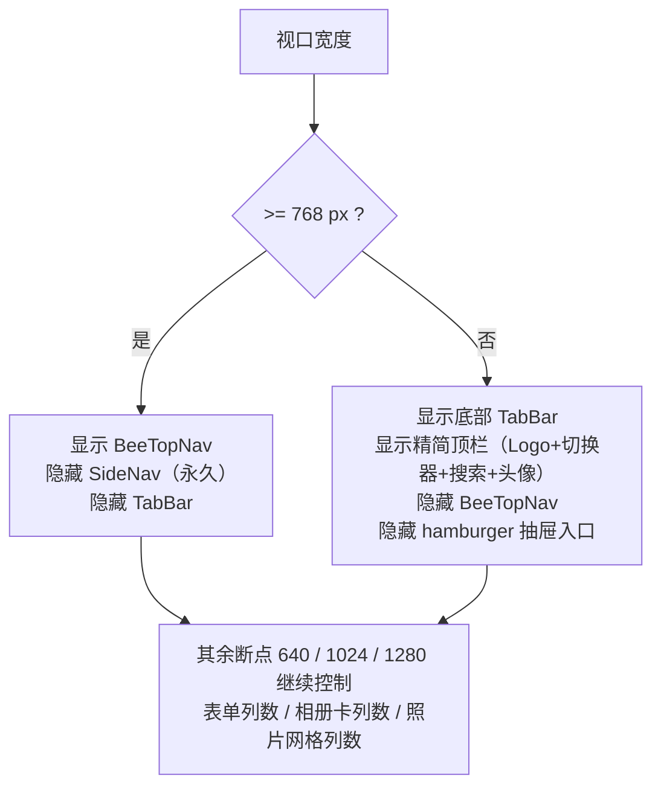
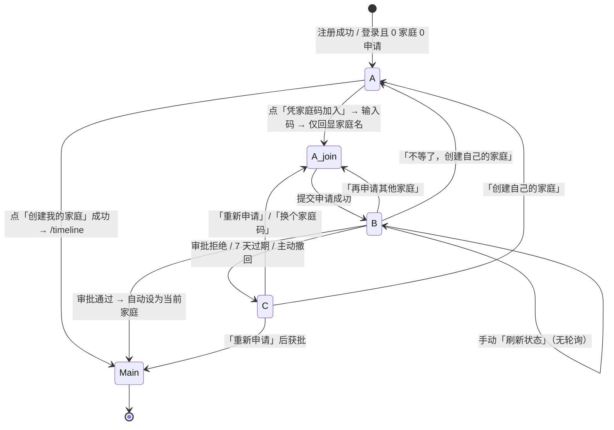

# 06 · 蜜记 Bee Family 增量 UI 设计规格（v1.1 变更集）

| 项 | 内容 |
| --- | --- |
| 文档版本 | v1.1-ui-incremental |
| 日期 | 2026-11-05 |
| 作者 | 许清楚（产品经理） |
| 状态 | 已定稿；§11 的 D-1…D-8 已全部由主理人裁定并写入正文；**GIF 白名单、HEIC 1600px 展示副本两项边界已由用户拍板为「已确认」，见 §9.7**；由主理人转交工程师按 §3–§9 落地 |
| 文档性质 | **增量文档，只描述像素级 / 交互级 UI 变更**。未提及的视觉一律继续以 `docs/02-ui-design.md` 为准 |
| 上游依据 | `docs/02-ui-design.md`（Design Tokens / 组件库 / 逐页线框 / 断点）、`docs/05-prd-incremental.md`（§6 切换语义 / §7 无家庭引导 / §8 顶部导航 / §9 HEIC·EXIF）、主理人下发的 **9 项用户最终拍板口径** |
| 本步边界 | **只做 UI 定义**：不改代码、不改 01/02/03/04/05 任何既有文档、不定义后端字段与 API 形状 |
| 语言 | 简体中文 |

> **冲突裁决（重要）**
> 1. **用户最终拍板口径 > `05-prd-incremental.md` 的推荐 > `02-ui-design.md` 的原规格**。本文严格按最终拍板口径出图，冲突处已在 §1 逐条列出。
> 2. 本文**不定义任何后端实体字段、列名、接口路径与响应结构**。涉及交互所需数据时，一律用「UI 需要什么」的中文表述（如「家庭名」「角色」「历史申请次数」），由架构师在 `docs/07-architecture-incremental.md` 中定义承载方式。
> 3. 本文所有数值为 **px / 已有 token 名**；**禁止新增硬编码色值**（唯一新增 token 见 §10.2，**D-6 已裁定落地**，且为既有硬编码的语义化别名，非新色值）。

---

## 0. 章节结构

| 章 | 内容 |
| --- | --- |
| §1 | 变更总览：UI 侧被覆盖条款与最终口径对照 |
| §2 | Design Tokens 复用总表与冲突登记 |
| §3 | 顶部导航（1440 主规格）：线框 / 分区 / 当前态 / 二级项 / 溢出 / 键盘 |
| §4 | 断点规则：≥768 与 <768 互斥、375 元素迁移 |
| §5 | `/onboarding` 无家庭引导页：三态线框 / 状态流转 / 文案 / 导航表现 |
| §6 | 家庭管理页 `/family`：家庭码卡 / 成员与角色 / 申请列表 / 权限矩阵 |
| §7 | 家庭切换器：下拉 / 在途上传阻断 / 切换后表现 |
| §8 | 照片信息面板：EXIF 19 字段分组 / GPS 行 / 三种缺失文案 / 下载入口 |
| §9 | 上传态：HEIC 队列条目 / 识别中·转码中·成功·失败四态 / 全站文案 |
| §10 | 与现有 Design Tokens 冲突或需新增 token 的处置 |
| §11 | 已裁定事项（8 条）+ 三处主动修正（已裁定采纳）+ QA 前置条件 |

---

## 1. 变更总览：UI 侧被覆盖条款

### 1.1 最终拍板口径 vs 既有文档

| # | 变更点 | 最终口径 | 覆盖的既有条款 | 本文落点 |
| --- | --- | --- | --- | --- |
| C-01 | 家庭码 | 单一 10 位去混淆字符、永久有效、可重置；**旧邀请码本次上线立即移除**，不留过渡 UI、不留弃用提示 | `02` §5.8 邀请码卡片（8 位 / 24 小时内有效 / 复制·重置）；`05` §5.2 过渡期、§10.3、Q7 | §6.2 |
| C-02 | 注册 | 不填任何码；注册后进入无家庭引导 | `02` §5.1 注册表单「邀请码（选填）」字段；`05` §3 INC-P0-01 | §5.1、§9.4 |
| C-03 | 管理员 | **多管理员、不转让**：仅 owner 可指定/撤销 admin、重置家庭码、删除家庭；**任一 admin（含 owner）可审批/拒绝**；owner 身份不可撤销不可转让 | `05` §4.3 R-01（仅 owner 审批）、§8.1 待审角标「仅 owner 可见」、§3 INC-P1-04（多管理员为 P1）、Q5 | §3.5、§6.4、§6.5 |
| C-04 | 申请 | 提交后**仅回显家庭名**；待审核**只做手动刷新，不轮询**；等待态保留两个出口 | `05` §7.4（P1 30s 轮询） | §5.4、§5.5 |
| C-05 | 被拒 | 允许再申请，24h 上限 5 次，**owner + admin 可见历史申请次数与近 24h 计数** | `05` §4.3 R-06 | §6.5（D-1 已裁定） |
| C-06 | 当前家庭 | 服务端记录；UI 需有家庭切换器 | `02` §4.1（无切换器）；`05` §6.1 | §3.4、§7 |
| C-07 | 导航 | **≥768 顶部导航，<768 保留现有底部 TabBar**；两套按断点互斥；不横滚、不汉堡抽屉 | `02` §2.13 / §4.1 / §4.2 左侧 SideNav 全部规格；`05` §8 | §3、§4 |
| C-08 | GPS | **展示精确经纬度原文、不接地理编码、不提供用户开关**（所有可见该照片的成员一律可见） | `05` §9.3 字段 #18「不展示坐标数值」、§9.4 全部（默认关闭开关 / 隐藏精确坐标 / 副本剥离 / 静态隐私提示）、§9.5 相关、Q3 | §8.4、§8.5 |
| C-09 | HEIC | 支持上传、**原始 HEIC 完整保留**；生成**长边 1600px 的 JPG 展示副本**用于灯箱展示与默认下载（C-12 / §8.6 已确认）；**全站下线「兼容性最佳」**；仅转码/解析失败时保留一条 iPhone 导出 JPEG 降级指引；**EXIF 从原 HEIC 读取，不从 1600px 副本读取** | `02` §6.1 预校验白名单与 Toast；`05` §9.2 | §8.6、§9 |
| C-10 | EXIF | `05` §9 的 19 字段分级照用；缺字段省略不留 `—`；无 EXIF / 被剥离 / 截图三种专属文案 | `02` §4.11 灯箱信息栏（现无拍摄信息区） | §8 |
| C-11 | GIF 白名单 | **已确认：本期不纳入**；白名单**仅 JPEG / PNG / WebP / HEIC**、**不含 GIF**、**不留可配置开关**（设置页 / 上传区均不提供「启用 GIF」类选项）；上传控件 accept 排除 GIF，用户选中 GIF 时给明确提示；HEIC 上传态章节不出现任何 GIF 分支 | `05` §9.1 第 6 项、§9.2 旧格式声明（含 GIF，已覆盖） | §9.3、§9.4、§9.7 |
| C-12 | HEIC 展示副本 | **已确认：默认长边 1600px 接受**，原 HEIC 完整保留；上传成功态与照片信息面板必须明示「已生成 1600px 展示副本，原图保留」；**不提供尺寸开关、不提供地理编码开关** | `05` §9.1 第 2/5 项（原文未向用户明示降质） | §8.6、§9.2、§9.7 |
| C-13 | Q2 技术路线 | **口径重申：服务端纯 Java 库**，不是 macOS 系统命令；UI 文案不得出现「仅 macOS 可用」或任何依赖系统工具 / 部署环境的表述 | `05` Q2 的产品推荐（系统命令为主） | §9.4、§9.7 |

### 1.1.1 状态标记约定

| 标记 | 含义 |
| --- | --- |
| **已确认（用户拍板）** | C-11 / C-12 等由用户直接拍板，UI 按此实现，不得自行更改；§9.7 保留两方案对照作为决策留痕 |
| **已裁定（主理人）** | §11 的 D-1…D-8 已全部裁定并写入正文；三处主动修正亦已裁定采纳（§11.1） |
| **口径重申** | 主理人下发的既定事实（C-13 / Q2 服务端纯 Java 库），UI 只需遵守 |
| **未采用方案** | §9.7 仅作决策留痕，不参与实现，文案不得回流 |

### 1.2 明确不变的既有规格（防止过度改造）

| 项 | 结论 |
| --- | --- |
| 色板 / 字号 / 字重 / 间距 / 圆角 / 阴影 / 动效 | **全部沿用 `02` §2**，不新增色值 |
| 蜂巢母题使用范围 | **不变**（`02` §3.2）。`/onboarding` 等待态的六边形呼吸插画属于「加载动画 + 空状态底纹」，在允许清单内 |
| 内容区容器 / 12 列栅格 | **不变**：`max-width: 1200px; padding: 0 var(--container-pad)`，≥1024 内容宽仍为 **1136px** |
| 相册卡 / 照片网格 / 灯箱图像区 / 成长曲线 ECharts 配色 | **不变** |
| 暗色模式 | **仍不做**（`02` §6.6） |
| 375 底部 TabBar 的 5 个入口、图标 20px、文字 10px、高 56px | **不变** |
| 视觉回归中「内容区」相关判定（5 列网格 / 下拉不截断 / 日期不折行 / 375 无横向溢出） | **判定值不变**，仅导航壳变化 |

---

## 2. Design Tokens 复用总表与冲突登记

### 2.1 新增 UI 元素的 Token 复用（禁止新色值）

| 元素 | 属性 | 复用 Token / 既有值 |
| --- | --- | --- |
| 顶栏背景 | `background` | `--bg-topbar`（**D-6 已裁定落地**；值 = `--bg-page` + 86% 透明度，见 §10.2） |
| 顶栏下边框 | `border-bottom` | `1px solid var(--border-subtle)` |
| 顶栏竖向分隔线 | `background` | `--border-default`，1×24px |
| Logo 六边形 | `background` | `--honey-500` |
| Logo 中文「蜜记」 | `color` / 字号 | `--text-brand` / 20px·600 |
| Logo 英文「Bee Family」 | `color` / 字号 | `--text-tertiary` / 11px·400 |
| 家庭切换器胶囊 | `background` / 圆角 | `--bg-sunken` / `--r-full` |
| 切换器文字 / chevron | `color` | `--text-primary`（14px·500）/ `--text-tertiary` |
| 导航项默认文字 | `color` | `--text-secondary`（14px·500） |
| 导航项 hover 底 / 文字 | `background` / `color` | `--honey-50` / `--text-primary` |
| 导航项当前态文字 | `color` / 字重 | `--text-brand` / 600 |
| 当前态下划线 | `background` | `--honey-500`，2px |
| 待审角标（桌面） | `background` / `color` | `--accent-coral` / `--text-inverse`，16×16 圆，10px 字 |
| 待审角标（375） | `background` | `--accent-coral`，8×8 圆点，无数字 |
| 搜索框 | 全套 | `--bg-sunken` / `--border-default` / `--r-md` / 40px（`02` §4.5） |
| 「上传照片」按钮 | 全套 | `primary` + `md`：`--honey-500` / `--text-inverse` / 40px / `--r-md`（`02` §4.4） |
| 头像 | `background` / `color` | `--warm-200` / `--text-primary`（首字占位），36×36 圆 |
| 下拉面板（切换器 / 更多 / 头像菜单） | 全套 | `--bg-elevated` / `--shadow-md` / `--r-md` / 上间距 4px / 最大高 280px（`02` §4.6） |
| 下拉选项 hover / selected | `background` | `--honey-50` / `--honey-100` + `--text-brand` |
| 家庭码文字 | `color` / 字体 | `--text-brand` / `--font-mono`，32px·700 |
| 家庭码卡底 | `background` | `--honey-50`（`02` §5.8） |
| 角色 Chip「创建者」 | 变体 | `honey`（`--honey-100` / `--text-brand`） |
| 角色 Chip「管理员」 | 变体 | `outline`（透明 / `--text-secondary` / 1px `--border-default`） |
| 角色 Chip「成员」 | 变体 | `default`（`--warm-100` / `--text-secondary`） |
| 申请状态 Chip「通过」 | 变体 | `honey` 或 `--color-success-bg` + `--color-success` |
| 申请状态 Chip「拒绝」 | 变体 | `--color-danger-bg` + `--color-danger` |
| 满员 / 阻断 / 重置警示条 | 底 / 文字 | `--color-warning-bg` / `--color-warning` |
| 转码中进度条 | 底 / 填充 | `--honey-200` / `--honey-500`（斜纹） |
| 上传成功 | `color` | `--color-success` |
| 上传失败 | 底 / 文字 | `--color-danger-bg` / `--color-danger` |
| 上传队列浮层 | 底 / 阴影 | `--bg-elevated` / `--shadow-lg`（`02` §6.1） |
| 拍摄信息区分组标题 | `color` | `--text-tertiary`，12px·500，字距 0.06em（`02` §4.2 分组标题规格） |
| EXIF 标签列 / 值列 | `color` | `--text-tertiary`（12px）/ `--text-secondary`（13px） |
| GPS 坐标值 | 字体 / `color` | `--font-mono` + `tabular-nums` / `--text-secondary` |
| 信息栏分隔线 | `background` | `--border-subtle`，1px |
| 「查看完整拍摄参数」 | `color` | `--honey-700`，13px |
| 下载按钮 | 变体 | `secondary` sm / `ghost` sm（`02` §4.4） |
| 模态框（重置确认 / 拒绝理由 / 撤销管理员） | 全套 | `sm` 400px / `--bg-elevated` / `--r-xl` / `--shadow-lg`（`02` §4.18） |
| Toast | 全套 | `02` §4.17（success / warning / danger / info） |
| `focus-visible` | `box-shadow` | `0 0 0 2px var(--honey-400)` + 2px 偏移（`02` §4.2） |
| 动效 | 时长 / 曲线 | `--dur-fast` 120ms / `--dur-base` 200ms / `--dur-slow` 320ms / `--ease-out` |
| 顶栏 / TabBar 高度 | — | `--topbar-h` 64px / `--tabbar-h` 56px |
| 间距 | — | `--sp-1`4 / `--sp-2`8 / `--sp-3`12 / `--sp-4`16 / `--sp-5`20 / `--sp-6`24 / `--sp-8`32 |

### 2.2 组件库新增/扩展（非 token，属组件规格变更）

| 组件 | 变更 | 说明 |
| --- | --- | --- |
| `BeeTopNav` | **新增** | 顶部导航容器（≥768 显示） |
| `BeeNavItem` | **改状态** | 激活态由「左 3px 竖条 + 蜜金底」改为「底部 2px 下划线」；原规格在 <768 的 TabBar 中仍保留 |
| `BeeFamilySwitcher` | **新增** | 家庭切换器（触发器 + 下拉 + 阻断态） |
| `BeeRoleChip` | **新增（复用 BeeTag）** | 3 种角色变体映射，不新增色值 |
| `BeeJoinRequestItem` | **新增** | 申请条目（88px 双行） |
| `BeeExifPanel` | **新增** | 灯箱信息栏内「拍摄信息」区块 |
| `BeeHexBadge` | **复用** | `/onboarding` 等待态呼吸插画、家庭码卡左上小徽章 |
| `BeeEmptyState` | **扩展 3 个变体** | `no-family`（全新）、`join-pending`（待审核）、`join-rejected`（被拒/过期）；原 5 变体不变 |
| `BeeFileDrop` | **改 accept 与说明** | 白名单与格式声明见 §9.4 |
| `BeeUploadItem` | **扩展状态** | `transcoding` / `transcode-failed` 两态 |

### 2.3 布局层级常量（非色值 token，允许字面量）

> `02` 文档仅定义灯箱 `z-index: 1000`。本次新增以下层级，**建议写入 `base.css` 集中管理**：

| 层 | z-index | 说明 |
| --- | --- | --- |
| 顶栏（sticky） | 100 | `position: sticky; top: 0` |
| 顶栏内下拉 / 更多菜单 | 200 | 切换器、头像菜单、更多 |
| 搜索浮层（768–1023） | 300 | 点击搜索图标展开的全宽浮层 |
| 上传队列浮层 | 900 | 沿用 `02` §6.1 右下角 |
| Toast | 950 | `02` §4.17 |
| 灯箱 | 1000 | **不变** |

---

## 3. 顶部导航（1440 主规格）

### 3.1 一级项清单与顺序（固定 5 项，不增不减）

| 序 | 名称 | 路由 | 图标（`02` §9.5 图标表） | 最小宽 | 可见角标 |
| --- | --- | --- | --- | --- | --- |
| 1 | 时间轴 | `/timeline` | `grid` | 84px | — |
| 2 | 相册 | `/albums` | 沿用现有相册图标（**D-8 已裁定**：不新增图标常量、不改 `IconName` 联合类型） | 84px | — |
| 3 | 成长记录 | `/growth` | `baby` | 84px | — |
| 4 | 家庭成员 | `/family` | `user` | 84px | 待审数字角标（owner + admin 可见） |
| 5 | 设置 | `/settings` | `settings` | 84px | — |

> 每项：`height: 40px`、`padding: 0 16px`、`gap: 4px`、圆角 `--r-md`、字号 14px/500。
> **顺序与 03 文档 §9.2 路由表、02 文档 §4.1 TabBar 的 5 项完全一致**，避免用户重新学习。

### 3.2 1440 线框（顶栏全宽，内部满铺，非 1200 居中）

> **D-3 已裁定**：顶栏**保持全宽**（`padding: 0 var(--container-pad)`，不套 `max-width: 1200px`）；Logo 左边缘 `x=32` 与内容区左边缘 `x=152` 不对齐作为**已知代价接受**。本节宽度预算表与 §4.2 的 1440 / 768 线框**均不变、不重算、不改为 `max-width:1200px`**。

```
视口 1440 × 900，顶栏 inner = 1440 - 2×32 = 1376px
┌────────────────────────────────────────────────────────────────────────────────────────┐
│ 顶栏 h=64  sticky top:0  z=100  bg=--bg-topbar  blur(12px)  border-bottom:1px        │
│ x=32                                                                          x=1408  │
│ ┌──────────┬─┬────────────────┬──────────────────────────────┬───────────────────┐  │
│ │ Logo 120 │ │ 切换器 200     │ 一级导航 5 项 = 386px        │ 用户区 492px      │  │
│ │ 32..152  │ │ 185..385       │ 409..795                     │ 916..1408         │  │
│ │          │ │                │                              │                   │  │
│ │ ◇ 32×37  │ │ ┌────────────┐ │ ┌────┬────┬────┬────┬────┐  │ ┌──────────────┐   │  │
│ │ 蜜记     │ │ │许家小院  ▾ │ │ │时间│相册│成长│家庭│设置│  │ │ 🔍 搜索 320 │   │  │
│ │ BeeFamily│ │ └────────────┘ │ │ 轴 │    │记录│成员│    │  │ └──────────────┘   │  │
│ │          │ │  胶囊 h=36     │ └────┴────┴────┴─●──┴────┘  │  [+ 上传]  ◯头像 │  │
│ │          │ │  top=14        │      ↑ 激活项底部 2px 蜜金    │   112px   36px  │  │
│ └──────────┴─┴────────────────┴──────────────────────────────┴───────────────────┘  │
│              ↑ 1×24 竖线 --border-default，左右各 16px                                │
└────────────────────────────────────────────────────────────────────────────────────────┘
   <main> 内容区：max-width 1200 居中 → 1440 下左右各 120px，内 padding 32 → 内容宽 1136px
   （内容宽与改版前一致：原 1440-240侧栏=1200，内 padding 32 → 1136px；所有栅格/卡片尺寸不变）
```

**宽度预算（1440，inner 1376px）**

| 区 | x 起 | 宽 | 组成 |
| --- | --- | --- | --- |
| 左 padding | 0 | 32 | `--container-pad` |
| Logo 区 | 32 | 120 | 六边形 32×37 + 10px + 两行文字（20px「蜜记」/ 11px「Bee Family」） |
| gap | 152 | 16 | `--sp-4` |
| 竖分隔 | 168 | 1 | 1×24px |
| gap | 169 | 16 | `--sp-4` |
| 家庭切换器 | 185 | 200 | 胶囊 36px 高，`top: 14px` |
| gap | 385 | 24 | `--sp-6` |
| 一级导航 | 409 | 386 | 5×84 + 4×4 间距（表格见 §3.1） |
| 弹性空白 | 795 | 121 | `flex: 1` |
| 用户区 | 916 | 492 | 搜索 320 + 12 + 上传 112 + 12 + 头像 36 |
| 右 padding | 1408 | 32 | `--container-pad` |
| **合计** | — | **1376** | ✅ 无溢出 |

### 3.3 分区规格表

| 区 | 规格 |
| --- | --- |
| **Logo 区** | 宽 120px、高 64px、flex 垂直居中；六边形蜂巢 32×37（`--honey-500`）+ 10px 间距 + 文字两行；整区可点，点击回 `/timeline`；`aria-label="蜜记首页"` |
| **家庭切换器** | 见 §7；宽 200px（超长家庭名内部省略）、高 36px、`top: 14px`、`--bg-sunken`、`--r-full`、padding `0 12px`；文字 14px/500 `--text-primary`，chevron 16px `--text-tertiary` |
| **一级导航区** | `display:flex; gap: 4px`；每项 40px 高、padding `0 16px`、`min-width: 84px`、圆角 `--r-md`、文字居中 |
| **用户区** | `display:flex; align-items:center; gap: 12px; margin-left:auto`；搜索框 320×40（`02` §4.5）；「+ 上传照片」`primary md` 112×40；头像 36×36 圆 |
| **待审角标** | 位于「家庭成员」项**右上角**（`top: -4px; right: 2px`），16×16 圆、`--accent-coral` 底、`--text-inverse` 10px/600 居中；`pending=0` 不渲染；`>9` 显示 `9+`；可见角色 = **owner + admin**（C-03；**D-2 已裁定两类角色均可见**） |
| **顶栏整体** | `position: sticky; top: 0; z-index: 100; height: var(--topbar-h)`；背景 `--bg-topbar` + `backdrop-filter: blur(12px)`；下边框 `1px solid var(--border-subtle)` |

### 3.4 当前态 / hover / focus / 键盘

| 状态 | 视觉 | 数值 |
| --- | --- | --- |
| 默认 | 文字 `--text-secondary`，无背景 | 14px/500 |
| hover | 背景 `--honey-50`（`--r-md`），文字 `--text-primary` | 过渡 `--dur-fast` 120ms |
| active（按下） | `transform: scale(0.98)`，背景 `--honey-100` | `--dur-fast` |
| **当前路由** | 文字 `--text-brand` + 600 字重；**底部 2px `--honey-500` 下划线**，`bottom: 0`，宽 = 项宽 − 32px，水平居中；`aria-current="page"` | 下划线 2px |
| focus-visible | `box-shadow: 0 0 0 2px var(--honey-400)` + 2px 偏移；**禁止 `outline: none`** | 2px |
| disabled | 不出现（5 项始终可点） | — |

> **为什么改下划线**：原 SideNav 激活态是「左侧 3px 竖条 + 蜜金底」（`02` §4.2）；横向导航没有左侧空间，且蜜金底会把顶栏染成一片金色，违背「照片是主角 / UI 退后半步」。下划线是横向导航的通用当前态。

**键盘可达性（硬性）**

| 操作 | 行为 |
| --- | --- |
| `Tab` 顺序 | Logo → 家庭切换器 → **导航区（roving tabindex，整区只占 1 个 Tab 停靠点）** → 搜索框 → 上传按钮 → 头像菜单 |
| `←` / `→` | 在 5 个导航项间移动焦点；**到边界停住，不循环** |
| `Enter` / `Space` | 激活当前焦点项（路由跳转） |
| `Esc` | 关闭切换器下拉 / 更多下拉 / 头像菜单 / 搜索浮层，焦点回到触发元素 |
| `/` 或 `⌘K` / `Ctrl+K` | 聚焦搜索框（**不变**） |
| `aria-current="page"` | 全顶栏**有且仅有 1 个** |
| 语义 | 全部使用 `<a>` / `<button>`；导航容器 `role="navigation" aria-label="主导航"`；下拉 `role="menu"` |

### 3.5 二级项与溢出处理

| 二级项 | 入口 | 面板规格 | 可见角色 |
| --- | --- | --- | --- |
| 家庭切换器下拉 | 点击切换器 | 宽 260px、最大高 280px 可滚、`--bg-elevated` + `--shadow-md` + `--r-md`、上间距 4px、内边距 4px；选项 48px（家庭名 + 角色 Chip + 当前项 ✓）；底部固定区「创建家庭」「加入家庭」两个 36px 项 | 全部登录用户 |
| 头像菜单 | 点击头像 | 宽 180px，2 项 × 36px：「账号设置」→ `/settings?tab=account`、「退出登录」 | 全部登录用户 |
| 搜索浮层（768–1023） | 点击搜索图标 | `top: 64px`、宽 = `100% - 2×--container-pad`、高 56px、`--bg-elevated` + `--shadow-lg`、内含全宽输入框（自动聚焦）；`Esc` 关闭 | 全部登录用户 |
| 「更多」下拉 | 溢出兜底时出现在导航末尾 | 宽 160px，收纳的末项各 36px | 全部登录用户 |
| 待审角标点击 | 点击「家庭成员」项 | 直达 `/family` 并自动切到「待处理」分组 | **owner + admin**（D-2 已裁定） |

**收缩优先级（从先到后，任何断点禁止横向滚动条 / 禁止顶栏换行）**

`Logo 英文 → Logo 中文 → 家庭切换器文字 → 搜索框宽度 → 搜索框收缩为图标 → 上传按钮收缩为图标 → 导航项 padding 16→12 → 末项收进「更多」`

| 断点 | padding | Logo | 切换器 | 导航 | 搜索 | 上传 | 头像 | 预算校验 |
| --- | --- | --- | --- | --- | --- | --- | --- | --- |
| **≥1280** | 32 | 图文 120 | 200（全名 ≤12 字） | 5×84+16 = 436→实取 386 文字宽 | 320 | 112 文字按钮 | 36 | 1440 实测 1255/1376 ✅ |
| **1024–1279** | 24 | 仅六边形 32 | 160（名 ≤8 字） | padding 12 → 5×76+16 = 396 | 240 | 112 文字按钮 | 36 | 1024 内 976：32+16+1+16+160+24+396+12+240+12+112+12+36 = 1069 > 976 ❌ → **追加收缩**：搜索 200、上传改 40 图标 → 32+16+1+16+160+24+396+12+200+12+40+12+36 = **957 ≤ 976** ✅ |
| **768–1023** | 16 | 仅六边形 24 | 100（名首字 + chevron） | padding 12 → 396 | **36 图标**（点击展开全宽浮层） | 36 图标 | 32 | 768 内 736：24+12+1+12+100+16+396+12+36+8+36+8+32 = **693 ≤ 736** ✅ |
| **<768** | 16 | 仅六边形 24 | ≤140（名 4 字 + chevron） | **不渲染**（TabBar 接管） | 32 图标 | **不渲染**（入口在页内） | 32 | 375 内 343：24+12+140+12+32+8+32 = **260 ≤ 343** ✅ |

> **注**：1024–1279 档的「追加收缩」是本次实测预算后的主动修正，**主理人已裁定采纳（§11.1 A-1）**：收缩为搜索 200px + 上传 40px 图标，修正了 `05` §8.2 中「≥1024 搜索 240 + 上传文字按钮」在 1024 宽度下放不下的问题。

---

## 4. 断点规则：≥768 与 <768 互斥

### 4.1 互斥切换点



| 判定 | 值 |
| --- | --- |
| 互斥媒体查询 | `@media (min-width: 768px)` → 顶栏导航 `display: flex`，TabBar `display: none`；`@media (max-width: 767px)` → 反之 |
| **同一时刻只允许一套主导航存在** | 视觉回归须断言 `topNavVisible XOR tabBarVisible === true` |
| SideNav | **永久移除**，不再有 72px 图标态、不再有汉堡抽屉 |
| 640 / 1024 / 1280 断点 | **全部保留**，继续控制 `02` §2.13 的表单列数 / 相册卡列数 / 照片网格列数 |
| 顶栏高度 | **≥768 与 <768 统一 64px（`--topbar-h`）**；不引入 56px 例外（见 §10.1 冲突 C-3）；**D-5 已裁定：覆盖 `05` §8.4 的 56px，不新增 `--topbar-h-mobile`** |
| TabBar | 高 `--tabbar-h` 56px + `env(safe-area-inset-bottom)`，**规格完全不变** |

### 4.2 375 下线框

```
375 × 812
┌─────────────────────────────────────────┐
│ 顶栏 h=64  padding 0 16  inner=343      │
│ ◇24   [ 许家小院 ▾ ]  ≤140    🔍32  ◯32 │  ← 无导航项 / 无上传按钮 / 无竖分隔
├─────────────────────────────────────────┤
│                                         │
│            页面内容（单列）              │
│            padding 0 16                 │
│                                         │
├─────────────────────────────────────────┤
│ TabBar h=56 + safe-area                 │
│  ⌂时间轴  ▦相册  ♡成长  👤家庭 ●  ⚙设置 │
│   20px 图标 + 10px 文字                 │
│   激活：--honey-600 + 顶部 2px 蜜金短线  │
│   ● = 待审 8px --accent-coral 圆点（无数字）│
└─────────────────────────────────────────┘
```

### 4.3 375 元素迁移与隐藏清单

| 元素 | ≥768 | <768 | 迁移去向 |
| --- | --- | --- | --- |
| 5 个一级导航项 | 顶栏常显 | **隐藏** | → 底部 TabBar（原样保留，`02` §4.1） |
| 左侧 SideNav / 汉堡按钮 | 永久移除 | 永久移除 | — |
| Logo 中文「蜜记」+ 英文副标 | ≥1280 显示 | **隐藏** | 仅保留 24×28 六边形 |
| 顶栏竖向分隔线 | 显示 | **隐藏** | — |
| 家庭切换器 | 顶栏 200px | **保留**，收缩至 ≤140px，显示家庭名 4 字 + chevron；点击出**底部选择面板**（高 ≤60vh，非下拉） | 顶栏 |
| 全局搜索框 320px | 显示 | **收缩为 32px 图标** | 点击展开全宽搜索浮层 `top:64px`（同 768–1023 档） |
| 「+ 上传照片」按钮 | 顶栏 | **隐藏** | → 时间轴页顶部主按钮 / 相册详情操作条（**不变**） |
| 待审数字角标 16×16 | 「家庭成员」项右上 | **改为 8×8 圆点（无数字）** | → TabBar「家庭成员」图标右上 |
| 面包屑 | 顶栏左（原规格） | **隐藏** | 相册详情页内保留页面头部 |
| 设置页左导航 200px | ≥1024 显示 | **<1024 变顶部横向 Tab** | `02` §5.10 原规则不变 |
| 灯箱信息栏 320px | 右侧 | **底部抽屉**（默认收起，上滑展开 60vh） | `02` §4.11 原规则不变；EXIF 区块在抽屉内纵向滚动 |
| 用户区头像 | 36×36 | 32×32 | 顶栏 |

---

## 5. `/onboarding` 无家庭引导页

### 5.1 页面骨架（三态共用）

| 项 | 规格 |
| --- | --- |
| 路由 | `/onboarding` |
| 布局 | `layout: 'blank'`：**不渲染 BeeTopNav、不渲染 TabBar、不渲染 BeeSideNav** |
| 分栏 | **沿用 `02` §5.1 登录页**：左品牌区 55%（`--honey-50` 底、padding 64px、六边形 Logo 32×37 + 40/48 `--font-display` 标语「把一家人的时光，收成一册暖光相册。」+ 48px 蜜金短线 + 右下角蜂巢纹样 8%）；右操作区 45%（`--bg-page`） |
| 右操作区容器 | 宽 **440px** 居中（≥768）/ `100% − 32px`（<768）；最小高 100vh，垂直居中 |
| 顶部条 | 高 64px：左 Logo（24×28 六边形 + 「蜜记」16/600）；右两个文字链「账号设置」（→ `/settings?tab=account`）与「退出登录」，各 12px/`--text-secondary`，间距 `--sp-4` |
| 卡片 | `BeeCard`，`--bg-surface` + `--shadow-sm` + `--r-lg`，padding `--sp-6` 24px |
| 允许访问 | `/onboarding`、`/settings?tab=account`、登出；**其余任何路由重定向回 `/onboarding`** |
| 导航表现 | 顶部条**不含**任何导航项、不含搜索、不含上传、不含家庭切换器；账号设置页同样为 blank 布局（设置页仅渲染「账号」子页，其余 3 个子页隐藏） |
| 响应式 | <1024 隐藏左品牌区，改为顶部居中 Logo（高 120px）；<640 卡片 padding `--sp-4` 16px、按钮全宽 |

### 5.2 状态 A · 全新（0 家庭、0 申请）线框

```
≥1280 · 右侧操作区 440px
┌──────────────────────────────────────────┐
│  顶部条 h=64   ◇ 蜜记      账号设置  退出登录 │
├──────────────────────────────────────────┤
│                                          │
│  先给自己安一个家                        │  ← 24/32 600 --text-primary
│  创建一个家庭，或凭家庭码申请加入。      │  ← 14/22 --text-secondary，下间距 24
│                                          │
│  ┌────────────────────────────────────┐  │
│  │ ◇ 32×37        创建我的家庭        │  │  ← 卡 A 高 112，hover --shadow-md
│  │ 蜜金六边形      自己成为家庭管理员  │  │     卡片 --bg-surface / --r-lg
│  │                 12/--text-tertiary │  │
│  │                        [创建 →]   │  │  ← primary sm 32px
│  └────────────────────────────────────┘  │
│              间距 --sp-3 (12px)           │
│  ┌────────────────────────────────────┐  │
│  │ ⌂ 32×37        凭家庭码加入        │  │  ← 卡 B 高 112
│  │ 暖灰六边形      向已有家庭发出申请  │  │
│  │                 12/--text-tertiary │  │
│  │                        [加入 →]   │  │  ← secondary sm 32px
│  └────────────────────────────────────┘  │
│                                          │
│  展开后的表单（点击卡后原位替换该卡）：  │
│  ┌────────────────────────────────────┐  │
│  │ 家庭名                             │  │  ← 13/500 标签 + 6px
│  │ ┌────────────────────────────────┐ │  │  ← Input 40px，1–40 字
│  │ └────────────────────────────────┘ │  │
│  │ [创建家庭  48px 全宽 primary lg]   │  │
│  └────────────────────────────────────┘  │
└──────────────────────────────────────────┘
```

| 项 | 规格 |
| --- | --- |
| 两张卡 | 等高 112px、`--r-lg`、`--bg-surface`、`--shadow-sm`；hover `translateY(-2px)` + `--shadow-md`（`02` §4.8）；整卡可点，`focus-visible` 为 2px `--honey-500` outline + 3px offset |
| 卡 A 徽章 | `BeeHexBadge` 32×37，`honey` 变体；卡 B 徽章 `outline` 变体 |
| 展开表单 | 点击卡后**原位展开**（非模态、非跳页），另一张卡保持可见（可改选）；展开动画 `--dur-base` `--ease-out` |
| 创建按钮 | `primary lg` 48px **全宽**（`02` §4.4 全宽例外）；字段为空或 >40 字时 disabled |
| 提交中 | 按钮内 16px 旋转环，文字保留「创建中…」 |
| 创建成功 | 直接跳 `/timeline` 空状态；顶部 Toast `info`「家庭码已生成，可在『家庭成员』页分享给家人」（3.5s） |

### 5.3 状态 B · 待审核中（0 家庭、≥1 条 pending）线框

```
┌──────────────────────────────────────────┐
│  顶部条 h=64   ◇ 蜜记      账号设置  退出登录 │
├──────────────────────────────────────────┤
│                                          │
│           ◇ 96×111 六边形呼吸插画        │  ← --honey-100 底 + --honey-300 描边
│            opacity .55↔1，2.4s 循环      │     呼吸（非旋转，避免焦虑）
│                                          │
│  已向「许家小院」发出申请                │  ← 20/28 600 --text-primary，居中
│  ▲ 家庭名唯一回显，样式见 §5.5           │
│                                          │
│  提交时间  2026-11-05 14:32              │  ← 12/18 --text-tertiary 居中
│  申请将在 7 天后过期                     │  ← 12/18 --text-tertiary 居中
│                                          │
│  ┌────────────────────────────────────┐  │
│  │      [ 🔄 刷新状态 ]               │  │  ← primary md 40px 全宽
│  └────────────────────────────────────┘  │
│              间距 --sp-3                  │
│  ┌──────────────────┬─────────────────┐  │
│  │  再申请其他家庭   │ 不等了，创建自己 │  │  ← 两个 secondary md 40px
│  │    secondary      │   的家庭        │  │     各 50% − 6px，gap 12px
│  └──────────────────┴─────────────────┘  │
│                                          │
│           撤回申请                       │  ← 12px --text-tertiary 文字链，居中
│                                          │
│  仅手动刷新，无自动轮询；刷新按钮每次    │  ← 12/18 --text-tertiary，卡片底部
│  点击重新查询一次状态                    │
└──────────────────────────────────────────┘
```

| 项 | 规格 |
| --- | --- |
| **两个出口按钮**（必须同时可见） | ①「再申请其他家庭」`secondary md` → 回到状态 A 的「凭家庭码加入」表单；②「不等了，创建自己的家庭」`secondary md` → 回到状态 A 的「创建我的家庭」表单。两按钮**等宽**、gap 12px、40px 高，位于「刷新状态」下方 |
| 「刷新状态」 | `primary md` 40px 全宽；点击后按钮进入 loading（16px 旋转环 + 「刷新中…」），返回后 Toast `info`「仍是待审核状态，请稍后再查」或跳转（见下） |
| **不做轮询** | 页面无任何定时器、无 WebSocket、无顶栏角标；仅进入页面时查询一次 + 手动刷新 |
| 撤回 | 12px 文字链 `--text-tertiary`；点击弹 `Modal sm` 确认「撤回后需要重新提交申请」，确认后回状态 C |
| 审批通过 | 刷新/重进页面后自动跳 `/timeline`，Toast `success`「已加入『许家小院』」（3.5s） |
| 审批拒绝 / 过期 | 刷新/重进页面后切到状态 C |
| 六边形呼吸插画 | 96×111 尖顶六边形（尖顶比例 `1/1.1547`，`02` §3.1），`--honey-100` 填充 + 2px `--honey-300` 双层描边；`opacity .55↔1`，2.4s `--ease-in-out` 无限；`prefers-reduced-motion` 时静态 `opacity: 1` |

### 5.4 状态 C · 被拒 / 过期 / 全撤回（0 家庭、无 pending、有历史）

| 项 | 规格 |
| --- | --- |
| 布局 | 与状态 A 相同的 440px 右操作区 + 顶部条 |
| 结果卡 | 高 120px、左 3px `--color-danger` 竖条（拒绝）/ `--warm-300` 竖条（过期·撤回）；内含状态 Chip + 家庭名 + 时间 + 拒绝理由（有则显示，≤100 字，2 行省略） |
| 三个入口 | ①「重新申请」`primary md` 全宽（带原家庭名，直接复用上次输入）；②「换个家庭码」`secondary md` 全宽；③「创建自己的家庭」`ghost md` 全宽；间距 `--sp-3` |
| 24h 计数 | 结果卡底部 12px `--text-tertiary`：「近 24 小时已提交 3 / 5 次」；达 5 次时「重新申请」disabled + 提示「操作太频繁，请稍后再试」 |
| 历史次数 | 12px `--text-tertiary`：「第 2 次申请」（UI 需要「历史申请次数」） |

### 5.5 「仅回显家庭名」的展示样式（C-04）

| 项 | 规格 |
| --- | --- |
| 出现位置 | ① 状态 A 输入家庭码并校验通过后的**确认条**；② 状态 B 标题行；③ 状态 C 结果卡 |
| 确认条（状态 A） | 宽 100%、高 64px、`--honey-50` 底、`--r-md`、padding `--sp-4`；左 12px `--text-tertiary`「你要申请加入」，下 20/28 600 `--text-brand`「许家小院」；下方 12px「提交申请」`primary lg` 全宽 + 「重新输入」文字链 |
| **回显内容白名单** | **只有家庭名** |
| **禁止回显** | 成员数、成员昵称、成员头像、照片数、相册数、创建者昵称、创建时间、家庭封面、统计概览 —— 一律不渲染、不请求 |
| 输入规则 | 10 位，展示为 `XXXXX-XXXXX`（示例 `BEE7K-M3Q92`）；`--font-mono` 20px/600、字距 `.12em`、自动转大写、忽略连字符与大小写；Input 40px |
| 错误态 | 统一内联文案「家庭码无效或不存在」，12px `--color-danger`，输入框描边 `--color-danger`；**不区分**码不存在 / 已重置 / 家庭已满 / 家庭已删除 |
| 已是成员 | 内联文案「你已是该家庭成员」+ 文字链「切换到该家庭」 |
| 已有 pending | 内联文案「申请已提交，请等待管理员处理」+ 文字链「查看申请状态」（→ 状态 B） |
| 留言（选填） | Textarea 最小 88px，标签「给管理员留一句话（选填）」，≤50 字，右下角字数 `12/50`；placeholder「我是团团的爸爸～」 |

### 5.6 三态流转



### 5.7 UI 需要什么（不给后端形状）

| 数据 | 用途 |
| --- | --- |
| 当前用户的家庭数量（0 / ≥1） | 决定三态与路由守卫 |
| 是否存在待审核申请 | 区分状态 A / B |
| 目标家庭名（仅名称） | 「仅回显家庭名」确认条与状态 B 标题 |
| 申请状态、提交时间、剩余等待天数、拒绝理由、历史申请次数、近 24 小时已提交次数 | 状态 B / C 的文案与计数 |
| 家庭码是否有效（布尔即可） | 统一错误文案，不需要原因枚举 |

---

## 6. 家庭管理页 `/family`

### 6.1 页面结构（1440，内容宽 1136px）

```
┌───────────────────────────────────────────────────────────────────────────────┐
│ 顶栏（§3，全站共用）                                                          │
├───────────────────────────────────────────────────────────────────────────────┤
│ 家庭成员                                        [ 复制家庭码 ]  primary md    │  ← BeePageHeader 最小 64px
│ [4 / 6 人]  许家小院                                                          │  ← 计数徽章 + 家庭名 14/--text-secondary
│                                            间距 --sp-6 (24px)                 │
│ ┌─────────────────────────────────────────────────────────────────────────┐ │
│ │ 成员                                            4 人     高 48 header    │ │
│ ├─────────────────────────────────────────────────────────────────────────┤ │
│ │ ◯36  妈妈   [创建者]   2025-08-01 加入   上传 32 张   身份不可撤销     │ │ ← 52px 行
│ │ ◯36  爸爸   [管理员]   2025-08-03 加入   上传 18 张   [⋯]             │ │
│ │ ◯36  外婆   [成员  ]   2025-09-12 加入   上传  6 张   [⋯]             │ │
│ │ ◯36  外公   [成员  ]   2025-09-12 加入   上传  0 张   [⋯]             │ │
│ └─────────────────────────────────────────────────────────────────────────┘ │
│                            间距 --sp-6 (24px)                                │
│ ┌──────────────────────────────┐  ┌──────────────────────────────────────┐ │
│ │ 家庭码卡  左 6 列 = 556px    │  │ 宝宝卡  右 6 列 = 556px             │ │
│ │                              │  │                                      │ │
│ │    B E E 7 K - M 3 Q 9 2    │  │  ┌──────┐ ┌──────┐                  │ │
│ │    32px mono / --text-brand  │  │  │ ◇ 团团│ │ + 新增│                  │ │
│ │    --honey-50 底 / --r-md    │  │  └──────┘ └──────┘                  │ │
│ │    永久有效 · 需管理员通过    │  │  （沿用 02 §5.8 宝宝区，不变）      │ │
│ │    [复制]  [重置]            │  │                                      │ │
│ │    ↑ secondary sm  ↑ ghost sm│  │                                      │ │
│ └──────────────────────────────┘  └──────────────────────────────────────┘ │
│                            间距 --sp-6 (24px)                                │
│ ┌─────────────────────────────────────────────────────────────────────────┐ │
│ │ 加入申请   [待处理 (2)] [已处理]                 仅 owner + admin 可见    │ │
│ │ ┌───────────────────────────────────────────────────────────────────┐ │ │
│ │ │ ⚠ 家庭已满 6 人，请先移除成员后再通过申请   （满员时才出现，40px）  │ │ │
│ │ ├───────────────────────────────────────────────────────────────────┤ │ │
│ │ │ ◯32 爸爸  dad@home.local          [第 2 次申请]               │ │ │ 88px
│ │ │     11-05 14:32 · 「我是团团的爸爸～」   近 24 小时 2 / 5 次      │ │ │
│ │ │                                   [拒绝]  [通过]                 │ │ │
│ │ ├───────────────────────────────────────────────────────────────────┤ │ │
│ │ │ ◯32 外婆  grandma@home.local      [第 1 次申请]               │ │ │ 88px
│ │ │     11-05 09:10 · 无留言                近 24 小时 1 / 5 次      │ │ │
│ │ │                                   [拒绝]  [通过]                 │ │ │
│ │ └───────────────────────────────────────────────────────────────────┘ │ │
│ └─────────────────────────────────────────────────────────────────────────┘ │
└───────────────────────────────────────────────────────────────────────────────┘
```

> **删除家庭**入口仍在 `/settings` 危险区（`02` §5.10），本页**不重复放置**；权限为 owner（C-03）。

### 6.2 家庭码卡（替换原「邀请码」卡）

| 项 | 规格 |
| --- | --- |
| 尺寸 | 左 6 列 = 556px（12 列栅格，gutter 24）；卡片 `--bg-surface` + `--shadow-sm` + `--r-lg`，padding `--sp-6` 24px，最小高 200px |
| 标题 | 「家庭码」`--fs-h4` 18/600；右上 12px `--text-tertiary`「永久有效」 |
| 码展示区 | 宽 100%、高 72px、`--honey-50` 底、`--r-md`、文字居中；`--font-mono` **32px/700**、`letter-spacing: .12em`、`color: var(--text-brand)`、`tabular-nums`；格式 `XXXXX-XXXXX`（示例 `BEE7K-M3Q92`） |
| 说明行 | 码下方 12px `--text-tertiary`：「凭此码申请加入，需管理员通过」；**不再出现**「24 小时内有效」「邀请码」「旧码」「即将失效」「弃用」等任何字样（C-01） |
| 操作 | 「复制」`secondary sm` 32px（左）、「重置」`ghost sm` 32px（右），gap `--sp-2`；复制成功 Toast `success`「家庭码已复制」 |
| **重置权限** | **仅 owner 可见**「重置」；admin / member 只看到「复制」 |
| **视觉权重（D-7 已裁定）** | 「重置」保持 `ghost sm`、确认按钮 `primary`、警示条 `--color-warning-bg`；**不使用 `danger`**（重置不删除任何数据，避免用户误以为会清掉照片 / 成员）；不新增其它变体 |
| 重置确认 | `Modal sm` 400px：标题「重置家庭码？」；`--color-warning-bg` 提示条（高 48px、12px/18、`--color-warning`）：「重置后旧码立即失效，已分享的旧码无法再用于申请；已提交的申请和已有成员不受影响。」；底部「取消」`secondary md` / 「确认重置」`primary md` |
| 重置后 | ① 卡内码即时替换为新码（无刷新）；② Toast `success`「家庭码已重置」；③ 卡内出现常驻警示条（至离开页面）：`--color-warning-bg` 底、40px 高、12px「旧码已失效，请把新码分享给家人」+ 文字链「再复制一次」 |
| 满员 | 6/6 时卡片不变（家庭码仍可复制，申请仍可提交但审批被阻断），仅申请列表出现满员提示 |

### 6.3 成员列表与角色标识

| 项 | 规格 |
| --- | --- |
| 行高 | **52px**，行间 1px `--border-subtle`；hover 背景 `--honey-50` |
| 行内容 | 头像 36×36 圆（`02` §4.15）→ 8px → 昵称 14/500 `--text-primary` → 8px → 角色 Chip → `margin-left:auto` → 加入时间 12/`--text-tertiary`（宽 120px）→ 上传照片数 12/`--text-tertiary`（宽 80px）→ 操作 |
| 角色 Chip（3 种，全部复用 `BeeTag`） | `owner` → `honey` 变体，文字「**创建者**」；`admin` → `outline` 变体，文字「**管理员**」；`member` → `default` 变体，文字「**成员**」。高 24px、padding 0 8px、12px/500、`--r-sm` |
| owner 行 | **不渲染 `[⋯]` 菜单**，右侧改显示 12px `--text-tertiary`「身份不可撤销」；Chip「创建者」不可点击、无 hover |
| `[⋯]` 按钮 | 32×32 `ghost` 图标按钮；下拉面板宽 180px、项高 36px（`02` §4.6 规格） |

**`[⋯]` 菜单项（按角色与目标角色）**

| 查看者 | 目标行 | 菜单项 |
| --- | --- | --- |
| owner | member | 「设为管理员」「移除成员」 |
| owner | admin | 「撤销管理员」「移除成员」 |
| owner | owner | 不渲染菜单 |
| admin | 任意行 | **不渲染 `[⋯]`** |
| member | 任意行 | **不渲染 `[⋯]`** |

| 操作 | 交互 | 文案 |
| --- | --- | --- |
| 设为管理员 | 点击即生效 + Toast `success` | 「已将『爸爸』设为管理员」；该行 Chip 即时变「管理员」 |
| 撤销管理员 | `Modal sm` 二次确认 | 标题「撤销『爸爸』的管理员身份？」；说明「撤销后 TA 将变为普通成员，不能再审批加入申请。」；确认后 Toast `success`「已撤销管理员身份」 |
| 移除成员 | `Modal sm` 二次确认 | 「移除后 TA 上传的照片会保留在家庭中」（沿用 `02` §5.8） |
| owner 身份 | — | 无任何转让 / 撤销 / 降级入口（C-03） |

### 6.4 权限可见性矩阵（C-03）

| 操作 | owner | admin | member | UI 表现 |
| --- | --- | --- | --- | --- |
| 复制家庭码 | ✅ | ✅ | ✅ | 恒显示 |
| 重置家庭码 | ✅ | ❌ | ❌ | 按钮不渲染 |
| 指定 / 撤销管理员 | ✅ | ❌ | ❌ | `[⋯]` 菜单不渲染 |
| 移除成员 | ✅ | ❌ | ❌ | 同上 |
| 删除家庭 | ✅ | ❌ | ❌ | 仅在 `/settings` 危险区渲染 |
| **审批 / 拒绝申请** | ✅ | ✅ | ❌ | 申请列表整块**仅 owner + admin 可见**；member 下不渲染该区块 |
| 查看待审角标 | ✅ | ✅ | ❌ | 顶栏「家庭成员」项 / TabBar 图标右上 |
| 查看成员列表 | ✅ | ✅ | ✅ | 恒显示（只读） |
| 查看历史申请次数 / 近 24h 计数 | ✅ | ✅ | ❌ | 申请列表内每行「第 N 次申请」徽章与「近 24 小时 N / 5 次」；**owner 与 admin 共用同一 88px 双行布局，不为 admin 单独出简化行**（D-1 已裁定） |

### 6.5 申请列表

| 项 | 规格 |
| --- | --- |
| 卡片 | 12 列全宽 1136px，`--bg-surface` + `--shadow-sm` + `--r-lg`，padding `--sp-6`；**仅 owner + admin 渲染**（member 下整块不渲染） |
| 头部 | 高 48px：左 `BeeTabs` 下划线式两项「待处理 (N)」「已处理」，激活 `--honey-500` 2px 下划线；右侧 12px `--text-tertiary`「仅创建者 / 管理员可见」 |
| **可见范围一致性（D-1 / D-2 已裁定）** | 「第 N 次申请」与「近 24 小时 N / 5 次」对 **owner 与 admin 均可见**；两类角色**共用同一 88px 双行申请行**，不为 admin 单独出简化行布局；「通过 / 拒绝」按钮对两类角色同样可见 |
| 满员提示条 | 高 40px、`--color-warning-bg` 底 + `--color-warning` 12px 文字「家庭已满 6 人，请先移除成员后再通过申请」；此时所有「通过」按钮 `disabled`（`opacity: .45`） |
| 申请行 | **高 88px**，行间 1px `--border-subtle`；两行结构：<br/>第 1 行（高 32px）：头像 32 圆 + 昵称 14/500 + 邮箱 12/`--text-tertiary` + 右「第 N 次申请」`outline` Chip<br/>第 2 行（高 40px）：提交时间 12/`--text-tertiary` + `·` + 留言 12/`--text-secondary`（≤50 字单行省略，无留言显示「无留言」）+ 右「近 24 小时 N / 5 次」12/`--text-tertiary` + 「拒绝」`ghost sm` 32px + 「通过」`primary sm` 32px（gap 8px） |
| 「通过」 | 点击后按钮 loading 200ms → 行从「待处理」移除、计数 −1、Toast `success`「已通过『爸爸』的加入申请」；成员列表同步新增一行 |
| 「拒绝」 | 点击弹 `Modal sm` 400px：标题「拒绝『爸爸』的加入申请？」；Textarea（最小 88px，标签「拒绝理由（选填）」，≤100 字，右下角字数）；底部「取消」`secondary md` / 「确认拒绝」`danger md`。确认后 Toast `success`「已拒绝申请」 |
| 「已处理」分组 | 每行高 56px：状态 Chip（通过 `honey` / 拒绝 `--color-danger-bg`+`--color-danger` / 撤回 `default` / 过期 `default`）+ 申请人昵称 + 处理时间 + 审批人昵称 + 拒绝理由（有则，单行省略）+ 右「第 N 次申请」 |
| 空态 | `BeeEmpty` compact：标题「暂无待处理的申请」，说明「把家庭码分享给家人，申请会出现在这里」；无按钮 |
| 移动端 <768 | 申请行改为纵向堆叠，高自适应（约 132px）；两个按钮各占 50% 且置于行底；左右 6 列卡片上下堆叠（`02` §5.8 原规则） |

### 6.6 UI 需要什么

| 数据 | 用途 |
| --- | --- |
| 家庭名、成员数 / 上限、家庭码（10 位） | 标题区与家庭码卡 |
| 当前用户在本家庭的角色 | 决定整页按钮可见性矩阵 |
| 成员列表：昵称、邮箱、头像、角色、加入时间、上传照片数 | 成员行 |
| 申请列表：申请人昵称/邮箱/头像、留言、提交时间、状态、历史申请次数、近 24 小时已提交次数、拒绝理由、审批人、处理时间 | 申请行与已处理分组 |
| 待审申请数量 | 顶栏 / TabBar 角标、Tab 计数 |

---

## 7. 家庭切换器

### 7.1 触发器与下拉

| 项 | 规格 |
| --- | --- |
| 触发器 | 高 36px、`--bg-sunken`、`--r-full`、padding `0 12px`；文字 14px/500 `--text-primary`（当前家庭名，≥1280 ≤12 字省略）；右侧 16px chevron `--text-tertiary`，展开时旋转 180° / `--dur-base` |
| 位置 | 顶栏 §3；<768 时 ≤140px、名 4 字、点击出**底部选择面板**（高 ≤60vh，`--r-xl` 顶部圆角） |
| 下拉面板 | 宽 260px、最大高 280px 可滚、`--bg-elevated` + `--shadow-md` + `--r-md`、上间距 4px、内边距 4px、z-index 200 |
| 选项 | 高 **48px**、圆角 `--r-sm`、padding `0 12px`：家庭名 14/500 + 角色 Chip（创建者/管理员/成员）+ 当前项右侧 ✓（`--honey-600`）；hover `--honey-50`；当前项背景 `--honey-100` + 文字 `--text-brand` |
| 底部固定区 | 1px `--border-subtle` 分隔 + 2 项 × 36px：「创建家庭」「加入家庭」→ 均跳 `/onboarding`（对应状态 A 的两个表单）；图标 16px |
| 空态 | 不可能出现（无家庭时已被路由守卫拦到 `/onboarding`），但需容错显示「暂无家庭」 |

### 7.2 有在途上传时阻断切换（C-06 / `05` §6.3）

| 项 | 规格 |
| --- | --- |
| 判定 | UI 需要「当前在途上传张数 N」；`N > 0` 即进入阻断态 |
| 触发器视觉 | 加 `.is-blocked`：`opacity: .45`、`cursor: not-allowed`、右侧 chevron 替换为 12px 上传图标（`--text-tertiary`）；**仍可点击**（用于解释原因，不做真 `disabled`），`aria-disabled="true"` |
| 点击行为 | **不展开下拉**；在触发器正下方弹出内联提示条：`position: absolute; top: 44px; left: 0`、宽 260px、`--color-warning-bg` 底、`--r-md`、padding `--sp-3` 12px、`--shadow-md`、z-index 200、`role="status" aria-live="polite"` |
| **提示文案（准确措辞）** | 「还有 **N** 张照片正在上传，请等待完成后再切换家庭」 |
| 提示条操作 | 下方 12px 文字链「查看上传队列」→ 点击聚焦右下角上传队列浮层并高亮 200ms |
| 消失条件 | `N` 归 0 时提示条自动收起（`--dur-base`），触发器恢复；用户点击提示条外区域也可收起 |
| 理由 | 已发出的上传归属原家庭；允许切换会让用户误以为文件传到了新家庭 |

### 7.3 切换动作与切换后表现

| 阶段 | 表现 |
| --- | --- |
| 点击目标家庭 | 选项行出现 16px 旋转环（`--dur-fast`），面板保持展开直至成功；**≤1s 内**完成 |
| 成功后立即 | ① 下拉关闭；② 触发器文字更新为新家庭名；③ **灯箱若打开则立即关闭**（`--dur-base` 淡出）；④ 清空搜索关键词与结果、照片勾选集、相册当前项、时间轴分页与滚动位置、当前宝宝选择、统计概览与标签建议 |
| 路由 | **强制 `router.replace('/timeline')`**（`05` §6.3 第 10 项），避免停留在 `/albums/:id` 等带旧家庭资源 id 的页面 |
| 首屏 | 时间轴展示 3 条骨架（`02` §4.19 timeline 变体），骨架后淡入（`--dur-page` 480ms，stagger 40ms） |
| Toast | `info`「已切换到『XX 家庭』」（3.5s，`02` §4.17） |
| 导航当前态 | 「时间轴」自动成为唯一激活项（`aria-current="page"`） |
| 待审角标 | 按新家庭重新计算（owner + admin 才显示） |
| 失败 | 下拉保持展开，Toast `danger`「切换失败，请重试」，触发器文字**不变更** |

### 7.4 UI 需要什么

| 数据 | 用途 |
| --- | --- |
| 已加入家庭列表：名称、当前用户在该家庭的角色、是否为当前家庭 | 下拉选项与 Chip |
| 在途上传张数 | 阻断态判定与提示文案 |
| 切换结果（成功 / 失败） | 后续状态重置与 Toast |

---

## 8. 照片信息面板（灯箱 320px 信息栏）

> **位置**：沿用 `02` §4.11 右侧信息栏 320px（`<768` 为底部抽屉）。本节**只新增一个「拍摄信息」区块**与底部下载入口，其余（标题 / 描述 / 元信息行 / 标签区）规格不变。
> **C-08 覆盖声明**：`05` §9.4 的「默认关闭开关 / 隐藏精确坐标 / 副本剥离 GPS」**全部作废**；旧静态隐私提示原句作废，改写版见 §8.4（**D-4 已裁定**）；本节按「展示精确经纬度原文、不接地理编码、不提供用户开关」出图。

### 8.1 面板纵向顺序（自上而下，固定）

| 序 | 区块 | 来源 | 常显 |
| --- | --- | --- | --- |
| 1 | 标题（`--fs-h3` 20/600）+ 描述（`--fs-body`） | `02` §4.11 | ✅ |
| 2 | 标签区（TagChip） | `02` §4.11 | 有则 |
| 3 | 元信息行：拍摄时间 / 地点 / 上传者 / 相册 | `02` §4.11 + §8.3 补充 | ✅ |
| 4 | 1px `--border-subtle` 分隔线 + 分组标题「拍摄信息」 | 新增 | ✅ |
| 5 | **A 基础区**（相机 / 镜头 / 参数） | 新增 | 有则 |
| 6 | **C 文件与位置区**（文件 / GPS 坐标） | 新增 | 有则 |
| 7 | 「查看完整拍摄参数 ⌄」展开入口 | 新增 | 有 ≥1 个 B 字段时 |
| 8 | 1px 分隔线 + 下载入口（1–2 个按钮 + hint） | 新增 | ✅ |
| 9 | 三种缺失文案（替代 5–7 区块） | 新增 | 条件 |

### 8.2 19 字段的分组与展示顺序

> **沿用 `05` §9.3 的 19 字段与「必选 / 可选」分级，仅调整展示位置以适应 320px 信息栏**。
> 「必选」= 字段存在时必须展示且解析能力必须实现；「可选」= 有则显示、无则省略。
> **缺字段一律省略，不渲染 `—`、不渲染空行。**

| 组 | 序 | 字段（19 项原编号） | 分级 | 展示格式 | 无值处理 |
| --- | --- | --- | --- | --- | --- |
| **元信息行** | 1 | 拍摄时间（#1） | 必选 | `2026-10-24 15:32:08`；回退上传时间时行尾加「（按上传时间）」+ 12px hint「可在编辑里手动修改」 | 恒有值（回退） |
| **A 基础区** | 2 | 相机 = 机身厂商 + 机身型号（#3 + #4 合并） | 必选 | `Apple iPhone 15 Pro` | 整行省略 |
| A | 3 | 镜头型号（#5） | 可选 | `主摄 24mm f/1.78` | 整行省略 |
| A | 4 | 参数 = 光圈 · 快门 · ISO · 焦距（#6–#9 合并一行） | 必选（各段） | `f/1.8 · 1/120 s · ISO 125 · 24 mm`；快门 <1s 用分数、≥1s 用 `2.5 s` | 缺失**段**省略，不留 `—`；四段全缺则整行省略 |
| **C 文件与位置** | 5 | 文件 = 像素尺寸 + 文件大小（#15 + #16 合并） | 必选 | `4032 × 3024 · 4.6 MB` | 由图片头兜底，恒有值 |
| C | 6 | 地点（用户手填，非 EXIF） | — | `青岛 · 金沙滩` | 整行省略 |
| C | 7 | **GPS 坐标（#18）** | 可选 | 见 §8.4 | 整行省略 |
| **B 展开区** | 8 | 等效 35mm 焦距（#10） | 可选 | `等效 26 mm` | 省略 |
| B | 9 | 曝光补偿（#11） | 可选 | `+0.3 EV` | 省略 |
| B | 10 | 曝光模式 / 测光模式（#12） | 可选 | `程序自动 / 评价测光` | 省略 |
| B | 11 | 白平衡 / 闪光灯（#13） | 可选 | `自动 / 未闪光` | 省略 |
| B | 12 | 原始文件名（#17） | 可选 | `IMG_4822.HEIC` | 省略 |
| B | 13 | 软件 / 修改时间（#19） | 可选 | `iOS 18.1` | 省略 |
| **D 内部消费（不渲染）** | — | 原始时区偏移（#2）、方向（#14） | 必选 | — | 仅用于时间解析与转码旋转校正 |

> **避免重复（§11.1 A-2 已裁定采纳）**：`05` §9.3 把 #1「拍摄时间」放在 A 基础区，`02` §4.11 元信息行也已有「拍摄时间」。本文规定 **#1 只在元信息行显示一次**（值 = 可编辑的拍摄时间），A 区不再重复。19 字段分级与数量不变，仅展示位置合并。

### 8.3 拍摄信息区样式

```
信息栏宽 320，padding 左 24 / 右 24 → 内容宽 272
┌────────────────────────────────────────┐
│ 拍摄信息                                │ ← 12/500 --text-tertiary 字距 .06em
│ ─────────────────────────────────────  │   1px --border-subtle，上下 12px
│ 相机    Apple iPhone 15 Pro            │ ← 标签 64px / 值 196px
│ 镜头    主摄 24mm f/1.78               │   标签 12/--text-tertiary
│ 参数    f/1.8 · 1/120 s · ISO 125 · 24 mm │  值 13/--text-secondary
│                                        │   ↑ 超长时自动折行，行高 20px
│ ─────────────────────────────────────  │
│ 文件    4032 × 3024 · 4.6 MB           │
│ 地点    青岛 · 金沙滩                   │
│ GPS    36.067123, 120.382671           │ ← --font-mono 13px tabular-nums
│ 坐标    海拔 12.3 m                     │   第二行 12/--text-tertiary（有则）
│ ─────────────────────────────────────  │
│ 查看完整拍摄参数  ⌄                     │ ← 13px --honey-700，展开 --dur-base 200ms
└────────────────────────────────────────┘
```

| 项 | 规格 |
| --- | --- |
| 标签列 | 宽 **64px**、`--fs-caption` 12/18、`--text-tertiary`，左对齐 |
| 值列 | 宽 **196px**（272 − 64 − 12）、13px/20、`--text-secondary`，`gap: 12px`；超长自动折行，不截断 |
| 行间距 | 相邻行 8px；分组之间 1px `--border-subtle` + 上下 12px |
| 「查看完整拍摄参数」 | 13px/`--honey-700` 文字按钮 + 16px chevron（展开旋转 180°）；**仅当至少 1 个 B 类字段有值时渲染**；展开区 200ms `--ease-out`，最多 5 行 |
| 移动端 | 信息栏为底部抽屉（`02` §4.11），拍摄信息区在抽屉内纵向滚动；标签列仍 64px |

### 8.4 GPS 行（C-08 最终口径）

| 项 | 规格 |
| --- | --- |
| 标签 | 「GPS 坐标」，12/18 `--text-tertiary`，宽 64px |
| 值（**精确经纬度原文**） | `--font-mono` 13px/20、`--text-secondary`、`tabular-nums`；十进制度**保留原始小数位，不四舍五入、不补零、不换算度分秒**；示例 `36.067123, 120.382671`；数据自带 N/S/E/W 时原样附后 |
| 第二行 | 有海拔时 12px `--text-tertiary`「海拔 12.3 m」；无海拔不渲染 |
| **无开关** | 面板内、设置页内**均不出现**任何「保留位置信息」开关 / Toggle / Checkbox |
| **无地图** | 不出现「在地图查看」链接、地图缩略图、地图图标；不出现地理编码后的地名 |
| **无隐藏提示** | 不出现「已隐藏精确坐标」「照片记录了拍摄位置」等 `05` §9.4 文案 |
| **设置页静态隐私提示（D-4 已裁定：保留但改写）** | 设置页保留一条常驻静态提示，文案固定为「**照片的拍摄参数与位置信息对所有家庭成员可见**」，12/18 `--text-tertiary`；**不做开关**、不出现 Toggle / Checkbox；旧句「原始 HEIC 文件包含完整拍摄信息与位置信息，分享前请留意。」不再使用 |
| **可见性** | **所有可见该照片的家庭成员一律可见**；UI **不做角色判断**、不做脱敏、不做 `—` 占位 |
| 空值 | 整行省略（与其余字段一致） |
| 与「地点」行 | 「地点」= 用户手填文本，`02` §4.11 原有行；「GPS 坐标」= 只读新行；**两行并存，顺序：地点在前，GPS 在后** |

### 8.5 三种缺失文案 + 解析异常（准确措辞）

| 场景 | 判定 | 准确措辞 | 样式 |
| --- | --- | --- | --- |
| **完全无 EXIF**（截图 / 扫描件 / 设计图） | 无任何拍摄参数 | 「这张照片没有拍摄参数（可能是截图或经过转发的图片）」 | 12/18 `--text-tertiary`，最多 2 行，无图标；A/C 区与「查看完整拍摄参数」**均不渲染** |
| **EXIF 被剥离**（聊天软件转发 / 隐私保护分享） | 有元数据目录但关键字段全缺 | 「拍摄参数已被清除（常见于聊天软件转发，或分享时开启了隐私保护）」 | 同上 |
| **只有部分字段** | 至少 1 个 A/C 字段有值 | 正常渲染，**缺失字段省略不留 `—`** | §8.3 |
| **拍摄时间缺失** | 无原始拍摄时间 | 元信息行值 = 上传时间 + 「（按上传时间）」；下方 hint「可在编辑里手动修改」 | 12px `--text-tertiary` |
| **EXIF 解析异常** | 读取报错但图像可解码 | 「拍摄参数读取失败，不影响照片浏览」+ 12px 文字链「重试」 | 12/18 `--text-tertiary`；照片仍正常显示 |
| **HEIC 展示副本** | 派生文件 | **EXIF 一律从原始 HEIC 读取，不从 1600px JPG 展示副本读取**（§8.6）；派生文件不单独展示一套 EXIF；**只展示原始照片的一份信息** | — |

> **硬性约束**：EXIF 解析为尽力而为，任何失败都不得阻断灯箱打开或照片浏览。

### 8.6 HEIC 原图与展示副本的下载 / 查看入口（C-09 / C-12 **已确认**）

> **1600px 口径（用户已拍板）**：HEIC 上传成功后生成**长边 1600px 的 JPG 展示副本**；**灯箱展示与默认下载走该 JPG 副本**，**原始 HEIC 完整保留、可单独下载**，原图**不被压缩覆盖**。
> **EXIF 读取口径**：**EXIF 一律从原始 HEIC 读取，不从 1600px JPG 展示副本读取**；副本只用于浏览与下载，不参与拍摄信息解析。

| 照片类型 | 入口 | 文案（准确措辞） | 规格 |
| --- | --- | --- | --- |
| 非 HEIC | 单按钮 | 「下载原图」 | `secondary sm` 32px，宽 100% |
| HEIC | 双按钮 | 「下载照片（JPG）」 + 「下载原始文件（HEIC）」 | 两个 `sm` 32px，各 `50% − 4px`、gap `--sp-2`；前者 `secondary`（**默认下载 = 长边 1600px JPG 展示副本**）、后者 `ghost`（**原始 HEIC 完整文件**） |
| HEIC | hint | 「**已生成 1600px 展示副本，原图保留**；JPG 用于浏览，原始 HEIC 可单独下载」 | 12/18 `--text-tertiary`，按钮下 8px；**必须明示原图保留而非被覆盖** |
| **查看入口** | **不提供「查看原图」按钮** | — | 浏览器无法直接渲染 HEIC，点了会看不到图；灯箱默认展示的即为 1600px JPG 展示副本 |
| **EXIF 来源** | 面板「拍摄信息」区块全部字段 | — | 取自**原始 HEIC**；1600px JPG 副本不作为 EXIF 数据源（§8.2 / §8.5） |
| 开关 | — | — | **不提供尺寸开关、画质开关、地理编码开关**（C-12 / C-08） |

> 结论：HEIC 的「查看」= 灯箱默认展示 1600px JPG 副本；「取回」= 两个下载按钮（默认给 1600px JPG、原始 HEIC 另给入口）。**不新增第三个入口**，不把默认下载静默降质而不告知。

---

## 9. 上传态（HEIC）

### 9.1 队列中的 HEIC 条目

| 项 | 规格 |
| --- | --- |
| 队列浮层 | 沿用 `02` §6.1：右下角、宽 **360px**、`--bg-elevated` + `--shadow-lg` + `--r-lg`、最多显示 4 条，其余「还有 N 张」 |
| 条目基础 | 高 **56px**（成功/常规态）；缩略图位 40×40 + 12px + 文件名（12px 单行省略）+ 状态行（12/18）+ 3px 进度条（`--honey-500`） |
| **HEIC 缩略图位** | **不使用本地预览**（浏览器无法可靠渲染 HEIC）：改 40×40 `--honey-50` 底 + `--r-sm` + 居中 `--font-mono` 12px/600 `--text-brand` 文字「HEIC」 |
| 格式 Chip | 文件名右侧 8px，`outline` 变体高 20px、字号 11px、文字「HEIC」；非 HEIC 文件**不显示**此 Chip |
| 文件名 | 保留原始扩展名，如 `IMG_4822.HEIC`（12px `--text-primary`，单行省略） |

### 9.2 HEIC 上传四态：交互与文案（准确措辞）

> **四个一等状态**：① 识别中 → ② 转码中 → ③ 成功 → ④ 失败（降级指引）。
> 「排队」「上传中」为②之前 / 之后的瞬时子状态，不单独占一等状态，见本节末表。
> **C-12 已确认**：成功态必须明示「已生成 1600px 展示副本，原图保留」，避免用户理解为原图被压缩覆盖。

| # | 状态 | 状态行文案（准确措辞） | 进度条 | 视觉 | 交互 |
| --- | --- | --- | --- | --- | --- |
| ① | **识别中** | 「正在识别照片格式…」 | 隐藏 | 12/18 `--text-tertiary`；缩略图位为 40×40 `--warm-100` 骨架呼吸；**尚未显示「HEIC」Chip** | 识别完成前不显示「重试」；单条识别超时 ≤2s，超时转 ④ 失败态 |
| ② | **转码中** | 「正在转换 HEIC 为通用格式…」 | 3px，`--honey-200` 底 + `--honey-500` 斜纹循环（`--dur-base` linear），**不确定进度** | 12/18 `--text-secondary`；条目左侧 12px 旋转环；显示「HEIC」Chip | 不可单条取消（避免半产物）；整批取消沿用 `02` §6.1 |
| ③ | **成功** | 「已上传 · 已生成 1600px 展示副本，原图保留」 | 满格后 200ms 淡出 | 12/18 `--color-success` + 14px ✓ 图标；状态行**允许折为 2 行**，条目高度自适应至 **72px**；文件名不变 | 点击条目可直接打开该照片灯箱；「下载原始文件（HEIC）」入口见 §8.6 |
| ④ | **失败（降级指引）** | 完整文案见下表 | 隐藏，条目底变 `--color-danger-bg` | 条目高度自适应至 **96–116px**；左 3px `--color-danger` 竖条 | 右下「重试」12px 文字链；**不弹全局 Modal** |

**① 识别阶段说明**：识别的是「文件是否为受支持的图片格式」，与服务端魔数校验同义；**本期白名单为 JPEG / PNG / WebP / HEIC**（C-11）。GIF 在**前端选择阶段即被拦截**，不会进入上传队列，因此 **HEIC 上传态章节不存在任何 GIF 分支**。

**④ 转码 / 解析失败的降级指引（唯一保留的 iPhone 操作文案，准确措辞）**

> 「这张 HEIC 暂时无法解析，请在 iPhone 相册中打开照片 → 分享 →『导出为 JPEG』后重新上传。原文件不会丢失。」

| 项 | 规格 |
| --- | --- |
| 展示 | 失败条目内，12/18 `--text-secondary`，最多 4 行；不弹全局 Modal |
| 「重试」 | 12px `--honey-700` 文字链，位于文案右下；点击重新入队并回到 ① 识别中 |
| 聚合 Toast | `warning`「N 张 HEIC 无法解析，已跳过」（3.5s）；失败项不计入成功数、不改变相册计数 |
| 「原文件不会丢失」释义 | 指**用户 iPhone 上的原文件**，非服务端存储；文案不得改写 |
| 成功汇总 Toast | `success`「已上传 100 张照片（含 20 张 HEIC），已生成 1600px 展示副本，原图保留」；无 HEIC 时沿用「已上传 100 张照片」 |
| 队列浮层常驻说明 | 浮层底部 12/18 `--text-tertiary`：「HEIC 会生成 1600px 展示副本用于浏览，原图完整保留」，**常驻显示**（不随 Toast 消失） |

**瞬时子状态（非一等状态）**

| 子状态 | 文案 | 说明 |
| --- | --- | --- |
| 排队 | 「等待上传」 | 并发 3 路未满时，位于 ① 之前 |
| 上传中 | 「正在上传… 64%」 | 位于 ② 之后、③ 之前；3px `--honey-500` 实宽进度条 |

> **实现无关约束**：本节四态描述的是**用户可见结果**，与转码由何种技术实现无关；UI 不暴露任何实现、依赖或部署环境信息（见 §9.4）。

### 9.3 上传区与拖拽区文案（C-11 已确认：白名单 = JPEG / PNG / WebP / HEIC）

| 位置 | 准确措辞 | 规格 |
| --- | --- | --- |
| **支持格式声明**（上传区 / 相册详情操作条 / 设置页） | 「支持 JPG / PNG / WebP / HEIC」 | 12/18 `--text-tertiary`；**不含 GIF** |
| **上传控件 accept** | 仅接受 `image/jpeg`、`image/png`、`image/webp`、`image/heic` 及对应扩展名 | UI 属性层排除 GIF；GIF 不进入 `02` §6.1 预校验队列 |
| **选中 GIF 时的提示（准确措辞）** | 「暂不支持 GIF 动图，请上传 JPG / PNG / WebP / HEIC 格式的照片」 | Toast `warning` 3.5s；单文件内联于上传区 12/18 `--color-danger` 亦可 |
| **多个 GIF 聚合提示** | 「3 个 GIF 文件暂不支持，已跳过」 | Toast `warning` 3.5s；沿用 `02` §6.1 聚合规则 |
| **拖拽 GIF 提示** | 同「暂不支持 GIF 动图，请上传 JPG / PNG / WebP / HEIC 格式的照片」 | 拖拽遮罩内 12/18 `--color-danger`，遮罩主文案保持「松开即可上传到《相册名》」 |
| 上传区说明 | 「iPhone 的 HEIC 照片可直接上传，系统会自动转成通用格式用于浏览；下载时可选原始 HEIC 文件。」 | 12/18 `--text-secondary`，最多 2 行 |
| 拖拽遮罩主文案 | 「松开即可上传到《相册名》」 | **不变**（`02` §6.2，`--fs-h3` 20/28） |
| 拖拽遮罩副文案 | 「支持 JPG / PNG / WebP / HEIC」 | 12/18 `--text-tertiary`，主文案下 12px；**不含 GIF** |
| 预校验 Toast | 「3 个文件超过 20MB，已跳过」 | `02` §6.1 原规则不变；**HEIC 不再被预校验拦截** |

> **C-11 已确认**：上传面板与拖拽遮罩的格式提示固定为「支持 JPG / PNG / WebP / HEIC」，且**不留任何可配置开关**（设置页 / 上传区均不提供「启用 GIF」类选项）。任何把 GIF 写进支持格式的旧文案均属回流，禁止出现；GIF 动图语义（首帧缩略图 / 动画保留 / `GIF87a/89a` 魔数 / `image/gif`）本期一律不定义。

### 9.4 **全站文案禁令（C-09 / C-11 / C-12 / C-13）**

| 禁止出现 | 范围 | 依据 |
| --- | --- | --- |
| 「兼容性最佳」 | 上传区、Toast、错误文案、设置页、登录页、帮助文案、代码注释中的用户可见字符串 —— **全站零命中** | C-09 |
| 「请在 iPhone「设置 → 相机 → 格式」中选择…」 | 全站 | C-09 |
| 「不支持 HEIC」「HEIC 格式不支持」 | 全站 | C-09 |
| 「24 小时内有效」「邀请码」「旧码」「弃用」 | 全站 | C-01 |
| 「已隐藏精确坐标」「保留位置信息」开关 | 全站 | C-08 |
| **把 GIF 列入支持格式 / 白名单**（含「支持 GIF」「格式白名单含 GIF」等任何表述） | 全站；唯一例外是 §9.3「暂不支持 GIF 动图，请上传 JPG / PNG / WebP / HEIC 格式的照片」这一条**明示拒绝**提示 | C-11 |
| **「仅 macOS 可用」「需安装系统工具」「依赖 sips / ImageMagick / ffmpeg / 命令行」等部署环境或实现表述** | 全站 UI 文案、Toast、帮助、aria-label | **C-13：Q2 最终为服务端纯 Java 库**，UI 不暴露实现与运行环境 |
| 「尺寸开关」「画质开关」「地理编码开关」 | 照片信息面板、设置页、上传面板 | C-12 / C-08 |

**必须出现（与禁令同等强度）**

| 必须出现 | 位置 | 依据 |
| --- | --- | --- |
| 「已生成 1600px 展示副本，原图保留」 | ① HEIC 上传成功态队列条目；② 成功汇总 Toast；③ 上传队列浮层常驻说明；④ 照片信息面板下载区 hint（§8.6） | C-12 / C-09 |
| 「支持 JPG / PNG / WebP / HEIC」 | 上传区、拖拽遮罩副文案、相册详情操作条、设置页 | C-11 |
| 「照片的拍摄参数与位置信息对所有家庭成员可见」 | 设置页静态隐私提示（唯一一条，**不做开关**） | D-4 |

> 视觉回归须增加 DOM 断言：`document.body.innerText.includes('兼容性最佳') === false`、`includes('仅 macOS') === false`、**`includes('GIF') === false`**、`includes('已生成 1600px 展示副本，原图保留') === true`（HEIC 成功态与灯箱信息面板）；对应 §12.3 的 V-11 / V-31 / V-32 / V-33。

### 9.5 注册表单变更（C-02）

| 项 | 规格 |
| --- | --- |
| 删除 | `02` §5.1 注册 Tab 中「邀请码（选填）」整个字段（标签 + Input + 间距 20px） |
| 表单高度 | 由 4 字段降为 3 字段（邮箱 / 密码 / 昵称），注册 Tab 表单区高度约减少 64px；**两 Tab 卡片高度各自自适应、不强制等高**（§11.1 A-3 已裁定采纳） |
| 主按钮 | `primary lg` 48px 全宽，文案「进入蜜记」不变 |
| 注册成功后 | 不建家庭、不自动加入；直接跳 `/onboarding` 状态 A（`05` §7） |

### 9.6 上传态与 Q2 口径的关系

| 项 | 结论 |
| --- | --- |
| Q2 最终技术路线 | **服务端纯 Java 库**（主理人重申口径，非 UI 决策） |
| UI 侧影响 | **零影响**：§9.1–§9.5 的四态、文案、Chip、进度条、按钮与具体转码实现无关 |
| UI 禁止 | 不得出现「仅 macOS 可用」「需安装系统工具」「依赖命令行」等表述（§9.4）；不得提供转码方式选择、不得展示能力探测结果 |
| 失败态一致性 | 无论底层实现如何，用户看到的永远是 §9.2 ④ 的同一条 iPhone 降级指引，不暴露实现细节 |

### 9.7 两项边界的决策记录（**已确认**，全部定案）

> 早期任务书曾把以下两项列为未决项，**用户已拍板为「已确认」**（属文档未落实的硬缺陷，已按要求修正，不属 §11 裁定项）。本节保留两方案对照与 UI 文案作为决策留痕；实现只按「采用」列执行，**不得自行改回未采用方案**。

#### 9.7.1 边界一：GIF 是否纳入上传白名单

| 项 | 方案 A（**✅ 已确认采用**） | 方案 B（未采用） |
| --- | --- | --- |
| 结论 | **本期不支持 GIF**；白名单 = JPEG / PNG / WebP / HEIC | 本期支持 GIF |
| 上传控件 accept | `image/jpeg, image/png, image/webp, image/heic`（排除 GIF） | 增加 `image/gif` |
| 上传面板格式提示行 | 「支持 JPG / PNG / WebP / HEIC」 | 白名单追加 GIF 的旧文案（全站禁止回流） |
| 拖拽遮罩副文案 | 「支持 JPG / PNG / WebP / HEIC」 | 同上（全站禁止回流） |
| 用户选中 GIF 时 | Toast `warning`「暂不支持 GIF 动图，请上传 JPG / PNG / WebP / HEIC 格式的照片」；多个时「3 个 GIF 文件暂不支持，已跳过」 | 无提示，正常入队 |
| HEIC 上传态章节 | **不出现任何 GIF 分支**（四态仅 识别中/转码中/成功/失败） | 需新增「动图取首帧 / 保动画」分支 |
| 额外范围 | 无 | 需定义动图首帧缩略图、动画是否保留、体积上限、`GIF87a/89a` 魔数、`image/gif` mimeType —— 明显外扩 |
| 状态 | **已确认** | 未采用 |

#### 9.7.2 边界二：HEIC 展示副本默认长边 1600px

| 项 | 方案 A（**✅ 已确认采用**） | 方案 B（未采用） | 方案 C（未采用） |
| --- | --- | --- | --- |
| 结论 | **接受 1600px 展示副本，原 HEIC 完整保留，UI 明示** | 默认下载改为 HEIC 原图 | 新增第四档「全分辨率 JPEG」 |
| 下载按钮组 | 「下载照片（JPG）」`secondary sm` + 「下载原始文件（HEIC）」`ghost sm`，各 50%−4px、gap 8px | 「下载原图（HEIC）」为主按钮，JPG 降为次级 | 同 A，但主按钮下载全分辨率 JPEG |
| 按钮旁标示 | 两按钮下方 12/18 `--text-tertiary`：**「已生成 1600px 展示副本，原图保留」** | 不需标示 | 需标示「全分辨率 JPEG 副本」 |
| 上传成功态 | 队列条目状态行「已上传 · 已生成 1600px 展示副本，原图保留」；成功汇总 Toast 同尾句；浮层常驻说明行 | 仅「已上传」 | 需说明第四档 |
| 照片信息面板 | §8.6 定稿：灯箱展示与默认下载走 1600px JPG 副本、原始 HEIC 可单独下载；hint 明示「已生成 1600px 展示副本，原图保留」；并注明 **EXIF 从原 HEIC 读取，不从 1600px 副本读取** | 同左但强调默认给原图 | 需增加档位说明 |
| 开关 | **不提供尺寸开关、不提供画质开关、不提供地理编码开关** | 同左 | 同左 |
| 存储约束 | 三档（原图 HEIC / 1600px JPG 预览 / 480px JPG 缩略）**不变** | 三档不变 | **打破三档**，需改 `05` §9.1 第 4 项 |
| 状态 | **已确认** | 未采用 | 未采用 |

> **产品侧说明（已定案，不属未决项）**：方案 A 会让 HEIC 用户默认拿到 1600px 缩放图，比 JPEG 用户的全分辨率原图低一档；用户已明确接受该差异，前提是**必须在上述 4 个位置明示**，不得静默降质。质量参数由架构设计统一为一个值，UI 不展示、不提供调节。

---

## 10. 与现有 Design Tokens 冲突或需新增 token 的处置

### 10.1 冲突登记与裁定

| # | 冲突点 | 原规格 | 本次裁定 | 理由 |
| --- | --- | --- | --- | --- |
| **C-1** | `--sidebar-w: 240px`（`02` §2.13 / §4.1） | ≥1024 240px / 768–1023 72px 图标态 / <768 0 | **≥768 重定义为 `0`**（SideNav 永久移除），保留变量名以防 `02` 文档其它引用失效；`<768` 仍为 0 | 值变更，**不新增 token**；避免留下"改了一半"的图标态 |
| **C-2** | 顶栏是否使用 `max-width: 1200px` 容器 | `02` §4.1 顶栏内容未明示；内容区为 1200 居中 | **顶栏全宽 + `padding: 0 var(--container-pad)`**；`<main>` 仍 1200 居中 | 1440 下全宽 inner=1376px 才能同时放下 320px 搜索框 + 5 个导航项 + 切换器（见 §3.2 预算）；若顶栏也居中 1200，搜索框必须降到 200px。代价：1440 下 Logo 左边缘 x=32，内容区左边缘 x=152，二者不对齐（**D-3 已裁定：保持全宽，不对齐作为已知代价接受；不重算 §3.2 预算**） |
| **C-3** | 移动端顶栏高度 | `05` §8.4 写「<768 顶栏 56px」；`02` §2.14 `--topbar-h: 64px` 全局 | **统一 64px，不引入 56px 例外**（**D-5 已裁定**） | ① 与 `--topbar-h` 一致、减少一套断点值；② 36px 切换器胶囊在 64px 内垂直居中更从容；③ 无需新增 `--topbar-h-mobile` token。**`05` §8.4 的 56px 被本规格覆盖** |
| **C-4** | 顶栏背景是硬编码 | `02` §4.1 写死 `rgba(251,247,241,.86)` | **落地语义别名 `--bg-topbar`**（值不变；**D-6 已裁定**） | 消除既有硬编码，不引入新色值 |
| **C-5** | NavItem 激活态 | `02` §4.2「左侧 3px 竖条 + `--honey-100` 底」 | 顶部导航改「底部 2px `--honey-500` 下划线」；**TabBar 内的 NavItem 保留原激活态** | 同一组件按容器分状态，不改 token |
| **C-6** | 角色 Chip 需要第 3 种视觉 | `02` §4.7 只有 default / honey / outline / coral 四变体 | **复用 3 个既有变体**：owner=`honey`、admin=`outline`、member=`default` | 不新增色值、不新增变体 |
| **C-7** | `BeeEmptyState` 变体不足 | `02` §4.16 / `03` §9.5 共 5 变体 | **扩展 3 个变体**：`no-family` / `join-pending` / `join-rejected` | 组件规格扩展，非 token |
| **C-8** | z-index 只定义了灯箱 1000 | `02` §4.11 | 补 5 个**布局层级常量**（100/200/300/900/950），见 §2.3 | 层级常量不是色值 token，允许字面量 |
| **C-9** | 内容区宽度是否变化 | `02` §2.13「1024+ 内容宽 1136px」 | **不变，仍 1136px** | 原 1440−240 侧栏=1200 内 padding 32 → 1136；现 1200 居中内 padding 32 → 1136。**所有栅格 / 卡片 / 5 列网格判定标准原样有效** |

### 10.2 已裁定新增 token（仅 1 个，且为既有硬编码的语义化别名）

```css
/* 追加到 tokens.css :root 末尾，值取自 02 文档 §4.1，不是新色值 */
--bg-topbar: rgba(251, 247, 241, 0.86);
```

| 项 | 说明 |
| --- | --- |
| 用途 | 顶栏 / 搜索浮层顶部条背景，配合 `backdrop-filter: blur(12px)` |
| 是否新色值 | ❌ 否，与 `02` §4.1 已写死的值完全一致 |
| 是否必须 | **必须落地（D-6 已裁定）**：`--bg-topbar: rgba(251, 247, 241, 0.86)`，值不变；顶栏不再使用字面量，与「禁止硬编码」约定一致 |
| 暗色预留 | `tokens.css` 末尾 `[data-theme="dark"] { }` 空块保持不变（`02` §6.6） |

### 10.3 明确「不新增」清单

| 类别 | 结论 |
| --- | --- |
| 任何新 hex / rgba 色值 | ❌ 不新增（C-4 只是别名化已有值） |
| 新字号 / 字重 / 圆角 / 阴影 / 动效时长 | ❌ 不新增，全部取 `--fs-*` / `--r-*` / `--shadow-*` / `--dur-*` |
| 新间距值 | ❌ 不新增，全部取 `--sp-*`；文中出现的 6px / 10px / 14px / 112px / 140px 等均为**组件尺寸**（宽高/内边距），不是间距阶梯 token |
| 新字体栈 | ❌ 不新增；GPS 坐标与家庭码复用 `--font-mono` |
| `--topbar-h-mobile` / `--nav-item-h` 等 | ❌ 不新增，统一 `--topbar-h` 64px、导航项 40px |

### 10.4 硬编码禁令与既有例外（沿用 `03` §9.5）

- 组件内**禁止**任何硬编码 hex；唯一允许的既有例外：① 灯箱图像区 `#1C1814`（照片衬底，非主题色）；② 页面底噪点 SVG 的 `rgba(42,36,30,.03)`；③ 媒体查询断点 px（CSS 变量不可用）。
- 本文新增的所有视觉元素 100% 通过 §2.1 映射到既有 token。

---

## 11. 已裁定事项（8 条）

> D-1…D-8 **全部已裁定**，结论已写入正文，本文不再保留任何未决项。
> 来源：D-1 / D-2 / D-3 为用户拍板后由主理人转达；D-4…D-8 为主理人直接裁定。产品侧不直连架构师 / QA，所有信息经主理人中转。

| # | 事项 | 裁定结论 | 正文落点 |
| --- | --- | --- | --- |
| **D-1** | 历史申请次数（「第 N 次申请」/「近 24 小时 N / 5 次」）可见范围 | **owner + admin 均可见**；两类角色**共用同一 88px 双行申请行**，不为 admin 单独出简化行布局。相对 Q6 属可见范围扩大，已由用户明确确认 | §1.1 C-05、§6.4、§6.5 |
| **D-2** | 待审角标可见范围 | **owner + admin 可见**（桌面 16×16 数字角标 / 375 8×8 圆点） | §3.1、§3.3、§3.5、§4.2、§6.4、§7.3 |
| **D-3** | 顶栏全宽 vs 1200 居中 | **保持全宽**；Logo 左边缘 x=32 与内容区左边缘 x=152 不对齐作为**已知代价接受**；§3.2 宽度预算与 1440 / 768 线框**均不变、不重算、不改为 `max-width:1200px`** | §3.2、§10.1 C-2 |
| **D-4** | 设置页静态隐私提示 | **保留但改写**为「照片的拍摄参数与位置信息对所有家庭成员可见」；**不做开关** | §8.4、§9.4 |
| **D-5** | <768 顶栏高度 | **统一 64px（`--topbar-h`）**，覆盖 `05` §8.4 的 56px；**不新增 `--topbar-h-mobile`** | §4.1、§10.1 C-3、§10.3 |
| **D-6** | `--bg-topbar` 别名 token | **落地** `--bg-topbar: rgba(251, 247, 241, 0.86)`，值不变 | §2.1、§10.2 |
| **D-7** | 家庭码「重置」按钮视觉权重 | **保持 `ghost sm` + `primary` 确认 + `--color-warning-bg` 警示条**；**不用 `danger`** | §6.2 |
| **D-8** | 「相册」导航项图标 | **复用现有相册图标**；**不新增图标常量、不改 `IconName` 联合类型** | §3.1 |

### 11.1 三处主动修正（主理人已裁定采纳，写入正文）

| # | 修正 | 裁定 | 正文落点 |
| --- | --- | --- | --- |
| A-1 | 1024–1279 档宽度预算 | **采纳**：收缩为搜索 200px + 上传 40px 图标，修正 `05` §8.2 在 1024 宽度下放不下的问题 | §3.5 |
| A-2 | 拍摄时间展示 | **采纳**：#1 只在元信息行显示一次，A 区不重复；19 字段分级与数量不变 | §8.2 |
| A-3 | 注册两 Tab 高度 | **采纳**：两 Tab 卡片高度各自自适应，不强制等高 | §9.5 |

> GIF 白名单（C-11）与 HEIC 1600px 展示副本（C-12）是**用户已拍板、文档未落实的硬缺陷**，已按要求修正并标为「已确认」（§1.1 / §9.7），**不属本章裁定项**。

### 11.2 QA 前置条件（已由主理人记录，实现完成后统一派发；产品侧不直连 QA、不定义脚本实现）

| # | 事项 | 说明 |
| --- | --- | --- |
| Q-1 | **`/onboarding` 截图需要「无家庭账号」** | 现有 `docs/seed-visual.mjs` 只造 1 个**有家庭**的账号，拍不到三态引导页；需补一个无家庭 seed 账号，或新增一个只造用户不造家庭的种子脚本 |
| Q-2 | **`docs/visual-check.mjs` 需扩展** | 当前脚本只输出 5 张（`01-login-1440` / `04-album-detail-1440` / `05-growth-1440` / `06-timeline-375` / `20-album-detail-375`）到 `docs/screenshots-qa/`；需补 §12.2 清单中的新页面与断点。本文只给截图名与判定标准，**不定义脚本实现** |
| Q-3 | **旧断言作废** | `04-test-report.md` 的 U1（HEIC 文案含「兼容性最佳」）、D4（`.HEIC → 41501`）、B2（缺邀请码注册 409）已随本次变更作废；`05` §10.4 已给新断言，请 QA 以 §12 视觉回归基线为准 |

---

## 12. 视觉回归基线变更

### 12.1 `docs/screenshots/` 中因本次变更失效的截图（逐张）

> 目录实测 18 张 PNG，尺寸经 `file` 核对：1440×900 共 13 张、375×812 共 5 张。**18 张全部失效**。

| # | 文件名 | 视口 | 失效原因 | 重拍后判定要点 |
| --- | --- | --- | --- | --- |
| 1 | `01-login-1440.png` | 1440×900 | 注册 Tab「邀请码（选填）」字段删除（C-02 / §9.5） | 注册 Tab 展开态字段数 = 3；DOM 无「邀请码」 |
| 2 | `02-timeline-1440.png` | 1440×900 | 左侧 SideNav → 顶部导航（C-07）；新增家庭切换器 | 顶栏 5 项常显、当前项下划线、SideNav 不可见 |
| 3 | `03-albums-1440.png` | 1440×900 | 同上 | 同上 + 相册卡 4 列不变 |
| 4 | `04-album-detail-1440.png` | 1440×900 | 同上 + 上传区格式声明变更（C-09 / C-11） | 5 列网格铺满、下拉不截断；支持格式声明含 HEIC、不含 GIF |
| 5 | `05-growth-1440.png` | 1440×900 | 同上 | 日期列仍 1 行、曲线区不变 |
| 6 | `06-timeline-375.png` | 375×812 | 顶栏新增家庭切换器、去掉汉堡；TabBar 新增待审圆点 | `overflow === false`；TabBar 5 项；顶栏无导航项 |
| 7 | `07-timeline-milestone-1440.png` | 1440×900 | 左侧 SideNav → 顶部导航 | 时间轴单列、里程碑卡不变 |
| 8 | `08-lightbox-1440.png` | 1440×900 | 信息栏新增「拍摄信息」区块 + GPS 行 + 下载入口（§8） | EXIF 分组顺序、GPS 行可见、无开关无地图 |
| 9 | `09-upload-panel-1440.png` | 1440×900 | HEIC 队列条目 / 转码中态 / 格式声明（§9） | HEIC 占位块、格式 Chip、四态文案（§9.2） |
| 10 | `10-batch-select-1440.png` | 1440×900 | 左侧 SideNav → 顶部导航 | 浮动操作条位置不变 |
| 11 | `11-search-1440.png` | 1440×900 | 同上 | 搜索结果分组不变 |
| 12 | `12-search-375.png` | 375×812 | 顶栏新增家庭切换器；搜索框改图标 | `overflow === false` |
| 13 | `13-family-1440.png` | 1440×900 | **整页重做**：邀请码卡 → 家庭码卡（10 位/永久）、新增管理员角色与申请列表（§6） | 家庭码 10 位、3 种角色 Chip、申请行 88px |
| 14 | `14-family-375.png` | 375×812 | 同上 + 上下堆叠 | 卡片纵向堆叠、申请行自适应、无横向溢出 |
| 15 | `15-settings-1440.png` | 1440×900 | 左侧 SideNav → 顶部导航；格式声明变更 | 左导航 200px 不变（≥1024） |
| 16 | `16-settings-375.png` | 375×812 | 顶栏新增家庭切换器；设置页横向 Tab | `overflow === false` |
| 17 | `17-baby-1440.png` | 1440×900 | 左侧 SideNav → 顶部导航 | 宝宝档案头部不变 |
| 18 | `18-empty-search-1440.png` | 1440×900 | 左侧 SideNav → 顶部导航 | 空态插画不变 |

### 12.2 需重拍清单

**A 组：原有 18 张，全部按原文件名、原视口重拍**（清单同上表，不再重复）。

**B 组：新增 15 张**（编号从 19 起；**跳过 20** —— `docs/visual-check.mjs` 已在 `docs/screenshots-qa/` 占用 `20-album-detail-375.png`，避免跨目录同名混淆）

| # | 新文件名 | 视口 | 内容 |
| --- | --- | --- | --- |
| 1 | `19-onboarding-create-1440.png` | 1440×900 | 状态 A 全新（两张并列卡） |
| 2 | `21-onboarding-join-1440.png` | 1440×900 | 状态 A 输入家庭码 + **仅回显家庭名**确认条 |
| 3 | `22-onboarding-pending-1440.png` | 1440×900 | 状态 B 等待态（两个出口按钮同时可见） |
| 4 | `23-onboarding-pending-375.png` | 375×812 | 状态 B 移动端 |
| 5 | `24-onboarding-rejected-1440.png` | 1440×900 | 状态 C 被拒（三个入口 + 24h 计数） |
| 6 | `25-topnav-1440.png` | 1440×900 | 顶栏完整态（含 5 项当前态 + 待审角标） |
| 7 | `26-topnav-768.png` | 768×900 | 768 收缩态（Logo 仅六边形、搜索图标、5 项文字保留） |
| 8 | `27-family-switcher-1440.png` | 1440×900 | 切换器下拉展开（多家庭 + 角色 Chip + 底部两入口） |
| 9 | `28-family-switcher-blocked-1440.png` | 1440×900 | 在途上传阻断态（提示条 + 查看队列链接） |
| 10 | `29-family-code-1440.png` | 1440×900 | 家庭码卡（复制 / 重置 + 重置确认 Modal） |
| 11 | `30-family-requests-1440.png` | 1440×900 | 申请列表「待处理」分组（2 条 + 历史次数 + 24h 计数） |
| 12 | `31-family-admin-1440.png` | 1440×900 | owner 视角 `[⋯]` 菜单（设为管理员 / 撤销管理员） |
| 13 | `32-lightbox-exif-1440.png` | 1440×900 | 灯箱 EXIF 完整（GPS 精确坐标行 + 下载双按钮） |
| 14 | `33-lightbox-exif-none-1440.png` | 1440×900 | 无 EXIF 专属文案 |
| 15 | `34-upload-heic-1440.png` | 1440×900 | 上传队列 HEIC 三态（转码中 / 成功 / 失败同屏） |

> 合计：**重拍 18 张 + 新增 15 张 = 33 张**（B 组实际 15 张，编号 19、21–34）。

### 12.3 判定标准（在原 `04` §7.2 基础上追加）

**A 组 · 沿用且不变的既有判定**

| 断言 | 期望 |
| --- | --- |
| `albumGrid.columns` | `5` |
| `albumGrid.gridWidth ≈ parentWidth` | 差 ≤ 2px |
| `albumSortSelect[*].clipped` | 全部 `false` |
| `growthDates[*].lines` | 全部 `1` |
| `growthChart.rendered` | `true` |
| `mobileTimeline.overflow` / `mobileAlbumDetail.overflow` | 全部 `false` |
| 内容区宽度（1440） | `1136px`（C-9，改版前后一致） |

**B 组 · 本次新增 DOM 判定**

| 断言 ID | 检查项 | 期望值 |
| --- | --- | --- |
| V-01 | `topNavVisible XOR tabBarVisible` | `true`（互斥，任何视口） |
| V-02 | ≥768 时 SideNav 可见性 | `false` |
| V-03 | 顶栏 `height` | `64px`（1440 / 768 / 375 全部） |
| V-04 | 顶部导航项数量 / 全部可见 | `5` / 无 `clipped`、无横向滚动 |
| V-05 | `aria-current="page"` 元素数 | `1` |
| V-06 | 当前项下划线 | `2px` 且计算色 = `--honey-500`（`#E89A2B`） |
| V-07 | 家庭切换器触发器 `height` | `36px` |
| V-08 | `document.documentElement.scrollWidth > innerWidth + 1` | 1440 / 1024 / 768 / 375 **全部 `false`** |
| V-09 | 375 下 TabBar 项数 / 高度 | `5` / `56px` |
| V-10 | 375 下顶栏导航项数 | `0` |
| V-11 | `document.body.innerText.includes('兼容性最佳')` | `false` |
| V-12 | `document.body.innerText.includes('邀请码')` | `false` |
| V-13 | 注册表单（注册 Tab）字段数 | `3`（邮箱 / 密码 / 昵称） |
| V-14 | 家庭码文本 | 10 位去混淆字符 + 1 个连字符，形如 `XXXXX-XXXXX`；无「24 小时内有效」 |
| V-15 | 家庭成员页角色 Chip 种类 | 3 种可区分（创建者 / 管理员 / 成员） |
| V-16 | member 视角下「重置」「`[⋯]`」「加入申请」区块 | 全部 `不可见` |
| V-17 | admin 视角下「通过 / 拒绝」按钮 + 历史次数 / 24h 计数 | 全部 `可见`（D-1 / D-2 已裁定，不为 admin 出简化行）；「重置」「指定管理员」`不可见` |
| V-18 | 申请行高度 / 待处理 Tab 计数 | `88px` / 与列表条数一致 |
| V-19 | `/onboarding` 三态下顶栏导航项数 + TabBar | `0` + `不可见`；顶部条仅有 Logo / 账号设置 / 退出登录 |
| V-20 | `/onboarding` 待审核态出口按钮数 | `2`（「再申请其他家庭」「不等了，创建自己的家庭」），且均 `enabled` |
| V-21 | `/onboarding` 定时器数量（轮询） | `0`（P0 只手动刷新） |
| V-22 | 家庭名回显范围 | 仅家庭名；DOM 中不含成员数 / 照片数 / 创建者 / 创建时间 |
| V-23 | 灯箱「拍摄信息」区块字段顺序 | 相机 → 镜头 → 参数 → 文件 → 地点 → GPS 坐标 → 展开入口 → 下载 |
| V-24 | GPS 行 | 存在、`--font-mono`、无 Toggle / 无地图链接 / 无「已隐藏」文案 |
| V-25 | EXIF 缺失字段占位 | DOM 中无 `—` 占位、无空标签行 |
| V-26 | 三种缺失文案 | 各自准确命中文案（§8.5），不串台 |
| V-27 | HEIC 下载入口 | 2 个按钮且文案为「下载照片（JPG）」「下载原始文件（HEIC）」；无「查看原图」 |
| V-28 | 上传队列 HEIC 条目 | 40×40「HEIC」占位块 + `outline` Chip；四态文案分别命中 §9.2（识别中 / 转码中 / 成功 / 失败） |
| V-29 | 失败条目 iPhone 降级指引 | 准确命中 §9.2 全文，且全站仅此 1 处出现 iPhone 操作路径 |
| V-30 | 阻断态 | 在途 N>0 时切换器 `aria-disabled="true"` 且提示条文案含「还有 N 张照片正在上传」 |
| **V-31** | `document.body.innerText.includes('GIF')` | **`false`**（C-11 硬缺陷修正）。基线态不触发「暂不支持 GIF 动图…」拒绝 Toast；唯一允许出现 GIF 字样的场景是 §9.3 该条**明示拒绝**提示，基线截图不触发 |
| **V-32** | `document.body.innerText.includes('已生成 1600px 展示副本，原图保留')` | **`true`**（HEIC 上传成功态、成功汇总 Toast、上传队列浮层常驻说明、照片信息面板下载区 hint 共 4 处，见 §9.4） |
| **V-33** | `document.body.innerText.includes('仅 macOS')` | **`false`**（C-13：Q2 为服务端纯 Java 库；同时断言无「需安装系统工具」「依赖命令行」等表述） |

**C 组 · 肉眼核对项（无法自动化）**

| # | 核对 |
| --- | --- |
| 1 | 顶栏当前态是下划线而非蜜金底；金色未大面积铺开 |
| 2 | `01-login-1440` 蜂巢纹理仍只在右下角，不穿品牌文案（`04` §7.2 原判定项） |
| 3 | 家庭码卡 10 位字符在 556px 卡内不折行、不溢出 |
| 4 | GPS 坐标在 196px 值列内不截断 |
| 5 | 三种缺失文案在 320px 信息栏内 ≤2 行，不撑破面板 |
| 6 | 375 下顶栏 + TabBar 合计 120px，内容区未被挤压变形 |

### 12.4 目录归属与回归前置条件（**已定稿**）

> 目录归属由主理人直接裁定，以下为定稿结论，不再保留任何未决措辞。

| 项 | 定稿结论 |
| --- | --- |
| **唯一基线目录** | **33 张统一以 `docs/screenshots/` 为唯一基线**（A 组 18 张按原文件名 / 原视口覆盖重拍 + B 组 15 张新增），不另立第二套基线 |
| **v1.0 归档** | A 组重拍前，先把现有 18 张 v1.0 截图**整体归档到 `docs/screenshots-v1/`**（保留原文件名与视口信息）；**只复制归档，不删除、不改写** `docs/screenshots/` 中的旧文件，直至新图全部重拍完成并核对通过 |
| **`docs/screenshots-qa/` 定位** | **仅作 `docs/visual-check.mjs` 的脚本临时输出**，不作为基线、不参与判定、不用于对比；脚本输出后由 QA 人工筛出合格图再并入 `docs/screenshots/` |
| **跳过编号 20** | **规则保留**：`docs/visual-check.mjs` 已在 `docs/screenshots-qa/` 占用 `20-album-detail-375.png`，B 组编号 19、21–34 不变（§12.2），避免跨目录同名混淆 |
| 种子数据 | 需「无家庭账号」+「多家庭账号」+「含待审申请账号」+「含 GPS EXIF 的 HEIC 照片」四类数据；现有 `seed-visual.mjs` 只覆盖「单家庭有照片」（见 §11.2 Q-1）；由主理人在实现完成后统一派发 QA |
| 浏览器 | `04` §7.2 记录 Chrome 在沙箱内被拦截；B 组 15 张需在非沙箱终端执行 |

---

**文档结束。** 落地顺序建议：`§11 已裁定完毕 → 架构师出 07 增量设计 → 工程师按 §3–§9 实现 → QA 按 §12 重拍 33 张（重拍前先把 v1.0 的 18 张归档到 docs/screenshots-v1/，见 §12.4）并执行 V-01…V-33 断言`。
