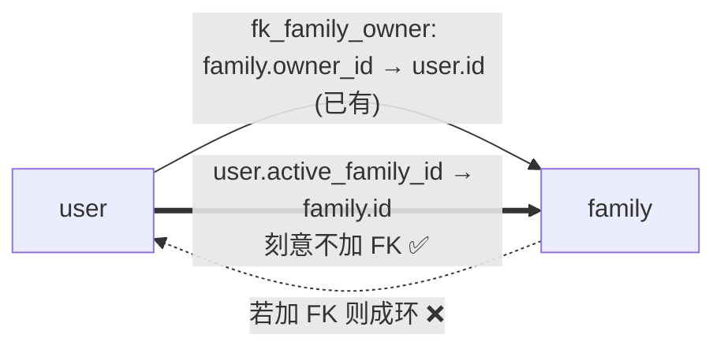
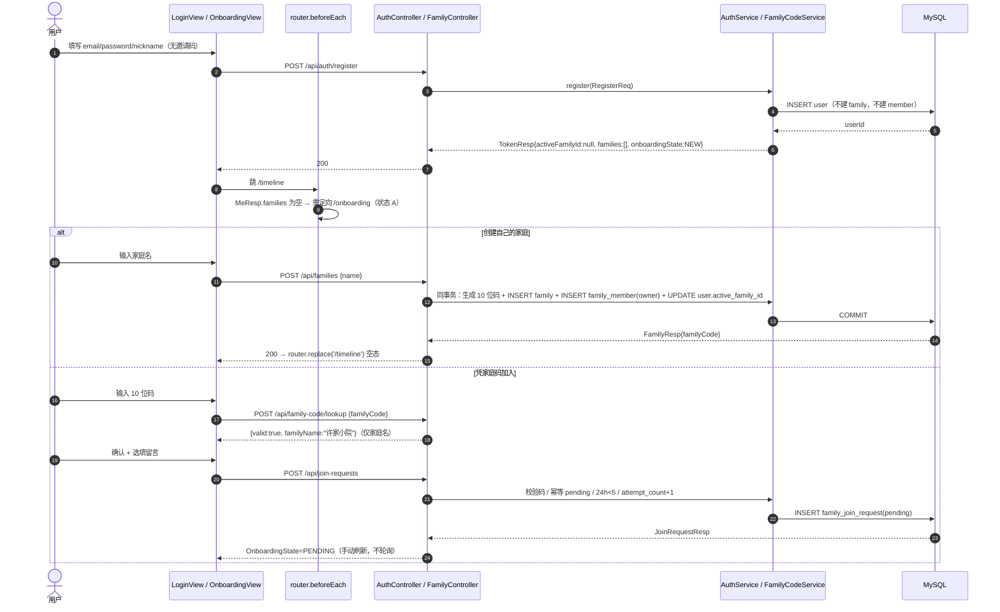
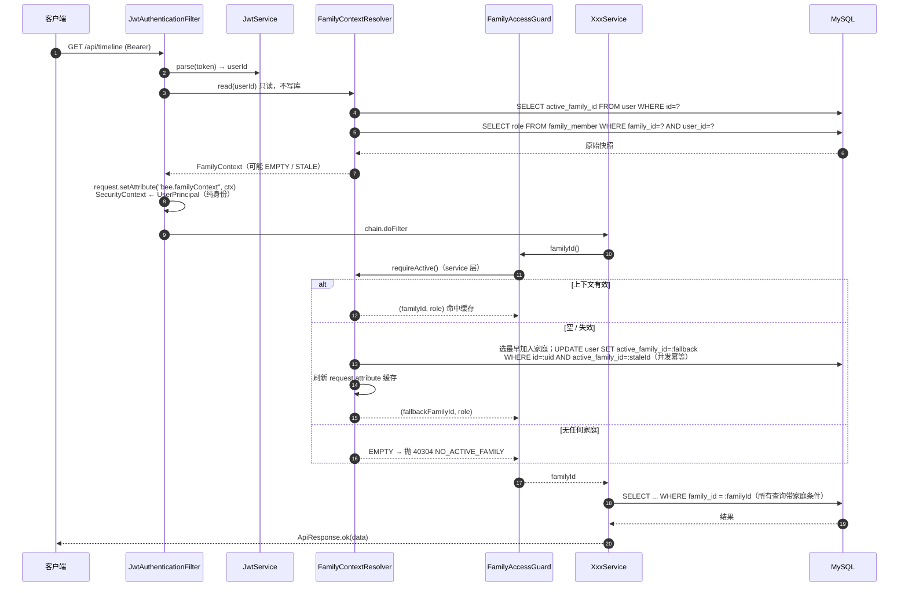
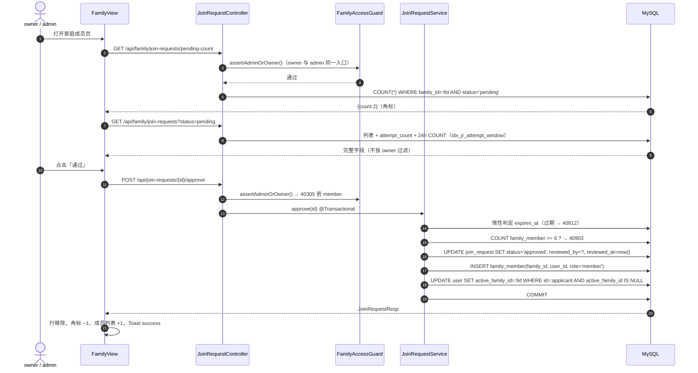
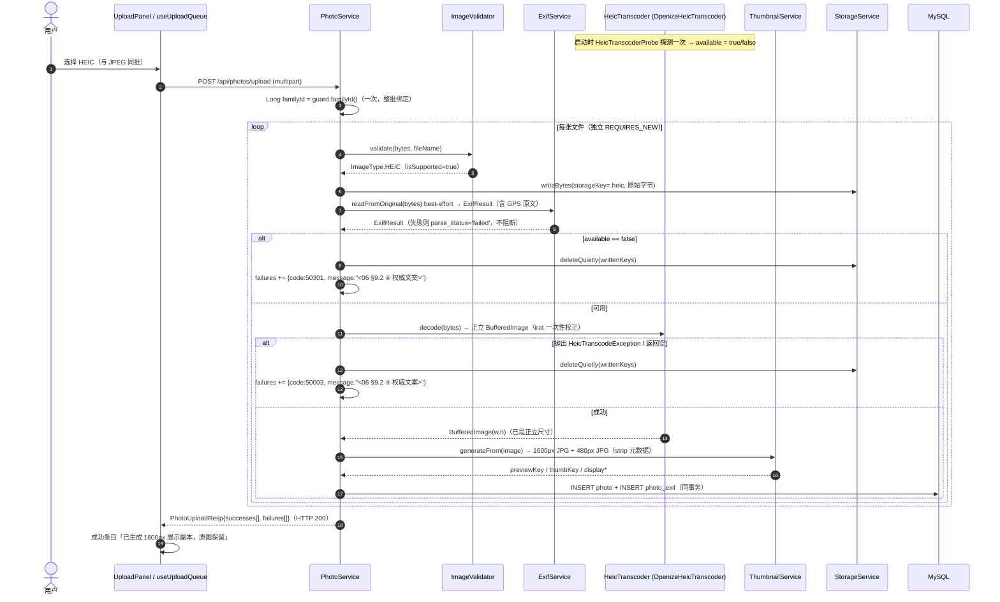
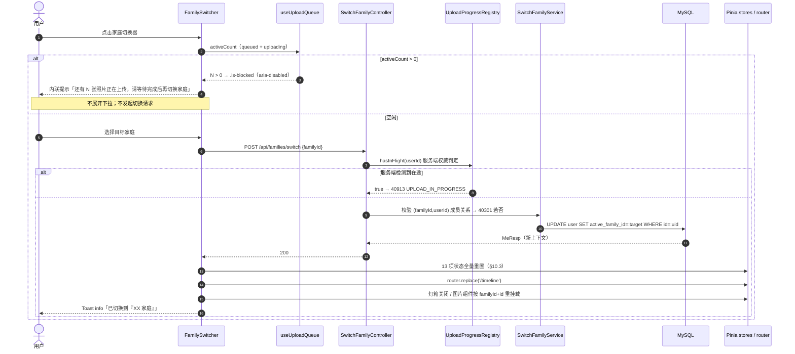
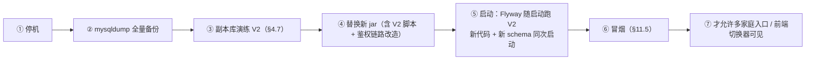
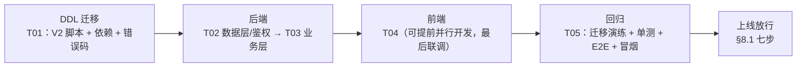
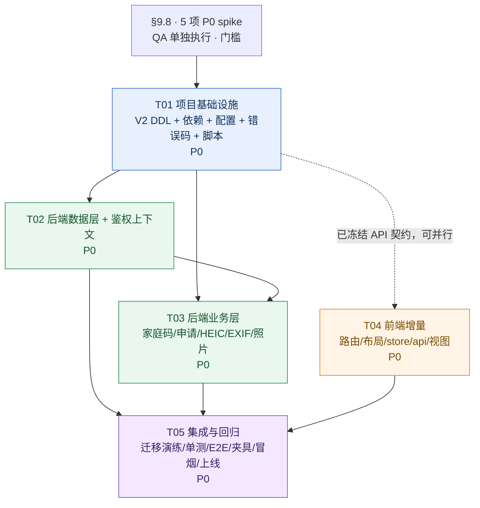

# 07 · 蜜记 Bee Family 增量架构变更设计（v1.1 变更集）

| 项 | 内容 |
| --- | --- |
| 文档编号 | `docs/07-architecture-incremental.md` |
| 版本 | v1.1（相对 `docs/03-architecture.md` v1.0 的增量变更集） |
| 上游依据 | `docs/01-prd.md`、`docs/03-architecture.md`、`docs/04-test-report.md`、`docs/05-prd-incremental.md`、`docs/06-ui-incremental.md` |
| 唯一任务来源 | `team-lead` 正式下发的任务书（4 条）与用户 9+4 项拍板结论 |
| 状态 | **定稿**。全部拍板项按「已确认」落地；**未决事项 0 项**；全篇无未决状态标记 |
| 语言 / 体裁 | 简体中文；表格 + Mermaid + SQL/JSON 代码块；不写 Java / Vue 业务实现代码 |
| 代码与数据纪律 | 不改既有文档、不改代码、不动 `bee_family` 演示库；DDL 演练只用独立副本库 `bee_family_v2_probe` |
| 演练结论 | **已实测**：V2 DDL 在 MySQL 8.4.7 独立副本库执行通过，行为与无 FK 环恢复均验证通过（§4.7） |
| 环境基线 | macOS / JDK 17（`export JAVA_HOME=/Library/Java/JavaVirtualMachines/jdk-17.jdk/Contents/Home`）/ Maven 3.9.9 / MySQL 8.4.7 / Node v22.22.2 npm 10.9.7 |

> **与 `03` 文档的关系**：本文是**覆盖式增量**，不复制 `03` 全文。`03` 中未被本文 §3「ADR 修订」与 §11「共享约定修订」点名的条款**继续有效**；被点名的条款以本文为准。工程师实现时须**同时**持有 `03` 与本文。
>
> **不采信清单**：PM 直接 DM 的 ADR 修订 / 实体字段 / 错误码建议一律不作为设计输入；跨成员信息只经 `team-lead` 中转。`05` PRD 中被用户拍板覆盖的条款（Q1 过渡期、Q2 系统命令 / macOS、Q3 默认关闭 GPS、Q5 唯一 owner、Q7 保留 1 版本、§9.4 副本剥离 GPS 的隐私前提）以本文 §2 基线为准。

---

## 目录

| 章 | 标题 |
| --- | --- |
| 1 | 实现思路与技术难点 |
| 2 | 拍板结论基线与文档边界 |
| 3 | ADR 修订说明（相对 `03`） |
| 4 | 数据模型与 V2 DDL |
| 5 | API 契约增量 |
| 6 | 权限矩阵与越权校验 |
| 7 | 关键流程时序图 |
| 8 | 安全设计增量（鉴权链路 / 三处已知风险 / 切换阻断） |
| 9 | HEIC / EXIF 技术选型 |
| 10 | 前端架构增量 |
| 11 | 任务分解、上线顺序、数据迁移与回滚 |
| 12 | 风险登记、回归基线变更与自检清单 |
| 附录 A | 可执行 V2 DDL 全文 |
| 附录 B | 错误码全表（35 项） |
| 附录 C | 类图（Mermaid `classDiagram`） |

---

## 1. 实现思路与技术难点

### 1.1 本次变更的性质

| 维度 | v1.0（`03`） | v1.1（本文） |
| --- | --- | --- |
| 用户 ↔ 家庭 | 1 : 1，DB 层 `uk_member_user(user_id)` 强制 | 1 : N，`user.active_family_id` 指定当次上下文 |
| 家庭码 | 8 位邀请码、24h TTL、持码即加入 | 10 位家庭码、永久、凭码申请 + 管理员审批 |
| 角色 | `owner` / `member` | `owner` / `admin` / `member`，多管理员、owner 不可转让 |
| HEIC | 拒绝（`41501`） | 支持：原图保留 + 1600px JPG 展示副本 + 480px 缩略 |
| EXIF | 只读拍摄时间 | 19 字段入库 + 灯箱展示 + 精确 GPS 原文 |
| 导航 | ≥1024 左侧 SideNav | ≥768 顶部导航 / <768 底部 TabBar（互斥） |
| 无家庭态 | 不存在 | `/onboarding` 三态引导页 |

### 1.2 核心技术难点与选型

| # | 难点 | 结论 | 落地位置 |
| --- | --- | --- | --- |
| D-1 | 多家庭后 `findByUserId` 返回多行 → `IncorrectResultSizeDataAccessException` → 全站 500 | 删除该查询；改为「读 `user.active_family_id` → 校验 `(family_id,user_id)` 成员关系 → 取 `role`」 | §8.1 `FamilyContextResolver` |
| D-2 | `user.active_family_id` ↔ `family.owner_id` 构成 FK 环 | **不加 FK**，应用层同事务维护；与 `03` §4.3 `cover_photo_id` 同型 | §4.4 |
| D-3 | 移除成员时 `setTokenValidAfter(now())` 会让该用户在其它家庭一并登出 | `token_valid_after` 收敛为**仅登出 / 改密码**触发；移除成员只重指 / 清空 `active_family_id` | §8.4 R-10 |
| D-4 | HEIC 纯 Java 解码依赖不可从 Maven Central 获取 | 备选 A：源码自建 + 锁 commit + vendor 到 `backend/lib/`；`<exclusions>` 排除其 `metadata-extractor` | §9.2 |
| D-5 | HEIC `irot` 容器旋转与 Exif `Orientation` 可能双重校正 | 旋转唯一责任方 = `HeicTranscoder#decode()`，输出即正立 `BufferedImage` | §9.6 |
| D-6 | V2 删除 `uk_member_user` 会因 FK 失去支撑索引报 `ERROR 1553` | 先补 `idx_member_user_joined(user_id, joined_at, id)` 再 DROP | §4.6 / 附录 A |
| D-7 | 旧代码 + 新 schema 中间态必然 500 | 停机 → 备份 → 换 jar → 启动（Flyway 随启动跑 V2），新代码与新 schema 同次启动 | §11.3 |
| D-8 | 切换家庭瞬间旧请求 / 旧 DOM 写入新上下文 | 13 项状态全量重置 + 请求家庭标记丢弃 + 图片组件强制重挂载 | §10.3 / §8.5 |
| D-9 | 24h 申请计数需对 owner 与 admin 一致可查 | `idx_jr_attempt_window(family_id, applicant_user_id, created_at)` 覆盖索引 | §4.5 / §6.4 |

### 1.3 框架与库选择（沿用，不新增架构层）

| 层 | 选型 | 是否变化 | 理由 |
| --- | --- | --- | --- |
| 后端 | Spring Boot 3.3.5 + Java 17 + Maven | 不变 | 单机单体，无微服务必要 |
| 持久层 | Spring Data JPA + Flyway，`ddl-auto: validate` | 不变 | 表结构唯一权威是 Flyway；`validate` 让实体漂移启动即暴露 |
| 安全 | Spring Security 6 + jjwt 0.12.6 | 不变 | 无状态 JWT，仅扩展解析链路 |
| 缩略图 | Thumbnailator 0.4.20 | 不变 | 纯 Java，从 `BufferedImage` 出发生成派生图 |
| EXIF | metadata-extractor 2.19.0 | 不变 | `HeifPictureHandler` 已能把 HEIC 内嵌 Exif 委派 `ExifReader`，无需新增 EXIF 依赖 |
| HEIC 解码 | **新增** vendored Openize.HEIC for Java 26.5.1 | 新增 | 纯 Java、无 native HEIF/JNI，见 §9 |
| 前端 | Vite + Vue 3.5 `<script setup>` + TS + vue-router 4 + Pinia + axios + ECharts 按需 | 不变 | 不引入 UI 组件库 |

架构模式沿用 `03` §3.2 的分层 MVC（controller → service → repository），事务边界在 service 层，查询 `@Transactional(readOnly = true)`，DTO 全量用 Java `record`。本次新增的 `FamilyContextResolver` / `HeicTranscoder` 均落在 service / support 层，不引入新分层。

---

## 2. 拍板结论基线与文档边界

### 2.1 用户 9 项拍板（Q1–Q9，最终结论）

| # | 结论 | 架构落点 |
| --- | --- | --- |
| Q1 | 单一 10 位家庭码；去混淆字符集、永久有效、全局唯一、可重置；创建家庭后台生成；创建者默认管理员（owner）；注册不再需要邀请码 | §4.3 / §5.2 |
| Q7 | **立即移除旧邀请码**：本次上线即删旧列与旧参数，无过渡期、无兼容代码、无弃用别名。此条覆盖 Q1 推荐文字里的过渡期措辞 | §4.6 / §5.2 / 附录 B |
| Q2 | HEIC 走**纯 Java 库**，目标部署机不再假定 macOS；必须论证无 native HEIF/JNI、启动能力探测、明确降级、绝不黑图 / 静默成功 | §9 |
| Q3 | EXIF 展示**精确十进制度经纬度原文**，不接外部地理编码，不提供用户开关，所有可见该照片的家庭成员均可见 | §9.7 |
| Q4 | ≥768 顶部导航，<768 保留底部 TabBar，两套按断点互斥 | §10.2 |
| Q5 | 多管理员、不转让；仅 owner 可指定 / 撤销 admin、重置家庭码、删除家庭；任一 admin（含 owner）可审批 / 拒绝申请；owner 不可撤销、不可转让 | §6.1 |
| Q6 | 被拒后可再申请；同一用户对同一家庭 24h 上限 5 次；owner（及 admin，见 C-3）可见历史申请次数 | §5.3.3 / §6.4 |
| Q8 | 服务端 `user.active_family_id` 持有当前家庭，不进 token、不用自定义 Header；每请求读激活家庭 → 校验成员 → 取 role | §8.1 |
| Q9 | 提交申请仅回显家庭名，不回显成员 / 照片 / 统计；待审核只手动刷新不轮询；无家庭允许账号设置与登出，不允许主界面；等待态保留「再申请其他家庭」「创建自己的家庭」两个出口 | §5.3 / §10.2 |

### 2.2 补充拍板结论（4 项，全部「已确认」）

| # | 结论 | 影响 |
| --- | --- | --- |
| C-1 | **GIF 本期不纳入上传白名单**。白名单 = `JPEG / PNG / WebP / HEIC`；后端 `ImageValidator`、前端 `accept`、错误文案统一排除 GIF；**不留可配置开关、不留「后续开启」隐式入口** | `41501` 默认文案固定为「不支持的图片格式（支持 JPG / PNG / WebP / HEIC）」；`Limits.ALLOWED_EXTENSIONS` / `BLOCKED_EXTENSIONS` / `validate.ts` 同步 |
| C-2 | **HEIC 展示副本默认长边 1600px 接受**，原 HEIC 完整保留。DDL 与接口区分 original 与 display 两副本（路径 / 尺寸 / 格式字段）；浏览器展示与默认下载走 1600px 副本、原 HEIC 可单独取得；**EXIF 从原 HEIC 读取，不从展示副本读取** | §4.5 `photo.display_*`、§9.4、§5.3 |
| C-3 | **待审角标与「第 N 次申请 / 24h 计数」对 owner + admin 均可见**。接口返回体不按 owner 过滤这些字段；查看申请列表 / 次数**不得判定为 owner-only 并据此返回 403** | §6.1 / §6.4 / §5.3.3 |
| C-4 | 顶栏全宽（仅 UI 布局取舍，对后端与路由约束无影响） | §10.2 不改 |

### 2.3 已否决方案（一笔带过，不作为可选路径）

| 方案 | 否决依据 |
| --- | --- |
| macOS `sips` / `heif-convert` / `magick` / `ffmpeg` / `exiftool` 系统命令链 | Q2 明确否决；目标机不再假定 macOS；不得作为主路线、推荐项或补充选项 |
| JNI / JNA + `libheif`（备选 C） | 违反 Q2「纯 Java、无 native HEIF/JNI」；需用户重新拍板才可启用 |
| 前端 WASM 解码 HEIC（备选 D） | 违反 Q2 服务端转码 + 原图保留的服务端存储模型 |
| Aspose 仓 `com.aspose:openize-heic:25.9` 进最终 `pom.xml` | 仅作 spike 对照，不进最终依赖树（§9.2） |

### 2.4 已核定事实修正（非未决项）

| 项 | `05` / `03` 表述 | 实测 / 核定事实 | 处置 |
| --- | --- | --- | --- |
| 家庭码字符集 | `05` §5.1 写「32 字符」「32¹⁰ ≈ 1.13×10¹⁵」 | 现有 `InviteCodes.ALPHABET = "ABCDEFGHJKMNPQRSTUVWXYZ23456789"` 实测 **31 字符**，组合空间 **31¹⁰ ≈ 8.20×10¹⁴** | 实现沿用 31 字符集（`RAND()*31` / `SecureRandom.nextInt(31)`）；数量级仍远大于枚举可行域，不影响 §5.1 的「不暴露存在性 + 审批硬边界」结论 |
| `40902` 语义改名 | `05` §1.4 建议「语义改名、编号保留」 | `team-lead` 终裁：`40902` 随旧邀请码**废弃、永久不再分配** | 见附录 B；本文不记录任何「唯一一次例外」授权，`03` §11.5 规则零破坏 |
| R-6 根因 | `05` §10.5 R-6 归因「`?token=` 浏览器缓存导致旧家庭缩略图闪现」 | URL 首段含 `familyId`，A/B 家 URL 不同，HTTP 缓存按 URL 隔离，**不会跨家庭命中**；真实根因是前端内存态 / DOM 未重置 | §8.5 给出修正后的诊断与措施 |

### 2.5 未决事项

**0 项。** 9 项 Q + 4 项补充结论 + 错误码终裁 + 纯 Java 依赖选型 + `irot` 责任方均已拍板。唯一**实现前置依赖**是 §9.8 的 5 项 P0 spike（由 `team-lead` 另行派单、QA 单独执行），属「门槛」而非待拍板问题；spike 未通过不得进入实现阶段，需回来重评。

---

## 3. ADR 修订说明（相对 `docs/03-architecture.md`）

| ADR | v1.0 结论 | v1.1 处置 | 修订理由 |
| --- | --- | --- | --- |
| **ADR-01** HEIC 不支持 | 前端 + 服务端拒绝，`41501` + 「兼容性最佳」指引 | **作废**，由 **ADR-01R** 取代 | Q2 拍板纯 Java 库转码；「兼容性最佳」全站下线 |
| **ADR-02** JWT 不携带 familyId，每请求解析 | 按 `user_id` 唯一索引查 `family_member` 一行 | **修订为 ADR-02R**，两条原则保留，解析链路重写 | 多家庭后 `findByUserId` 返回多行导致全站 500（D-1） |
| ADR-03 Bearer + localStorage | — | **保留**，不动 | 内网自用取舍不变；新增「前端不得按 code 做本地文案映射」（§11.2） |
| **ADR-04** 图片访问双凭证 | `?token=` 仅 `/api/files/**` | **修订为 ADR-04R**：`guard.familyId()` 恒取服务端激活家庭 | 切换家庭后 A 家旧 `` URL 必须被 `40301` 拦截（§8.3） |
| ADR-05 时间轴 SQL 层 UNION ALL | — | **保留**，不动 | 排序键 `type_ord` 不变；只把 `:familyId` 来源改为激活家庭 |
| ADR-06 BigDecimal 序列化为 JSON 数字 | — | **保留**，不动 | `gps_altitude` 等 `DECIMAL` 同样输出数字 |
| **ADR-07**（新增）当前家庭存服务端 | — | `user.active_family_id`；不进 token、不用 Header | Q8 |
| **ADR-08**（新增）家庭码是标识不是密钥 | — | 安全边界 = 审批 + 限流 + 不暴露存在性 | Q1 / `05` §5.4 |
| **ADR-09**（新增）GPS 精确展示无开关 | — | 派生文件剥离元数据是重编码副作用，非隐私开关；DB 原文为展示唯一数据源 | Q3，与 PM 原建议的冲突裁定见 §9.7 |
| **ADR-10**（新增）每张照片只属一个家庭 | — | `photo.family_id NOT NULL` + FK，无跨家庭移动 / 复制接口；切换不影响既有归属 | `05` §6.2 |

### 3.1 ADR-01R · HEIC 支持（纯 Java 转码，三档文件）

| 项 | 内容 |
| --- | --- |
| 决策 | 原 HEIC 字节原样保留；服务端用纯 Java 库解码为**正立 `BufferedImage`**；由此生成 1600px JPG 展示副本与 480px JPG 缩略图；**仍为三档文件，不新增第四档** |
| 能力探测 | 启动时探测一次；不可用 → `available=false`，服务正常启动，其它格式不受影响（§9.5） |
| 降级 | 能力不可用 → `50301`；单张转码失败 → `50003`；两者都进 `failures[]`，逐张独立成败，不落库、不写盘、不黑图、不静默成功 |
| 旋转 | 唯一责任方 `HeicTranscoder#decode()`（§9.6） |
| 后果 | `ImageValidator` 删除 HEIC 拒绝分支；`ImageType.HEIC.isSupported()` 改为 `true`；`Limits.HEIC_HINT` 删除；`41501` 默认文案改「支持 JPG / PNG / WebP / HEIC」 |

### 3.2 ADR-02R · 每请求解析链路（保留两原则）

| 项 | 内容 |
| --- | --- |
| 保留 | ① `familyId` / `role` 不进 JWT；② 权限变更即时生效（每请求查库） |
| 修订 | 解析源从「`family_member` 按 `user_id` 唯一查一行」改为「`user.active_family_id` → 校验 `(active_family_id, user_id)` 成员关系 → 取该家庭内 `role`」 |
| 权威上下文 | `FamilyContext`（`familyId`, `role`）由 service 层 `FamilyContextResolver` 产出，**每请求一次缓存在 request attribute**；`UserPrincipal` 退化为纯身份载体 |
| 禁止 | Servlet Filter 内不写库；失效自动回退的 `UPDATE` 只在 service 层 `requireActive()` 内执行，且用条件 `WHERE active_family_id = :staleId` 保证并发幂等 |
| 成本 | 每请求 2 次主键 / 唯一索引 SELECT（user 1 次 + family_member 1 次），仍 < 0.5ms |

### 3.3 ADR-04R · 切换家庭后的文件归属

| 项 | 内容 |
| --- | --- |
| 保留 | `?token=` 仅用于 `/api/files/**`；token 不在 URL 中携带家庭信息 |
| 修订 | `FileController` 的 `guard.familyId()` 必须恒取**服务端当前激活家庭**；A 家旧 `` URL 在 B 家上下文被 `40301` 拦截 |
| 前端配套 | 切换时关闭灯箱、清空图片 store、以 `familyId + photoId` 作 `:key` 强制重挂载图片组件（§8.5） |
| 不做 | 不给 URL 追加家庭参数（会破坏 30 天 `immutable` 缓存），不新造签名 URL |

---

## 4. 数据模型与 V2 DDL

### 4.1 表清单变化（10 → 12）

| # | 表 | v1.0 | v1.1 | 说明 |
| --- | --- | --- | --- | --- |
| 1 | `user` | ✅ | 改 | +`active_family_id BIGINT NULL`（无 FK） |
| 2 | `family` | ✅ | 改 | +`family_code CHAR(10) NOT NULL UNIQUE`；−`invite_code`、−`invite_code_expires_at`、−`uk_family_invite_code` |
| 3 | `family_member` | ✅ | 改 | −`uk_member_user`；+`idx_member_user_joined`；`role` 扩展为 3 值；+`owner_flag` 生成列 + 单 owner 唯一键 |
| 4 | `baby` | ✅ | 不变 | — |
| 5 | `growth_record` | ✅ | 不变 | — |
| 6 | `milestone` | ✅ | 不变 | — |
| 7 | `album` | ✅ | 不变 | — |
| 8 | `photo` | ✅ | 改 | +`source_format`、+`display_key`、+`display_mime_type`、+`display_width/height/file_size`；`mime_type` 注释扩展；**`family_id` 零改动** |
| 9 | `tag` | ✅ | 不变 | — |
| 10 | `photo_tag` | ✅ | 不变 | — |
| 11 | `family_join_request` | — | **新增** | 申请状态机 + 24h 计数 |
| 12 | `photo_exif` | — | **新增** | EXIF 19 字段 + GPS 原文 |

### 4.2 文件清单（本次涉及的所有相对路径）

> 按层分组；「新」= 需创建，「改」= 需修改，「删」= 需删除。完整清单见 §11.1 任务详情。

| 层 | 文件 | 动作 |
| --- | --- | --- |
| 迁移 | `backend/src/main/resources/db/migration/V2__multi_family_heic_exif.sql` | 新 |
| 依赖 | `backend/pom.xml`、`backend/lib/openize-heic-26.5.1.jar`、`backend/lib/licenses/{Openize,IsoBmff-MIT,MetadataExtractor-Apache-2.0}.txt` | 改 / 新 |
| 配置 | `backend/src/main/resources/application.yml`（仅 `app.heic.*` 探测开关，无敏感值）、`backend/README.md`（合规声明） | 改 |
| 实体 | `domain/User.java`、`domain/Family.java`、`domain/FamilyMember.java`、`domain/Photo.java`、`domain/FamilyJoinRequest.java`、`domain/PhotoExif.java`、`domain/enums/Role.java` | 改×6 / 新×2 |
| 仓储 | `repository/UserRepository.java`、`FamilyRepository.java`、`FamilyMemberRepository.java`、`FamilyJoinRequestRepository.java`、`PhotoExifRepository.java` | 改×3 / 新×2 |
| DTO | `dto/auth/{RegisterReq,TokenResp,MeResp}.java`、`dto/family/{FamilyResp,InviteCodeResp→FamilyCodeResp,FamilyBriefResp,MemberResp}.java`、`dto/join/*.java`、`dto/photo/{PhotoResp,PhotoDetailResp,ExifResp}.java`、`dto/heic/*.java` | 改 / 新 / 删 |
| 公共 | `common/ErrorCode.java`（35 项）、`common/GlobalExceptionHandler.java`（429/503 映射） | 改 |
| 安全 | `security/{FamilyContextResolver,FamilyContext,JwtAuthenticationFilter,UserPrincipal,FamilyAccessGuard,SecurityUtils}.java`、`config/SecurityConfig.java` | 新×2 / 改×5 |
| 服务 | `service/{AuthService,FamilyService,JoinRequestService,FamilyCodeService,SwitchFamilyService,ExifService,PhotoService,PhotoIngestService,ThumbnailService,FileController-support}.java` | 改 / 新 |
| HEIC | `support/heic/{HeicTranscoder,HeicDecodeResult,HeicTranscodeException,OpenizeHeicTranscoder,HeicTranscoderProbe,HeicProperties}.java` | 新×6 |
| 工具 | `support/{Limits,ImageType,ImageValidator,InviteCodes→FamilyCodes}.java`、`controller/FileController.java`、`controller/PhotoController.java` | 改 / 删 |
| 前端路由 | `frontend/src/router/index.ts` | 改 |
| 前端布局 | `layouts/{AppShell,TopNav,TopBar,TabBar,SideNav}.vue` | 改 / 新 / 停用 |
| 前端 store | `stores/{auth,family,switch,upload-progress}.ts`、`stores/index.ts` | 改 / 新 |
| 前端 api | `api/{auth,family,joinRequest,switch,photo,http}.ts` | 改 / 新 |
| 前端视图 | `views/{OnboardingView,FamilyView,SettingsView,LoginView,Lightbox}.vue` | 新 / 改 |
| 前端工具 | `utils/{validate,fileUrl,format}.ts`、`types/{models,api,upload}.ts`、`composables/useUploadQueue.ts` | 改 |
| 测试 | `backend/src/test/**`、`docs/e2e-verify.mjs`、`docs/api-smoke.sh`、`scripts/{backup,rollback}.sh`、`docs/qa/heic-fixtures/**` | 改 / 新 |

### 4.3 字段语义总表

| 表.字段 | 类型 | 语义 | 约束 / 索引 |
| --- | --- | --- | --- |
| `family.family_code` | `CHAR(10) NOT NULL` | 10 位去混淆家庭码，全局唯一、永久、可重置 | `uk_family_code` UNIQUE；应用层 `SecureRandom` + 冲突重试 ≤5 |
| `family_member.role` | `VARCHAR(10)` | `owner` / `admin` / `member`（家庭内角色，非全局） | `ck_member_role` CHECK |
| `family_member.owner_flag` | `TINYINT` 生成列 | `role='owner'` → 1，其余 → NULL | `uk_member_single_owner(family_id, owner_flag)` 保证每家庭至多 1 owner（MySQL 唯一键允许多个 NULL） |
| `user.active_family_id` | `BIGINT NULL` | 服务端权威当前家庭；`NULL` = 无可用家庭 | `idx_user_active_family`；**无 FK**（§4.4）；应用层维护 |
| `family_join_request.status` | `VARCHAR(12)` | `pending/approved/rejected/withdrawn/expired` | `ck_jr_status` |
| `family_join_request.pending_flag` | `TINYINT` 生成列 | `status='pending'` → 1，终态 → NULL | `uk_jr_one_pending(family_id, applicant_user_id, pending_flag)` 保证同时最多 1 条 pending，终态历史可无限累加 |
| `family_join_request.attempt_count` | `INT NOT NULL DEFAULT 1` | 该用户对该家庭**累计**第几次申请（展示「第 N 次申请」） | `ck_jr_attempt(>=1)`；写入时 `COUNT(*)+1` |
| `family_join_request.family_code_snapshot` | `CHAR(10) NOT NULL` | 提交时使用的码，仅审计追溯 | **不参与校验**；重置码不影响历史 |
| `family_join_request.expires_at` | `DATETIME NOT NULL` | `created_at + 7 天`，仅 `pending` 有意义 | 惰性判定：任何读取时判断是否过期并落库 |
| `photo.source_format` | `VARCHAR(10) NOT NULL` | 原始文件真实格式 `jpeg/png/webp/heic` | `ck_photo_source_format` |
| `photo.display_key` | `VARCHAR(255) NULL` | 1600px JPG 展示副本相对 key；**仅 HEIC 有值** | 与 `preview_key` 指向同一物理文件（§4.5） |
| `photo.display_mime_type` / `display_width` / `display_height` / `display_file_size` | 可空 | 展示副本格式与尺寸 | HEIC 时 `display_mime_type='image/jpeg'` |
| `photo.latitude` / `longitude` | `DECIMAL(9,6) NULL` | GPS **数值**（派生自原文，供 P1 地图） | 不参与 UI 展示 |
| `photo_exif.gps_latitude_raw` / `gps_longitude_raw` | `VARCHAR(32) NULL` | 十进制度**原文**，不四舍五入、不补零、不换算度分秒 | **UI 展示唯一数据源** |
| `photo_exif.parse_status` | `VARCHAR(12)` | `ok/absent/stripped/failed` | 驱动 §9.9 三种缺失文案 |
| `photo_exif.orientation` | `SMALLINT NULL` | 仅审计 | **不参与旋转计算**（§9.6） |

### 4.4 【已知风险 2】`active_family_id` ↔ `owner_id` FK 环



| 项 | 结论 |
| --- | --- |
| 环的成因 | `family.owner_id` 已 FK → `user.id`；若 `user.active_family_id` 再 FK → `family.id`，`mysqldump` 恢复需关闭 `FOREIGN_KEY_CHECKS`，且删家庭 / 删用户互相阻塞 |
| 决策 | **不加 FK**，只加普通索引 `idx_user_active_family`；一致性由应用层**同事务**维护，与 `03` §4.3 `cover_photo_id` 完全同型 |
| 强制不变量 | ① `active_family_id` 必须指向该用户**仍是成员**的家庭；② 删家庭时同事务把受影响用户的 `active_family_id` 重指到其最早加入的其余家庭，无则置 `NULL`；③ 移除成员时若命中当前家庭则重指 / 清空；④ 删用户走 FK 级联，无需额外处理 |
| 失效回退 | `FamilyContextResolver.requireActive()`：成员关系缺失时按 `joined_at ASC, id ASC` 选回退家庭，用 `UPDATE user SET active_family_id=:fallback WHERE id=:uid AND active_family_id=:staleId` 条件更新，并发幂等 |
| 实测 | `mysqldump --single-transaction` 全量恢复到独立库 `bee_family_v2_restore`，`FOREIGN_KEY_CHECKS` 保持 ON 即成功（§4.7） |

### 4.5 【C-2】original 与 display 两副本的字段区分

| 档 | 物理文件 | key 列 | 格式列 | 尺寸 / 体积列 | 用途 |
| --- | --- | --- | --- | --- | --- |
| 原图 original | `{uuid}.heic` | `storage_key` | `mime_type='image/heic'`、`source_format='heic'` | `file_size`、`width`、`height` | 「下载原始文件（HEIC）」；EXIF 唯一读取源 |
| 展示副本 display | `{uuid}_preview.jpg` | `preview_key`，HEIC 时另有 `display_key`（同值语义句柄） | `display_mime_type='image/jpeg'` | `display_file_size`、`display_width`、`display_height` | 灯箱展示 + **默认下载**（1600px JPG） |
| 缩略 thumb | `{uuid}_thumb.jpg` | `thumb_key` | — | — | 网格 / 时间轴 / 封面（480px） |

| 约束 | 内容 |
| --- | --- |
| 三档不变 | `display_key` 与 `preview_key` 在 HEIC 下指向**同一物理文件**，由 service 在同一次写入中赋同值；**不产生第四档文件** |
| 非 HEIC | `display_key` / `display_*` 全为 `NULL`；`preview_key` 仍是同格式 1600px 派生图；默认下载走 `storage_key`（「下载原图」） |
| 前端判定 | `displayKey !== null` 即 HEIC；据此渲染「下载照片（JPG）」+「下载原始文件（HEIC）」双按钮（`06` §8.6） |
| 派生文件元数据 | 由 `BufferedImage` 重编码天然 strip 全部元数据（含 GPS），无需额外剥离代码；见 §9.7 |

### 4.6 【Q7】`DROP COLUMN` 安全步骤

| 序 | 步骤 | 前置确认 | 失败后果 |
| --- | --- | --- | --- |
| 1 | 只读检查：`information_schema.KEY_COLUMN_USAGE` 查 `REFERENCED_COLUMN_NAME IN ('invite_code')` | 必须返回 **0 行** | 有隐藏 FK 引用 → 中止 |
| 2 | 只读检查：`information_schema.TRIGGERS` / `VIEWS` / `COLUMNS.GENERATION_EXPRESSION` | 必须 **0 处依赖** | 有触发器 / 视图 / 生成列 → 先删依赖 |
| 3 | 只读检查：每家庭恰好 1 个 owner | 返回 0 行异常家庭才继续 | 否则 `uk_member_single_owner` 会失败 |
| 4 | **先删索引** `ALTER TABLE family DROP INDEX uk_family_invite_code` | 索引存在 | 直接 `DROP COLUMN` 会报依赖错误 |
| 5 | 再删两列 `DROP COLUMN invite_code, DROP COLUMN invite_code_expires_at` | 无历史数据依赖（旧码一律作废，无兼容需求） | — |
| 6 | 代码侧同步删：`RegisterReq.inviteCode`、`InviteCodeResp`、`InviteCodes` 的 8 位 / TTL 常量、`FamilyRepository.findByInviteCode/existsByInviteCode`、`FamilyMapper.toInviteCodeResp`、`GET/POST /api/family/invite-code*`、前端 `INVITE_CODE_PATTERN` / `validateInviteCode` | Q7：无别名、无弃用接口、无双份测试基线 | 残留即视为未完成 |
| 7 | 错误码 `40902 INVITE_CODE_INVALID` 从 `ErrorCode` 枚举删除，**永久不再分配** | 编号不复用 | 见附录 B |

> **MySQL DDL 隐式提交**：单条语句失败不会回滚已成功语句。上线前必须 `mysqldump` 全量备份，且先在副本库演练（§4.7）。因此 V2 脚本内按「新增 → 回填 → 收紧 → 删列 → 建表」顺序排布，任意一步失败可凭备份整体重来，不做脚本内事务伪保证。

### 4.7 副本库演练记录（**已实测**）

| 项 | 结果 |
| --- | --- |
| 库名 | `bee_family_v2_probe`（独立创建；`bee_family` 演示库**全程只读，未触碰**，实测 `user=1`、无 `join` / `exif` 表） |
| 基线数据 | `user=1 / family=1 / family_member=1 / album=3 / baby=1 / photo=56`，与 `05` §10.1 一致 |
| V1 应用 | `mysql bee_family_v2_probe < backend/src/main/resources/db/migration/V1__init.sql` → 10 表创建成功 |
| V2 执行 | `mysql bee_family_v2_probe < V2__multi_family_heic_exif.sql` → **EXIT=0**，仅 3 条 `TINYINT` display-width 弃用告警（Code 1681，无害） |
| B-1 回填 | `family_code` 1 行非空且长度 10；`user.active_family_id=1`；`photo=56 / source_format='jpeg' 56 / family_id=1 全部 56`；`join_request=0`、`photo_exif=0` |
| B-2 多家庭 | 同一 `user_id` 可存在 2 条 `family_member`（`1→2 家`、`2→2 家`），不再报唯一冲突 |
| B-3 单 owner | 第 2 个 `owner` 插入被 `uk_member_single_owner` 拒绝（`ERROR 1062 '1-1'`） |
| B-4/B-5 pending 唯一 | `pending_flag` 生成列正确；第 2 条 pending 被 `uk_jr_one_pending` 拒绝（`ERROR 1062 '1-2-1'`），终态记录可累加 |
| B-6 24h 计数 | `idx_jr_attempt_window` 经 `FORCE INDEX` 验证为 `type=range` + `Using index`（覆盖索引）；用户 3 的 5 条申请中 30h 前的 1 条被正确排除，计数 = 4 |
| B-7 撤回再申请 | `status='withdrawn'` → `pending_flag=NULL`，新 pending `attempt_count=2` 可插入 |
| B-8 重置码 | 旧码在 `family` 表中消失，`family_id=1` 的既有 pending 仍存在，`family_code_snapshot` 不变 |
| B-9/B-12 EXIF | `photo_exif` 1:1 写入成功；`DELETE photo` 级联删除 `photo_exif` 成功 |
| B-10 归属 | `photo.family_id` 仍 `NOT NULL BIGINT`（V2 零改动） |
| B-11 CHECK | 非法 `status` / `parse_status` / `source_format='gif'` / `role='superadmin'` 全部被 `ERROR 3819` 拒绝 |
| B-13 删家庭 | `family_join_request` / `family_member` 级联归零；`user.active_family_id` 可悬空 → **证明必须由应用层重指**（§4.4） |
| 无 FK 环 | `mysqldump --single-transaction --routines --triggers` → `bee_family_v2_restore` 全量恢复成功（**`FOREIGN_KEY_CHECKS` 保持 ON**），12 表齐备 |

> 演练脚本位于 `/tmp/v2_final.sql`、`/tmp/v2_seed.sql`、`/tmp/v2_behavior.sql`、`/tmp/v2_behavior2.sql`（临时文件，不入库、不进项目目录）。

### 4.8 数据迁移与回填（演示库平滑升级）

| 步 | 动作 | 对现有数据影响 | 验收 |
| --- | --- | --- | --- |
| M-1 | `mysqldump --single-transaction --routines --triggers bee_family > backup.sql` | 无 | 备份可恢复（§4.7 已验证无环） |
| M-2 | `family` 加 `family_code NULL` → 回填 10 位码 → `MODIFY NOT NULL` → `ADD UNIQUE` | 1 行 UPDATE | 1 个有效码、长度 10、唯一 |
| M-3 | 删 `uk_family_invite_code` + 两旧列 | 旧码作废（Q7 无兼容） | `SHOW CREATE TABLE family` 无 invite 字样 |
| M-4 | `family_member` 补 `idx_member_user_joined` → 删 `uk_member_user` → 扩展 role CHECK → 加 `owner_flag` 生成列 + 单 owner 唯一键 → owner 角色幂等回填 | 1 行 `role='owner'` 不变 | 「妈妈」仍是 owner；后续可插第 2 条成员关系 |
| M-5 | `user` 加 `active_family_id NULL`（无 FK）→ 回填最早加入家庭 | 1 行 UPDATE = 1 | 登录后落「许家小院」，不进 `/onboarding` |
| M-6 | 建 `family_join_request` / `photo_exif` | 空表，无回填 | 表存在、0 行 |
| M-7 | `photo` 加 `source_format` / `display_*`，回填 `source_format='jpeg'` | **56 行只改新增列**；`family_id` / `storage_key` / `thumb_key` / `preview_key` / `mime_type` 值零改动 | `photo=56 / album=3`；三档文件数不变 |
| M-8 | **不动**：`photo.family_id`、`album/baby/tag/milestone/growth_record.family_id`、磁盘目录 `uploads/{familyId}/{yyyy}/{MM}/`、文件名 | 零改动 | 迁移前后存储目录 `diff` 为空 |
| M-9 | 启动新 jar（Flyway 随启动跑 V2）→ 冒烟 | — | §11.5 |

**迁移后完整性基线**：`user=1 / family=1 / family_member=1 / photo=56 / album=3 / baby=1 / family_code 非空且唯一 / active_family_id=1 / join_request=0 / photo_exif=0`，56 张照片三档路径均可读。历史 56 张照片**不回填 EXIF**（INC-P2-01 本期不做），灯箱按「无 EXIF」文案展示，不报错、不空白。

---

## 5. API 契约增量

### 5.1 通用约定修订

| 项 | v1.0 | v1.1 |
| --- | --- | --- |
| 响应体 | `ApiResponse<T>{code,message,data,traceId}` | **不变** |
| 分页 | `page` 0 基 / `size` 默认 24 | **不变** |
| 时间 / 空值 / BigDecimal | `03` §11.2–11.4 | **不变** |
| 认证 | Bearer；`/api/files/**` 额外 `?token=` | **不变**（ADR-04R 只改归属来源） |
| **文案** | 前端 `types/api.ts` 维护 `ERROR_MESSAGE: Record<number,string>` 本地映射 | **修订**：`40301` 等差异化 message 一律透传，**前端不得按 code 做本地文案映射，一律展示服务端 `message`**；`ERROR_MESSAGE` 仅保留网络层（`-1`）兜底 |
| 上传批量语义 | `POST /api/photos/upload` 恒 HTTP 200，逐张成败在 `successes[] / failures[]` | **不变**；新增 `50003` / `50301` 作为 `failures[].code`（业务码，不是 HTTP 状态） |
| 家庭上下文 | 由 `family_member` 反查 | **全部接口**取 `guard.familyId()` = 服务端激活家庭；禁止按 `userId` 直取资源 |

### 5.2 错误码终裁（完整 35 项见附录 B）

| 处置 | 编号 | 说明 |
| --- | --- | --- |
| **废弃，永久不再分配** | `40902 INVITE_CODE_INVALID` | 随旧邀请码一并删除；编号不复用、不留别名；无「已获授权改语义」记录，`03` §11.5 零破坏 |
| **新编号启用** | `40909 FAMILY_CODE_INVALID` | 该号原为「Q1=并存」预分配但**从未发布**，故可启用；409 组不留空档 |
| 依次不变 | `40910 / 40911 / 40912 / 40913` | — |
| 差异化 message 透传 | `40301 CROSS_FAMILY_ACCESS` | 「无权访问该资源」/「该内容属于其他家庭，请先切换家庭」；改号不改，只改文案；前端一律展示服务端 message |
| 复用 / 扩展 | `40302 OWNER_ONLY`、`40303 NOT_RESOURCE_CREATOR`、`40903 FAMILY_MEMBER_LIMIT`（复用给满 6 人禁止通过申请）、`40906 MEMBER_NOT_REMOVABLE`（扩展 owner 不可撤销 / 降级） | 编号与枚举常量不变 |
| 仅改默认文案 | `41501 UNSUPPORTED_MEDIA_TYPE` → 「不支持的图片格式（支持 JPG / PNG / WebP / HEIC）」 | 无「确认支持才追加」条件分支、无 GIF 分支 |
| 新增 11 项 | `40304 NO_ACTIVE_FAMILY`、`40305 ADMIN_ONLY`、`40402 JOIN_REQUEST_NOT_FOUND`、`40909`、`40910 JOIN_REQUEST_ALREADY_MEMBER`、`40911 JOIN_REQUEST_STATUS_ILLEGAL`、`40912 JOIN_REQUEST_EXPIRED`、`40913 UPLOAD_IN_PROGRESS`、`42901 RATE_LIMITED`、`50003 HEIC_TRANSCODE_FAILED`、`50301 HEIC_TRANSCODER_UNAVAILABLE` | 枚举总数 `25 − 1 + 11 = 35` |

> `429` / `503` 在 `GlobalExceptionHandler#build` 中经 `HttpStatus.resolve()` 映射为 `TOO_MANY_REQUESTS` / `SERVICE_UNAVAILABLE`；`ApiError.isAuthError` 判定区间 `40100..40199` 不变，`40304/40305` 不会触发误清 token。

### 5.3 接口总表（增量 22 条：新增 15 / 修改 5 / 删除 2）

> 权限列：`公开` = 无需认证；`登录` = 有 token 即可（**含无家庭**）；`成员` = 需有效激活家庭；`owner` = 家庭创建者；`owner\|admin` = 创建者或管理员。

#### 5.3.1 认证与账号（改 3）

| # | 方法 | 路径 | 权限 | 请求体 / 参数 | 响应体 | 主要错误码 | 变更 |
| --- | --- | --- | --- | --- | --- | --- | --- |
| 1 | POST | `/api/auth/register` | 公开 | `RegisterReq{email,password,nickname}`（**删除 `inviteCode`**） | `TokenResp` | 40001 40901 | 改 |
| 2 | POST | `/api/auth/login` | 公开 | `LoginReq{email,password}` | `TokenResp` | 40001 40101 | 改（响应扩展） |
| 3 | GET | `/api/auth/me` | **登录** | — | `MeResp` | 40100 | 改（无家庭可达） |

```json
// POST /api/auth/register 请求（Q1：无任何码）
{ "email": "baba@home.local", "password": "abc12345", "nickname": "爸爸" }

// TokenResp（注册成功后 0 家庭，activeFamilyId=null，前端跳 /onboarding 状态 A）
{
  "token": "eyJ...", "expiresAt": "2026-11-12 10:00:00",
  "user": { "id": 2, "email": "baba@home.local", "nickname": "爸爸", "avatarUrl": null,
            "createdAt": "2026-11-05 10:00:00" },
  "activeFamilyId": null, "family": null, "role": null,
  "families": [], "babies": [], "onboardingState": "NEW", "pendingRequestCount": 0
}
```

```json
// MeResp —— 无家庭 + 1 条 pending（Q9：仅回显家庭名，不回显成员/照片/统计）
{
  "user": { "id": 2, "email": "baba@home.local", "nickname": "爸爸", "avatarUrl": null,
            "createdAt": "2026-11-05 10:00:00" },
  "activeFamilyId": null, "family": null, "role": null, "babies": [], "families": [],
  "onboardingState": "PENDING", "pendingRequestCount": 1,
  "pendingRequest": {
    "id": 12, "familyName": "许家小院", "status": "pending",
    "createdAt": "2026-11-05 14:32:00", "expiresAt": "2026-11-12 14:32:00",
    "attemptCount": 2, "attempts24h": 2, "message": "我是团团的爸爸～"
  },
  "historyRequestCount": 1
}
```

| `MeResp` 字段 | 说明 |
| --- | --- |
| `families: FamilyBriefResp[]` | 下拉切换器数据源；`{familyId,name,role,isActive,memberCount,pendingReviewCount}`；`pendingReviewCount` 仅 owner/admin 有值，member 为 `null` |
| `onboardingState` | `NEW` / `PENDING` / `REJECTED_OR_EXPIRED`；由 `family_join_request` 惰性判定后派生 |
| `pendingRequest` | **只含家庭名**，不含成员 / 照片 / 统计；Q9 |
| `pendingRequestCount` | 申请人自己的 pending 数（≠ 管理员待审角标） |

**Q9 无家庭态返回体**：所有业务接口（`/api/timeline`、`/api/albums`、`/api/photos` 等）在 `guard.familyId()` 处抛 `40304 NO_ACTIVE_FAMILY`（HTTP 403），不是 500、不是空白 200。可用接口白名单见 §8.2。

#### 5.3.2 家庭、家庭码与成员（新增 7 / 改 3 / 删 2）

| # | 方法 | 路径 | 权限 | 请求体 / 参数 | 响应体 | 主要错误码 | 变更 |
| --- | --- | --- | --- | --- | --- | --- | --- |
| 4 | POST | `/api/families` | **登录** | `CreateFamilyReq{name}`（1–40 字） | `FamilyResp`（含 `familyCode`） | 40001 | 新 |
| 5 | GET | `/api/families` | **登录** | — | `List<FamilyBriefResp>` | 40100 | 新 |
| 6 | POST | `/api/families/switch` | **登录** | `SwitchFamilyReq{familyId}` | `MeResp` | 40001 40301 40913 | 新 |
| 7 | GET | `/api/family` | 成员 | — | `FamilyResp`（`inviteCode` → `familyCode`，去掉 TTL 字段） | 40304 40301 | 改 |
| 8 | PATCH | `/api/family` | **owner** | `UpdateFamilyReq{name}` | `FamilyResp` | 40001 40302 | 保留 |
| 9 | DELETE | `/api/family` | **owner** | `DeleteFamilyReq{confirmName}` | `Void` | 40302 40908 | 改（同事务重指 `active_family_id`） |
| 10 | GET | `/api/family/family-code` | 成员 | — | `FamilyCodeResp{code}` | 40304 | 新（替代旧邀请码接口） |
| 11 | POST | `/api/family/family-code/reset` | **owner** | — | `FamilyCodeResp` | 40302 | 新 |
| 12 | GET | `/api/family/members` | 成员 | — | `List<MemberResp>`（role 三值） | 40304 | 改 |
| 13 | PATCH | `/api/family/members/{userId}/role` | **owner** | `SetRoleReq{role:"admin"\|"member"}` | `MemberResp` | 40302 40401 40906 | 新 |
| 14 | DELETE | `/api/family/members/{userId}` | **owner** | — | `Void` | 40302 40401 40906 | 改（R-10） |
| ~~—~~ | ~~GET~~ | ~~/api/family/invite-code~~ | — | — | — | — | **删** |
| ~~—~~ | ~~POST~~ | ~~/api/family/invite-code/reset~~ | — | — | — | — | **删** |

```json
// FamilyResp（familyCode 对所有成员可见；无 expiresAt）
{ "id": 1, "name": "许家小院", "ownerId": 1, "ownerNickname": "妈妈", "memberCount": 4,
  "memberLimit": 6, "coverPhotoId": 12, "familyCode": "BEE7KM3Q92",
  "createdAt": "2025-08-01 09:00:00" }

// FamilyCodeResp
{ "code": "BEE7KM3Q92" }

// FamilyBriefResp（切换器 / MeResp.families[]）
{ "familyId": 1, "name": "许家小院", "role": "owner", "isActive": true,
  "memberCount": 4, "pendingReviewCount": 2 }
```

| 规则 | 结论 |
| --- | --- |
| 家庭码生成 | 创建家庭时 `SecureRandom` 从 31 字符集取 10 位；同事务落库；`uk_family_code` 冲突重试 ≤5 次，仍冲突 → `50001` + 告警 |
| 展示格式 | 服务端存不带连字符的 `CHAR(10)`；前端展示 `XXXXX-XXXXX`；输入忽略连字符与大小写（server 侧 `toUpperCase` 归一） |
| 重置 | 仅 owner；`UPDATE family SET family_code=:new WHERE id=:id`；旧码立即失效；**既有 pending 绑定 `family_id`，不受影响仍可审批**（实测 B-8） |
| 创建家庭 | 任意登录用户（含 0 家庭）；创建者 `role=owner`；同事务把 `user.active_family_id` 指向新家庭；**不强制建宝宝** |
| 删除家庭 | 同事务：清 / 重指所有受影响用户的 `active_family_id`（§4.4）→ 级联删 `family_member` / `join_request` / 子资源 → `afterCommit` 删 `uploads/{familyId}` 目录 |
| owner 保护 | 不可撤销、不可转让、不可降级：`uk_member_single_owner` + `40906 MEMBER_NOT_REMOVABLE`；`SetRoleReq` 目标为 owner 时 40906 |

#### 5.3.3 加入申请（新增 7）

| # | 方法 | 路径 | 权限 | 请求体 / 参数 | 响应体 | 主要错误码 |
| --- | --- | --- | --- | --- | --- | --- |
| 15 | POST | `/api/family-code/lookup` | **登录** | `LookupReq{familyCode}` | `FamilyLookupResp{valid,familyName}` | 40001 40002 |
| 16 | POST | `/api/join-requests` | **登录** | `CreateJoinReq{familyCode,message?}`（≤50 字） | `JoinRequestResp` | 40001 40909 40910 42901 |
| 17 | GET | `/api/join-requests/mine` | **登录** | — | `OnboardingStateResp` | 40100 |
| 18 | POST | `/api/join-requests/{id}/withdraw` | **登录** | — | `JoinRequestResp` | 40402 40911 |
| 19 | GET | `/api/family/join-requests` | **owner\|admin** | `status=pending\|handled&page=0&size=20` | `PageResponse<JoinRequestResp>` | 40305 40002 |
| 20 | GET | `/api/family/join-requests/pending-count` | **owner\|admin** | — | `PendingCountResp{count}` | 40305 |
| 21 | POST | `/api/join-requests/{id}/approve` | **owner\|admin** | — | `JoinRequestResp` | 40305 40402 40903 40911 40912 |
| 22 | POST | `/api/join-requests/{id}/reject` | **owner\|admin** | `RejectReq{reason?}`（≤100 字） | `JoinRequestResp` | 40305 40402 40911 |

```json
// POST /api/family-code/lookup（Q9：只回显家庭名；码不存在/已重置/家庭已满/已删除统一 valid=false）
{ "valid": true, "familyName": "许家小院" }
{ "valid": false, "familyName": null }
```

```json
// JoinRequestResp —— owner 与 admin 返回体完全一致，attemptCount/attempts24h/createdAt 不按 owner 过滤
{
  "id": 12, "familyId": 1, "status": "pending",
  "applicant": { "userId": 2, "nickname": "爸爸", "email": "baba@home.local", "avatarUrl": null },
  "message": "我是团团的爸爸～", "rejectReason": null,
  "attemptCount": 2, "attempts24h": 2,
  "createdAt": "2026-11-05 14:32:00", "expiresAt": "2026-11-12 14:32:00",
  "reviewedBy": null, "reviewedAt": null, "reviewerNickname": null,
  "familyCodeSnapshot": "BEE7KM3Q92"
}
```

| 规则 | 结论 |
| --- | --- |
| 状态机 | `pending → approved / rejected / withdrawn / expired`；终态永久保留、不可修改；重新申请一律生成**新 id** |
| 惰性过期 | `pending` 且 `expires_at < now()`，任何读取该申请时在同一事务内落 `status='expired'`；不删除、不自动通过 |
| 已有 pending | 接口**幂等返回已有 pending**（`200`），不新增、不报错；DB 由 `uk_jr_one_pending` 兜底 |
| 已是成员 | `40910 JOIN_REQUEST_ALREADY_MEMBER` + 提供「切换到该家庭」入口 |
| 24h 限流 | 提交前 `SELECT COUNT(*) WHERE family_id=? AND applicant_user_id=? AND created_at >= now()-24h`；≥5 → `42901 RATE_LIMITED`；owner 与 admin 在申请列表均可见 `attempts24h`（C-3） |
| 审批权限 | `guard.assertAdminOrOwner()`；**member 返回 `40305 ADMIN_ONLY`（不是 40302）**；查看列表 / 次数 / 角标同样 `40305`，**不得判为 owner-only** |
| 通过原子性 | 单事务：惰性过期检查 → 状态改 `approved` → `INSERT family_member(role=member)` → 若申请人 `active_family_id IS NULL` 则指向该家庭；满 6 人 → `40903 FAMILY_MEMBER_LIMIT` |
| 通过角色 | 一律 `member`，与申请人在别家是否 owner 无关 |
| 历史可见 | 申请人只看自己的；owner/admin 只看当前激活家庭的；跨家庭查询 → `40301` |

#### 5.3.4 照片 / EXIF / 文件（改 3）

| # | 方法 | 路径 | 权限 | 变更 | 主要错误码 |
| --- | --- | --- | --- | --- | --- |
| 23 | POST | `/api/photos/upload` | 成员 | `multipart`：白名单加 HEIC；`failures[]` 新增 `50003` / `50301`；`successes[]` 增加 `sourceFormat` / `displayKey` | 41301 41302 41501 50002 50003 50301 |
| 24 | GET | `/api/photos/{id}` | 成员 | `PhotoDetailResp` 增加 `sourceFormat`、`displayKey/display*`、嵌套 `exif: ExifResp\|null`、GPS 原文 | 40301 40401 |
| 25 | GET | `/api/files/{*key}` | 成员（`?token=`） | `resolveMediaType` 增加 `.heic → image/heic`；归属校验恒取激活家庭（ADR-04R） | 40100 40301 40401 |

```json
// PhotoDetailResp 增量字段（非 HEIC 时 display* 与 exif 可为 null）
{
  "id": 57, "sourceFormat": "heic", "mimeType": "image/heic",
  "storageKey": "1/2026/11/<uuid>.heic",
  "previewKey": "1/2026/11/<uuid>_preview.jpg",
  "thumbKey": "1/2026/11/<uuid>_thumb.jpg",
  "displayKey": "1/2026/11/<uuid>_preview.jpg",
  "displayMimeType": "image/jpeg", "displayWidth": 1600, "displayHeight": 1200,
  "displayFileSize": 486233,
  "fileSize": 4823456, "width": 4032, "height": 3024,
  "latitude": 36.067123, "longitude": 120.382671,
  "exif": {
    "parseStatus": "ok", "hasExif": true, "exifStripped": false, "takenAtFromExif": true,
    "make": "Apple", "model": "iPhone 15 Pro", "lensModel": "主摄 24mm f/1.78",
    "fNumber": "1.8", "exposureTime": "1/120", "iso": "125", "focalLength": "24 mm",
    "focalLength35mm": "26 mm", "exposureBias": "+0.3 EV", "exposureMode": "程序自动",
    "meteringMode": "评价测光", "whiteBalance": "自动", "flash": "未闪光",
    "orientation": 1, "offsetTimeOriginal": "+08:00",
    "gpsLatitudeRaw": "36.067123", "gpsLongitudeRaw": "120.382671", "gpsAltitude": 12.30,
    "originalFileName": "IMG_4822.HEIC", "software": "iOS 18.1",
    "modifyTime": "2026-10-24 15:32:08", "width": 4032, "height": 3024, "fileSize": 4823456
  }
}
```

| 规则 | 结论 |
| --- | --- |
| `41501` 文案 | 固定「不支持的图片格式（支持 JPG / PNG / WebP / HEIC）」；GIF / SVG / 伪装文件 / 未知格式统一命中，无分支 |
| 上传批量 | HTTP 恒 200；`50301` / `50003` 是 `failures[].code` 业务码；其它格式文件不受影响 |
| 下载 | HEIC：默认下载 `displayKey`（1600px JPG）+ 单独「下载原始文件（HEIC）」→ `storageKey`；非 HEIC：单按钮「下载原图」→ `storageKey` |
| 不提供 | 「查看原图」按钮（浏览器无法渲染 HEIC）；尺寸 / 画质 / 地理编码开关 |
| EXIF 来源 | **原始文件字节**（HEIC 或 JPEG），在转码之前读取；展示副本不参与解析 |

#### 5.3.5 删除清单（Q7 无过渡）

| 删除项 | 位置 |
| --- | --- |
| `invite_code` / `invite_code_expires_at` 列 + `uk_family_invite_code` 索引 | `V2__multi_family_heic_exif.sql` |
| `RegisterReq.inviteCode` 字段 | `dto/auth/RegisterReq.java` |
| `InviteCodeResp` | `dto/family/`，由 `FamilyCodeResp{code}` 取代 |
| `GET /api/family/invite-code`、`POST /api/family/invite-code/reset` | `FamilyController.java` / `FamilyService.java` |
| `FamilyRepository.findByInviteCode/existsByInviteCode` | 改为 `findByFamilyCode/existsByFamilyCode` |
| `FamilyMapper.toInviteCodeResp`、`buildFamilyResp` 的邀请码可见性分支 | 改为 `familyCode` 对所有成员可见 |
| `InviteCodes.java`（8 位 / TTL） | 由 `FamilyCodes.java`（10 位 / 无 TTL）取代 |
| `Limits.INVITE_CODE_LENGTH` / `INVITE_CODE_TTL` / `HEIC_HINT` | 删除；`UNSUPPORTED_HINT` 改「仅支持 JPG / PNG / WebP / HEIC 格式的图片。」 |
| 前端 `INVITE_CODE_PATTERN` / `validateInviteCode` / 注册页邀请码字段 | `utils/validate.ts`、`views/LoginView.vue` |
| `ErrorCode.INVITE_CODE_INVALID(40902)` | **永久不再分配** |

---

## 6. 权限矩阵与越权校验

### 6.1 权限矩阵（owner / admin / member × 操作）

> ✅ 允许 / ❌ 禁止（服务端返回对应错误码）。「账号级」= 与家庭无关，`guard.familyId()` 不参与。

| 操作 | owner | admin | member | 服务端强制校验点 | 禁止时的错误码 |
| --- | --- | --- | --- | --- | --- |
| 浏览 / 上传 / 编辑自己的资源 | ✅ | ✅ | ✅ | `guard.familyId()` + `findBy...AndFamilyId` | `40304` / `40301` |
| 删除自己的照片 | ✅ | ✅ | ✅ | `assertUploaderOrCreatorOrOwner` | `40303` |
| 查看成员列表 | ✅ | ✅ | ✅ | `guard.familyId()` | `40304` |
| 复制家庭码 | ✅ | ✅ | ✅ | `guard.familyId()` | `40304` |
| 创建宝宝 / 相册 / 里程碑 / 成长记录 | ✅ | ✅ | ✅ | `guard.familyId()` | `40304` |
| **查看申请列表 / 申请次数 / 时间戳 / 状态 / 待审角标** | ✅ | ✅ | ❌ | `guard.assertAdminOrOwner()` | `40305 ADMIN_ONLY` |
| **审批 / 拒绝申请** | ✅ | ✅ | ❌ | `guard.assertAdminOrOwner()` | `40305 ADMIN_ONLY` |
| **待审数量角标数据源** | ✅ | ✅ | ❌ | 与列表同一 SQL，owner 与 admin **一致** | `40305 ADMIN_ONLY` |
| 指定 / 撤销 admin | ✅ | ❌ | ❌ | `guard.assertOwner()` | `40302 OWNER_ONLY` |
| 移除成员 | ✅ | ❌ | ❌ | `guard.assertOwner()` | `40302` / `40906` |
| 重置家庭码 | ✅ | ❌ | ❌ | `guard.assertOwner()` | `40302` |
| 重命名家庭 / 删除家庭 | ✅ | ❌ | ❌ | `guard.assertOwner()` | `40302` / `40908` |
| owner 撤销 / 转让 / 降级 | ❌ | ❌ | ❌ | `uk_member_single_owner` + service 显式拒绝 | `40906 MEMBER_NOT_REMOVABLE` |
| 创建家庭 / 凭码申请 / 撤回自己的申请 | 账号级 ✅ | 账号级 ✅ | 账号级 ✅ | 仅 `SecurityUtils.currentUserId()` | `40100` |
| 切换家庭 | 账号级 ✅ | 账号级 ✅ | 账号级 ✅ | 校验目标 `(familyId,userId)` 成员关系 | `40301` / `40913` |
| 账号设置（昵称 / 头像 / 密码）/ 登出 | 账号级 ✅ | 账号级 ✅ | 账号级 ✅ | 无需家庭；**无家庭亦可** | `40100` |
| 进入主界面（`/timeline` 等业务路由） | 有家庭 ✅ | 有家庭 ✅ | 有家庭 ✅ | 无家庭时路由守卫 → `/onboarding` | `40304` |

**C-3 三处同步核对**：① 权限矩阵中「查看申请列表 / 次数 / 角标」与「审批」对 owner + admin 同为 ✅，`member` 为 ❌；② §4.5 `idx_jr_attempt_window` 支撑 24h 计数，且该统计 SQL 在 `assertAdminOrOwner()` 下对 admin 可查询；③ §6.3 越权校验**不把查看申请列表 / 次数判为 owner-only**，`JoinRequestResp` 不按 owner 过滤 `attemptCount` / `attempts24h` / `createdAt` / `status`。

### 6.2 服务端强制校验点

| 层 | 机制 | 覆盖 |
| --- | --- | --- |
| 第 1 层 · 上下文 | `FamilyContextResolver.requireActive()`：读 `user.active_family_id` → `family_member(family_id,user_id)` 唯一行 → `role`；无 / 失效 → 回退或 `40304` | 每请求一次，缓存在 request attribute |
| 第 2 层 · 查询 | 所有 repository 方法必须带 `familyId`：`findByIdAndFamilyId`、`findByFamilyIdAndAlbumId`、`countByFamilyId`…；**禁止 `findByUserId` 系列决定资源归属** | 全部家庭内资源 |
| 第 3 层 · 闸门 | `FamilyAccessGuard.familyId()` / `assertSameFamily()` / `assertOwner()` / **`assertAdminOrOwner()`（新增）** / `assertCreatorOrOwner()` / `assertUploaderOrCreatorOrOwner()` | 角色类操作 |
| 第 4 层 · 文件 | `FileController`：`key.startsWith(guard.familyId() + "/")` + `StorageService.resolve` 路径穿越双保险 | `/api/files/**` |
| 第 5 层 · DB | `photo.family_id NOT NULL` + FK `ON DELETE CASCADE`；`uk_member_family_user`；`uk_member_single_owner`；`uk_jr_one_pending` | 兜底 |

### 6.3 越权校验细则

| 场景 | 判定 | 返回 | 前端 |
| --- | --- | --- | --- |
| 未登录 / token 失效 | 认证失败 | `40100` / `40103` | 清 token → `/login?redirect=` |
| 已登录但无任何家庭 / 激活家庭失效且无其它家庭 | 无可用家庭 | `40304 NO_ACTIVE_FAMILY` | 跳 `/onboarding`；不弹 danger Toast |
| 激活家庭失效但**还有其它家庭** | 上下文失效可恢复 | `200`（service 层条件 UPDATE 回退 + 业务请求按新家庭重放一次） | Toast info「已切换到 XX 家庭」 |
| 资源属于**未加入**的家庭 | 越权 | `40301` + 「无权访问该资源」 | Toast danger + 返回上一页 |
| 资源属于**已加入但非当前**的家庭 | 上下文不符（非越权） | `40301` + 「该内容属于其他家庭，请先切换家庭」 | Toast + 提示；P1 快捷切换 |
| member 调用审批 / 查看申请列表 | 权限不足 | `40305 ADMIN_ONLY` | 按钮本就隐藏 |
| admin 调用 owner 独占操作 | 权限不足 | `40302 OWNER_ONLY` | 按钮本就隐藏 |
| 满 6 人时通过申请 | 数量上限 | `40903 FAMILY_MEMBER_LIMIT` | 「通过」按钮 disabled + 满员提示条 |
| 移除 / 降级 owner | 不可移除 | `40906 MEMBER_NOT_REMOVABLE` | owner 行无 `[⋯]` 菜单 |
| 无家庭访问业务接口 | 无可用家庭 | `40304` | 路由守卫拦截 |

> **差异化 message 契约**：`40301` 用同一个 code 承载不同文案，`BusinessException` 自定义 message 经 `ApiResponse.fail` 透传；**前端不得按 code 做本地文案映射，一律展示服务端 `message`**（§5.1）。

### 6.4 24h 计数查询与索引（C-3）

```sql
-- 同一用户对同一家庭近 24h 提交次数（限流判定 + 申请列表「近 24 小时 N / 5 次」）
-- 覆盖索引：idx_jr_attempt_window(family_id, applicant_user_id, created_at)
SELECT COUNT(*) FROM `family_join_request`
 WHERE `family_id` = :familyId
   AND `applicant_user_id` = :applicantUserId
   AND `created_at` >= DATE_SUB(NOW(), INTERVAL 24 HOUR);

-- 累计第 N 次申请（attempt_count 写入值）
SELECT COUNT(*) + 1 FROM `family_join_request`
 WHERE `family_id` = :familyId AND `applicant_user_id` = :applicantUserId;
```

| 项 | 结论 |
| --- | --- |
| 实测 | `EXPLAIN ... FORCE INDEX(idx_jr_attempt_window)` → `type=range` + `Using index`（覆盖索引，无需回表）；实测 5 条中 30h 前的 1 条被正确排除 |
| 可见范围 | 该 SQL 在 `GET /api/family/join-requests` 与 `/pending-count` 的 `assertAdminOrOwner()` 下执行；**owner 与 admin 返回完全一致**，不按 owner 过滤字段 |
| 小表优化器 | 数据量小时优化器可能选 `uk_jr_one_pending`；不影响正确性，索引本身已就绪 |

### 6.5 「每张照片只属一个家庭」约束落地

| # | 规则 | 实现 |
| --- | --- | --- |
| 1 | `photo.family_id` 非空、创建后不可变 | V1 已有 `BIGINT NOT NULL` + `fk_photo_family ON DELETE CASCADE`；V2 **零改动**；`PhotoService#ingestOne` 的 `familyId` 来自 `upload()` 入口**一次** `guard.familyId()`，不接受前端参数 |
| 2 | 归属由服务端决定 | 上传请求在 `PhotoService.upload()` 第 171 行取一次 `Long familyId = guard.familyId()` 并作为参数贯穿 `ingestOne`；**已发出的上传绑定发起时家庭**，切换被阻断期间无歧义 |
| 3 | 全量查询按当前家庭过滤 | 时间轴 / 相册 / 照片 / 搜索 / 标签 / 统计 / 封面候选 / 灯箱缩略条一律 `family_id = active_family_id` |
| 4 | 不可见而非灰显 / 无跨家庭合集 | 不提供跨家庭移动、复制、重新归属、共享到另一家庭的接口（P0/P1 均不提供） |
| 5 | 切换不迁移数据 | 只改 `user.active_family_id`；照片 / 相册 / 磁盘目录 / 文件名零改动 |

---

## 7. 关键流程时序图

### 7.1 注册 → 无家庭引导 → 创建家庭 / 凭码申请



### 7.2 每请求鉴权（ADR-02R）+ 激活家庭失效自动回退



### 7.3 申请审批通过（原子性 + 满员 + admin 可见）



### 7.4 HEIC 上传（能力探测 / 唯一旋转 / 三档 / 降级）



### 7.5 切换家庭（在途上传阻断 + 13 项重置）



---

## 8. 安全设计增量

### 8.1 【已知风险 1】ADR-02R 修订解析链路与强制上线顺序

| 项 | 内容 |
| --- | --- |
| 现状风险 | `JwtAuthenticationFilter.java:91`、`AuthService.java:148`（login）、`AuthService.java:164`（me）共 **3 处**调用 `familyMemberRepository.findByUserId(...)`，返回 `Optional<FamilyMember>`。V2 删除 `uk_member_user` 后，同一用户 2 条成员关系即返回多行 → `IncorrectResultSizeDataAccessException` → **全站 500** |
| 改造 | 删除 `FamilyMemberRepository.findByUserId`；新增 `findAllByUserIdOrderByJoinedAt`（切换列表 / 回退）、复用 `findByFamilyIdAndUserId`（唯一行校验） |
| 新链路 | `FamilyContextResolver.read(userId)`（Filter 内只读）：`SELECT active_family_id FROM user` → `SELECT role FROM family_member WHERE family_id=? AND user_id=?` → `FamilyContext(familyId, role)` 存入 request attribute |
| 权威入口 | `guard.familyId()` / `guard.role()` → `FamilyContextResolver.requireActive()`（service 层）：缓存有效直接返回；空 / 失效则条件 UPDATE 回退并刷新缓存；仍无家庭 → `40304` |
| 禁止 | **不在 Servlet Filter 写库**；不在 token 放 `familyId` / `role`；不用自定义 Header |
| 并发幂等 | `UPDATE user SET active_family_id=:fallback WHERE id=:uid AND active_family_id=:staleId`（`NULL` 时用 `IS NULL` 变体），多标签页 / 多请求同时回退只有一个生效 |

**强制上线顺序（不可调换）**：



| 禁止中间态 | 原因 |
| --- | --- |
| **旧代码 + 新 schema** | 旧 `findByUserId` 在 `uk_member_user` 删除后返回多行 → 全站 500 |
| 先跑 DDL 再慢慢发版 / 先发前端 | 同上；且 `ddl-auto: validate` 会在旧实体仍映射 `invite_code` 时启动失败 |
| `V1__init.sql` 任何修改 | Flyway checksum 校验失败；V2 只新增脚本 |
| 先开放多家庭写入，再改解析 | `05` §10.5 R-2 阻断级风险；必须先完成 DB 迁移与鉴权链路改造、再开放多家庭入口 |

### 8.2 无家庭可达端点白名单

| 允许（只取 `currentUserId()`，不调 `guard.familyId()`） | 禁止（调 `guard.familyId()` → `40304`） |
| --- | --- |
| `GET/PATCH /api/auth/me`、`PUT /api/auth/password`、`POST /api/auth/logout` | `/api/timeline`、`/api/albums*`、`/api/photos*`、`/api/babies*`、`/api/milestones*`、`/api/growth*`、`/api/search`、`/api/tags`、`/api/stats/*` |
| `GET/POST /api/families`、`POST /api/families/switch` | `/api/family*`（成员页 / 家庭码 / 申请列表） |
| `POST /api/family-code/lookup` | `/api/files/**`（无家庭无 key 可校验） |
| `POST /api/join-requests`、`GET /api/join-requests/mine`、`POST /api/join-requests/{id}/withdraw` | 前端路由守卫：`0 家庭` 访问任何 `layout:'app'` 路由 → `/onboarding` |

`SecurityConfig` 的 `permitAll` 清单不变（`/api/auth/register`、`/api/auth/login`、`/error`、`/actuator/health`、静态资源）；白名单是**业务层**的「不要求家庭上下文」，不是 Spring Security 的放行。

### 8.3 【ADR-04R】切换家庭后的文件归属校验

| 项 | 结论 |
| --- | --- |
| 现有防线 | `FileController.java:67` 已有 `relativeKey.startsWith(familyId + "/")`；`StorageService.resolve()` 已有 `normalize + startsWith(root)` |
| 多家庭下唯一变化 | `guard.familyId()` 改为恒取**服务端激活家庭**（ADR-02R），不取自 token / Header / 前端参数 |
| 效果 | 用户在 B 家上下文用 `?token=` 请求 A 家的 `` URL（`1/2026/11/xxx.jpg`）→ `!startsWith("2/")` → `40301 CROSS_FAMILY_ACCESS` |
| token 泄露面 | `?token=` 仍只在 `/api/files/**` 生效；7 天有效期、无刷新机制；`Referrer-Policy: no-referrer` + 访问日志脱敏不变 |
| 前端配套 | 切换时关闭灯箱、清图片 store、`:key="familyId + photoId"` 强制重挂载；**不追加 URL 家庭参数**（会破坏 30 天 `immutable` 缓存） |

### 8.4 【已知风险 3】R-10 误登出修复

```java
// FamilyService.java:203-217 现状（错误，应删除 setTokenValidAfter）
familyMemberRepository.deleteMember(familyId, userId);
userRepository.findById(userId).ifPresent(user -> {
    user.setTokenValidAfter(DateTimes.now());   // ← 会让该用户在其它家庭一并登出
    userRepository.save(user);
});
```

| 项 | 结论 |
| --- | --- |
| 根因 | `token_valid_after` 是**账号级**水位线；多家庭下从 A 家移除成员，其 B 家会话也被判 `40103` |
| 修复 | `removeMember` **删除** `setTokenValidAfter` 写入；改为：若 `user.active_family_id == 被移除的 familyId`，同事务按 `joined_at ASC, id ASC` 重指到其余家庭，无则置 `NULL`；否则不动 |
| 收敛 | `token_valid_after` 只由 **`AuthService.logout()`** 与 **`AuthService.changePassword()`** 两处写入；Javadoc 与 `V1__init.sql` 注释中「被移除成员」字样相应修订 |
| 权限即时生效 | 移除成员后该用户下一请求经 `FamilyContextResolver.requireActive()` 校验成员关系失败 → 自动回退到其它家庭或 `40304`；无需吊销 token 即可保证不再读到被移除家庭的数据 |
| 验收 | 用户同时属于 A、B 两家；从 A 家移除后，B 家 token 仍可正常访问，A 家资源返回 `40301` |

### 8.5 切换边界、R-6 诊断修正与在途上传阻断

| 项 | 前端判定点 | 服务端判定点 |
| --- | --- | --- |
| 在途上传 | `useUploadQueue.activeCount`（`queued` + `uploading`）> 0 → 切换器 `.is-blocked`、`aria-disabled="true"`、不展开下拉、内联提示「还有 N 张照片正在上传，请等待完成后再切换家庭」 | `UploadProgressRegistry`（进程内 `ConcurrentHashMap<userId, AtomicInteger>`，上传入口 +1 / `finally` −1）；`POST /api/families/switch` 先查，>0 → `40913 UPLOAD_IN_PROGRESS`。单机部署无需 Redis |
| 已发出上传 | 继续归属原家庭 | `PhotoService.upload()` 入口取一次 `familyId` 贯穿整批，不受切换影响（§6.5） |
| 请求串台 | 切换时 `AbortController.cancelAll()` 取消在途业务请求；或给请求打家庭标记，响应回来与当前 `activeFamilyId` 不符则丢弃 | — |

**R-6 诊断修正（架构侧直接修正 `05` §10.5）**：

| 原表述 | 修正结论 |
| --- | --- |
| 「图片 URL `?token=` 的浏览器缓存 → 旧家庭缩略图在新家庭页面闪现」 | **不成立**：`fileUrl()` 生成的 URL 首段是 `familyId`（`1/2026/11/x_thumb.jpg`），A / B 家 URL 不同，HTTP 缓存按 URL 隔离；`Cache-Control: private, max-age=2592000, immutable` 只会命中同 URL |
| 真实根因 | ① Pinia store 仍持有旧家庭 `photos` / `album` / `timeline` 数据；② 旧 `` DOM 未卸载（尤其灯箱、悬浮缩略条）；③ 切换瞬间旧请求响应写回新 store |
| 正确措施 | §10.3 第 3/4/6/9/12 项：清 store、关灯箱、取消在途请求、`:key="familyId+photoId"` 重挂载、清骨架状态。**不**给 URL 追加家庭参数、**不**缩短缓存、**不**引入第二套签名 |

### 8.6 上传安全增量

| 项 | 结论 |
| --- | --- |
| 白名单 | `jpg/jpeg/png/webp/heic/heif`（魔数为唯一可信依据）；**GIF 明确排除**，无开关、无后续开启入口 |
| HEIC 魔数 | 沿用 `ImageValidator.sniff()` 的 `ftyp` + brand 集合 `heic/heix/hevc/hevx/mif1/msf1/heif`；`ImageType.HEIC.isSupported()` 改 `true` |
| 仍然拒绝 | SVG（`looksLikeSvg`）、可执行后缀黑名单、`UNKNOWN`、`image/gif` → `41501` 统一文案 |
| 图片炸弹 | HEIC 解码后再校验 `width*height <= 100_000_000`；解码前先做体积 20MB 限制 |
| 逐张独立 | `REQUIRES_NEW` + `writtenKeys` 补偿删除不变；HEIC 失败清理三档（原图 / display / thumb）中的已写文件 |
| 不黑图 / 不静默成功 | 转码失败或能力不可用时**不写 DB、不写盘残留、不返回 success**；`width/height` 只取正立 `BufferedImage` 实测值 |

## 9. HEIC / EXIF 技术选型

### 9.1 Q2 硬约束、组件与接口契约

| # | 硬约束（Q2 / `team-lead` 裁定） | 落地位置 |
| --- | --- | --- |
| H-1 | 解码链路**纯 Java**：不得依赖 native HEIF 库（`libheif` / `libde265` / ImageMagick / ffmpeg）、不得 JNI / JNA、不得 `ProcessBuilder` 调系统命令 | §9.2 |
| H-2 | 目标部署机为通用 Linux / macOS / Windows + JDK 17，**不再假定 macOS**；`sips` / `heif-convert` / `magick` / `ffmpeg` / `exiftool` 不进任何候选链（§2.3 已否决） | §9.2 |
| H-3 | 服务端转码 + 原图保留：不做前端 WASM 解码，不把解码责任推给浏览器 | §9.4 |
| H-4 | **可插拔** `HeicTranscoder` 接口，替换实现不改 `PhotoService` | §9.1 接口契约 |
| H-5 | **启动能力探测**一次；`available=false` 时服务正常启动，JPEG / PNG / WebP 不受影响 | §9.5 |
| H-6 | **失败降级**：不黑图、不静默成功、不写 DB、不留盘上残留文件、不产生 5xx | §9.5 / §9.9 |
| H-7 | EXIF 一律从**原始文件字节**读取，派生 JPEG 不参与解析 | §9.3 / §9.7 |
| H-8 | `irot` 旋转唯一责任方为 `HeicTranscoder#decode()`，输出即正立 `BufferedImage` | §9.6 |
| H-9 | 真实 HEIC 夹具由本项目**自行拍摄的 iPhone 照片**生成，禁止打包上游 Nokia 样本 | §9.6 / §9.2 |
| H-10 | 5 项 P0 spike 为实现前置门槛，未通过不得进入实现阶段 | §9.8 |

**新增组件清单**（`support/heic/*`，全部「新」，与 §4.2 一致）：

| 组件 | 类型 | 职责 |
| --- | --- | --- |
| `HeicTranscoder` | `interface` | 唯一解码入口；可插拔，替换实现不改调用方 |
| `HeicDecodeResult` | `record` | `BufferedImage image`、`int width`、`int height`、`boolean rotationApplied`；`width/height` 恒为**正立后**实测值 |
| `HeicTranscodeException` | `RuntimeException` | 解码失败信号，`PhotoService` 捕获后转 `50003` |
| `OpenizeHeicTranscoder` | `class implements HeicTranscoder` | 唯一实现；内部一次性完成 `irot`/`imir` 正立化 |
| `HeicTranscoderProbe` | `ApplicationRunner` | 启动探测一次，产出 `available` 布尔 |
| `HeicProperties` | `@ConfigurationProperties("app.heic")` | 探测开关、两档长边阈值；无敏感值 |

**接口契约**（签名级，不写实现）：

| 方法 | 入参 | 返回 | 后置条件 / 异常 |
| --- | --- | --- | --- |
| `HeicTranscoder#decode` | `byte[] originalBytes` | `HeicDecodeResult` | 输出正立图；失败抛 `HeicTranscodeException`；**不得**返回空白 / 全黑 / 部分解码图 |
| `HeicTranscoder#isAvailable` | — | `boolean` | 由 `HeicTranscoderProbe` 启动时缓存，运行期只读 |
| `HeicTranscoderProbe#run` | `ApplicationArguments` | `void` | 探测失败只记 1 条 WARN，**不抛异常、不阻断启动** |
| `ExifService#readFromOriginal` | `byte[] originalBytes` | `ExifResult` | best-effort；任何异常返回 `parse_status='failed'`，绝不外抛 |
| `ThumbnailService#generateFrom` | `HeicDecodeResult`, `String keyBase` | `ThumbnailResult` | 从正立 `BufferedImage` 出 1600px / 480px 两档 JPG |

`application.yml` 增量（不引入密钥、不留「后续开启」入口）：

```yaml
app:
  heic:
    probe-on-startup: true      # 启动能力探测；false 仅用于本地调试，不改上传行为
    display-max-edge: 1600     # C-2 已确认：展示副本长边 1600px
    thumb-max-edge: 480        # 沿用 03，不变
```

### 9.2 纯 Java 依赖候选对比、终裁与合规事实

**复核事实（`team-lead` 终裁依据）**：

| 事实 | 内容 |
| --- | --- |
| Maven Central | 无 `openize-heic` 任何坐标，无法按常规 `<dependency>` 直取 |
| Aspose 仓 | 存在 `com.aspose:openize-heic:25.9` |
| 官方产品页 | 坐标为 `openize:openize-heic:25.4`，且要求额外配置 `https://releases.aspose.com/java/repo/` |
| 坐标不一致 | 25.9 / 25.4、groupId 两种写法并存 → 不作为唯一来源，避免私有仓库不可达导致构建断裂 |

**候选对比**：

| 备选 | 坐标 / 来源 | 纯 Java | 可获取性 | 结论 |
| --- | --- | --- | --- | --- |
| **A** | GitHub `openize-com/openize-heic-java` **26.5.1** 源码自建 + **锁 commit** + vendor 到 `backend/lib/` | ✅ 无 native | 源码可锁 commit，产物入库，离线可构建 | ✅ **采用** |
| B | `com.aspose:openize-heic:25.9` / `openize:openize-heic:25.4`（私有 repo） | ✅ | 依赖 `releases.aspose.com/java/repo/` 外部可达性 | ⚠️ **仅 spike 对照，不进最终 `pom.xml`**、不进交付依赖树 |
| C | JNI / JNA + `libheif` | ❌ | — | ❌ 违反 Q2，已否决（§2.3 一笔带过，不作可选路径） |
| D | 前端 WASM 解码 | ❌ 破坏服务端转码 / 原图保留模型 | — | ❌ 违反 Q2，已否决 |

**终裁落地（备选 A，无 A/B 分支）**：

1. 以**锁定 commit** 从源码用 JDK 17 `mvn -DskipTests -Dmaven.compiler.release=17 package` 自建，产物重命名为 `backend/lib/openize-heic-26.5.1.jar`。
2. 保留上游 POM（声明传递依赖），用 `mvn install:install-file -DlocalRepositoryPath=backend/lib/maven-repo` 装入**项目内 `file://` 仓库**；`pom.xml` 增加 `<repositories>` 指向该目录，依赖声明为普通 compile scope，**使 `<exclusions>` 生效**。
3. `<exclusions>` 排除 `com.drewnoakes:metadata-extractor`，统一由项目 `metadata-extractor.version=2.19.0` 提供（与现有 `pom.xml` properties 一致）——EXIF 解析全局只有一个版本。
4. `COMMIT.lock` 记录上游 commit hash、构建命令、JDK/JMaven 版本，保证可复现。
5. 备选 B 只在 §9.8 的 S-1 spike 中作解码结果对照，比对完即移除，**不得**写入交付 `pom.xml`。

```xml
<!-- backend/pom.xml 增量（示意，非实现代码） -->
<repositories>
  <repository>
    <id>bee-vendor</id>
    <url>file://${project.basedir}/lib/maven-repo</url>
  </repository>
</repositories>

<dependency>
  <groupId>openize</groupId>
  <artifactId>openize-heic</artifactId>
  <version>26.5.1</version>
  <exclusions>
    <!-- 统一由项目 2.19.0 提供，避免两个 EXIF 版本并存 -->
    <exclusion>
      <groupId>com.drewnoakes</groupId>
      <artifactId>metadata-extractor</artifactId>
    </exclusion>
  </exclusions>
</dependency>
```

`backend/lib/` 交付内容：

| 文件 | 说明 |
| --- | --- |
| `openize-heic-26.5.1.jar` | 源码自建产物 |
| `openize-heic-26.5.1.pom` | 保留上游传递依赖声明（使 `<exclusions>` 生效） |
| `isobmff-*.jar` | 上游 MIT 依赖，一并 vendor，避免联网解析 |
| `COMMIT.lock` | 锁定 commit + 构建命令 + JDK 17 / Maven 3.9.9 |
| `maven-repo/**` | 项目内 `file://` 仓库，供 `<repositories>` 引用 |
| `licenses/Openize.txt` | 主许可证：Openize License |
| `licenses/IsoBmff-MIT.txt` | Openize.IsoBmff：MIT |
| `licenses/MetadataExtractor-Apache-2.0.txt` | MetadataExtractor：Apache-2.0 |

**必须写入设计的合规事实（3 条，`team-lead` 明确要求）**：

| # | 事实 | 处置 |
| --- | --- | --- |
| L-1 | 上游 README 明确：「Openize does not and cannot grant **You** a patent license for the utilization of HEVC/H.265 image compression/decompression technologies」。**HEVC/H.265 专利许可不在授权范围内** | 登记为显式风险 R-04（§12.1）；这是**支持 HEIC 解码本身固有的风险**，不是选 A 或 B 能规避的；要求**部署方自行确认专利授权**，并写入 `backend/README.md` 合规声明 |
| L-2 | 上游 OSS Notice：Nokia 测试样本仅授权**非商业评估 / 测试 / 学术研究** | **不得打包进本项目仓库**；HEIC 夹具必须由本项目自行拍摄的 iPhone 照片生成，夹具规格写明来源约束（§9.6）；QA 单独执行，设计侧只定义规格与判据 |
| L-3 | 许可证组合为 **Openize License（主）+ Openize.IsoBmff MIT + MetadataExtractor Apache-2.0**，**非标准 SPDX** | 三份许可证文本归档到 `backend/lib/licenses/`；`backend/README.md` 逐条列明，不使用单一 SPDX 标识概括 |

`backend/README.md` 合规声明最小内容：① 引入组件与锁定的上游 commit；② 三份许可证名称与路径；③ HEVC/H.265 专利许可不在上游授权范围内、部署方需自行确认；④ 测试夹具来源为本项目自拍 iPhone 照片，未包含任何第三方受限样本；⑤ 纯 Java、无 native 依赖声明。

### 9.3 EXIF 解析范围与字段清单

| 项 | 结论 |
| --- | --- |
| 读取源 | **原始文件字节**（`multipart` 原始 `byte[]`），HEIC 或 JPEG 均在**转码之前**读取；派生 JPG 不参与解析（H-7 / C-2） |
| 依赖 | `metadata-extractor 2.19.0`；其 `HeifPictureHandler` 已能把 HEIC 内嵌 Exif 委派 `ExifReader`，**无需新增 EXIF 依赖**（§1.3） |
| 时机 | `PhotoService#ingestOne` 写盘成功后、转码前调用 `ExifService#readFromOriginal(bytes)`；与逐张 `REQUIRES_NEW` 独立事务对齐 |
| best-effort | 解析失败**不得阻断上传、不产生 5xx、不导致入库失败**；沿用现有 `readTakenAt()` 的 `try/catch → Optional.empty()` 模式扩展为 `ExifResult`；失败时 `photo_exif` 仍写一行 `parse_status='failed'` |
| 历史数据 | 迁移后 56 张历史照片**不回填 EXIF**（INC-P2-01 本期不做），灯箱按「无 EXIF」文案展示，不报错、不空白 |

**字段范围**（`photo_exif` 全列，DDL 见附录 A §5）：

| 类别 | 字段 | 说明 |
| --- | --- | --- |
| 主键 | `photo_id` | 1:1，`fk_exif_photo ON DELETE CASCADE` |
| 状态 / 来源标志（4） | `has_exif`、`exif_stripped`、`parse_status`、`taken_at_from_exif` | 驱动 §9.9 文案矩阵 |
| 拍摄参数 19 字段（§4.1 口径） | `make`、`model`、`lens_model`、`f_number`、`exposure_time`、`iso`、`focal_length`、`focal_length_35mm`、`exposure_bias`、`exposure_mode`、`metering_mode`、`white_balance`、`flash`、`orientation`、`offset_time_original`、`gps_latitude_raw`、`gps_longitude_raw`、`gps_altitude`、`original_file_name` | UI 展示字段；`orientation` **仅审计，不参与旋转**（§9.6） |
| 辅助展示（2） | `software`、`modify_time` | 不计入 19 项核心参数 |
| 时间戳（2） | `created_at`、`updated_at` | — |
| 尺寸 / 体积 | `width`、`height`、`fileSize` | **不存 `photo_exif`**，由 `ExifResp` 从 `photo` 投影 |

| 规则 | 结论 |
| --- | --- |
| `photo.taken_at` | 仍由 Exif `DateTimeOriginal` best-effort 派生，失败回落 `DateTimes.now()`；`taken_at_from_exif` 标记来源 |
| 数值真源 | `photo.latitude` / `longitude`（`DECIMAL(9,6)`）由 GPS 原文派生，供 P1 地图；**不参与 UI 展示** |
| 展示真源 | `photo_exif.gps_latitude_raw` / `gps_longitude_raw`（`VARCHAR(32)` 十进制度原文）为 **UI 展示唯一数据源**（§9.7） |
| 不接 | 外部地理编码、地图服务、逆地址解析 |

### 9.4 【C-2】original 与 display 两副本定稿（无 A/B 方案）

| 档 | 物理文件 | key 列 | 格式 / 尺寸 | 用途 |
| --- | --- | --- | --- | --- |
| 原图 original | `{uuid}.heic` | `storage_key` | `image/heic`；`source_format='heic'`；原始宽高 / 体积 | **EXIF 唯一读取源**；「下载原始文件（HEIC）」 |
| 展示副本 display | `{uuid}_preview.jpg` | `preview_key`；HEIC 时另写 `display_key`（同值语义句柄） | `image/jpeg`；**长边 1600px** | 灯箱展示 + **默认下载**（1600px JPG） |
| 缩略 thumb | `{uuid}_thumb.jpg` | `thumb_key` | `image/jpeg`；长边 480px | 网格 / 时间轴 / 封面 |

| 定稿口径 | 结论 |
| --- | --- |
| 1600px | **已确认**，`app.heic.display-max-edge=1600`；原 HEIC 字节**完整保留**、不做有损覆盖 |
| 三档不变 | `display_key` 与 `preview_key` 指向**同一物理文件**，service 在同一次写入赋同值；**不产生第四档**（§4.5） |
| 下载 | HEIC：默认下载 `displayKey`（1600px JPG）+ 单独「下载原始文件（HEIC）」→ `storageKey`；非 HEIC：单按钮「下载原图」→ `storageKey`（`06` §8.6） |
| 前端判定 | `displayKey !== null` 即 HEIC，据此渲染双按钮；非 HEIC 的 `display_*` 全为 `NULL` |
| 不提供 | 「查看原图」按钮（浏览器无法渲染 HEIC）、画质 / 尺寸 / 地理编码开关、A/B 方案开关 |
| 派生元数据 | 由 `BufferedImage` 重编码天然 strip 全部元数据（含 GPS），**无需额外剥离代码**（§9.7） |

### 9.5 启动能力探测与失败降级

| 项 | 结论 |
| --- | --- |
| 探测时机 | `HeicTranscoderProbe` 实现 `ApplicationRunner`，启动执行一次；用内置极小合法 HEIC 字节做一次 `decode()` |
| 探测约束 | 不联网、不写磁盘、不访问 DB、不加载 native 库；失败只记 **1 条 WARN**，捕获 `Throwable` |
| 结果 | `available` 布尔由 `OpenizeHeicTranscoder` 持有，运行期只读；服务**照常启动**，其它格式完全不受影响 |
| 禁止 | 每次上传重复探测；探测失败抛异常阻断启动；把 `available=false` 记为 5xx |

**三级降级矩阵**（与 §7.4 时序一致）：

| 场景 | `available` | 行为 | `failures[].code` | HTTP |
| --- | --- | --- | --- | --- |
| 启动探测失败 | `false` | 每张 HEIC 直接进 `failures[]`；JPEG / PNG / WebP 正常 | `50301 HEIC_TRANSCODER_UNAVAILABLE` | 200（批量恒 200） |
| 单张解码失败 / 返回空 | `true` | 清理本张已写的三档文件；**不写 DB** | `50003 HEIC_TRANSCODE_FAILED` | 200 |
| 解码成功 | `true` | 生成 1600px / 480px JPG → `INSERT photo` + `INSERT photo_exif`（同事务） | — | 200 |

> `50301` / `50003` 的 `failures[].message` **使用同一份 `06` §9.2 ④ 权威文案**（§9.9 裁定），两码只在 `code` 与日志维度区分；尤其 `50301` 不得把「能力探测不可用」写进用户文案。

**「不黑图 / 不静默成功」4 条硬约束**：① `decode()` 不得返回空白 / 全黑 / 部分解码图，异常一律抛 `HeicTranscodeException`；② `width/height` 只取**正立 `BufferedImage` 实测值**，不取容器 `ispe` 盒；③ 失败时 `writtenKeys` 中的原图 / display / thumb 全部 `deleteQuietly` 补偿删除；④ 失败条目不得出现在 `successes[]`、不得写任何 DB 行、不得产生 5xx。

> `42901` / `50301` 若在独立入口被直接抛出，则 `GlobalExceptionHandler#build` 经 `HttpStatus.resolve()` 映射为 `TOO_MANY_REQUESTS` / `SERVICE_UNAVAILABLE`（§5.2）；但在上传批量语义下二者恒为 `failures[].code` 业务码，HTTP 保持 200。

### 9.6 `irot` 旋转唯一责任方（6 条强制约束 + QA 夹具规格）

| 事实 | 结论 |
| --- | --- |
| 方向权威 | HEIC 方向来自 **ISO-BMFF 容器级 `irot` / `imir`**，**不是** Exif `Orientation` |
| `irot` 取值 | `0`→0°、`1`→90°、`2`→180°、`3`→270°（顺时针）；`imir` 为镜像，与 `irot` 组合后一次性合成 |
| 与 Exif 的关系 | `photo_exif.orientation` / `HeifDirectory.TAG_IMAGE_ROTATION` **只入库、只审计**，不参与旋转计算 |

**6 条强制约束（不得拆分、不得下放）**：

| # | 约束 |
| --- | --- |
| 1 | **唯一执行点**是 `OpenizeHeicTranscoder#decode()` 内部；`PhotoService` / `ThumbnailService` / `ExifService` / `FileController` 一律不得做旋转 |
| 2 | 输出契约：`HeicDecodeResult.image` **恒为正立 `BufferedImage`**，`width/height` 为旋转后的实测尺寸，`rotationApplied` 仅供审计 |
| 3 | `photo_exif.orientation` 与 `HeifDirectory.TAG_IMAGE_ROTATION` 只落库 / 审计，**不参与旋转计算**（§4.3） |
| 4 | **禁止**「既读 `Orientation` 又读 `irot` 并各自 rotate」；非 HEIC 路径若保留 Exif `Orientation` 自动校正，必须与 HEIC 路径代码隔离、不得混用 |
| 5 | 宽高只从正立 `BufferedImage` 实测；不得用 `ispe` 盒原始宽高当作输出尺寸（会导致 90°/270° 照片宽高颠倒） |
| 6 | 1600px / 480px 两档派生图**一律从正立 `BufferedImage` 生成**，`ThumbnailService` 不做二次方向校正 |

**QA 夹具规格（设计侧只定义规格与判据，QA 单独执行）**：

| # | 夹具 | 判据 |
| --- | --- | --- |
| F-1 | 真实 iPhone HEIC，`irot`=90° | 正立；`width/height` 与横向原图互换 |
| F-2 | 真实 iPhone HEIC，`irot`=180° | 正立；宽高不变 |
| F-3 | 真实 iPhone HEIC，`irot`=270° | 正立；`width/height` 互换 |
| F-4 | `irot` 与 Exif `Orientation` **同时非 1** 的组合样本 | **只按 `irot` 校正一次**，无双重旋转；`orientation` 落库值不变 |
| F-5 | **含 P/B slices 的 Live Photo 类 HEIC** | 验证 `50003` 降级链路：若无法解码则 `failures[].code=50003`、**不黑图、不静默成功、不落库、不留盘上残留文件**；若可解码则输出正立图 |

| 来源约束 | 内容 |
| --- | --- |
| 生成方式 | 全部由**本项目自行拍摄的 iPhone 照片**生成，规格写入 `docs/qa/heic-fixtures/README.md`（含拍摄机型、系统版本、`irot` 注入方式、原始字节 hash） |
| 禁止 | **不得使用上游 Nokia 测试样本**（L-2）；不得打包任何第三方受限样本；不得用 `sips` / `ffmpeg` 等系统命令生成（Q2） |
| 判据归属 | 设计侧定义规格与判据，QA 单独执行；结果回填 §9.8 的 S-2 / S-5 |

### 9.7 GPS 精确展示、ADR-09 冲突裁定与派生文件元数据（Q3）

| 项 | 结论 |
| --- | --- |
| Q3 定稿 | EXIF 展示**精确十进制度经纬度原文**；**不接**外部地理编码；**不提供**用户开关；**所有可见该照片的家庭成员均可见**（`06` §8.4） |
| 原文规则 | `gps_latitude_raw` / `gps_longitude_raw` 不四舍五入、不补零、不换算度分秒、不改符号；DB 原文为 **UI 展示唯一数据源** |
| 数值真源 | `photo.latitude` / `longitude`（`DECIMAL(9,6)`）派生自原文，供 P1 地图复用；**不参与 UI 展示**，避免两处漂移 |
| 不提供 | 地图、逆地理编码、「隐藏精确坐标」提示、隐私开关、「副本必须剥离 GPS」的隐私前提 |

**ADR-09 冲突裁定（架构侧直接裁定 `05` §9.4）**：

| `05` §9.4 原表述 | 裁定 |
| --- | --- |
| 「默认关闭 GPS / 隐藏精确坐标 / 副本必须剥离 GPS」的隐私前提 | **以 Q3 为准，整体推翻**；本文 §2 基线列为「不采信」条款之一 |
| 派生文件剥离元数据 | 是 `BufferedImage` **重编码的副作用**（天然 strip 全部元数据，含 GPS），**不是隐私开关**，也不构成「隐藏精确坐标」 |
| 展示与派生文件的关系 | UI 展示的 GPS 来自 **DB 原文**（从原始 HEIC 读取后落 `photo_exif`），**不因派生 JPG 被剥离而消失**；派生文件从不作为 EXIF 数据源（H-7 / C-2） |
| 无额外代码 | 不需要「主动剥离 GPS」代码，也不需要「保留 GPS」开关；重编码自然完成，DB 原文独立保存 |

### 9.8 实现前置门槛 · 5 项 P0 硬验收 spike

> 由 `team-lead` 另行派单、**QA 单独执行**。这 5 项是**门槛，不是待拍板问题**（§2.5 未决事项仍为 0 项）。**5/5 全通过才允许进入 §11 的 T01**；任一失败不得进入实现阶段，需回来重评，必要时请用户重新拍板。

| # | P0 验收项 | 判据 | 失败处置 |
| --- | --- | --- | --- |
| S-1 | 纯 Java 依赖可离线构建、可解码 | 锁定 commit 源码在 JDK 17 + Maven 3.9.9 自建成功；vendor jar 装入项目 `file://` 仓库后 `mvn -o package` 通过；`<exclusions>` 后 EXIF 仅 2.19.0 一个版本；至少 1 张自拍 HEIC 解码为正立 `BufferedImage`；JVM 启动**无 native 库加载**；备选 B 仅作对照后移除 | 回到 `team-lead` 重评依赖选型 |
| S-2 | `irot` 唯一校正 | F-1 / F-2 / F-3 / F-4 全部正立；90°/270° 宽高互换正确；F-4 无双重旋转；`orientation` 落库但值不变；6 条约束全部满足 | 重评旋转责任方 |
| S-3 | 1600px 展示副本 + 480px 缩略 | 两档长边精确 1600 / 480；JPG 可被浏览器直接打开；**原 HEIC 字节 hash 前后一致**；`display_key == preview_key` 指向同一物理文件；三档文件数不出现第 4 个 | 重评展示副本方案 |
| S-4 | EXIF + GPS 从原始 HEIC 读取 | 19 字段可读；`gps_*_raw` 原文精确无改写；派生 JPG 已被 strip；损坏 / 无 EXIF 样本解析失败时 `parse_status` 正确且**不阻断上传、不产生 5xx、不导致入库失败**；历史 56 张不回填 | 重评 EXIF 解析链路 |
| S-5 | 失败降级不黑图、不静默成功 | F-5（P/B slices Live Photo）+ 人为损坏 HEIC → `50003` 或 `50301`；`failures[]` 有条目、`successes[]` 无该条、`photo`/`photo_exif` 无新增行、磁盘三档无残留；同批 JPEG 全部成功；`available=false` 时服务正常启动且其它格式不受影响 | **不得进入实现阶段** |

| 属性 | 结论 |
| --- | --- |
| 与 §12 的关系 | S-1..S-5 结果回填 §12.3 自检清单；未通过则该清单不得打勾 |
| 与任务的关系 | 属 T01 之前的门槛，不占 §11 的 5 个任务编号 |
| 与「未决事项 0 项」 | 不冲突：门槛是实现前置依赖，不是需要用户拍板的设计问题 |

### 9.9 `parse_status` 与文案矩阵

| `parse_status` | 判定条件 | 灯箱文案（三种缺失文案） |
| --- | --- | --- |
| `ok` | 成功解析到至少 1 个 EXIF 目录且字段可读 | 正常展示 19 字段 + GPS 精确原文 |
| `absent` | 无 EXIF 目录（截图 / 二次导出 / 社交平台转存） | 「该照片没有拍摄参数信息」 |
| `stripped` | 检测到元数据被移除标志 | 「拍摄参数已被移除」 |
| `failed` | 解析抛异常 / 不支持的容器 | 「暂时无法读取拍摄参数」 |

| 降级 / 拒绝文案 | 内容 |
| --- | --- |
| `50003` / `50301` | **同一份权威文案**（逐字照抄 `06` §9.2 ④，不得改写）：「这张 HEIC 暂时无法解析，请在 iPhone 相册中打开照片 → 分享 →『导出为 JPEG』后重新上传。原文件不会丢失。」 |
| `41501` | **固定**「不支持的图片格式（支持 JPG / PNG / WebP / HEIC）」；GIF / SVG / 伪装文件 / 未知格式统一命中，无分支、无「后续开启」入口 |

> **文案单一真源裁定（架构侧对齐 `06` §9.2 / §9.4）**：`06` 把「HEIC 转码 / 解析失败的降级指引」定为四态中唯一的 ④ 失败态，措辞逐字锁定并注明「文案不得改写」；同时 `06` §9.4 明确「UI 不暴露任何实现、依赖或部署环境信息 / 不得展示能力探测结果」。据此：
>
> | 项 | 结论 |
> | --- | --- |
> | `50003` / `50301` 用户可见文案 | **完全相同**，均为上述权威文案；`failures[].message` 由服务端逐字下发 |
> | 两码的区别 | **仅内部诊断 / 日志 / 聚合统计**（单张解码失败 vs 启动能力不可用），**不体现在用户文案上**——否则 `50301` 会泄露「转码能力不可用」这一探测结果，违反 `06` §9.4 |
> | 与 K-2 的关系 | 前端把 `failures[].message` 逐字渲染进 `06` §9.2 ④ 失败条目（96–116px 行、右下「重试」、聚合 Toast「N 张 HEIC 无法解析，已跳过」）；**不按 code 做本地文案映射**，因为两码文案本就同源 |
> | 「原文件不会丢失」释义 | 按 `06` §9.2 指**用户 iPhone 上的原文件**，非服务端存储；服务端仍按 §9.5 清理本张已写文件 |
> | 成功态 / 常驻说明 | 「已生成 1600px 展示副本，原图保留」等由 `06` §9.2 ③ / §9.7 定义，属 UI 状态文案，不经 `message` 下发 |
>
> 即：**`06` §9.2 ④ 是用户文案的唯一真源，`ErrorCode.defaultMessage` 只是它的服务端载体**，架构侧不另造措辞、不缩写、不替换「JPEG」为「JPG」。

**全站文案禁令**（与 `06` §9.4 一致）：禁止出现「兼容性最佳」「不支持 HEIC」「邀请码」「24 小时内有效」「GIF 支持」「仅 macOS」「转码能力不可用 / 能力探测」等字样；`Limits.HEIC_HINT` 与 `Limits.INVITE_CODE_*` 一并删除（§5.3.5）。前端**不得按 code 做本地文案映射，一律展示服务端 `message`**（§11.2）。

---

## 10. 前端架构增量

### 10.1 路由与守卫

| 路径 | `name` | `meta.layout` | `meta.requiresAuth` | 家庭上下文 | 变更 |
| --- | --- | --- | --- | --- | --- |
| `/login` | `login` | `blank` | `false` | 否 | 注册页**删除邀请码字段** |
| `/register` | `register` | `blank` | `false` | 否 | 删邀请码输入 / 校验 |
| `/onboarding` | `onboarding` | `blank` | `true` | **否（无家庭态）** | **新增**；三态引导 |
| `/timeline` 等主界面 | — | `app` | `true` | **必须** | 无家庭时守卫重定向 |
| `/settings/account` | — | `app` | `true` | **否（允许无家庭）** | 保留；Q9 |
| 登出 | — | — | `true` | **否（允许无家庭）** | 保留；Q9 |
| `/switch` | — | — | — | — | **不新增路由**；切换为顶栏下拉动作，成功后 `router.replace('/timeline')` |

`router.beforeEach` 判定顺序（在现有登录判定之后追加，不改动前两条）：

| 序 | 判定 | 动作 |
| --- | --- | --- |
| 1 | `auth.restore()` | 沿用 |
| 2 | `requiresAuth !== false && !auth.token` | `/login?redirect=`（沿用） |
| 3 | `to.name === 'login' && auth.token` | `/timeline`（沿用） |
| 4 | **新增**：`families.length === 0 && to.meta.layout === 'app' && to.path` 不在账号白名单 | 重定向 `/onboarding`；不弹 danger Toast（`40304` 同理） |
| 5 | **新增**：账号白名单 = `/onboarding`、`/settings/account`、登出；无家庭时仅这三类可达 | 与 §8.2 服务端白名单一致 |
| 6 | 切换家庭成功后 | 强制 `router.replace('/timeline')`，`history` 不保留旧家庭深链 |

> 无家庭态是**业务层**概念，`SecurityConfig` 的 `permitAll` / `authenticated` 清单不变（§8.2）。前端守卫只做路由层收敛，服务端 `40304` 仍是权威兜底。

### 10.2 导航断点、无家庭态与顶栏全宽（Q4 / Q9 / C-4）

| 断点 | 导航形态 | 互斥实现 |
| --- | --- | --- |
| `>= 768px` | **顶部导航**（`TopNav` / `TopBar`，含家庭切换器、待审角标） | 单一真源 `matchMedia('(min-width: 768px)')`；断点切换时**卸载另一套**，禁止两套同时挂载 |
| `< 768px` | **底部 TabBar** | 同上 |

| 项 | 结论 |
| --- | --- |
| 顶栏全宽（C-4） | 仅 UI 布局取舍，**对后端与路由约束无影响**；本文 §10.2 不改 |
| `SideNav` | v1.0 的 `≥1024 左侧 SideNav` **停用**（不引入新断点）；布局组件见 §4.2 |
| 待审角标 | 对 **owner + admin 均可见**（C-3），`member` 隐藏；数据源 `GET /api/family/join-requests/pending-count`，owner 与 admin 同 SQL |
| 「第 N 次申请 / 24h 计数」 | 申请列表对 **owner + admin 均展示**完整 `attemptCount` / `attempts24h` / `createdAt` / `status`；接口返回体不按 owner 过滤（§5.3.3） |

**Q9 无家庭态 UI**：

| 项 | 结论 |
| --- | --- |
| 回显范围 | 提交申请后**仅回显家庭名**（`FamilyLookupResp.familyName` / `MeResp.pendingRequest.familyName`），不回显成员 / 照片 / 统计 |
| 刷新 | 待审核态**只手动刷新，不轮询**、不设 `setInterval`、不接 WebSocket |
| 可达 | 账号设置、登出；**不得进主界面** |
| 等待态两个出口 | 「再申请其他家庭」「创建自己的家庭」常驻（Q9） |
| 三态 | `NEW`（0 家庭 0 申请）/ `PENDING`（有 pending）/ `REJECTED_OR_EXPIRED`（被拒 / 过期，可再申请，展示 `attempts24h`） |

### 10.3 切换家庭 · 13 项状态全量重置

> 服务端 `POST /api/families/switch` 返回 `200` 后**同步**执行，集中于单一函数 `resetAllForFamily(newFamilyId)`，禁止把清理逻辑散落到各组件。执行顺序：先 `cancelAll()` → 再清空 store → 再重挂载 → 最后 `router.replace('/timeline')`。

| # | 状态项 | 动作 |
| --- | --- | --- |
| 1 | `activeBabyId` | 按 `familyId` 分键重读：`bee.activeBabyId.{familyId}`；禁止沿用旧值 |
| 2 | 当前相册 / 相册列表 / 封面候选 | 清空 |
| 3 | **时间轴分页 / 分组 / 滚动位置 + 照片列表 / 勾选集**（清 Pinia store） | 全量清空（R-6 根因之一） |
| 4 | **灯箱**（关闭并卸载） | 关闭 + 卸载组件（R-6 根因之一） |
| 5 | 搜索词 / 搜索结果 / 筛选条件 | 清空 |
| 6 | **在途业务请求** | `AbortController.cancelAll()`；或给请求打家庭标记，响应与当前 `activeFamilyId` 不符则丢弃 |
| 7 | 统计 / 标签 / 成员列表 / 待审角标 | 清空并按新家庭重取 |
| 8 | 上传队列（阻断态 / `activeCount` / 队列项） | 清空；切换前本就要求 `activeCount===0` |
| 9 | **图片组件强制重挂载** | ``；悬浮缩略条同样处理（§8.5 第 9 项） |
| 10 | 路由 | `router.replace('/timeline')`；不留旧家庭深链 |
| 11 | `localStorage` 家庭相关键 | 按 `familyId` 分键；`ACTIVE_BABY_KEY` 由单键改为分键 |
| 12 | **图片缓存键 / 骨架 / loading 占位状态** | 清空（§8.5 第 12 项） |
| 13 | 账号 / token / 主题 / Toast 队列 | **保留，不清**（避免误登出 / 闪屏） |

| 项 | 结论 |
| --- | --- |
| 诊断对应 | §8.5 引用的「第 3/4/6/9/12 项」= 清 store / 关灯箱 / 取消在途请求 / `:key` 重挂载 / 清骨架状态，与上表编号一一对应 |
| R-6 禁止项 | **不**给 URL 追加家庭参数、**不**缩短 30 天 `immutable` 缓存、**不**引入第二套签名 URL（URL 首段已含 `familyId`，HTTP 缓存天然隔离） |
| 验收 | 双家庭切换后 **0 残留**：旧家庭图片 / 数据 / 角标 / 滚动位置 / 灯箱状态全部不可见 |

### 10.4 Store / API / 类型 / 工具

| 文件 | 动作 | 关键变更 |
| --- | --- | --- |
| `stores/auth.ts` | 改 | `applyContext` 扩展 `families: FamilyBriefResp[]`、`activeFamilyId`、`onboardingState`、`pendingRequestCount`；`fetchMe()` 消费 `MeResp`（§5.3.1） |
| `stores/family.ts` | 改 | `inviteCode` → `familyCode`；`fetchInviteCode()` → `fetchFamilyCode()`；去掉 TTL 字段 |
| `stores/switch.ts` | **新** | `resetAllForFamily(newFamilyId)`，集中承载 §10.3 的 13 项 |
| `stores/upload-progress.ts` | **新** | `activeCount`（`queued` + `uploading`）、`AbortController` 注册表 |
| `stores/index.ts` | 改 | 注册新 store |
| `api/auth.ts` | 改 | register 删 `inviteCode`；`TokenResp` / `MeResp` 扩展 |
| `api/family.ts` | 改 | 家庭码、成员角色、创建 / 删除家庭 |
| `api/joinRequest.ts` | **新** | lookup / create / mine / withdraw / list / pending-count / approve / reject |
| `api/switch.ts` | **新** | `POST /api/families/switch` |
| `api/photo.ts` / `api/http.ts` | 改 | `PhotoDetailResp` 新字段；`ACTIVE_BABY_KEY` 分键；`40304` → `/onboarding`；`40301` 展示服务端 `message`；`40100/40103` → `/login` |
| `types/models.ts` / `types/api.ts` / `types/upload.ts` | 改 | 三值 `Role`、`JoinStatus`、`FamilyBriefResp`、`ExifResp`、`sourceFormat` / `displayKey` |
| `utils/validate.ts` | 改 | 白名单加 `heic/heif`、**明确排除 `gif`**；删 `INVITE_CODE_PATTERN` / `validateInviteCode` |
| `utils/fileUrl.ts` | 改 | 依 `displayKey !== null` 生成双下载入口；**不追加家庭参数** |
| `utils/format.ts` | 改 | GPS 原文展示（不格式化、不换算）、「第 N 次申请」 |
| `composables/useUploadQueue.ts` | 改 | `activeCount` 暴露给切换器；`failures[]` 消费 `50003` / `50301` |
| `types/api.ts` 的 `ERROR_MESSAGE` | 改 | 仅保留网络层（`-1`）兜底；**删除按 code 的本地文案映射** |

### 10.5 前端白名单、文案禁令与验收要点

| 项 | 结论 |
| --- | --- |
| 上传 `accept` | `.jpg,.jpeg,.png,.webp,.heic,.heif`；**不含 `.gif`**；后端魔数为唯一可信依据（`06` §9.3） |
| 上传 `accept` 与错误文案 | 与 `ImageValidator.ALLOWED_EXTENSIONS` / `41501` 统一；**不留可配置开关、不留「后续开启」隐式入口**（C-1） |
| 全站文案禁令 | 同 §9.9；禁止「兼容性最佳」「不支持 HEIC」「邀请码」「24 小时内有效」「GIF 支持」「仅 macOS」 |
| `41501` 文案 | 固定「不支持的图片格式（支持 JPG / PNG / WebP / HEIC）」 |
| 断点验收 | 767 / 768 / 769 三处切换，任何时刻只存在一套导航；顶栏全宽 |
| 无家庭态验收 | 0 家庭访问 `/timeline` → `/onboarding`；账号设置 / 登出可达；主界面不可达 |
| 权限可见性验收 | 待审角标与次数：owner ✅ / admin ✅ / member ❌（`06` §6.4） |
| 切换验收 | 双家庭 0 残留；在途上传时切换器 `.is-blocked` + 不发起请求 |
| 与回归的对应 | 以上并入 §11.5 冒烟与 §12.2 新增必测场景 |

## 11. 任务分解、上线顺序、数据迁移与回滚

### 11.1 任务分解（5 个任务，按依赖排序）

> 分组原则：按层 / 功能模块分组，不按单文件拆分；**T01 为项目基础设施**（迁移脚本 + 依赖声明 + 配置 + 公共基础，全部集中）；每个任务 ≥3 个文件；硬上限 5 个任务。T04 前端可依据 §5 已冻结的 API 契约与 T02/T03 **并行**开发，只依赖 T01 的契约基线，避免长链式依赖。

| ID | 任务名 | 源文件（相对路径，摘要；完整清单见 §4.2） | 依赖 | 优先级 |
| --- | --- | --- | --- | --- |
| **T01** | **项目基础设施**：V2 DDL 迁移 + 依赖 / 配置 + 公共基础 + 脚本 | `db/migration/V2__multi_family_heic_exif.sql`、`pom.xml`、`lib/openize-heic-26.5.1.jar` + `lib/maven-repo/**` + `lib/COMMIT.lock` + `lib/licenses/*.txt`、`application.yml`、`backend/README.md`、`common/ErrorCode.java`（35 项）、`common/GlobalExceptionHandler.java`（429/503 映射）、`scripts/backup.sh`、`scripts/rollback.sh` | — | **P0** |
| **T02** | 后端数据层 + 多家庭鉴权上下文 | `domain/{User,Family,FamilyMember,FamilyJoinRequest,Photo,PhotoExif}.java`、`domain/enums/{Role,JoinStatus,ParseStatus,SourceFormat}.java`、`repository/{User,Family,FamilyMember,FamilyJoinRequest,PhotoExif}Repository.java`、`security/{FamilyContext,FamilyContextResolver,JwtAuthenticationFilter,UserPrincipal,FamilyAccessGuard,SecurityUtils}.java`、`config/SecurityConfig.java` | T01 | **P0** |
| **T03** | 后端业务层：家庭码 / 多家庭 / 申请审批 / 成员角色 / HEIC / EXIF / 照片 / 文件 | `service/{Auth,Family,FamilyCode,JoinRequest,SwitchFamily,Exif,Photo,PhotoIngest,Thumbnail}Service.java`、`service/UploadProgressRegistry.java`、`support/heic/{HeicTranscoder,HeicDecodeResult,HeicTranscodeException,OpenizeHeicTranscoder,HeicTranscoderProbe,HeicProperties}.java`、`support/{FamilyCodes,Limits,ImageType,ImageValidator}.java`、`controller/{Family,JoinRequest,SwitchFamily,Photo,File,Auth}Controller.java`、`dto/**`（auth/family/join/photo/heic）、`mapper/**` | T01, T02 | **P0** |
| **T04** | 前端增量：路由 / 布局 / store / api / 视图 / 工具 | `src/router/index.ts`、`src/layouts/{AppShell,TopNav,TopBar,TabBar,SideNav}.vue`、`src/stores/{auth,family,switch,upload-progress,index}.ts`、`src/api/{auth,family,joinRequest,switch,photo,http}.ts`、`src/views/{OnboardingView,FamilyView,SettingsView,LoginView,Lightbox}.vue`、`src/utils/{validate,fileUrl,format}.ts`、`src/types/{models,api,upload}.ts`、`src/composables/useUploadQueue.ts` | T01（契约基线） | **P0** |
| **T05** | 集成与回归：迁移演练 / 单测 / E2E / HEIC 夹具 / 冒烟 / 上线 | `backend/src/test/**`（更新旧断言 + 新增用例）、`docs/e2e-verify.mjs`、`docs/api-smoke.sh`、`docs/qa/heic-fixtures/**`（F-1..F-5，自拍 iPhone 生成）、`docs/04-test-report.md`（回归结论回填）、`scripts/{backup,rollback}.sh`（演练） | T01, T02, T03, T04 | **P0** |

**前后端分布**：

| 维度 | 分布 |
| --- | --- |
| 任务总数 | **5 个**（硬上限内，无超限、无单文件任务） |
| 后端任务 | **T01**（迁移 / 依赖 / 公共基础，后端侧）、**T02**（数据层 + 安全）、**T03**（业务层 + 控制器 + DTO）→ 3 个纯后端任务 |
| 前端任务 | **T04** → 1 个纯前端任务 |
| 集成 / 测试 / 交付 | **T05** → 1 个（跨前后端 + QA + 运维脚本），不占前后端归属 |
| 首个任务 | T01 = 项目基础设施（迁移脚本 + `pom.xml` + vendored jar + 配置 + 错误码 + 运维脚本），符合「配置 + 入口 + 依赖声明集中在一个任务」 |
| 粒度自检 | 5 个任务各含 ≥10 个文件；T01 集中全部配置 / 依赖声明，无配置散落；T04 仅依赖 T01 契约，可与 T02/T03 并行 |

> **T01 的额外前置门槛**：T01 开工前必须先通过 §9.8 的 5 项 P0 spike（S-1..S-5）。spike 由 `team-lead` 另行派单、QA 单独执行，未通过不得进入实现阶段。该门槛不占任务编号。

### 11.2 共享约定修订（Shared Knowledge，相对 `03` §11）

> `03` §11.2–11.4（时间 / 空值 / BigDecimal）、§11.5（错误码编号规则）**全部继续有效**，本节只列增量与覆盖项。

| # | 约定 | 内容 |
| --- | --- | --- |
| K-1 | 统一响应体 | `ApiResponse<T>{code,message,data,traceId}` 不变；`PageResponse<T>{items,page,size,total,totalPages,hasMore}` 不变；`page` 0 基、`size` 默认 24 |
| K-2 | **错误码文案透传** | `40301` 等差异化 `message` 由 `BusinessException` 经 `ApiResponse.fail` 透传；**前端不得按 code 做本地文案映射，一律展示服务端 `message`**；`types/api.ts` 的 `ERROR_MESSAGE` 仅保留网络层（`-1`）兜底（ADR-03 增量） |
| K-3 | 错误码编号 | `code = HTTP状态码 × 100 + 两位序号`；已发布编号永不复用、永不改语义；`40902` 永久废弃不留空档（由 `40909` 启用补齐）；总数 35 项（附录 B） |
| K-4 | 家庭上下文 | 所有资源查询按 `familyId = guard.familyId()` 过滤；**禁止按 `userId` 直取资源**；`familyId` / `role` 不进 token、不用自定义 Header；每请求由 `FamilyContextResolver.requireActive()` 产出并缓存于 request attribute |
| K-5 | 无 FK 环 | `user.active_family_id` 不加 FK；一致性由**同事务应用层**维护；删家庭 / 移除成员时按 `joined_at ASC, id ASC` 重指，回退用条件 `UPDATE ... WHERE active_family_id = :staleId` 保证并发幂等 |
| K-6 | 时间 / 空值 / 数值 | 时间沿用 `03` §11.2（`yyyy-MM-dd HH:mm:ss` / `Asia/Shanghai`）；Jackson `default-property-inclusion: always` 全量输出 `null`，前端用 `T \| null` 精确建模；`BigDecimal` 序列化为 JSON 数字、保留 DB scale、`write-bigdecimal-as-plain: true`；GPS 原文为字符串、不参与数值格式化 |
| K-7 | 事务边界 | service 层；查询 `@Transactional(readOnly = true)`；上传逐张 `REQUIRES_NEW` + `writtenKeys` 补偿删除；切换 / 审批 / 删家庭为单事务；**不在 Servlet Filter 写库** |
| K-8 | DTO / 映射 | 全部 Java `record`，后缀 `Req/Resp/Query`；实体 ↔ DTO 由独立 mapper 静态方法；`JoinRequestResp` 对 owner 与 admin **完全同构**，不按角色裁剪字段 |
| K-9 | 文件存储 | 目录 `{familyId}/{yyyy}/{MM}/{uuid}.{ext}` 不变；三档文件（original / display 1600px / thumb 480px）；`?token=` 仅 `/api/files/**`；`resolveMediaType` 增 `.heic → image/heic`；归属校验恒取激活家庭 |
| K-10 | 上传批量语义 | `POST /api/photos/upload` 恒 HTTP 200，逐张成败在 `successes[] / failures[]`；`50003` / `50301` 是 `failures[].code` 业务码，不是 HTTP 状态 |
| K-11 | 全站文案禁令 | 禁用「兼容性最佳」「不支持 HEIC」「邀请码」「24 小时内有效」「GIF 支持」「仅 macOS」；`41501` 固定「不支持的图片格式（支持 JPG / PNG / WebP / HEIC）」；上传白名单 `JPEG / PNG / WebP / HEIC`，**GIF 明确排除且无开关** |
| K-12 | 合规 | HEVC/H.265 专利许可不在上游授权范围内（部署方自行确认，写入 `backend/README.md`）；Nokia 样本不得入库；三份许可证归档 `backend/lib/licenses/`；HEIC 夹具由自拍 iPhone 照片生成 |
| K-13 | 迁移纪律 | `V1__init.sql` 绝不修改（Flyway checksum）；`ddl-auto: validate`；MySQL DDL 隐式提交，不做脚本内事务伪保证；`bee_family` 演示库只读，演练只用 `bee_family_v2_probe` |

### 11.3 上线顺序（DDL 迁移 → 后端 → 前端 → 回归）与 ADR-02 强制顺序结论

**任务级上线顺序**（与 §11.1 任务编号一致，不可调换主干）：



| 阶段 | 内容 | 出口判据 |
| --- | --- | --- |
| ① DDL 迁移 | T01：V2 脚本定稿、副本库演练（§4.7）、备份 / 回滚脚本就绪、错误码 35 项落地 | V2 在 `bee_family_v2_probe` EXIT=0、13 项行为验证通过、无 FK 环恢复成功 |
| ② 后端 | T02 鉴权链路改造 → T03 业务接口 | `findByUserId` 全站清零；所有查询带 `family_id`；190+ 用例全绿 |
| ③ 前端 | T04：`/onboarding`、断点导航、切换重置、双下载入口 | `type-check` / `lint` / `build` / `verify` 全绿 |
| ④ 回归 | T05：迁移后 56 张照片可读、E2E、HEIC 夹具、冒烟 | §11.5 冒烟清单全通过、§12.2 新增必测场景全绿 |
| ⑤ 放行 | §8.1 七步 | 才开放多家庭入口 / 前端切换器可见 |

**ADR-02（修订为 ADR-02R）上线顺序结论**：解析链路改造（`findByUserId` → `user.active_family_id` → 成员关系 → `role`）**必须与 V2 DDL 同一次启动生效**，即「新代码 + 新 schema」同批上线；强制七步为 **停机 → `mysqldump` 全量备份 → 副本库演练 V2 → 替换新 jar → 启动（Flyway 随启动跑 V2）→ 冒烟 → 才允许多家庭入口**。禁止「旧代码 + 新 schema」「先跑 DDL 再慢慢发版」「先发前端」「先开放多家庭写入再改解析」四类中间态；原因与后果见 §8.1 表。结论：**该顺序是阻断级约束，不可并行、不可拆分、不可降级**。

### 11.4 数据迁移与回滚方案

**数据迁移**（详细 M-1..M-9 见 §4.8，脚本见附录 A）：

| 步 | 动作 | 回滚点 |
| --- | --- | --- |
| M-0 | `mysqldump --single-transaction --routines --triggers bee_family > backup.sql`；校验可恢复到独立库 | 全量备份是唯一回滚基线 |
| M-1 | `family` 四步加码：`ADD NULL` → 回填 → `MODIFY NOT NULL` → `ADD UNIQUE uk_family_code` | 见下方「回滚 A」 |
| M-2 | 删 `uk_family_invite_code` + 两旧列（Q7 无兼容） | 旧码作废，不提供数据回迁 |
| M-3 | `family_member` 补 `idx_member_user_joined` → 删 `uk_member_user` → 扩 role CHECK → 加 `owner_flag` 生成列 + 单 owner 唯一键 | 见下方「回滚 A」 |
| M-4 | `user` 加 `active_family_id`（无 FK）→ 回填最早加入家庭 | — |
| M-5 | 建 `family_join_request` / `photo_exif` | 空表，直接 DROP |
| M-6 | `photo` 加 `source_format` / `display_*` 并回填 `source_format='jpeg'`；`family_id` / 三档 key / 磁盘目录**零改动** | 见下方「回滚 A」 |
| M-7 | 启动新 jar（Flyway 自跑 V2）→ 冒烟（§11.5） | — |

**回滚方案**：

| 方案 | 触发条件 | 动作 | 数据影响 |
| --- | --- | --- | --- |
| **回滚 A · 整体回退（主方案）** | V2 任一步失败 / 启动失败 / 冒烟不通过 | ① 停机；② `DROP DATABASE bee_family; CREATE DATABASE bee_family ...;` ③ `mysql bee_family < backup.sql`（含 `flyway_schema_history`，恢复到 V1 版本记录）；④ 换回旧 jar 启动；⑤ 用旧 schema + 旧代码重新冒烟 | **零数据丢失**（停机窗口内无写入）；V2 期间产生的新申请 / 新家庭 / HEIC 照片随回退一并撤销，需在恢复后由用户重做 |
| **回滚 B · 定点修复（仅 V2 前段失败）** | 仅 `family_code` 回填 / 唯一键步骤失败，且未删旧列 | 定点 `DROP INDEX uk_family_code` / `DROP COLUMN family_code` 后重跑该段（MySQL DDL 隐式提交，不做跨语句事务伪保证） | 零丢失；须先确认 §4.6 前置检查仍通过 |
| **回滚 C · 前进修复（推荐）** | 逻辑 bug 而非 schema 问题 | 补 `V3__fix_*.sql` 前进修复，不回退 schema | 零丢失；`V1` 与 `V2` checksum 均不动 |
| 禁止 | — | 手工改 `flyway_schema_history`、直接改 `V1__init.sql`、`ddl-auto: update` 自动补列、只回滚代码不回滚 schema（旧实体映射 `invite_code` 会启动失败） | — |

| 项 | 结论 |
| --- | --- |
| 备份校验 | 备份必须实测恢复到独立库（§4.7 已验证无 FK 环、12 表齐备、`FOREIGN_KEY_CHECKS` 保持 ON） |
| 停机窗口 | 单机部署，V2 在 56 张照片量级为秒级；窗口 = 备份 + V2 + 启动 + 冒烟 |
| 磁盘 | 迁移**不动** `uploads/{familyId}/...`；回滚 A/B/C 均无需恢复磁盘文件（只有新增 HEIC 文件随数据库记录一并失效，保留孤儿文件由后续清理任务处理，不阻断回滚） |
| 演练纪律 | 演练库只用 `bee_family_v2_probe` / `bee_family_v2_restore`；**若沙箱限制导致 V2 无法实测，必须如实标注「未实测」并中止上线，不得写「已验证通过」** |

### 11.5 冒烟与回归验收

**上线冒烟清单**（启动后立即执行，`api-smoke.sh` 覆盖 M-9）：

| # | 检查 | 期望 |
| --- | --- | --- |
| 1 | `/actuator/health` | `UP`；`HeicTranscoderProbe` 日志明确 `available=true/false` 之一 |
| 2 | `flyway_schema_history` | V1、V2 均 `success`；`SHOW CREATE TABLE family` 无 `invite` 字样、有 `uk_family_code` |
| 3 | 演示账号登录 | `MeResp.activeFamilyId=1`、`families` 含「许家小院」、不进 `/onboarding`（M-5 回填生效） |
| 4 | 时间轴 / 相册 / 灯箱 | 56 张照片三档路径全可读；历史照片 EXIF 区显示「无拍摄参数」而非报错 / 空白 |
| 5 | 家庭码 | 10 位、唯一、对所有成员可见；`GET /api/family/family-code` 返回 200 |
| 6 | 权限矩阵 | owner / admin 均可见待审角标与 `attempts24h`；member 调申请列表返回 `40305` |
| 7 | 无家庭态 | 新注册用户 → `/onboarding`；业务接口返回 `40304`；账号设置 / 登出可达 |
| 8 | HEIC | S-1..S-5 夹具通过；失败样例进 `failures[]` 且无 DB 行 / 无盘残留 |
| 9 | 错误码 | `40304 / 40305 / 40402 / 40909 / 40910 / 40911 / 40912 / 40913 / 42901 / 50003 / 50301` 均可正确返回；`41501` 文案固定、GIF 被拒 |
| 10 | 磁盘 | `diff` 迁移前后 `uploads/` 目录为空差异（M-8） |

### 11.6 Required Packages（第三方依赖清单）

| 包 | 版本 | 用途 | 变化 |
| --- | --- | --- | --- |
| `org.springframework.boot:spring-boot-starter-{web,security,validation,data-jpa,actuator}` | 3.3.5 | Web / 安全 / 校验 / JPA / 健康检查 | 不变 |
| `org.flywaydb:flyway-core` + `flyway-mysql` | 随 BOM | 迁移；新增 `V2__multi_family_heic_exif.sql` | 不变 |
| `com.mysql:mysql-connector-j` | 随 BOM | JDBC | 不变 |
| `io.jsonwebtoken:jjwt-{api,impl,jackson}` | 0.12.6 | JWT | 不变 |
| `net.coobird:thumbnailator` | 0.4.20 | 从正立 `BufferedImage` 生成 1600px / 480px JPG | 不变 |
| `com.drewnoakes:metadata-extractor` | 2.19.0 | EXIF / HEIC 内嵌 Exif 解析（**唯一版本**） | 不变 |
| `org.projectlombok:lombok` | 1.18.34 | 样板代码 | 不变 |
| `openize:openize-heic` | **26.5.1（vendored，锁 commit）** | 纯 Java HEIC 解码 | **新增**（项目内 `file://` 仓库 + `<exclusions>` 排除其 `metadata-extractor`） |
| `openize:openize-isobmff`（MIT） | 随上游 26.5.1 | Openize.HEIC 传递依赖，一并 vendor | **新增** |
| `com.aspose:openize-heic:25.9` / `openize:openize-heic:25.4` | — | **仅 spike 对照，不进最终 `pom.xml`** | 不引入 |
| 前端 `vue@^3.5` / `vue-router@^4` / `pinia` / `axios` / `vite` / `typescript` / `echarts`（按需） | 沿用现有 `package.json` | SPA | 不变；**不引入** UI 组件库、WASM 解码库、地图 / 地理编码 SDK |

> 三份许可证文本（Openize License / MIT / Apache-2.0）随 `backend/lib/licenses/` 归档；组合非标准 SPDX，见 §9.2 L-3。

### 11.7 任务依赖图



| 边 | 说明 |
| --- | --- |
| `SP → T01` | spike 未通过不得进入实现阶段（§9.8） |
| `T01 → T02/T03/T04` | 基础设施先行；T04 仅依赖 T01 冻结的 API 契约，可与后端并行 |
| `T02 → T03` | 鉴权上下文 / `assertAdminOrOwner()` 是业务层前置 |
| `T02/T03/T04 → T05` | 回归需三者全部完成 |
| 无环 | 图中无循环依赖；不存在跨任务往返修改 |

---

## 12. 风险登记、回归基线变更与自检清单

### 12.1 风险登记

| ID | 风险 | 等级 | 状态 / 处置 | 落点 |
| --- | --- | --- | --- | --- |
| **R-1** | **已知风险 1**：`findByUserId` 单行假设在多家庭后返回多行 → `IncorrectResultSizeDataAccessException` → **全站 500** | **阻断** | 已闭环：删除该查询，改 `active_family_id` → 成员关系 → `role`；与 V2 同次启动；3 处调用点全部改造 | §8.1 / §11.3 |
| **R-2** | **已知风险 2**：`user.active_family_id ↔ family.owner_id` FK 环 | **阻断** | 已闭环：**不加 FK**，只加普通索引；应用层同事务维护；副本库 `mysqldump` 全量恢复实测通过（`FOREIGN_KEY_CHECKS` 保持 ON） | §4.4 / §4.7 |
| **R-3** | **已知风险 3**：`FamilyService.java:213` 移除成员时 `setTokenValidAfter(now())` 让用户在其它家庭一并登出 | **阻断** | 已闭环：删除该写入，改为重指 / 清空 `active_family_id`；`token_valid_after` 收敛为仅登出 / 改密码两处 | §8.4 |
| R-4 | **HEVC/H.265 专利许可**不在 Openize 授权范围内；支持 HEIC 解码本身固有风险，选 A 或 B 均无法规避 | **合规 / 高** | **显式登记**：`backend/README.md` 合规声明要求部署方自行确认专利授权；上线前由部署方确认；**不得**在文档中表述为「已获授权」 | §9.2 L-1 / §11.2 K-12 |
| R-5 | 上游 Nokia 测试样本仅授权非商业评估 / 测试 / 学术研究 | 合规 | 已闭环：夹具由自拍 iPhone 照片生成，`docs/qa/heic-fixtures/README.md` 写明来源约束；**不得打包进仓库** | §9.2 L-2 / §9.6 |
| R-6 | 许可证组合非标准 SPDX（Openize License + MIT + Apache-2.0） | 合规 | 已闭环：三份文本归档 `backend/lib/licenses/`，README 逐条列明，不用单一 SPDX 概括 | §9.2 L-3 |
| R-7 | Openize.HEIC 不在 Maven Central；私有 repo 坐标不一致（25.9 / 25.4） | 高 | 已闭环：源码自建 + 锁 commit + vendor 到项目内 `file://` 仓库 + `COMMIT.lock`；备选 B 仅 spike 对照 | §9.2 |
| R-8 | MySQL DDL 隐式提交，单条失败不回滚已成功语句 | 中 | 已闭环：全量备份优先、副本库演练、V2 按「新增 → 回填 → 收紧 → 删列 → 建表」排序；整体回退方案 A | §4.6 / §11.4 |
| R-9 | `irot` 与 Exif `Orientation` 双重校正 → 旋转错误 / 黑图 | 高 | 已闭环：唯一责任方 + 6 条强制约束 + F-1..F-5 夹具 + `50003` 降级 | §9.6 / §9.8 S-2/S-5 |
| R-10 | 切换家庭瞬间旧请求 / 旧 DOM 写入新上下文（R-6 归因修正：非 `?token=` 缓存） | 中 | 已闭环：13 项状态重置 + `cancelAll()` + `:key` 重挂载 + 服务端 `40913` 在途上传阻断 | §8.5 / §10.3 |
| R-11 | `family_code` 碰撞 / 重置导致旧码误用 | 低 | 已闭环：`uk_family_code` + `SecureRandom` 冲突重试 ≤5；重置后旧码立即失效，既有 pending 绑定 `family_id` 仍可审批 | §5.3.2 / §4.7 B-8 |
| R-12 | 家庭码是标识不是密钥，可能被枚举 | 低 | 已闭环：审批硬边界 + 24h 限流 5 次 + `lookup` 统一 `valid=false` 不暴露存在性 | ADR-08 / §5.3.3 |
| R-13 | 视觉回归在 `04` 基线中未执行 | 中 | 归入 T05；`06` UI 规格增量部分由 QA 补视觉回归 | §12.2 |

### 12.2 回归基线变更（相对 `docs/04-test-report.md`）

**原基线**：后端 `mvn test` 190 用例全绿；MySQL 组 6 用例全绿；前端 `type-check` / `lint` / `build` / `npm run verify` 32/32；端到端 49 用例 46 通过 / 3 失败（后补记 49/49）；视觉回归未执行。

**必须替换的旧断言**：

| 旧断言 | 新断言 |
| --- | --- |
| U1：HEIC 文案含「iPhone / 兼容性最佳」 | HEIC 可上传成功；`41501` 文案固定为「不支持的图片格式（支持 JPG / PNG / WebP / HEIC）」；全站无「兼容性最佳」字样 |
| D4：`.HEIC → 41501` | `.HEIC → successes[]`；三档文件齐备；`displayKey` 非空；原文件 hash 不变 |
| B2：有用户时缺邀请码注册 → `409 / 40902` | 注册**不传任何码** → 200，`activeFamilyId=null`、0 家庭；`40902` 不再存在 |
| B3：凭码注册 → 直接加入同一家庭 | 凭码 → 创建 `pending` 申请 → owner/admin 审批通过后才成为成员；`lookup` 只回显家庭名 |
| `uk_member_user` 约束相关用例 | 同一 `user_id` 允许 2 条 `family_member`；单 owner 由 `uk_member_single_owner` 保证 |
| 邀请码 8 位 / 24h TTL / `invite-code` 接口用例 | 家庭码 10 位 / 无 TTL / `family-code` 接口；无旧字段残留 |

**新增必测场景**（T05 覆盖）：

| # | 场景 | 期望 |
| --- | --- | --- |
| N-1 | 注册 → 创建家庭 → 生成 10 位码 | `family_code` 唯一非空；`active_family_id` 指向新家庭；创建者 `owner` |
| N-2 | 第二用户凭码申请 → owner 通过 → 可见数据 | 单事务：`join_request.status=approved` + `family_member(member)` + 申请人 `active_family_id` 填充 |
| N-3 | admin 审批 / 查看列表与次数 | 与 owner 返回体完全一致；member 返回 `40305` |
| N-4 | 拒绝 → 重新申请 | 新 id、`attempt_count=2`、`attempts24h=2`；`uk_jr_one_pending` 不冲突 |
| N-5 | 撤回 / 7 天惰性过期 / 满 6 人禁止通过 | `withdrawn` / `expired` / `40903` 各自正确，终态不可改 |
| N-6 | 重置码后旧码失效、既有 pending 仍可审批 | 旧 `lookup` → `valid=false`；`family_code_snapshot` 不变；审批成功 |
| N-7 | 双家庭切换后 0 残留 | 旧家庭图片 / 数据 / 角标 / 滚动 / 灯箱均不可见；`40301` 差异化 message 透传 |
| N-8 | 上传中切换被阻断 | 前端 `.is-blocked`；服务端 `40913`；已发出的上传归属原家庭 |
| N-9 | HEIC + JPEG 混合批量 | 逐张独立成败；HTTP 恒 200；`successes[] / failures[]` 数量正确 |
| N-10 | 损坏 HEIC / `available=false` | `50003` / `50301`；无 DB 行、无盘残留、不黑图、不静默成功 |
| N-11 | `irot` 90°/180°/270° + 组合样本（F-1..F-4） | 正立、宽高正确、无双重旋转 |
| N-12 | 含 P/B slices 的 Live Photo 类 HEIC（F-5） | 降级链路正确，不黑图、不静默成功 |
| N-13 | 截图无 EXIF 文案 | `parse_status=absent` → 「该照片没有拍摄参数信息」；不报错、不空白 |
| N-14 | GPS 精确展示 / 派生文件策略 | `gps_*_raw` 原文精确；派生 JPG 已 strip；EXIF 从原始 HEIC 读取 |
| N-15 | 迁移后 56 张照片可读 | `photo=56 / album=3`；三档路径全可读；`family_id` / 文件名零改动 |
| N-16 | 无家庭态 | 业务接口 `40304`；账号设置 / 登出可达；手动刷新不轮询 |
| N-17 | 三处已知风险（R-1/R-2/R-3） | 多家庭登录不 500；无 FK 环可恢复；从 A 家移除后 B 家 token 仍有效 |

### 12.3 自检清单（交付前逐项核对）

| # | 检查项 | 结论 |
| --- | --- | --- |
| 1 | 文件名 = `docs/07-architecture-incremental.md`（非 `06`） | ✅ |
| 2 | **未决事项 0 项**；全篇无未决状态标记 | ✅ |
| 3 | 9 项 Q + 4 项补充结论（C-1..C-4）全部按「已确认」落地 | ✅ |
| 4 | Q7 立即移除旧邀请码：旧列 / 旧参数 / 旧接口 / 旧测试断言 / `40902` 全删，无过渡期、无兼容代码、无弃用别名 | ✅ §5.3.5 |
| 5 | GIF 明确排除白名单，无开关、无「后续开启」入口；`41501` 文案固定 | ✅ |
| 6 | HEIC 展示副本 1600px 已确认；`original` 与 `display` 两副本 DDL / 接口区分；无 A/B 方案 | ✅ §4.5 / §9.4 |
| 7 | 错误码 35 项；`40909` 启用、`40902` 永久废弃；编号变更记录含「曾预分配未发布」 | ✅ 附录 B |
| 8 | `40301` 差异化 message 透传；API 契约明写前端不得按 code 本地映射 | ✅ §5.1 / §11.2 K-2 |
| 9 | admin 可见范围三处同步：权限矩阵 / `JoinRequestResp` 同构 / 越权不判 owner-only；`idx_jr_attempt_window` 覆盖 24h | ✅ §6.1 C-3 / §6.4 |
| 10 | 三处已知风险（`findByUserId` 多行 500 / FK 环 / `setTokenValidAfter` 误登出）显式处理并有验收 | ✅ §8.1 / §4.4 / §8.4 / §12.1 |
| 11 | HEVC 专利 / Nokia 样本 / 三份许可证合规事实写入设计 + README 声明 | ✅ §9.2 |
| 12 | 5 项 P0 spike 为实现前置门槛；`irot` 6 条强制约束 + 5 个夹具规格（含 P/B slices） | ✅ §9.8 / §9.6 |
| 13 | 纯 Java 备选 A 定稿；B 仅 spike 对照；JNI / WASM 只作已否决方案一笔带过 | ✅ §9.2 / §2.3 |
| 14 | V2 DDL 已实测（独立库 `bee_family_v2_probe`）；`bee_family` 演示库全程只读；无 FK 环恢复实测 | ✅ §4.7 |
| 15 | 上线顺序 `DDL 迁移 → 后端 → 前端 → 回归` + 数据迁移 + 回滚方案 + ADR-02 强制顺序结论 | ✅ §11.3 / §11.4 |
| 16 | 任务总数 5（硬上限内），首个为基础设施，每任务 ≥3 文件，无长链依赖 | ✅ §11.1 / §11.7 |
| 17 | 跨成员信息只经 `team-lead`；PM 直接 DM 不采信 | ✅ §文首不采信清单 |

### 12.4 Anything UNCLEAR

**0 项未决。** 9 项 Q、4 项补充结论、错误码终裁、纯 Java 依赖选型、`irot` 责任方、GIF 白名单、1600px 展示副本、admin 可见范围均已拍板，本文全部按「已确认」落地，全篇无未决状态标注。

| 假设 / 前提（已核定，非未决） | 内容 |
| --- | --- |
| A-1 | 目标部署机为单机单进程（沿用 `03`），故 `UploadProgressRegistry` 用进程内 `ConcurrentHashMap` 即可，无需 Redis |
| A-2 | MySQL 8.4.7 / JDK 17 / Maven 3.9.9 / Node v22.22.2 与 `04` 基线一致；V2 DDL 演练结论基于该环境 |
| A-3 | 现有演示库基线 `user=1 / family=1 / photo=56`（与 `05` §10.1 一致）；新库 / 空库走同一 V2 脚本，`UPDATE` 段自然为 0 行 |
| A-4 | 历史 56 张照片**不回填 EXIF**（INC-P2-01 本期不做），灯箱按「无 EXIF」文案展示 |
| A-5 | 备选 A 的上游 `openize-com/openize-heic-java` 26.5.1 源码可获取、可锁定 commit；若 S-1 证明不可自建，则按 §9.8 回到 `team-lead` 重评，**必要时请用户重新拍板** |
| A-6 | `06-ui-incremental.md` 的视觉细节由 PM 负责；本文只约定路由 / 断点 / 状态 / API 契约，不重复定义 Design Token |

**唯一实现前置依赖（门槛，非待拍板问题）**：§9.8 的 5 项 P0 spike，由 `team-lead` 另行派单、QA 单独执行；**spike 未通过不得进入实现阶段**，需回来重评。除此之外无仍需确认事项。

---

## 附录 A · 可执行 V2 DDL 全文

> 交付路径：`backend/src/main/resources/db/migration/V2__multi_family_heic_exif.sql`。以下即 §4.7 副本库演练所用脚本的定稿版；已在 `bee_family_v2_probe` 实测 EXIT=0（仅 3 条 `TINYINT` display-width 弃用告警 Code 1681，无害）。`V1__init.sql` 绝不修改。

```sql
-- =============================================================================
-- V2__multi_family_heic_exif.sql
-- MySQL 8.4.7 / utf8mb4_0900_ai_ci / InnoDB
-- 纪律：V1__init.sql 绝不修改（Flyway checksum）；上线前必须 mysqldump 全量备份
-- 注意：MySQL DDL 隐式提交，单条失败不会回滚已成功语句；先在副本库演练
-- =============================================================================
SET NAMES utf8mb4;

-- -----------------------------------------------------------------------------
-- §0 迁移前置检查（只读，运维执行前单独跑；返回 0 行才允许继续）
-- -----------------------------------------------------------------------------
-- 0.1 每个家庭必须恰好 1 个 owner（否则 uk_member_single_owner 会失败）
-- SELECT f.id, COUNT(fm.id) AS owner_cnt FROM family f
--   LEFT JOIN family_member fm ON fm.family_id=f.id AND fm.role='owner'
--  GROUP BY f.id HAVING owner_cnt <> 1;
-- 0.2 旧邀请码列不得被外键/视图/触发器/生成列引用
-- SELECT * FROM information_schema.KEY_COLUMN_USAGE
--  WHERE TABLE_SCHEMA=DATABASE() AND REFERENCED_COLUMN_NAME IN ('invite_code');
-- 0.3 photo.album_id / milestone.photo_id 的既有 FK 仍在（M-6 零改动基线）

-- -----------------------------------------------------------------------------
-- §1 family：新增家庭码（4 步）+ 立即删除旧邀请码列（Q7，无过渡期）
-- -----------------------------------------------------------------------------
ALTER TABLE `family`
  ADD COLUMN `family_code` CHAR(10) NULL
  COMMENT '10 位家庭码，去混淆字符集，全局唯一，永久有效，可重置'
  AFTER `invite_code_expires_at`;

-- 为现存家庭回填 10 位码；字符集沿用 InviteCodes.ALPHABET（实测 31 字符）
SET @FC_ALPHABET = 'ABCDEFGHJKMNPQRSTUVWXYZ23456789';
UPDATE `family` SET `family_code` = CONCAT(
  SUBSTRING(@FC_ALPHABET, FLOOR(1 + RAND()*31), 1), SUBSTRING(@FC_ALPHABET, FLOOR(1 + RAND()*31), 1),
  SUBSTRING(@FC_ALPHABET, FLOOR(1 + RAND()*31), 1), SUBSTRING(@FC_ALPHABET, FLOOR(1 + RAND()*31), 1),
  SUBSTRING(@FC_ALPHABET, FLOOR(1 + RAND()*31), 1), SUBSTRING(@FC_ALPHABET, FLOOR(1 + RAND()*31), 1),
  SUBSTRING(@FC_ALPHABET, FLOOR(1 + RAND()*31), 1), SUBSTRING(@FC_ALPHABET, FLOOR(1 + RAND()*31), 1),
  SUBSTRING(@FC_ALPHABET, FLOOR(1 + RAND()*31), 1), SUBSTRING(@FC_ALPHABET, FLOOR(1 + RAND()*31), 1))
 WHERE `family_code` IS NULL;

-- 唯一性预检：若返回行，重跑上面 UPDATE 直到 0 行
-- SELECT `family_code`, COUNT(*) c FROM `family` GROUP BY `family_code` HAVING c > 1;

ALTER TABLE `family` MODIFY COLUMN `family_code` CHAR(10) NOT NULL;
ALTER TABLE `family` ADD UNIQUE KEY `uk_family_code` (`family_code`);

-- Q7：先删索引再删列（invite_code 上有 uk_family_invite_code）
ALTER TABLE `family` DROP INDEX `uk_family_invite_code`;
ALTER TABLE `family` DROP COLUMN `invite_code`, DROP COLUMN `invite_code_expires_at`;

-- -----------------------------------------------------------------------------
-- §2 family_member：解除 1 用户 = 1 家庭 + 引入 admin + 单 owner 约束
-- -----------------------------------------------------------------------------
-- 必须先补普通索引，否则 DROP uk_member_user 会因 fk_member_user 失去支撑索引报 ERROR 1553
ALTER TABLE `family_member`
  ADD KEY `idx_member_user_joined` (`user_id`, `joined_at`, `id`);
ALTER TABLE `family_member` DROP KEY `uk_member_user`;

ALTER TABLE `family_member` DROP CHECK `ck_member_role`;
ALTER TABLE `family_member`
  ADD CONSTRAINT `ck_member_role` CHECK (`role` IN ('owner','admin','member'));

-- 角色回填（幂等）：family.owner_id 指向的成员必须是 owner
UPDATE `family_member` fm
  JOIN `family` f ON f.`id` = fm.`family_id` AND f.`owner_id` = fm.`user_id`
   SET fm.`role` = 'owner'
 WHERE fm.`role` <> 'owner';

-- 每家庭至多 1 个 owner：生成列 + 唯一键（终态行 owner_flag=NULL，唯一键允许多个 NULL）
ALTER TABLE `family_member`
  ADD COLUMN `owner_flag` TINYINT
    GENERATED ALWAYS AS (CASE WHEN `role`='owner' THEN 1 ELSE NULL END) STORED,
  ADD UNIQUE KEY `uk_member_single_owner` (`family_id`, `owner_flag`);

-- -----------------------------------------------------------------------------
-- §3 user：服务端权威的当前家庭（Q8）
--   ★ 刻意不加 FK：active_family_id → family.id 会与 family.owner_id → user.id 成环，
--     与 03 文档 §4.3 cover_photo_id 同型，一致性由应用层同事务维护。
-- -----------------------------------------------------------------------------
ALTER TABLE `user`
  ADD COLUMN `active_family_id` BIGINT NULL
    COMMENT '服务端权威当前家庭；NULL=无可用家庭；无 FK，应用层维护'
    AFTER `token_valid_after`,
  ADD KEY `idx_user_active_family` (`active_family_id`);

UPDATE `user` u
   SET u.`active_family_id` = (
     SELECT fm.`family_id` FROM `family_member` fm
      WHERE fm.`user_id` = u.`id`
      ORDER BY fm.`joined_at` ASC, fm.`id` ASC LIMIT 1)
 WHERE u.`active_family_id` IS NULL;

-- -----------------------------------------------------------------------------
-- §4 family_join_request：申请状态机 + 24h 计数索引
--   idx_jr_attempt_window 服务「同一 applicant 在同一 family 近 24h 提交次数」，
--   该查询 owner 与 admin 均可发起，不按 owner 过滤（C-3）。
-- -----------------------------------------------------------------------------
CREATE TABLE `family_join_request` (
  `id`                    BIGINT       NOT NULL AUTO_INCREMENT,
  `family_id`             BIGINT       NOT NULL,
  `family_code_snapshot`  CHAR(10)     NOT NULL COMMENT '提交时使用的码，仅审计追溯，不参与校验',
  `applicant_user_id`     BIGINT       NOT NULL,
  `status`                VARCHAR(12)  NOT NULL COMMENT 'pending/approved/rejected/withdrawn/expired',
  `message`               VARCHAR(50)      NULL,
  `reject_reason`         VARCHAR(100)     NULL,
  `attempt_count`         INT          NOT NULL DEFAULT 1 COMMENT '该用户对该家庭累计第几次申请',
  `reviewed_by`           BIGINT           NULL COMMENT '审批人 user id（owner 或 admin）',
  `reviewed_at`           DATETIME         NULL,
  `pending_flag`          TINYINT      GENERATED ALWAYS AS
                            (CASE WHEN `status`='pending' THEN 1 ELSE NULL END) STORED,
  `created_at`            DATETIME     NOT NULL DEFAULT CURRENT_TIMESTAMP,
  `expires_at`            DATETIME     NOT NULL COMMENT '= created_at + 7 天，仅 pending 有意义',
  `updated_at`            DATETIME     NOT NULL DEFAULT CURRENT_TIMESTAMP ON UPDATE CURRENT_TIMESTAMP,
  PRIMARY KEY (`id`),
  UNIQUE KEY `uk_jr_one_pending` (`family_id`, `applicant_user_id`, `pending_flag`),
  KEY `idx_jr_family_status_created` (`family_id`, `status`, `created_at`),
  KEY `idx_jr_attempt_window` (`family_id`, `applicant_user_id`, `created_at`),
  KEY `idx_jr_applicant_created` (`applicant_user_id`, `created_at`),
  CONSTRAINT `fk_jr_family`    FOREIGN KEY (`family_id`)         REFERENCES `family` (`id`) ON DELETE CASCADE,
  CONSTRAINT `fk_jr_applicant` FOREIGN KEY (`applicant_user_id`) REFERENCES `user`   (`id`) ON DELETE CASCADE,
  CONSTRAINT `ck_jr_status`    CHECK (`status` IN ('pending','approved','rejected','withdrawn','expired')),
  CONSTRAINT `ck_jr_attempt`   CHECK (`attempt_count` >= 1)
) ENGINE=InnoDB DEFAULT CHARSET=utf8mb4 COLLATE=utf8mb4_0900_ai_ci COMMENT='加入家庭申请';

-- -----------------------------------------------------------------------------
-- §5 photo_exif（EXIF 字段 + GPS 原文）与 photo 展示副本字段
--   GPS 数值真源仍在 photo.latitude/longitude（DECIMAL(9,6)，P1 地图复用）；
--   photo_exif 只存「原文字符串」与海拔，不重复存数值，避免两处漂移。
-- -----------------------------------------------------------------------------
CREATE TABLE `photo_exif` (
  `photo_id`              BIGINT       NOT NULL,
  `has_exif`              TINYINT(1)   NOT NULL DEFAULT 0,
  `exif_stripped`         TINYINT(1)   NOT NULL DEFAULT 0,
  `parse_status`          VARCHAR(12)  NOT NULL COMMENT 'ok/absent/stripped/failed',
  `taken_at_from_exif`    TINYINT(1)   NOT NULL DEFAULT 0,
  `make`                  VARCHAR(64)      NULL,
  `model`                 VARCHAR(64)      NULL,
  `lens_model`            VARCHAR(128)     NULL,
  `f_number`              VARCHAR(32)      NULL,
  `exposure_time`         VARCHAR(32)      NULL,
  `iso`                   VARCHAR(32)      NULL,
  `focal_length`          VARCHAR(32)      NULL,
  `focal_length_35mm`     VARCHAR(32)      NULL,
  `exposure_bias`         VARCHAR(32)      NULL,
  `exposure_mode`         VARCHAR(32)      NULL,
  `metering_mode`         VARCHAR(32)      NULL,
  `white_balance`         VARCHAR(32)      NULL,
  `flash`                 VARCHAR(32)      NULL,
  `orientation`           SMALLINT         NULL COMMENT '仅审计；不参与旋转计算',
  `offset_time_original`  VARCHAR(8)       NULL,
  `gps_latitude_raw`      VARCHAR(32)      NULL COMMENT '十进制度原文，不四舍五入不补零',
  `gps_longitude_raw`     VARCHAR(32)      NULL,
  `gps_altitude`          DECIMAL(9,2)     NULL,
  `original_file_name`    VARCHAR(255)     NULL,
  `software`              VARCHAR(64)      NULL,
  `modify_time`           DATETIME         NULL,
  `created_at`            DATETIME     NOT NULL DEFAULT CURRENT_TIMESTAMP,
  `updated_at`            DATETIME     NOT NULL DEFAULT CURRENT_TIMESTAMP ON UPDATE CURRENT_TIMESTAMP,
  PRIMARY KEY (`photo_id`),
  CONSTRAINT `fk_exif_photo` FOREIGN KEY (`photo_id`) REFERENCES `photo` (`id`) ON DELETE CASCADE,
  CONSTRAINT `ck_exif_parse_status` CHECK (`parse_status` IN ('ok','absent','stripped','failed'))
) ENGINE=InnoDB DEFAULT CHARSET=utf8mb4 COLLATE=utf8mb4_0900_ai_ci COMMENT='照片 EXIF 拍摄参数';

-- photo：区分 original 与 display(1600px) 两副本；三档文件数不变，不新增第四档
ALTER TABLE `photo`
  ADD COLUMN `source_format`     VARCHAR(10)  NOT NULL DEFAULT 'jpeg'
      COMMENT '原始文件真实格式 jpeg/png/webp/heic' AFTER `mime_type`,
  ADD COLUMN `display_key`       VARCHAR(255)     NULL
      COMMENT '展示副本(1600px JPG)相对 key；仅 HEIC 有值' AFTER `preview_key`,
  ADD COLUMN `display_mime_type` VARCHAR(40)      NULL COMMENT '展示副本 MIME；HEIC 固定 image/jpeg',
  ADD COLUMN `display_width`     INT              NULL,
  ADD COLUMN `display_height`    INT              NULL,
  ADD COLUMN `display_file_size` BIGINT           NULL,
  MODIFY COLUMN `mime_type` VARCHAR(40) NOT NULL
      COMMENT '原始文件 MIME：image/jpeg | image/png | image/webp | image/heic',
  ADD CONSTRAINT `ck_photo_source_format`
      CHECK (`source_format` IN ('jpeg','png','webp','heic'));

-- 历史 56 张照片回填（不解析 EXIF，不回填坐标；INC-P2-01 本期不做）
UPDATE `photo` SET `source_format` = CASE `mime_type`
    WHEN 'image/png'  THEN 'png'
    WHEN 'image/webp' THEN 'webp'
    WHEN 'image/heic' THEN 'heic'
    ELSE 'jpeg' END;

-- -----------------------------------------------------------------------------
-- §6 迁移后自检（只读，应全部符合预期）
-- -----------------------------------------------------------------------------
-- SELECT COUNT(*) FROM `photo`;                             -- 56（零改动）
-- SELECT COUNT(*) FROM `photo` WHERE `source_format`='jpeg'; -- 56
-- SELECT `id`,`family_code` FROM `family`;                 -- 1 行、10 位、非空
-- SELECT `id`,`active_family_id` FROM `user`;              -- 1 行、指向 family 1
-- SELECT COUNT(*) FROM `family_join_request`;              -- 0（空表）
-- SELECT COUNT(*) FROM `photo_exif`;                       -- 0（空表）
-- photo.family_id / album.family_id / 磁盘目录 / 文件名：零改动
```

---

## 附录 B · 错误码全表（35 项）

> 编号规则 `code = HTTP状态码 × 100 + 两位序号`（`03` §11.5）。总数 = 原 25 − 废弃 1 + 新增 11 = **35**。`40902` 随旧邀请码废弃、**永久不再分配**；`40909` 曾为「Q1=并存」预分配但**从未发布**，故可启用，409 组不留空档。本文不记录任何「唯一一次例外 / 已获授权改语义」，`03` §11.5 零破坏。

| # | code | 常量 | HTTP | 默认文案 / 说明 | 处置 |
| --- | --- | --- | --- | --- | --- |
| 1 | `0` | `OK` | 200 | OK | 保留 |
| 2 | `40001` | `INVALID_PARAM` | 400 | 参数校验失败 | 保留 |
| 3 | `40002` | `INVALID_ARGUMENT` | 400 | 参数取值非法 | 保留 |
| 4 | `40100` | `UNAUTHORIZED` | 401 | 未登录或登录已失效 | 保留 |
| 5 | `40101` | `INVALID_CREDENTIALS` | 401 | 邮箱或密码错误 | 保留 |
| 6 | `40102` | `INVALID_OLD_PASSWORD` | 401 | 原密码不正确 | 保留 |
| 7 | `40103` | `TOKEN_EXPIRED` | 401 | 登录已过期，请重新登录 | 保留 |
| 8 | `40300` | `FORBIDDEN` | 403 | 无权执行该操作 | 保留 |
| 9 | `40301` | `CROSS_FAMILY_ACCESS` | 403 | 无权访问该资源 | **保留，差异化 message 透传**；前端一律展示服务端 message，不按 code 本地映射 |
| 10 | `40302` | `OWNER_ONLY` | 403 | 仅家庭创建者可执行此操作 | 复用 / 扩展（owner 独占操作） |
| 11 | `40303` | `NOT_RESOURCE_CREATOR` | 403 | 仅创建者可执行此操作 | 复用 |
| 12 | `40304` | `NO_ACTIVE_FAMILY` | 403 | 当前账号暂无可用家庭 | **新增**；无家庭态业务接口统一返回，不弹 danger Toast |
| 13 | `40305` | `ADMIN_ONLY` | 403 | 仅家庭创建者或管理员可执行此操作 | **新增**；申请列表 / 次数 / 审批对 member 返回此码，**不得判 owner-only** |
| 14 | `40401` | `RESOURCE_NOT_FOUND` | 404 | 资源不存在 | 保留 |
| 15 | `40402` | `JOIN_REQUEST_NOT_FOUND` | 404 | 加入申请不存在或已处理 | **新增** |
| 16 | `40901` | `EMAIL_ALREADY_EXISTS` | 409 | 该邮箱已注册 | 保留 |
| ~~—~~ | ~~`40902`~~ | ~~`INVITE_CODE_INVALID`~~ | ~~409~~ | ~~邀请码无效或已过期~~ | **废弃，永久不再分配**；无别名、无兼容代码、无弃用接口 |
| 17 | `40903` | `FAMILY_MEMBER_LIMIT` | 409 | 家庭成员已达 6 人上限 | 复用 / 扩展（满 6 人禁止通过申请） |
| 18 | `40904` | `BABY_LIMIT` | 409 | 宝宝档案已达 3 个上限 | 保留 |
| 19 | `40905` | `ALBUM_NAME_DUPLICATED` | 409 | 同名相册已存在 | 保留 |
| 20 | `40906` | `MEMBER_NOT_REMOVABLE` | 409 | 不能移除家庭创建者或自己 | 复用 / 扩展（owner 不可撤销 / 降级） |
| 21 | `40907` | `CROSS_ALBUM_MOVE` | 409 | 目标相册不存在或无权访问 | 保留 |
| 22 | `40908` | `CONFIRM_MISMATCH` | 409 | 输入的家庭名不匹配，无法删除 | 保留 |
| 23 | `40909` | `FAMILY_CODE_INVALID` | 409 | 家庭码无效 | **新编号启用**（曾预分配未发布）；`40910..40913` 依次不变 |
| 24 | `40910` | `JOIN_REQUEST_ALREADY_MEMBER` | 409 | 你已是该家庭成员，可直接切换 | **新增** |
| 25 | `40911` | `JOIN_REQUEST_STATUS_ILLEGAL` | 409 | 该申请当前状态不允许此操作 | **新增** |
| 26 | `40912` | `JOIN_REQUEST_EXPIRED` | 409 | 该申请已过期，请重新申请 | **新增** |
| 27 | `40913` | `UPLOAD_IN_PROGRESS` | 409 | 还有照片正在上传，请稍后再切换家庭 | **新增** |
| 28 | `41301` | `FILE_TOO_LARGE` | 413 | 单张照片不能超过 20MB | 保留 |
| 29 | `41302` | `BATCH_TOO_LARGE` | 413 | 单批最多 100 张 | 保留 |
| 30 | `41501` | `UNSUPPORTED_MEDIA_TYPE` | 415 | **不支持的图片格式（支持 JPG / PNG / WebP / HEIC）** | **仅改默认文案**（原「支持 jpg/jpeg/png/webp」）；GIF / SVG / 伪装文件统一命中，无分支、无「确认支持才追加」条件 |
| 31 | `42901` | `RATE_LIMITED` | 429 | 24 小时内申请次数已达上限，请稍后再试 | **新增**；经 `HttpStatus.resolve()` 映射 `TOO_MANY_REQUESTS` |
| 32 | `50001` | `INTERNAL_ERROR` | 500 | 服务异常，请稍后重试 | 保留 |
| 33 | `50002` | `STORAGE_WRITE_FAILED` | 500 | 文件保存失败，请重试 | 保留 |
| 34 | `50003` | `HEIC_TRANSCODE_FAILED` | 500 | 「这张 HEIC 暂时无法解析，请在 iPhone 相册中打开照片 → 分享 →『导出为 JPEG』后重新上传。原文件不会丢失。」（`06` §9.2 ④ 权威文案，逐字） | **新增**；上传批量语义下为 `failures[].code` 业务码，HTTP 恒 200，不产生 5xx；与 `50301` 用户文案**同源** |
| 35 | `50301` | `HEIC_TRANSCODER_UNAVAILABLE` | 503 | **同上，逐字一致**；不得出现「转码能力不可用 / 能力探测」等实现信息（`06` §9.4） | **新增**；`GlobalExceptionHandler` 映射 `SERVICE_UNAVAILABLE`；上传批量下为 `failures[].code`；两码区别仅在内部诊断 |

| 校验 | 结论 |
| --- | --- |
| `50003` / `50301` 文案同源 | 两码 `defaultMessage` 完全相同，用户侧无差别；差异只在 code 与日志维度，避免泄露能力探测结果（§9.9 裁定） |
| 计数 | 有效 35 项 + 废弃 1 项（`40902` 不计数、不复用）= 原 25 枚举 + 新增 11 − 删除 1 |
| `ApiError.isAuthError` | 判定区间 `40100..40199` 不变；`40304/40305` 不触发误清 token |
| `429` / `503` 映射 | `GlobalExceptionHandler#build` 经 `HttpStatus.resolve()`；`50301` 抛异常时为 503、作为 `failures[].code` 时 HTTP 恒 200 |
| 前端文案 | 一律展示服务端 `message`；`ERROR_MESSAGE` 仅保留网络层（`-1`）兜底 |

---

## 附录 C · 类图（Mermaid `classDiagram`）

> 数据模型（domain）+ 服务 / 安全 / 支撑类；`<<record>>` 为 DTO / 值对象，`<<interface>>` 为可插拔转码器，`<<enum>>` 为枚举。关系用 `||--o{`（1:N）、`||--||`（1:1）、`..>`（依赖）、`--|>`（实现）清晰标注。

```mermaid
classDiagram
    direction TB

    class User {
        <<entity>>
        +Long id
        +String email
        +String passwordHash
        +String nickname
        +String avatarUrl
        +LocalDateTime tokenValidAfter
        +Long activeFamilyId
        +LocalDateTime createdAt
    }
    class Family {
        <<entity>>
        +Long id
        +String name
        +Long ownerId
        +String familyCode
        +Long coverPhotoId
        +LocalDateTime createdAt
    }
    class FamilyMember {
        <<entity>>
        +Long id
        +Long familyId
        +Long userId
        +Role role
        +Integer ownerFlag
        +LocalDateTime joinedAt
    }
    class FamilyJoinRequest {
        <<entity>>
        +Long id
        +Long familyId
        +String familyCodeSnapshot
        +Long applicantUserId
        +JoinStatus status
        +String message
        +String rejectReason
        +Integer attemptCount
        +Long reviewedBy
        +LocalDateTime reviewedAt
        +Integer pendingFlag
        +LocalDateTime createdAt
        +LocalDateTime expiresAt
    }
    class Photo {
        <<entity>>
        +Long id
        +Long familyId
        +Long albumId
        +String storageKey
        +String thumbKey
        +String previewKey
        +String displayKey
        +String mimeType
        +SourceFormat sourceFormat
        +String displayMimeType
        +Integer width
        +Integer height
        +Integer displayWidth
        +Integer displayHeight
        +Long fileSize
        +Long displayFileSize
        +BigDecimal latitude
        +BigDecimal longitude
        +LocalDateTime takenAt
        +Long uploadedBy
    }
    class PhotoExif {
        <<entity>>
        +Long photoId
        +Boolean hasExif
        +Boolean exifStripped
        +ParseStatus parseStatus
        +Boolean takenAtFromExif
        +String make
        +String model
        +String lensModel
        +String fNumber
        +String exposureTime
        +String iso
        +String focalLength
        +String focalLength35mm
        +String exposureBias
        +String exposureMode
        +String meteringMode
        +String whiteBalance
        +String flash
        +Integer orientation
        +String offsetTimeOriginal
        +String gpsLatitudeRaw
        +String gpsLongitudeRaw
        +BigDecimal gpsAltitude
        +String originalFileName
        +String software
        +LocalDateTime modifyTime
    }
    class Role {
        <<enum>>
        owner
        admin
        member
    }
    class JoinStatus {
        <<enum>>
        pending
        approved
        rejected
        withdrawn
        expired
    }
    class ParseStatus {
        <<enum>>
        ok
        absent
        stripped
        failed
    }
    class SourceFormat {
        <<enum>>
        jpeg
        png
        webp
        heic
    }

    class UserPrincipal {
        <<record>>
        +Long userId
        +String email
        +String nickname
    }
    class FamilyContext {
        <<record>>
        +Long familyId
        +Role role
        +boolean empty
    }
    class FamilyContextResolver {
        <<service>>
        +read(Long userId) FamilyContext
        +requireActive() FamilyContext
        -fallback(Long uid, Long staleId) FamilyContext
    }
    class FamilyAccessGuard {
        <<service>>
        +principal() UserPrincipal
        +familyId() Long
        +role() Role
        +assertSameFamily(Long resourceFamilyId) void
        +assertOwner() void
        +assertAdminOrOwner() void
        +assertCreatorOrOwner(Long createdBy) void
        +assertUploaderOrCreatorOrOwner(Long u, Long c) void
    }
    class JwtAuthenticationFilter {
        <<filter>>
        +doFilterInternal(req, res, chain) void
        -resolveToken(req) String
        -isTokenRevoked(iat, validAfter) boolean
    }

    class AuthService {
        <<service>>
        +register(RegisterReq) TokenResp
        +login(LoginReq) TokenResp
        +me() MeResp
        +logout() void
        +changePassword(...) void
    }
    class FamilyCodeService {
        <<service>>
        +generate() String
        +lookup(LookupReq) FamilyLookupResp
        +reset(Long familyId) FamilyCodeResp
    }
    class FamilyService {
        <<service>>
        +create(CreateFamilyReq) FamilyResp
        +get() FamilyResp
        +update(UpdateFamilyReq) FamilyResp
        +delete(DeleteFamilyReq) void
        +listMembers() List~MemberResp~
        +setRole(Long uid, SetRoleReq) MemberResp
        +removeMember(Long uid) void
    }
    class JoinRequestService {
        <<service>>
        +create(CreateJoinReq) JoinRequestResp
        +mine() OnboardingStateResp
        +withdraw(Long id) JoinRequestResp
        +list(Long fid, status, page, size) PageResponse
        +pendingCount(Long fid) PendingCountResp
        +approve(Long id) JoinRequestResp
        +reject(Long id, RejectReq) JoinRequestResp
    }
    class SwitchFamilyService {
        <<service>>
        +switchTo(SwitchFamilyReq) MeResp
    }
    class UploadProgressRegistry {
        <<service>>
        +begin(Long userId) void
        +end(Long userId) void
        +hasInFlight(Long userId) boolean
    }

    class HeicTranscoder {
        <<interface>>
        +decode(byte[] originalBytes) HeicDecodeResult
        +isAvailable() boolean
    }
    class OpenizeHeicTranscoder {
        <<service>>
        -boolean available
        +decode(byte[] originalBytes) HeicDecodeResult
        +isAvailable() boolean
        -applyIrot(raw, irot, imir) BufferedImage
    }
    class HeicDecodeResult {
        <<record>>
        +BufferedImage image
        +int width
        +int height
        +boolean rotationApplied
    }
    class HeicTranscodeException {
        <<exception>>
    }
    class HeicTranscoderProbe {
        <<service>>
        +run(ApplicationArguments) void
    }
    class HeicProperties {
        <<config>>
        +boolean probeOnStartup
        +int displayMaxEdge
        +int thumbMaxEdge
    }
    class ExifService {
        <<service>>
        +readFromOriginal(byte[] bytes) ExifResult
        +readTakenAt(byte[] bytes) Optional~LocalDateTime~
    }
    class ExifResult {
        <<record>>
        +ParseStatus parseStatus
        +String gpsLatitudeRaw
        +String gpsLongitudeRaw
        +Map fields
    }
    class ImageValidator {
        <<support>>
        +validate(byte[] bytes, String fileName) ImageType
        -sniff(byte[] header) ImageType
    }
    class FamilyCodes {
        <<support>>
        +generate() String
    }
    class PhotoService {
        <<service>>
        +upload(List~MultipartFile~ files, Long albumId) PhotoUploadResp
        -ingestOne(file, familyId, ...) Photo
        -cleanup(List~String~ writtenKeys) void
    }
    class PhotoIngestService {
        <<service>>
        +ingest(PhotoDraft draft) Photo
    }
    class PhotoDraft {
        <<record>>
        +Long familyId
        +String storageKey
        +String thumbKey
        +String previewKey
        +String displayKey
        +SourceFormat sourceFormat
    }
    class ThumbnailService {
        <<service>>
        +generate(String originalKey, String keyBase, ImageType type) ThumbnailResult
        +generateFrom(HeicDecodeResult r, String keyBase) ThumbnailResult
    }
    class StorageService {
        <<service>>
        +allocateKey(Long familyId, date, String ext) String
        +writeBytes(String key, byte[] bytes) void
        +loadAsResource(String key) Resource
        +deleteQuietly(String key) void
    }
    class FileController {
        <<controller>>
        +read(String key) ResponseEntity~Resource~
    }
    class ApiResponse {
        <<record>>
        +int code
        +String message
        +T data
        +String traceId
    }
    class PageResponse {
        <<record>>
        +List~T~ items
        +int page
        +int size
        +long total
        +int totalPages
        +boolean hasMore
    }

    User "1" -- "0..1" Family : active_family_id （无 FK，应用层维护）
    Family "1" -- "1" User : owner_id FK
    User "1" -- "0..*" FamilyMember : 成员关系（1:N 多家庭）
    Family "1" -- "0..*" FamilyMember : 成员
    FamilyMember --> Role : role
    User "1" -- "0..*" FamilyJoinRequest : 提交申请
    Family "1" -- "0..*" FamilyJoinRequest : 收到申请
    FamilyJoinRequest --> JoinStatus : status
    Family "1" -- "0..*" Photo : family_id（单家庭归属）
    Photo "1" -- "0..1" PhotoExif : photo_id 1:1 CASCADE
    Photo --> SourceFormat : sourceFormat
    PhotoExif --> ParseStatus : parseStatus

    JwtAuthenticationFilter ..> FamilyContextResolver : read() 只读
    JwtAuthenticationFilter ..> UserPrincipal : 构造纯身份
    FamilyContextResolver ..> FamilyContext : 产出 / 缓存
    FamilyAccessGuard ..> FamilyContextResolver : requireActive()
    AuthService ..> FamilyCodeService : 注册不再用码
    FamilyService ..> FamilyCodeService : create/reset
    JoinRequestService ..> FamilyAccessGuard : assertAdminOrOwner()
    SwitchFamilyService ..> UploadProgressRegistry : hasInFlight()
    PhotoService ..> ImageValidator : validate()
    PhotoService ..> ExifService : readFromOriginal()
    PhotoService ..> HeicTranscoder : decode()
    PhotoService ..> ThumbnailService : generateFrom()
    PhotoService ..> PhotoIngestService : ingest()
    PhotoService ..> StorageService : write/delete
    PhotoIngestService ..> Photo : 构造
    PhotoIngestService ..> PhotoExif : 构造
    ThumbnailService ..> HeicDecodeResult : 消费正立图
    HeicTranscoder <|.. OpenizeHeicTranscoder : implements
    OpenizeHeicTranscoder ..> HeicDecodeResult : 返回
    OpenizeHeicTranscoder ..> HeicTranscodeException : 抛出
    HeicTranscoderProbe ..> OpenizeHeicTranscoder : 探测 available
    HeicTranscoderProbe ..> HeicProperties : 读取
    FileController ..> FamilyAccessGuard : familyId() 归属校验
    FileController ..> StorageService : loadAsResource()
    AuthService ..> ApiResponse : 封装
    JoinRequestService ..> PageResponse : 分页
```

---

> **文档结束**。本文为 `docs/03-architecture.md` v1.0 的覆盖式增量变更集；工程师实现时须同时持有 `03` 与本文。所有拍板项已按「已确认」落地，**未决事项 0 项**；唯一实现前置依赖为 §9.8 的 5 项 P0 spike（QA 单独执行、门槛性质）。


